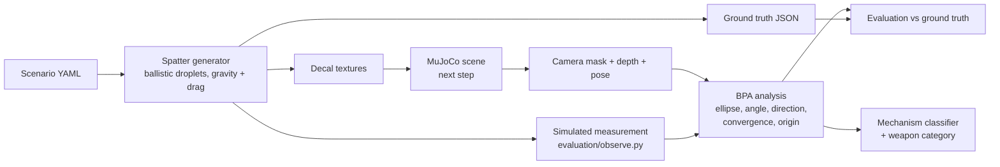

# Phase 2: Crime Scene Investigator (simulation)

A simulated Unitree Go2 explores an indoor scene containing simulated
bloodstain patterns (non-graphic red decals), finds stains, and analyses them:
impact angles, directionality, area of origin, pattern (mechanism)
classification and the weapon categories the pattern is *consistent with*.
Forensic-science education project; people appear only as simple mannequins.

**Status (28 Oct 2026):** Stage A in progress; due 9 Nov 2026.
- **A1 done:** the simulator runs, the Go2 walks with velocity commands, keyboard teleop works, and every sensor is verified.
- Built earlier: the spatter generator with ground truth.
- Built earlier for Stage B: the BPA maths and mechanism classifier. They stay untouched until Stage A is confirmed.

Plan and progress: [docs/plan.md](docs/plan.md).

## Setup (Windows + WSL2 Ubuntu 22.04, or native Ubuntu 22.04)

```bash
git clone https://github.com/CDJ7/Unitree-Dog-Claude-Dog-.git ~/Unitree-Dog-Claude-Dog-   # under ~, NOT /mnt/c
cd ~/Unitree-Dog-Claude-Dog- && git checkout phase2-csi
cd Phase_2_Investigator
python3 -m venv ~/go2venv && source ~/go2venv/bin/activate   # or reuse an existing Python 3.10+ venv
./scripts/setup.sh --check     # read-only: WSL2, GPU, WSLg, Python, rendering
./scripts/setup.sh             # simulator submodule (~520 MB, shallow) + Python packages
python -m pytest               # unit tests (~40 s)
```

WSL notes:
- GPU: `nvidia-smi` must work inside WSL. That comes from the **Windows** NVIDIA driver; never install a Linux NVIDIA driver inside WSL.
- Windows: the MuJoCo viewer and OpenCV windows open through WSLg. If no window appears, run `wsl --update` in PowerShell, then `wsl --shutdown`.
- Docker, ROS 2 and Robonix are not needed. We run the simulator's own Python classes in-process ([plan section 2](docs/plan.md#2-simulator-route)).
- On native Ubuntu everything is the same; windows open on the normal desktop.

## Run the simulator (Stage A)

```bash
./scripts/run_sim.sh --scenario 1                      # teleop in the MuJoCo viewer
./scripts/run_sim.sh --scenario 1 --mode sensors       # live sensor viewer; drive with the same keys
./scripts/run_sim.sh --mode teleop-cv                  # teleop in an OpenCV window (fallback)
./scripts/run_sim.sh --mode check                      # headless A1 check: walking + every sensor
./scripts/run_sim.sh --env scenesmith_house_186 --mode sensors --spawn 4.5 2.4 -0.5
```

Keys (click the window first):

| Key | Action |
|---|---|
| W / S | forward / back |
| A / D | turn left / right |
| Q / E | strafe left / right |
| Space | stop |
| R | reset |
| Esc | quit |

Speeds latch: each press adds one step (0.1 m/s, 0.25 rad/s, 0.05 m/s strafe) up to the gait's limits (0.4 m/s, 0.5 rad/s, 0.15 m/s). Collisions are printed as they happen.

The sensor viewer shows:
- front RGB (320x240, 60 deg FOV);
- depth;
- a third-person view;
- the 2D LiDAR scan;
- the 3D LiDAR cloud from above, with the odometry path, and from the side;
- IMU, odometry and command readouts.

`--snapshot file.png --demo-drive` saves one image headless; `--gif` saves an animation.

For Stage B, the simulator exposes these data types (`sim_env/interfaces.py`):

| Type | Contents |
|---|---|
| `CameraFrame` | rgb, depth in metres, K, T_world_cam (OpenCV convention) |
| `LidarScan` | planar scan + 3D cloud, T_world_lidar |
| `RobotState` | pose, velocity, IMU, last cmd_vel |
| `EventDescription` | input to event playback |

Driving goes through `navigation/velocity.py` (cmd_vel, speed limits, dead-man).

## Spatter, BPA and classifier (no simulator needed)

```bash
# spatter + ground truth + decal textures + 3D preview for built-in scenario 1
python scripts/generate_scenario.py --scenario 1   # -> outputs/s1_living_room_blunt/
python scripts/generate_scenario.py --random 42    # a random scenario
python training/train_mechanism_classifier.py      # (Stage B) ~2 min
python evaluation/run_bpa_eval.py                  # (Stage B) writes evaluation/results/*.png, ~5-10 min
```

## How it works



**Spatter generator** (`sim_env/spatter/`)
- Droplets are launched from an origin by a mechanism: impact, cast-off,
  projected, drip, or transfer (a smear).
- Each droplet flies under gravity and quadratic drag until it hits a floor,
  wall, ceiling or furniture surface.
- The stain is an ellipse with sin(alpha) = width / length, aligned with the
  travel direction, with a tail and satellite drops.
- Every droplet, stain and event parameter is saved as ground truth.

**BPA analysis** (`analysis/bpa/`)
1. Fit an ellipse to each stain's body, excluding the tail, to get the impact
   angle and the travel direction.
2. Undo the camera perspective using depth and the robot's pose.
3. Find the area of convergence on the surface.
4. Find the area of origin, using straight lines, the tangent method, or
   gravity-corrected ballistic back-tracing.
5. Report a 95% uncertainty ellipsoid.

**Mechanism classifier** (`analysis/classifier/`)
- Gradient boosting on 24 interpretable features of a stain group.
- Mechanisms map to weapon categories through
  `sim_env/config/weapon_mapping.yaml`, which also notes how reliable each
  inference is.
- Explanations always say "consistent with", never certainty.

## Scenarios

| # | File | Event | Weapon category |
|---|---|---|---|
| 1 | `s1_living_room_blunt.yaml` | impact spatter + cast-off from back-swing | blunt |
| 2 | `s2_kitchen_edged.yaml` | projected (arterial-style) + drip trail | edged |
| 3 | `s3_hallway_fall.yaml` | low impact against furniture, drip, hand smear | none (fall) |
| 4 | `s4_bedroom_castoff_edged.yaml` | two overhead cast-off swings + drip | edged |

`python -m sim_env.scenarios.random_scenario --seed N` makes more. Each
scenario includes red distractor objects that are not blood, to test false
positives.

## Results so far

See `evaluation/results/` (graphs + JSON) and the table in
[docs/plan.md](docs/plan.md#7-bpa-analysis-done-and-first-results).

## Known limitations

Simulation:
- Simulated vs real Go2:
  - The sim LiDAR is a MID-360 model; the real Go2 has an L1.
  - Odometry in the sim is ground truth.
  - The sim front camera is 320x240 at 5 Hz.
- The simulator's built-in gait clamps to 0.4 m/s forward, 0.15 m/s sideways and 0.5 rad/s.
- MuJoCo 3.3.7's batched ray cast (`mj_multiRay`) misses some box geoms:
  - Depth: up to ~9% of floor pixels near doorways. `SimSession.camera()` re-casts those pixels one by one, so depth is complete.
  - 3D LiDAR cloud: ~0.5% of rays, mostly downward. Left as is; the 2D scan used for navigation is unaffected.
- Rendering speed:
  - In a CPU-only container it is slow (~100-300 ms per view).
  - With a GPU through WSLg it should be a few ms.
  - Physics keeps real time either way.

Analysis:
- Everything is synthetic. The analysis has so far been tested only with perfect segmentation; real images, SAM and RF-DETR errors come later.
- The stain spread model is a heuristic. Angles and directions follow exact geometry, but stain sizes do not come from a fluid model.
- For stains on a single surface, the origin height depends on the assumed impact speeds (stated in the output). The uncertainty ellipsoid includes this effect.
- The weapon-category weights are teaching priors, not casework statistics.

## Folder layout

| Folder | Contents |
|---|---|
| `sim_env/` | simulator session (`runtime.py`), interfaces, scenarios, spatter physics |
| `navigation/` | cmd_vel interface, teleop (exploration comes in A4) |
| `analysis/` | BPA maths and classifier |
| `evaluation/` | scoring against ground truth |
| `training/` | model training |
| `tests/` | unit tests |
| `scripts/` | launchers, viewers, checks |
| `docs/` | plan and summary; `media/` has screenshots and evidence |
| `third_party/robot-unitree-go2-mujoco` | the simulator, as a git submodule |

Placeholders for Stage B: `perception/`, `gui/`.
