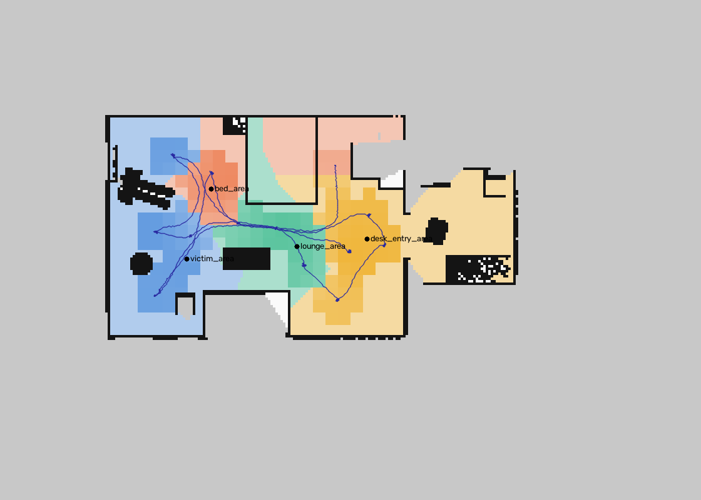
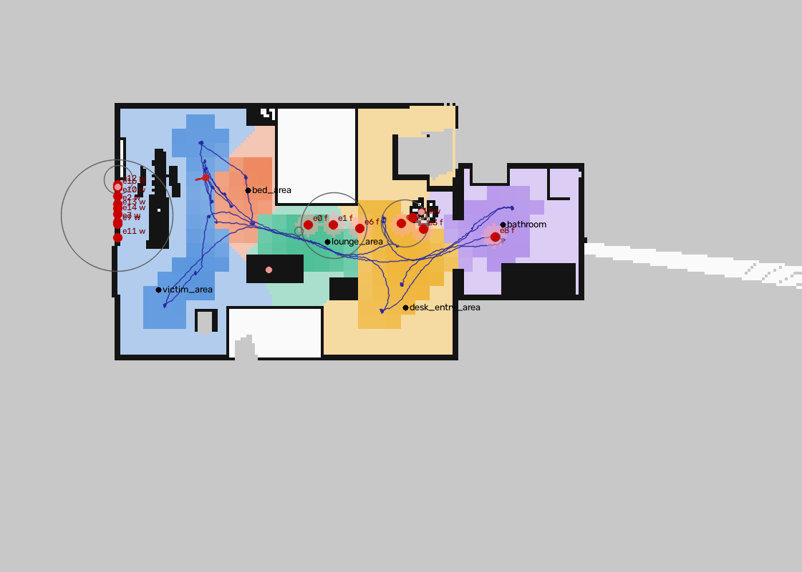
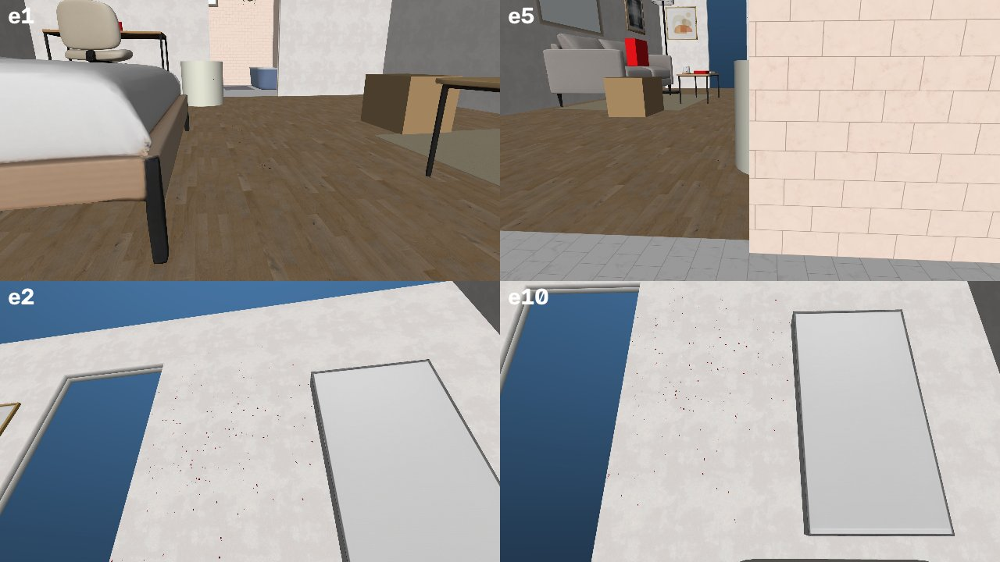
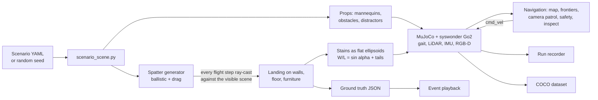
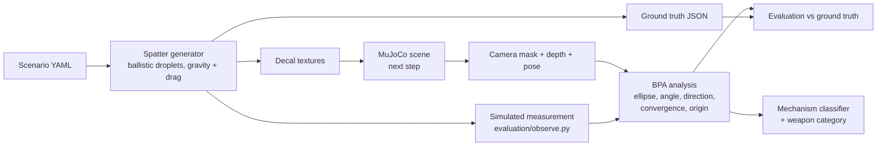

# Phase 2: Crime Scene Investigator (simulation)

A simulated Unitree Go2 explores an indoor scene containing simulated
bloodstain patterns (non-graphic red decals), finds stains, and analyses them:
impact angles, directionality, area of origin, pattern (mechanism)
classification and the weapon categories the pattern is *consistent with*.
Forensic-science education project; people appear only as simple mannequins.

**In the lab with the real dog? Start with [`LAB_PLAN.md`](LAB_PLAN.md).**

**Status, next steps and lessons learned:** [`docs/STATUS.md`](docs/STATUS.md).

**Full write-up:** [`REPORT.md`](REPORT.md) ([PDF](Phase2_Report.pdf)): Stage A simulation, Stage R self-built zone
maps, Stage C crime-scene search and stain analysis, with every result and its source file.

**Status (17 Nov 2026):** Stage R (the real dog maps and tags the lab) is in progress, see below.
**Status (29 Oct 2026):** Stage A (simulation) is built: A1-A6 and the Stage A checklist with
evidence ([docs/stage_a_checklist.md](docs/stage_a_checklist.md)). Waiting for confirmation before
Stage B (analysis + GUI). The BPA maths and mechanism classifier built earlier stay untouched until then.
Plan: [docs/plan.md](docs/plan.md).

## Stage R: the real Go2 maps the lab itself (started 17 Nov 2026)

Test 2 is submitted and frozen; its real-dog work continues here. The dog now **explores the lab on its
own, builds a LiDAR map, and tags every part of it with a zone** (lab_1, lab_2, open_area, shelves),
using Test 2's camera classifier. You can then send it to a zone on that map. This is the base for
bringing the crime-scene search to the real robot.

- Plan, and how it relates to Test 2's zone map: [`docs/real_robot_plan.md`](docs/real_robot_plan.md)
- Terminal walkthrough for the Linux laptop: [`real_robot/README.md`](real_robot/README.md)
- Notes for Claude Code in the terminal: [`CLAUDE.md`](CLAUDE.md)

```bash
python scripts/real_check.py                                    # sensors only, the dog does not move
python scripts/map_zones.py --backend real --max-time 600       # the dog explores and tags zones
python scripts/goto_zone.py --map outputs/zone_map/<map> --backend real --zone lab_2
python scripts/map_zones.py --random 1854 --video               # the same in simulation, scored
```

### Stage R results so far (simulation; the real-dog session is next)

**The test scene:** house-185 scene r1854, which Test 2's classifier never saw in training. The dog
explored it on its own (frontiers, then look-arounds about 1 m apart) and tagged its map with the five
zones. The map is scored against the true zone polygons. Files are in `docs/media/stage_r/`.

| Mapping run (`sim_r1854_map_report.json`) | Value |
|---|---|
| Time / path | 323 s of robot time, 35.7 m |
| Look-arounds / camera frames tagged | 13 / 617 |
| Collisions | 0 |
| Zone goal points in the right zone | **4/4** zones on the map |
| Map cells in the right zone | 0.667 overall |
| Map cells in the right zone, by zone | victim_area 0.954, desk_entry_area 0.813, bed_area 0.615, lounge_area 0.603, bathroom 0.000 |

The bathroom was never entered, so it has no camera votes. Its doorway is too narrow for the 0.32 m
planning radius, and the map labels it from the neighbouring zone. Letting the coverage phase use the
0.24 m tight radius was tried and made things worse: the dog wedged itself in a gap and 4 goals in a
row failed (cell accuracy 0.553).

| Go to zone on that map | Result |
|---|---|
| All four mapped zones, simulator frame (`sim_goto_4zones.json`) | **4/4 arrived**, 17.7–27.5 s each, 0 collisions. The camera look-around agreed every time. |
| Real-robot code path through the simulator, odometry offset by (1.5 m, −2 m, 40°) (`sim_goto_relocalised.json`) | Relocalised from one look-around at (4.88, 1.76), heading −2°, against the true start (4.88, 1.78, 0°); score 0.99. Then **2/2 arrived**. At victim_area the camera said lounge_area (0.44): the facing-vs-standing confusion that the map now overrides. |



*The dog's own map of r1854: black obstacles, zones in colour (darker = more camera votes), its path in
blue, and each zone's goal point. Video: [`sim_r1854_map_building.mp4`](docs/media/stage_r/sim_r1854_map_building.mp4).*


### Crime-scene search in simulation (C2–C4, 18–19 Nov 2026)

The first crime-scene steps for the real dog are built and tested in simulation. In one run, the dog
explores, finds stains with its camera, puts them on its map, keeps off floor evidence, and inspects
what it found.

```bash
python training/train_stain_detector.py         # C2: train + evaluate the stain detector (CPU, ~25 min)
python scripts/investigate.py --scenario 1      # C3 + C4: the search mission, scored against ground truth
```

**C2: stain detector** (`perception/stain_detector.py`, CPU only, no GPU or deep network):
- **How it works:** red mask, then regions, then shape, colour and geometry features, then a random forest.
- **Why colour alone isn't enough:** the scenes contain red distractors (towel, mug, cushion, book) in
  the same red as blood. What separates them is the pattern (many small spots, or one flat mark) and
  the geometry (lying flat on a surface, rather than standing out from it).
- **Data:** the camera is set up like the Go2's 1280×720, 100° stream. Labels come from the simulator's
  segmentation. Split by scene: 18 random scenes train, 4 validate, and the 5 hand-made scenarios test.

| Hand-made test scenes (`docs/media/stage_c/detector_metrics.json`) | With depth | Image only (real-dog case) |
|---|---|---|
| Region precision / recall | 0.919 / 0.973 | 0.920 / 0.923 |
| Red distractors called a stain | 4.8 % of 207 | 5.8 % |
| Visible stain clusters found per view | 0.783 | 0.754 |

At the navigation camera's 320×240, most droplets are under a pixel. A colour check there found 23 % of
stain pixels, against 99 % of distractor pixels. That's why the detector works on the 720p stream.

**C3: evidence map** (`mapping/evidence_map.py`):
- Detections become 3-D points, which are grouped into clusters with a surface (floor / wall / raised)
  and a zone.
- A cluster counts as **confirmed** after 2 frames, so one-off false alarms drop out.

**C4: mission** (`scripts/investigate.py`):
- Confirmed floor evidence becomes a **keep-out** layer that the planner routes around.
- Viewpoints are never placed on evidence.
- The detected clusters (not ground truth) are inspected from 2 standoff views with close-ups.

**Scenario 1** (living room, blunt force), the same mission with and without keep-out (files in
`docs/media/stage_c/`):

| | **With keep-out** | Without |
|---|---|---|
| Ground-truth stain clusters found | 5 / 7 | 5 / 7 |
| Precision of confirmed clusters | 0.941 | 0.938 |
| Red distractors flagged as evidence | 0 / 3 | 0 / 3 |
| Floor stains walked over | **23 / 84** | 56 / 84 |
| ... of those, after the dog had found them | **19** | 52 |
| Collisions | 0 | 0 |

- **Missed clusters:** both are on furniture. One is 9 stains near the west wall at 1.2 m; the other is
  3 stains at 2.7 m, above the camera's view.
- **Keep-out** cuts the floor stains walked over by more than half, but not to zero. It is a cost, not a
  wall, so a drip trail through the only doorway can still be crossed; it also only protects stains
  already found.
- **Real dog:** the Go2's camera has no depth, so there the image-only model applies. Region positions
  will come from the floor plane (camera height and pitch) and the LiDAR (plan step C2/C3 real).



*Scenario 1 as the dog mapped it:
- zones in colour and the path in blue;
- confirmed evidence as red dots (f = floor, w = wall), with keep-out in pink;
- ground-truth clusters as grey circles.

Video: [`s1_investigation.mp4`](docs/media/stage_c/s1_investigation.mp4).*



*Inspection close-ups of four detected clusters:
- **Wall (bottom: e2, e10):** the impact spatter is clearly captured.
- **Floor (top: e1, e5):** framed poorly. The stains are tiny on the wood floor, and e5's view ends up
  facing a wall.

Better floor framing (aim lower, stand closer) is needed before stain analysis (C5) can use these.*

### Stain analysis from the dog's own close-ups (C5, 19–20 Nov 2026)

After the search, `scripts/investigate.py` continues on its own, using only what the dog detected and
photographed (no ground truth):
1. **Close-up tour** (`navigation/closeups.py`): aim points across every confirmed evidence cluster. The
   dog stands about 0.5 m from floor stains, and 0.5–1.3 m from walls when furniture or a body is in the
   way. It takes 1920×1080 close-ups.
2. **Measures every stain** (`analysis/closeup.py`) with Phase 2's BPA code: surface plane from depth,
   perspective undone, then ellipse, impact angle and direction.
3. **Analyses the scene** (`analysis/scene_report.py`): stain groups, the mechanism, the weapon categories
   the pattern is "consistent with", and a gravity-corrected area of origin. The result is a per-zone
   `scene_report.md` written by the dog.

**Mechanism classifier for close-ups** (`training/train_mechanism_simclose.py`):
- **The problem:** Phase 2's classifier learned from ideal measurements of every stain. Close-ups miss
  the small round stains at a pattern's edges, so it called scenario 1's impact "projected".
- **The fix:** stain groups measured from *simulated close-ups* taken the way the mission takes them, from
  58 random scenes in all three houses (367 groups), together with Phase 2's ideal synthetic groups.
- **Test set:** the 5 hand-made scenarios, 30 groups, never used in training
  (`docs/media/stage_c/mechanism_simclose.json`).

| Classifier | Validation | **Test** |
|---|---|---|
| Phase 2 original (ideal synthetic) | 0.809 | 0.700 |
| Simulator close-ups only | 0.888 | 0.867 |
| **Close-ups + ideal synthetic** (chosen on validation, `perception/models/mechanism_gb_simclose.pkl`) | 0.933 | **0.967** |

**The full mission on all five hand-made scenarios** (`docs/media/stage_c/s*_report*.json`,
`missions_simclose.json`):

| Scenario | Clusters found | Stains in found clusters | Distractors flagged | Floor stains walked over (after found) | Collisions | Close-ups | Mechanism | Area-of-origin error |
|---|---|---|---|---|---|---|---|---|
| S1 living room, blunt | 5/7 | 0.98 | 0/3 | 24/84 (20) | 0 | 8 | **2/2** (impact, cast-off) | 0.42 m |
| S2 living room, projected | 3/4 | 0.98 | 0/3 | 0/34 | 0 | 1 | **1/1** (projected) | 0.62 m |
| S3 bedroom, fall | 4/6 | 0.94 | 0/3 | 16/140 (0) | 0 | 3 | **1/1** (impact) | 0.68 m |
| S4 bedroom, cast-off | 1/19 | 0.57 | 0/3 | 0/17 | 0 | 0 | not analysed | — |
| S5 simple room, bat | 4/6 | 0.98 | 0/3 | 1/44 (1) | 0 | 3 | **1/1** (impact) | 0.40 m |
| S4 with an emulated 1.0 m mast camera | 4/19 | 0.65 | 0/3 | 0/17 | 0 | 1 | 0/1 | 2.0 m |

- **Measured stains:** the impact-angle error is a median of 6.1–6.6° in S1–S3.
- **The scene report for S1** reads: "impact spatter … consistent with a blunt swung object (e.g. bat, pipe,
  hammer)", with an area of origin about 1.2 m above the floor (truth: a pipe, origin 1.55 m). See
  `docs/media/stage_c/s1_scene_report.md`.

**Failures, and why:**
- **S4:** 15 of its 19 clusters are cast-off on top of the bed, about 0.6 m up, above the dog's camera
  (0.41 m). It cannot see them. The one cluster it found (the wall impact) had no reachable standing spot
  for close-ups.
- **S5, fixed (24–26 Nov 2026):** the dog used to get wedged in a corner at 84 s. Its escape moves were
  ones the safety filter then zeroed or slowed to a crawl, and backing off had no room. Now, when backing
  off fails, it tries escape moves the filter actually lets through. Result: 44 m of path, 15
  look-arounds, close-ups taken, mechanism right, origin 0.40 m off. S1 is unchanged by the fix (the same
  24/84, 2/2 and 0.42 m).
- **S4 with a mast:** `--camera-height 1.0` emulates a camera on a 1 m mast. It finds more of the bed-top
  cast-off (4/19 clusters, 65 % of the stains, against 1/19 and 57 %), but its only analysed group is wrong
  (impact, truth cast-off). A mast alone is not enough here: the bed top would also need close-ups taken
  from above.
- **Real dog:** the Go2's own front camera (1280×720 at about 100°) is far too coarse for droplet-level
  close-ups. On the real dog this step needs a separate high-resolution camera.

## Setup (Windows + WSL2 Ubuntu 22.04, or native Ubuntu 22.04)

```bash
git clone https://github.com/CDJ7/Unitree-Dog-Claude-Dog-.git ~/Unitree-Dog-Claude-Dog-   # under ~, NOT /mnt/c
cd ~/Unitree-Dog-Claude-Dog- && git checkout phase2-csi
cd Phase_2_Investigator
python3 -m venv ~/go2venv && source ~/go2venv/bin/activate   # or reuse an existing Python 3.10+ venv
./scripts/setup.sh --check     # read-only: WSL2, GPU, WSLg, Python, rendering
./scripts/setup.sh             # simulator submodule (~520 MB, shallow) + Python packages
python -m pytest               # unit tests (~40 s)
```

WSL notes:
- GPU: `nvidia-smi` must work inside WSL. That comes from the **Windows** NVIDIA driver; never install a Linux NVIDIA driver inside WSL.
- Windows: the MuJoCo viewer and our sensor/teleop windows (both GLFW, no Qt) open through WSLg. If no window appears, run `wsl --update` in PowerShell, then `wsl --shutdown`.
- Docker, ROS 2 and Robonix are not needed. We run the simulator's own Python classes in-process ([plan section 2](docs/plan.md#2-simulator-route)).
- On native Ubuntu everything is the same; windows open on the normal desktop.

## Run the simulator (Stage A)

One command, any scenario, any mode:

```bash
./scripts/run_sim.sh --scenario 1                               # teleop in the MuJoCo viewer
./scripts/run_sim.sh --scenario 1 --mode sensors                # live sensor viewer (drive with the keys)
./scripts/run_sim.sh --scenario 1 --mode explore --viewer       # autonomous exploration, watched live
./scripts/run_sim.sh --scenario 1 --mode inspect                # explore + camera patrol + inspect stains
./scripts/run_sim.sh --scenario 1 --mode playback --viewer      # event reenactment (MP4 without --viewer)
./scripts/run_sim.sh --scenario 2 --mode record                 # record camera/depth/LiDAR/poses (A6)
./scripts/run_sim.sh --mode dataset                             # COCO dataset of stain regions (A6)
./scripts/run_sim.sh --scenario 3 --mode render                 # overview sheet of a scenario
./scripts/run_sim.sh --random 7 --mode explore                  # a seeded random scenario
./scripts/run_sim.sh --mode check                               # A1 check: walking + every sensor
```

The first launch of a scenario builds it (spatter landing on the real scene, about 10 s) and caches
it in `sim_env/build/`. Outputs go to `outputs/`, `runs/` and `datasets/` (all gitignored).

### Scenarios

| # | Scenario | Where | Events | Weapon category |
|---|---|---|---|---|
| 1 | `s1_living_room_blunt` | house 185 living room | impact on the west wall, cast-off back-swing onto the floor | blunt (pipe) |
| 2 | `s2_living_room_projected` | house 185 desk corner + bathroom | projected (arterial-style) on the east wall, drip trail through the door | edged (knife) |
| 3 | `s3_bedroom_fall` | house 186 bedroom (north-east) | low impact (head on nightstand), drip, hand smear on the wall | none (fall) |
| 4 | `s4_bedroom_castoff` | house 186 bedroom (desk) | stab: small impact on the south wall, two overhead cast-off swings onto the bed | edged (knife) |
| 5 | `s5_simple_room_bat` | `csi_simple_room` (our package) | impact on the south wall, drag smear on the floor, drip trail from the bat | blunt (bat) |

Every scenario has:
- mannequins (capsule figures; the victim in its final posture);
- obstacles in the robot's path;
- 3 red distractors (cushion, book, mug, towel) that are not blood.

Overview sheets are in `docs/media/a3_*.jpg`. `--random SEED` makes a seeded random scenario in any of the three environments.

Ground truth (`sim_env/build/scenarios/<id>/ground_truth.json`) contains:
- every event: origin, mechanism, weapon category, swing path, and each droplet's launch, impact point, impact angle and direction;
- every stain and smear;
- mannequins, obstacles and distractors;
- the stain clusters, which are the inspection targets.

### How the simulation works



- **Simulator:** the syswonder simulator's own native Python classes (Go2 gait, sensors, houses) run in-process, unmodified (git submodule). Our environment package `csi_simple_room` is added through a symlink overlay with a merged manifest (`sim_env/environments.py`).
- **Spatter** (`sim_env/spatter/`): the physics-based generator. It lands droplets in the simulator through `MjSurfaces`, which ray-casts each flight step against the visible meshes, so stains sit where the camera sees surfaces.
- **Stains as geometry:** MuJoCo 3.3.7 drops texture alpha, so each stain is a flat ellipsoid with the ground-truth width, length (W/L = sin α) and direction, plus a tail and satellites. Smears are streaking chains.
- **Navigation** (`navigation/`, see [navigation/README.md](navigation/README.md)):
  - a LiDAR occupancy grid, with a persistent layer for low obstacles;
  - frontier exploration;
  - a camera-coverage patrol, so the camera actually looks at every reachable surface;
  - minimum-cost planning, pure pursuit and a safety layer (slows at 0.6 m, stops at 0.2 m, never turns into an obstacle, escape manoeuvres);
  - collision logging and the inspect behaviour.
- **Inspection:** for each stain region (ground-truth clusters for now; detections in Stage B), the robot stands off at 2-3 angles with line of sight. It saves the 320x240 sensor frame and a 1920x1080 close-up with depth, K and pose.
- **Event playback** (`sim_env/playback.py`):
  - the attacker's arm and weapon follow the swing;
  - droplets fly their exact trajectories, and each stain appears when its droplet lands;
  - smears grow behind a hand;
  - the victim walks or collapses.

  Input is a list of `EventDescription`s: from ground truth now, from the analysis in Stage B (`--from-descriptions` shows that path).
- **Data export:** the run recorder and the COCO dataset builder. Formats are in [docs/recording_format.md](docs/recording_format.md).

### Teleop keys

Click the window first.

| Key | Action |
|---|---|
| W / S | forward / back |
| A / D | turn left / right |
| Q / E | strafe left / right |
| Space | stop |
| R | reset |
| Esc | quit |

Speeds latch: each press adds one step (0.1 m/s, 0.25 rad/s, 0.05 m/s strafe) up to the gait's limits (0.4 m/s, 0.5 rad/s, 0.15 m/s).

The sensor viewer shows:
- front RGB (320x240, 60 deg FOV) and depth;
- a third-person view;
- the 2D LiDAR scan;
- the 3D LiDAR cloud from above, with the odometry path, and from the side;
- IMU, odometry and command readouts.

### Interfaces for Stage B

`sim_env/interfaces.py` defines these types; live sessions and recorded runs produce the same ones.

| Type | Contents |
|---|---|
| `CameraFrame` | rgb, depth in metres, K, T_world_cam (OpenCV convention), `backproject`, `project` |
| `LidarScan` | planar scan + 3D cloud, T_world_lidar |
| `RobotState` | pose, velocity, IMU, last cmd_vel |
| `EventDescription` | input to event playback |

Driving goes through `navigation/velocity.py` (cmd_vel, speed limits, dead-man). Recorded runs are
read back with `sim_env.recorder.RunReader`.

## Spatter, BPA and classifier (no simulator needed)

```bash
# spatter + ground truth + decal textures + 3D preview for built-in scenario 1
python scripts/generate_scenario.py --scenario 1   # -> outputs/s1_living_room_blunt/
python scripts/generate_scenario.py --random 42    # a random scenario
python training/train_mechanism_classifier.py      # (Stage B) ~2 min
python evaluation/run_bpa_eval.py                  # (Stage B) writes evaluation/results/*.png, ~5-10 min
```

## How it works



**Spatter generator** (`sim_env/spatter/`)
- Droplets are launched from an origin by a mechanism: impact, cast-off,
  projected, drip, or transfer (a smear).
- Each droplet flies under gravity and quadratic drag until it hits a floor,
  wall, ceiling or furniture surface.
- The stain is an ellipse with sin(alpha) = width / length, aligned with the
  travel direction, with a tail and satellite drops.
- Every droplet, stain and event parameter is saved as ground truth.

**BPA analysis** (`analysis/bpa/`)
1. Fit an ellipse to each stain's body, excluding the tail, to get the impact
   angle and the travel direction.
2. Undo the camera perspective using depth and the robot's pose.
3. Find the area of convergence on the surface.
4. Find the area of origin, using straight lines, the tangent method, or
   gravity-corrected ballistic back-tracing.
5. Report a 95% uncertainty ellipsoid.

**Mechanism classifier** (`analysis/classifier/`)
- Gradient boosting on 24 interpretable features of a stain group.
- Mechanisms map to weapon categories through
  `sim_env/config/weapon_mapping.yaml`, which also notes how reliable each
  inference is.
- Explanations always say "consistent with", never certainty.

## Scenarios

| # | File | Event | Weapon category |
|---|---|---|---|
| 1 | `s1_living_room_blunt.yaml` | impact spatter + cast-off from back-swing | blunt |
| 2 | `s2_kitchen_edged.yaml` | projected (arterial-style) + drip trail | edged |
| 3 | `s3_hallway_fall.yaml` | low impact against furniture, drip, hand smear | none (fall) |
| 4 | `s4_bedroom_castoff_edged.yaml` | two overhead cast-off swings + drip | edged |

`python -m sim_env.scenarios.random_scenario --seed N` makes more. Each
scenario includes red distractor objects that are not blood, to test false
positives.

## Results so far

See `evaluation/results/` (graphs + JSON) and the table in
[docs/plan.md](docs/plan.md#7-bpa-analysis-done-and-first-results).

## Known limitations

Simulation:
- Simulated vs real Go2 (details in [navigation/README.md](navigation/README.md)):
  - The sim LiDAR is a MID-360 model; the real Go2 has an L1. The MID-360's lowest ray is 7 deg down, so low objects (a lying mannequin) are only seen from more than ~2 m away; they stay in the map.
  - Odometry is ground truth.
  - The sim front camera is 320x240 at 5 Hz. Close-ups are rendered at 1920x1080 from the camera position with an emulated body pitch, because the sim gait cannot pitch.
- The simulator's gait clamps to 0.4 m/s forward, 0.15 m/s sideways and 0.5 rad/s, and turns slowly in tight spaces.
- The houses have no ceilings, so cast-off lands on walls, floor and furniture, never overhead.
- The houses' furniture colliders are conservative boxes. Parts of house 186 (behind the bed) are unreachable for the robot, so its scenarios are placed in the reachable part.
- MuJoCo 3.3.7's batched ray cast (`mj_multiRay`) misses some box geoms:
  - Depth: up to ~9% of floor pixels near doorways. `SimSession.camera()` re-casts those pixels, so depth is complete.
  - 3D LiDAR cloud: ~0.5% of rays. Left as is; the 2D scan is unaffected.
- Rendering speed:
  - On CPU only (this cloud container), rendering takes ~100-300 ms per image; the GPU should take a few ms.
  - Physics runs at ~3x real time either way.
- Droplets pass through mannequins; stains are never drawn on people (non-graphic by design).

Analysis:
- Everything is synthetic. The analysis has so far been tested only with perfect segmentation; real images, SAM and RF-DETR errors come later.
- The stain spread model is a heuristic. Angles and directions follow exact geometry, but stain sizes do not come from a fluid model.
- For stains on a single surface, the origin height depends on the assumed impact speeds (stated in the output). The uncertainty ellipsoid includes this effect.
- The weapon-category weights are teaching priors, not casework statistics.

## Folder layout

| Folder | Contents |
|---|---|
| `sim_env/` | runtime (`SimSession`), interfaces, scenarios (`configs/`, `analytic/`, `random_sim.py`), spatter physics, scene building, playback, recorder, our environment package (`scene_packages/`) |
| `navigation/` | velocity interface, teleop, occupancy grid, planner, frontiers, camera coverage, safety layer, explorer, inspect |
| `analysis/` | BPA maths and classifier (Stage B, built earlier) |
| `training/` | COCO dataset builder (A6), mechanism classifier training |
| `evaluation/` | scoring against ground truth |
| `tests/` | pytest suite |
| `scripts/` | `run_sim.sh` and the tools it calls |
| `docs/` | plan, Stage A checklist, recording format; `media/` has screenshots and videos |
| `third_party/robot-unitree-go2-mujoco` | the simulator, as a git submodule |

Placeholders for Stage B: `perception/`, `gui/`.
