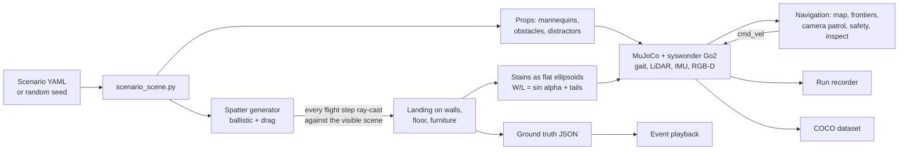
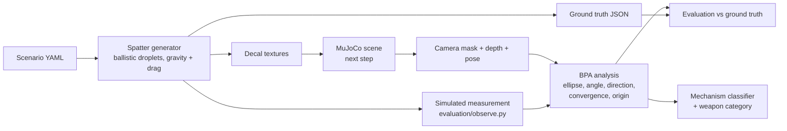

# Phase 2: Crime Scene Investigator (simulation)

A simulated Unitree Go2 explores an indoor scene containing simulated
bloodstain patterns (non-graphic red decals), finds stains, and analyses them:
impact angles, directionality, area of origin, pattern (mechanism)
classification and the weapon categories the pattern is *consistent with*.
Forensic-science education project; people appear only as simple mannequins.

**Status (29 Oct 2026):** Stage A (simulation) is built: A1-A6 and the Stage A checklist with
evidence ([docs/stage_a_checklist.md](docs/stage_a_checklist.md)). Waiting for confirmation before
Stage B (analysis + GUI). The BPA maths and mechanism classifier built earlier stay untouched until then.
Plan: [docs/plan.md](docs/plan.md).

## Setup (Windows + WSL2 Ubuntu 22.04, or native Ubuntu 22.04)

```bash
git clone https://github.com/CDJ7/Unitree-Dog-Claude-Dog-.git ~/Unitree-Dog-Claude-Dog-   # under ~, NOT /mnt/c
cd ~/Unitree-Dog-Claude-Dog- && git checkout phase2-csi
cd Phase_2_Investigator
python3 -m venv ~/go2venv && source ~/go2venv/bin/activate   # or reuse an existing Python 3.10+ venv
./scripts/setup.sh --check     # read-only: WSL2, GPU, WSLg, Python, rendering
./scripts/setup.sh             # simulator submodule (~520 MB, shallow) + Python packages
python -m pytest               # unit tests (~40 s)
```

WSL notes:
- GPU: `nvidia-smi` must work inside WSL. That comes from the **Windows** NVIDIA driver; never install a Linux NVIDIA driver inside WSL.
- Windows: the MuJoCo viewer and our sensor/teleop windows (both GLFW, no Qt) open through WSLg. If no window appears, run `wsl --update` in PowerShell, then `wsl --shutdown`.
- Docker, ROS 2 and Robonix are not needed. We run the simulator's own Python classes in-process ([plan section 2](docs/plan.md#2-simulator-route)).
- On native Ubuntu everything is the same; windows open on the normal desktop.

## Run the simulator (Stage A)

One command, any scenario, any mode:

```bash
./scripts/run_sim.sh --scenario 1                               # teleop in the MuJoCo viewer
./scripts/run_sim.sh --scenario 1 --mode sensors                # live sensor viewer (drive with the keys)
./scripts/run_sim.sh --scenario 1 --mode explore --viewer       # autonomous exploration, watched live
./scripts/run_sim.sh --scenario 1 --mode inspect                # explore + camera patrol + inspect stains
./scripts/run_sim.sh --scenario 1 --mode playback --viewer      # event reenactment (MP4 without --viewer)
./scripts/run_sim.sh --scenario 2 --mode record                 # record camera/depth/LiDAR/poses (A6)
./scripts/run_sim.sh --mode dataset                             # COCO dataset of stain regions (A6)
./scripts/run_sim.sh --scenario 3 --mode render                 # overview sheet of a scenario
./scripts/run_sim.sh --random 7 --mode explore                  # a seeded random scenario
./scripts/run_sim.sh --mode check                               # A1 check: walking + every sensor
```

The first launch of a scenario builds it (spatter landing on the real scene, about 10 s) and caches
it in `sim_env/build/`. Outputs go to `outputs/`, `runs/` and `datasets/` (all gitignored).

### Scenarios

| # | Scenario | Where | Events | Weapon category |
|---|---|---|---|---|
| 1 | `s1_living_room_blunt` | house 185 living room | impact on the west wall, cast-off back-swing onto the floor | blunt (pipe) |
| 2 | `s2_living_room_projected` | house 185 desk corner + bathroom | projected (arterial-style) on the east wall, drip trail through the door | edged (knife) |
| 3 | `s3_bedroom_fall` | house 186 bedroom (north-east) | low impact (head on nightstand), drip, hand smear on the wall | none (fall) |
| 4 | `s4_bedroom_castoff` | house 186 bedroom (desk) | stab: small impact on the south wall, two overhead cast-off swings onto the bed | edged (knife) |
| 5 | `s5_simple_room_bat` | `csi_simple_room` (our package) | impact on the south wall, drag smear on the floor, drip trail from the bat | blunt (bat) |

Every scenario has:
- mannequins (capsule figures; the victim in its final posture);
- obstacles in the robot's path;
- 3 red distractors (cushion, book, mug, towel) that are not blood.

Overview sheets are in `docs/media/a3_*.jpg`. `--random SEED` makes a seeded random scenario in any of the three environments.

Ground truth (`sim_env/build/scenarios/<id>/ground_truth.json`) contains:
- every event: origin, mechanism, weapon category, swing path, and each droplet's launch, impact point, impact angle and direction;
- every stain and smear;
- mannequins, obstacles and distractors;
- the stain clusters, which are the inspection targets.

### How the simulation works



- **Simulator:** the syswonder simulator's own native Python classes (Go2 gait, sensors, houses) run in-process, unmodified (git submodule). Our environment package `csi_simple_room` is added through a symlink overlay with a merged manifest (`sim_env/environments.py`).
- **Spatter** (`sim_env/spatter/`): the physics-based generator. It lands droplets in the simulator through `MjSurfaces`, which ray-casts each flight step against the visible meshes, so stains sit where the camera sees surfaces.
- **Stains as geometry:** MuJoCo 3.3.7 drops texture alpha, so each stain is a flat ellipsoid with the ground-truth width, length (W/L = sin α) and direction, plus a tail and satellites. Smears are streaking chains.
- **Navigation** (`navigation/`, see [navigation/README.md](navigation/README.md)):
  - a LiDAR occupancy grid, with a persistent layer for low obstacles;
  - frontier exploration;
  - a camera-coverage patrol, so the camera actually looks at every reachable surface;
  - minimum-cost planning, pure pursuit and a safety layer (slows at 0.6 m, stops at 0.2 m, never turns into an obstacle, escape manoeuvres);
  - collision logging and the inspect behaviour.
- **Inspection:** for each stain region (ground-truth clusters for now; detections in Stage B), the robot stands off at 2-3 angles with line of sight. It saves the 320x240 sensor frame and a 1920x1080 close-up with depth, K and pose.
- **Event playback** (`sim_env/playback.py`):
  - the attacker's arm and weapon follow the swing;
  - droplets fly their exact trajectories, and each stain appears when its droplet lands;
  - smears grow behind a hand;
  - the victim walks or collapses.

  Input is a list of `EventDescription`s: from ground truth now, from the analysis in Stage B (`--from-descriptions` shows that path).
- **Data export:** the run recorder and the COCO dataset builder. Formats are in [docs/recording_format.md](docs/recording_format.md).

### Teleop keys

Click the window first.

| Key | Action |
|---|---|
| W / S | forward / back |
| A / D | turn left / right |
| Q / E | strafe left / right |
| Space | stop |
| R | reset |
| Esc | quit |

Speeds latch: each press adds one step (0.1 m/s, 0.25 rad/s, 0.05 m/s strafe) up to the gait's limits (0.4 m/s, 0.5 rad/s, 0.15 m/s).

The sensor viewer shows:
- front RGB (320x240, 60 deg FOV) and depth;
- a third-person view;
- the 2D LiDAR scan;
- the 3D LiDAR cloud from above, with the odometry path, and from the side;
- IMU, odometry and command readouts.

### Interfaces for Stage B

`sim_env/interfaces.py` defines these types; live sessions and recorded runs produce the same ones.

| Type | Contents |
|---|---|
| `CameraFrame` | rgb, depth in metres, K, T_world_cam (OpenCV convention), `backproject`, `project` |
| `LidarScan` | planar scan + 3D cloud, T_world_lidar |
| `RobotState` | pose, velocity, IMU, last cmd_vel |
| `EventDescription` | input to event playback |

Driving goes through `navigation/velocity.py` (cmd_vel, speed limits, dead-man). Recorded runs are
read back with `sim_env.recorder.RunReader`.

## Spatter, BPA and classifier (no simulator needed)

```bash
# spatter + ground truth + decal textures + 3D preview for built-in scenario 1
python scripts/generate_scenario.py --scenario 1   # -> outputs/s1_living_room_blunt/
python scripts/generate_scenario.py --random 42    # a random scenario
python training/train_mechanism_classifier.py      # (Stage B) ~2 min
python evaluation/run_bpa_eval.py                  # (Stage B) writes evaluation/results/*.png, ~5-10 min
```

## How it works



**Spatter generator** (`sim_env/spatter/`)
- Droplets are launched from an origin by a mechanism: impact, cast-off,
  projected, drip, or transfer (a smear).
- Each droplet flies under gravity and quadratic drag until it hits a floor,
  wall, ceiling or furniture surface.
- The stain is an ellipse with sin(alpha) = width / length, aligned with the
  travel direction, with a tail and satellite drops.
- Every droplet, stain and event parameter is saved as ground truth.

**BPA analysis** (`analysis/bpa/`)
1. Fit an ellipse to each stain's body, excluding the tail, to get the impact
   angle and the travel direction.
2. Undo the camera perspective using depth and the robot's pose.
3. Find the area of convergence on the surface.
4. Find the area of origin, using straight lines, the tangent method, or
   gravity-corrected ballistic back-tracing.
5. Report a 95% uncertainty ellipsoid.

**Mechanism classifier** (`analysis/classifier/`)
- Gradient boosting on 24 interpretable features of a stain group.
- Mechanisms map to weapon categories through
  `sim_env/config/weapon_mapping.yaml`, which also notes how reliable each
  inference is.
- Explanations always say "consistent with", never certainty.

## Scenarios

| # | File | Event | Weapon category |
|---|---|---|---|
| 1 | `s1_living_room_blunt.yaml` | impact spatter + cast-off from back-swing | blunt |
| 2 | `s2_kitchen_edged.yaml` | projected (arterial-style) + drip trail | edged |
| 3 | `s3_hallway_fall.yaml` | low impact against furniture, drip, hand smear | none (fall) |
| 4 | `s4_bedroom_castoff_edged.yaml` | two overhead cast-off swings + drip | edged |

`python -m sim_env.scenarios.random_scenario --seed N` makes more. Each
scenario includes red distractor objects that are not blood, to test false
positives.

## Results so far

See `evaluation/results/` (graphs + JSON) and the table in
[docs/plan.md](docs/plan.md#7-bpa-analysis-done-and-first-results).

## Known limitations

Simulation:
- Simulated vs real Go2 (details in [navigation/README.md](navigation/README.md)):
  - The sim LiDAR is a MID-360 model; the real Go2 has an L1. The MID-360's lowest ray is 7 deg down, so low objects (a lying mannequin) are only seen from more than ~2 m away; they stay in the map.
  - Odometry is ground truth.
  - The sim front camera is 320x240 at 5 Hz. Close-ups are rendered at 1920x1080 from the camera position with an emulated body pitch, because the sim gait cannot pitch.
- The simulator's gait clamps to 0.4 m/s forward, 0.15 m/s sideways and 0.5 rad/s, and turns slowly in tight spaces.
- The houses have no ceilings, so cast-off lands on walls, floor and furniture, never overhead.
- The houses' furniture colliders are conservative boxes. Parts of house 186 (behind the bed) are unreachable for the robot, so its scenarios are placed in the reachable part.
- MuJoCo 3.3.7's batched ray cast (`mj_multiRay`) misses some box geoms:
  - Depth: up to ~9% of floor pixels near doorways. `SimSession.camera()` re-casts those pixels, so depth is complete.
  - 3D LiDAR cloud: ~0.5% of rays. Left as is; the 2D scan is unaffected.
- Rendering speed:
  - On CPU only (this cloud container), rendering takes ~100-300 ms per image; the GPU should take a few ms.
  - Physics runs at ~3x real time either way.
- Droplets pass through mannequins; stains are never drawn on people (non-graphic by design).

Analysis:
- Everything is synthetic. The analysis has so far been tested only with perfect segmentation; real images, SAM and RF-DETR errors come later.
- The stain spread model is a heuristic. Angles and directions follow exact geometry, but stain sizes do not come from a fluid model.
- For stains on a single surface, the origin height depends on the assumed impact speeds (stated in the output). The uncertainty ellipsoid includes this effect.
- The weapon-category weights are teaching priors, not casework statistics.

## Folder layout

| Folder | Contents |
|---|---|
| `sim_env/` | runtime (`SimSession`), interfaces, scenarios (`configs/`, `analytic/`, `random_sim.py`), spatter physics, scene building, playback, recorder, our environment package (`scene_packages/`) |
| `navigation/` | velocity interface, teleop, occupancy grid, planner, frontiers, camera coverage, safety layer, explorer, inspect |
| `analysis/` | BPA maths and classifier (Stage B, built earlier) |
| `training/` | COCO dataset builder (A6), mechanism classifier training |
| `evaluation/` | scoring against ground truth |
| `tests/` | pytest suite |
| `scripts/` | `run_sim.sh` and the tools it calls |
| `docs/` | plan, Stage A checklist, recording format; `media/` has screenshots and videos |
| `third_party/robot-unitree-go2-mujoco` | the simulator, as a git submodule |

Placeholders for Stage B: `perception/`, `gui/`.
