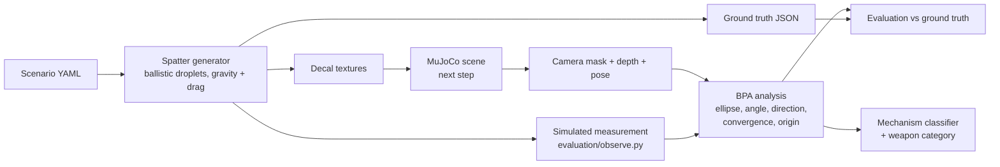

# Phase 2: Crime Scene Investigator (simulation)

A simulated Unitree Go2 explores an indoor scene containing simulated
bloodstain patterns (non-graphic red decals), finds stains, and analyses them:
impact angles, directionality, area of origin, pattern (mechanism)
classification and the weapon categories the pattern is *consistent with*.
Forensic-science education project; people appear only as simple mannequins.

**Status (21 Oct 2026):** the pure-Python core works and is tested. That covers
the physics-based spatter generator with full ground truth (Part 1), the BPA
analysis maths (Part 4), and a first mechanism classifier and evaluation.
Simulator integration, RF-DETR, the bloodstain SAM wrapper, autonomous
exploration and the GUI come next. See [docs/plan.md](docs/plan.md).

## Quick start (no simulator needed)

```bash
cd Phase_2_Investigator
./scripts/setup.sh --check                       # read-only environment check
./scripts/setup.sh                               # simulator submodule + Python packages into ~/go2venv
python -m pytest                                 # unit tests (~10 s)

# spatter + ground truth + decal textures + 3D preview for built-in scenario 1
python scripts/generate_scenario.py --scenario 1   # -> outputs/s1_living_room_blunt/

# a random scenario
python scripts/generate_scenario.py --random 42

# train the mechanism classifier on synthetic ground truth (~2 min)
python training/train_mechanism_classifier.py

# evaluate the BPA maths against ground truth, writes evaluation/results/*.png (~5-10 min)
python evaluation/run_bpa_eval.py
```

## How it works



**Spatter generator** (`sim_env/spatter/`)
- Droplets are launched from an origin by a mechanism: impact, cast-off,
  projected, drip, or transfer (a smear).
- Each droplet flies under gravity and quadratic drag until it hits a floor,
  wall, ceiling or furniture surface.
- The stain is an ellipse with sin(alpha) = width / length, aligned with the
  travel direction, with a tail and satellite drops.
- Every droplet, stain and event parameter is saved as ground truth.

**BPA analysis** (`analysis/bpa/`)
1. Fit an ellipse to each stain's body, excluding the tail, to get the impact
   angle and the travel direction.
2. Undo the camera perspective using depth and the robot's pose.
3. Find the area of convergence on the surface.
4. Find the area of origin, using straight lines, the tangent method, or
   gravity-corrected ballistic back-tracing.
5. Report a 95% uncertainty ellipsoid.

**Mechanism classifier** (`analysis/classifier/`)
- Gradient boosting on 24 interpretable features of a stain group.
- Mechanisms map to weapon categories through
  `sim_env/config/weapon_mapping.yaml`, which also notes how reliable each
  inference is.
- Explanations always say "consistent with", never certainty.

## Scenarios

| # | File | Event | Weapon category |
|---|---|---|---|
| 1 | `s1_living_room_blunt.yaml` | impact spatter + cast-off from back-swing | blunt |
| 2 | `s2_kitchen_edged.yaml` | projected (arterial-style) + drip trail | edged |
| 3 | `s3_hallway_fall.yaml` | low impact against furniture, drip, hand smear | none (fall) |
| 4 | `s4_bedroom_castoff_edged.yaml` | two overhead cast-off swings + drip | edged |

`python -m sim_env.scenarios.random_scenario --seed N` makes more. Each
scenario includes red distractor objects that are not blood, to test false
positives.

## Results so far

See `evaluation/results/` (graphs + JSON) and the table in
[docs/plan.md](docs/plan.md#7-bpa-analysis-done-and-first-results).

## Known limitations

- Everything is synthetic, and the analysis has so far been tested only with
  perfect segmentation. Real images, SAM and RF-DETR errors come later.
- The stain spread model is a heuristic. Angles and directions follow exact
  geometry, but stain sizes do not come from a fluid model.
- For stains on a single surface, the origin height depends on the assumed
  impact speeds (stated in the output). The uncertainty ellipsoid includes
  this effect.
- The weapon-category weights are teaching priors, not casework statistics.

## Folder layout

`sim_env/` scenarios and spatter physics · `analysis/` BPA maths and
classifier · `evaluation/` scoring against ground truth · `training/` model
training · `tests/` · `scripts/` · `docs/`. Placeholders for the next parts:
`perception/`, `navigation/`, `gui/`.
