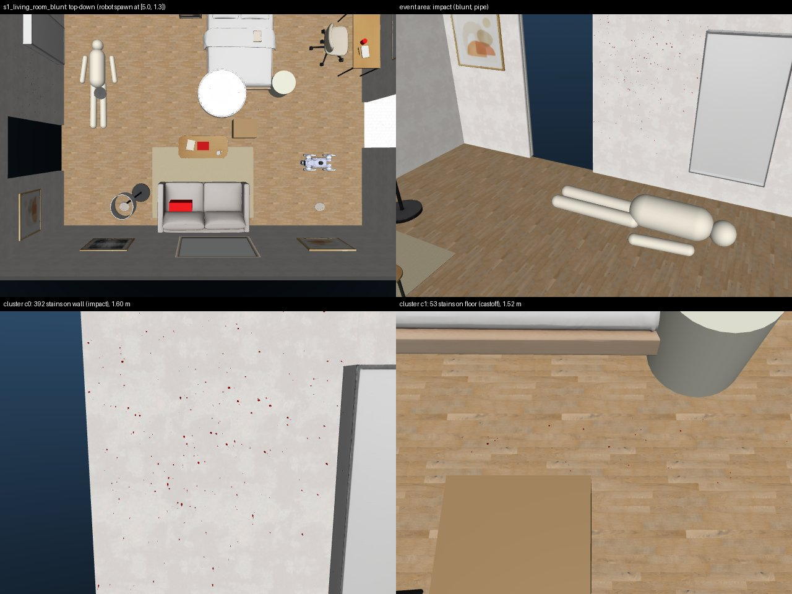
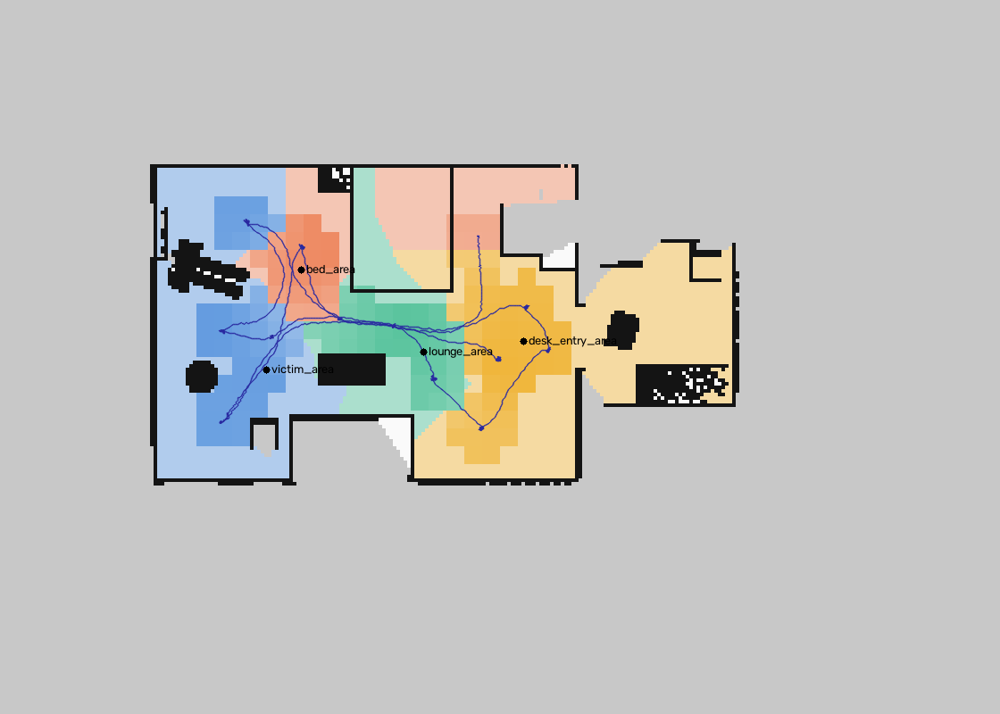
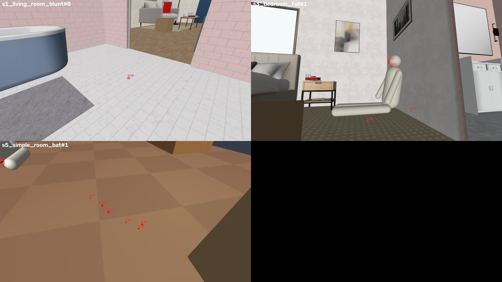
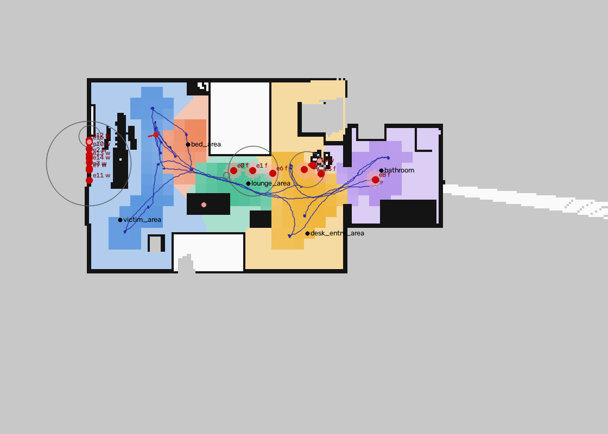
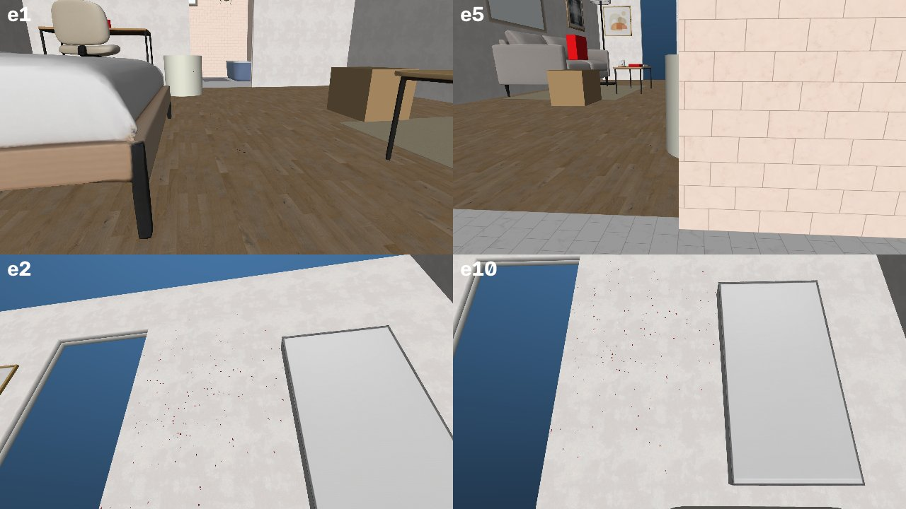

# A Unitree Go2 Crime-Scene Investigator

**Phase 2: technical report**

Repository: <https://github.com/CDJ7/Unitree-Dog-Claude-Dog-> (folder `Phase_2_Investigator/`) · November 2026

Every number in this report comes from a result file written by the project's scripts, and the file is
named next to each table. Everything up to section 6 runs in simulation. The real-robot software is
written and tested against the simulator, but it has **not yet run on the dog** (section 5.5). A shorter,
command-oriented companion is [`README.md`](README.md).

---

## Abstract

The project builds a quadruped crime-scene investigator: a Unitree Go2 that searches a room for
bloodstains, keeps off them, photographs them, and writes a report of what the patterns suggest. It runs
in a MuJoCo model of furnished houses with physically simulated blood spatter, and the same navigation
stack is connected to the real dog.

**Simulated crime scene (Stage A):**
- Droplets fly with gravity and drag, and are ray-cast onto the real walls, floors and furniture.
- Stains have the correct shape for their impact angle: W/L = sin α within 0.03 between 20° and 70°.
- Five hand-made scenarios cover blunt, edged and no-weapon events.
- The Go2 explores every scenario with no collisions and inspects the stain regions.

**The dog maps the room itself (Stage R):**
- It explores with its LiDAR and tags each part of its own map with a named zone, using a camera
  classifier.
- In an unseen house-185 scene it put all **4/4** zone goal points in the right zone, with no
  collisions.
- It then reached **4/4** zones on that map, and **2/2** after relocalising from a 40° / 2.5 m odometry
  offset. Relocalisation was within 2 cm and 2°.

**Crime-scene search on the dog's own sensors (Stage C), five hand-made scenarios:**
- A CPU-only stain detector separates stains from same-coloured distractors: test precision 0.92,
  recall 0.97, and 4.8 % of distractors flagged.
- The search finds 94–98 % of the stains in four scenarios and flags **0 of 15** red distractors, with
  no collisions.
- A keep-out layer cuts the floor stains walked over in scenario 1 from 56/84 to 24/84.
- From the dog's own close-ups, a mechanism classifier retrained on simulated close-up measurements
  reaches **0.967** test accuracy (29/30 groups), against 0.700 for the original.
- In the full missions it named the mechanism correctly in **5/5** analysed stain groups, and placed
  the area of origin **0.40–0.68 m** from the truth.

**Not yet done:** the runs on the real dog. The bed-top cast-off of scenario 4 is out of reach of a
camera mounted at 0.41 m.

---

## Contents

1. [Introduction](#1-introduction)
2. [System overview](#2-system-overview)
3. [Stage A: the simulated crime scene](#3-stage-a-the-simulated-crime-scene)
4. [Bloodstain analysis on ideal measurements](#4-bloodstain-analysis-on-ideal-measurements)
5. [Stage R: the dog maps the room and tags its zones](#5-stage-r-the-dog-maps-the-room-and-tags-its-zones)
6. [Stage C: the crime-scene search](#6-stage-c-the-crime-scene-search)
7. [Discussion](#7-discussion)
8. [Limitations and next steps](#8-limitations-and-next-steps)
9. [Reproducibility](#9-reproducibility)
10. [References](#10-references)

---

## 1. Introduction

A crime scene has to be documented completely without being changed. People who walk through it leave
shoe prints in pools and smear trails. A quadruped robot can survey the scene first:
- it fits through cluttered rooms;
- it carries a camera and a LiDAR;
- it can be made to never step on evidence.

**Bloodstain pattern analysis (BPA)** then reads the stains:
- the impact angle from each stain's shape (W/L = sin α);
- the direction of travel from its tail;
- the area of origin by tracing the drops back;
- and the mechanism (impact, cast-off, projected, drip, transfer), which constrains what kind of event
  and weapon the pattern is consistent with.

**This project builds on two earlier pieces of work:**
- **Test 1** (`go2_stream/`): streaming, keyboard teleop with a dead-man and speed caps, LiDAR and
  camera on the real Go2.
- **Test 2** (`Test2/`): a camera zone classifier (ResNet18) on simulated and real lab data, and a first
  go-to-zone behaviour.

Test 2 is submitted and frozen. Phase 2 reuses its code and models without changing them.

---

## 2. System overview

**Simulator** (`sim_env/`):
- syswonder's MuJoCo Go2 simulator, run in-process: walking gait, MID-360 LiDAR, IMU, RGB-D camera, and
  houses 185 and 186;
- our spatter generator, scenarios, event playback, run recorder and COCO export.

**Navigation** (`navigation/`):
- a 5 cm LiDAR occupancy grid with a low-obstacle layer;
- frontier exploration and a minimum-cost planner;
- pure pursuit and a safety layer: it slows from 0.6 m, stops at 0.2 m from the nose, and refuses turns
  that would sweep the body into an obstacle;
- escape moves, inspection, close-up tours, and a **keep-out** layer for evidence.

**Mapping** (`mapping/`):
- the zone map (camera votes per place, from all headings);
- the mapper (frontiers, look-arounds, viewpoint coverage);
- relocalisation by scan matching;
- the evidence map (stain detections turned into evidence clusters).

**Perception** (`perception/`):
- the zone classifier (Test 2 checkpoints);
- the stain detector (red regions, then features, then a random forest).

**Analysis** (`analysis/`):
- BPA measurement (ellipse, angle, direction), area of origin, and the mechanism classifier;
- close-up measurement and the scene report.

**Real robot** (`real_robot/`): `RealGo2Session` puts the real dog behind the simulator's session
interface, so the whole navigation stack runs unchanged on it:
- the L1 LiDAR's deskewed cloud becomes a planar scan plus obstacle points;
- the pose comes from odometry;
- motion goes through Test 1's teleop safety.

`SimLink` runs this exact real-robot code path against the simulator.

---

## 3. Stage A: the simulated crime scene

Source: [`docs/stage_a_checklist.md`](docs/stage_a_checklist.md), tests and `docs/media/a*`.

### 3.1 Spatter in the simulator
- **Flight:** droplets fly with gravity and quadratic drag. Every flight step is ray-cast against the
  visible scene, so stains land on real meshes.
- **Shape:** stains are flat ellipsoids with the ground-truth width, length and direction, plus tails,
  satellites and smears.
- **Tests:**
  - landing within 1 mm and 0.5° of the analytic reference;
  - rendered stains satisfy W/L = sin α within 0.03 between 20° and 70°, with orientation within 4°;
  - all five mechanisms generate and render.

### 3.2 Scenarios
| # | Scenario | Events | Weapon category | Stains | Clusters |
|---|---|---|---|---|---|
| 1 | living room (house 185) | impact + cast-off | blunt (pipe) | 504 | 7 |
| 2 | desk corner + bathroom (185) | projected + drip trail | edged (knife) | 155 | 4 |
| 3 | bedroom north-east corner (186) | low impact + drip + hand smear | none (fall) | 158 | 6 |
| 4 | bedroom desk (186) | stab impact + two cast-off swings | edged (knife) | 313 | 19 |
| 5 | simple room | impact + drag smear + drip | blunt (bat) | 470 | 7 |

Every scenario also has mannequins, obstacles in the robot's path, and three red distractors (a towel,
mug, cushion or book) that are not blood. `--random SEED` makes seeded random scenarios in any house.



*Figure 3.1 — Scenario 1: the scene, the spatter and its ground truth. `docs/media/a3_s1_living_room_blunt.jpg`.*

### 3.3 Autonomous exploration and inspection with ground-truth targets
| Scenario | Path | Camera coverage (surfaces / floor) | Collisions | Inspection |
|---|---|---|---|---|
| S1 | 53 m | 73 % / 81 % | 0 | 5/5 targets |
| S2 | 14 m | 60 % / 78 % | 0 | 2/2 |
| S3 | 9 m | 64 % / 79 % | 0 | 2/2 (stains partly hidden by the victim) |
| S4 | 13 m | 54 % / 70 % | 0 | 2/4 (the south wall has no reachable view) |
| S5 | 45 m | 59 % / 54 % | 0 | 6/6 |

Stage A also includes event playback (a reenactment of each event from its description) and data
export: a run recorder and a COCO stain dataset.

---

## 4. Bloodstain analysis on ideal measurements

Source: `evaluation/results/bpa_eval.json`, `evaluation/results/mechanism_classifier.json`. These
measure the analysis itself, on ideal segmentations of the simulated stains (no robot, no camera).

| Measure | Result |
|---|---|
| Impact angle error, median / 90th percentile (2,341 stains, 34 scenarios) | 1.9° / 6.5° |
| Travel direction error, median; reversed | 0.6°; 1.7 % |
| Area of origin, straight-line method, median error (33 events) | 0.70 m |
| Area of origin, gravity-corrected, median error (90th percentile) | **0.12 m** (0.95 m) |
| True origin inside the 95 % ellipsoid | 88 % |
| Mechanism classifier, test accuracy (250 groups, split by scenario) | **0.94** |

The straight-line method over-estimates the height, which is the textbook bias of string methods.
Tracing drops back along ballistic curves corrects most of it.

The camera path degrades with distance. With a 1920×1080, 40° close-up camera, the median angle error is
1.1–2.0° up to 1 m from a stain, and 12° at 1.5 m (`bpa_eval.json`, `camera_standoff`). This shapes the
close-up design of section 6.4.

---

## 5. Stage R: the dog maps the room and tags its zones

### 5.1 Why a self-built map
In Test 2 the real dog decided "where am I" and "which way" from camera views. Its classifier reached
0.814 on a held-out lab session (Test 2 report, section 7.6), but the camera shows the zone the dog
*faces*, not where it *stands*: open-area accuracy was 0.24 facing one way and 0.90 facing another.

Test 2's zone map (section 7.7) fixed this with operator-labelled recordings. Phase 2 makes the map
without any labels:
- the dog explores with its LiDAR;
- at stops about 1 m apart it turns a full circle;
- every place on its map collects the classifier's votes from all the directions it was seen from.

### 5.2 Method
- **Zone map** (`mapping/zone_map.py`):
  - classifier votes per 0.25 m cell, in 8 heading bins and averaged over the bins, so staring one way
    can't outvote a look-around;
  - 3×3 smoothing;
  - a flood fill of the free space that never crosses walls;
  - per zone: area, confidence, and a goal point deep inside the zone and away from obstacles.
- **Mapper** (`mapping/mapper.py`): frontier exploration with a look-around at each goal. Because the
  LiDAR sees a room from a few spots, frontiers run out early, so a coverage phase then visits viewpoints
  about 1 m apart until every reachable area has had a look-around.
- **Relocalisation** (`mapping/localize.py`): the real dog's odometry restarts at every boot. After one
  look-around, its LiDAR points are matched to the saved map by FFT correlative scan matching (2° steps,
  then 0.5°). A low score stops the run instead of driving on a wrong map.
- **Go to zone** (`scripts/goto_zone.py`):
  1. relocalise;
  2. plan to the zone's goal point and drive with the safety layer;
  3. look around on arrival as a second opinion.

### 5.3 Results in simulation
Scene r1854 (house 185) was never seen by the classifier in training. Files are in `docs/media/stage_r/`.

| Mapping run (`sim_r1854_map_report.json`) | Result |
|---|---|
| Robot time / path | 323 s, 35.7 m |
| Look-arounds / frames tagged | 13 / 617 |
| Collisions | 0 |
| Zone goal points in the right zone | **4/4** |
| Map cells in the right zone | 0.667 overall: victim 0.954, desk/entry 0.813, bed 0.615, lounge 0.603, bathroom 0 (never entered: its doorway is narrower than the planning radius) |

| Go to zone | Result |
|---|---|
| Four zones, simulator frame (`sim_goto_4zones.json`) | **4/4** arrived, 17.7–27.5 s each, the camera agreed every time |
| Real-robot code path, odometry offset by (1.5 m, −2 m, 40°) (`sim_goto_relocalised.json`) | Relocalised at (4.88, 1.76, −2°) against the truth (4.88, 1.78, 0°), score 0.99. Then **2/2** arrived. At one goal the camera said "lounge" (0.44): it was looking into the next zone. The map overrode it. |



*Figure 5.1 — The dog's own map of r1854: obstacles black, zones in colour (darker = more camera votes), path blue, and each zone's goal point. `docs/media/stage_r/sim_r1854_zone_map.png`.*

### 5.4 Two lessons that changed the method
- **Coverage, not frontiers, fills the zone map.** With frontiers alone, exploration ended after a few
  goals and look-arounds, and most cells were labelled only by the flood fill. So the coverage phase was
  added.
- **Narrow gaps.** Letting the coverage phase use the 0.24 m "tight" planning radius sent the dog into a
  gap where it wedged: 4 failed goals in a row, and cell accuracy 0.553
  (`sim_r1854_tight_radius_report.json`). Coverage keeps the normal radius.

### 5.5 The real robot: what is ready and what is not
**Written and tested against the simulator through `SimLink`:**
- `real_robot/session.py`: deskewed L1 cloud, planar scan, odometry pose, camera, and motion through
  Test 1's teleop.
- `scripts/real_check.py`: a sensors-only check; the dog does not move.
- `map_zones.py --backend real` and `goto_zone.py --backend real`.

**Two real-dog lessons from Test 2's lab runs are built in:**
- **The upside-down L1:** its raw cloud makes the floor look like an obstacle, so only the
  odometry-frame deskewed cloud is used.
- **Larger stop distances:** 0.40 m from the nose, and slowing from 0.90 m.

Directions in which a sparse cloud has no return are treated as "no information", not "free", so they
cannot carve free space through walls.

**Not yet done:** any run on the dog. The lab procedure is in
[`real_robot/README.md`](real_robot/README.md).

---

## 6. Stage C: the crime-scene search

One command (`scripts/investigate.py`) runs the whole mission:
1. explore and look around;
2. detect stains on the 720p camera every second, and map them;
3. keep off floor evidence;
4. take close-ups of every confirmed cluster;
5. measure every stain and write a scene report.

Only the dog's own detections are used; ground truth is used only for scoring.

### 6.1 Stain detector (C2)
- **Why colour isn't enough:** the distractors are the same red as blood, and at the navigation
  camera's 320×240 most droplets are below a pixel, so they wash out. So the detector runs on frames like
  the Go2's 1280×720, 100° stream.
- **Pipeline:** red mask, then regions (spatter grouped), then features, then a random forest (no GPU).
  - shape and colour features: spot count, fill, size, saturation spread;
  - geometry features from depth: physical size, height, surface normal, flatness, depth step to the
    surrounding surface.
- **Labels:** from the simulator's segmentation.
- **Split by scene:** 18 random scenes train, 4 validate, and the 5 hand-made scenarios test.

| Test, 5 hand-made scenarios (`docs/media/stage_c/detector_metrics.json`) | With depth | Image only (real-dog case) |
|---|---|---|
| Region precision / recall | 0.919 / 0.973 | 0.920 / 0.923 |
| Red distractors called a stain (207 regions) | 4.8 % | 5.8 % |
| Visible stain clusters found per view | 0.783 | 0.754 |



*Figure 6.1 — Test-scene views: regions judged stain (red, with probability) and rejected (grey); the red book on the side table is rejected. `docs/media/stage_c/detector_examples.jpg`.*

### 6.2 Evidence map (C3)
- Each detection becomes a 3-D point with a surface normal.
- Detections join the nearest cluster within 0.35 m on a similar surface.
- A cluster has a surface (floor / wall / raised), a zone, and its views and probabilities.
- A cluster is **confirmed** after 2 frames with a mean probability ≥ 0.5, which removes one-off false
  alarms.

### 6.3 Keep-out (C4)
- **Planning:** confirmed floor evidence becomes a keep-out layer. It adds a high cost wherever the body
  would touch it, so paths go around evidence. A doorway covered by a drip trail stays passable, because
  it is a cost and not a wall.
- **Viewpoints:** never placed on evidence.
- **Metric:** floor stains walked over (the body rectangle over a stain), and how many of those were
  walked over *after* the dog had found them.

| Scenario 1, same mission (`s1_report_keepout.json`, `s1_report_no_keepout.json`) | With keep-out | Without |
|---|---|---|
| Clusters found / precision | 5/7 / 0.95 | 5/7 / 0.94 |
| Floor stains walked over (after found) | **24/84 (20)** | 56/84 (52) |
| Collisions | 0 | 0 |

### 6.4 Close-ups and stain analysis (C5)
- **Close-up tour** (`navigation/closeups.py`): aim points across each confirmed cluster. The dog stands
  about 0.5 m from floor stains, and 0.5–1.3 m from walls when furniture or a body is in front. It takes
  1920×1080, 40° close-ups (in simulation, an emulated evidence camera; see section 8).
- **Measurement** (`analysis/closeup.py`): every red blob goes through the section-4 measurement (plane
  from depth, perspective undone, ellipse), and duplicates across frames are merged.
- **Scene report** (`analysis/scene_report.py`):
  - stain groups (0.3 m), then the mechanism classifier;
  - the weapon categories the pattern is "consistent with" (never an identification);
  - a gravity-corrected area of origin for impact and projected groups;
  - a per-zone `scene_report.md`.

**A mechanism classifier for close-ups:**
- **The problem:** on the dog's own close-ups, the section-4 classifier called scenario 1's impact
  "projected". A controlled test traced it to *coverage*: even ideal measurements of only the stains the
  close-ups covered were classified "projected", because close-ups miss the small round stains at a
  pattern's edges.
- **Tried and dropped:** retraining on degraded synthetic measurements was worse.
- **What worked** (`training/train_mechanism_simclose.py`): training on groups measured from
  *simulated close-ups* taken the way the mission takes them, from 58 random scenes in all three houses
  (367 groups), together with the ideal synthetic groups. The model was chosen on validation.

| Classifier (`docs/media/stage_c/mechanism_simclose.json`) | Validation (89 groups) | **Test (30 groups, 5 hand-made scenarios)** |
|---|---|---|
| Original, ideal synthetic | 0.809 | 0.700 |
| Simulator close-ups only | 0.888 | 0.867 |
| **Close-ups + ideal synthetic** | 0.933 | **0.967** |

### 6.5 The full mission on all five scenarios
Search with keep-out, close-ups and analysis with the close-up classifier. Files:
`docs/media/stage_c/s*_report*.json` and `missions_simclose.json`.

| Scenario | Clusters found | Stains in found clusters | Distractors flagged | Floor stains walked over (after found) | Collisions | Close-ups | Stains measured | Angle error (median) | Mechanism | Origin error |
|---|---|---|---|---|---|---|---|---|---|---|
| S1 | 5/7 | 0.98 | 0/3 | 24/84 (20) | 0 | 8 | 191 | 6.2° | **2/2** | 0.42 m |
| S2 | 3/4 | 0.98 | 0/3 | 0/34 | 0 | 1 | 120 | 6.1° | **1/1** | 0.62 m |
| S3 | 4/6 | 0.94 | 0/3 | 16/140 (0) | 0 | 3 | 43 | 6.6° | **1/1** | 0.68 m |
| S4 | 1/19 | 0.57 | 0/3 | 0/17 | 0 | 0 | – | – | – | – |
| S5 | 4/6 | 0.98 | 0/3 | 1/44 (1) | 0 | 3 | 190 | 5.9° | **1/1** | 0.40 m |
| S4, 1 m mast camera | 4/19 | 0.65 | 0/3 | 0/17 | 0 | 1 | 19 | 4.9° | 0/1 | 2.0 m |

- **Same measurements, original classifier:** S1–S3 get 2/4 mechanisms right
  (`missions_ideal.json`); the close-up classifier gets 4/4.
- **S1's scene report** (`docs/media/stage_c/s1_scene_report.md`): "impact spatter … consistent with a
  blunt swung object (e.g. bat, pipe, hammer)", with an area of origin about 1.2 m above the floor.
  Truth: a pipe, origin at 1.55 m.
- **S4:** 15 of its 19 clusters are cast-off on top of a bed (about 0.6 m), above the camera (0.41 m), so
  no distance or angle can see them. An emulated 1 m mast raises cluster recall from 1/19 to 4/19, but
  its one analysed group is wrong.



*Figure 6.2 — Scenario 1 as the dog mapped it: zones, path, confirmed evidence (red; f = floor, w = wall), keep-out (pink) and ground-truth clusters (grey circles). `docs/media/stage_c/s1_evidence_map.png`.*



*Figure 6.3 — Inspection close-ups of four detected clusters. The west-wall impact spatter is clearly resolved; floor stains on wood are much harder. `docs/media/stage_c/s1_closeups.jpg`.*

### 6.6 Failures found and fixed on the way
| Problem | Cause | Fix |
|---|---|---|
| Wedged in the S1 bathroom doorway for the rest of a run | LiDAR points inside the 3 cm safety margin made every escape move count as a hit | Straight and sideways moves count only points they bring closer; turns keep the strict rule (the legs stick out past the body box; the relaxed rule let a leg scrape a wall) |
| Wedged in an S5 corner at 84 s | The escape planner chose moves the safety filter then zeroed, or slowed to 8 mm/s | Keep the best move unless the filter would leave it unable to move the robot; try such moves when backing off has no room |
| A side-step during look-arounds | It ignored keep-out: S1 walked over 47 instead of 24 floor stains | Reverted |
| Training stuck for over an hour | A mask seen almost edge-on projected pixels out to near infinity, so the ellipse fit looped over billions of slices | Implausible extents are rejected; real smears still pass |
| Trained models missing from git | Phase 2's `.gitignore` excluded every `*.pkl` | `perception/models/*.pkl` are committed |

---

## 7. Discussion

- **One stack, two robots.** The real-robot session presents the same interface as the simulator. So
  everything in sections 5 and 6 runs on the real dog unchanged, and the `SimLink` tests exercise the
  exact code path. What the simulator cannot test is the sensors: the L1's density and noise, odometry
  drift, the floor height, and lighting.
- **Maps beat single views.** The single-view failure Test 2 measured (the camera sees where the dog
  faces) is solved by fusing votes over headings and places on a map. In simulation the map overrode a
  wrong camera vote at the goal.
- **Train on what the robot sees.** Two components failed until they were trained on data from the
  robot's own viewpoint:
  - the stain detector at 320×240;
  - the mechanism classifier on ideal measurements.

  In both cases the fix was rendering the training data the way the mission sees it, not a better model.
- **Honest limits.** Keep-out halves the stains walked over but cannot protect stains not yet found.
  Mechanisms are right where the dog can see the pattern, but a camera at 0.41 m cannot see onto
  furniture tops.

---

## 8. Limitations and next steps

1. **Runs on the real dog (Stage R):**
   - `real_check.py`, then `map_zones.py --backend real`, then `goto_zone.py`;
   - tune the floor height, the scan band and the speeds;
   - measure zone-map accuracy and arrivals in the lab.
2. **Stain detection on the real dog. The laptop has a good GPU,** so:
   - fine-tune RF-DETR-Seg (Phase 2 plan B1) on the simulator COCO set together with photos of
     non-graphic printed stain patterns taken by the dog's camera in the lab;
   - compare it with the CPU random forest's image-only model;
   - estimate region positions from the floor plane (known camera height and pitch) and the LiDAR,
     because the Go2's camera has no depth.
3. **Close-ups on the real dog.** The Go2's 1280×720, ~100° camera resolves about 2 mm per pixel at 1 m,
   too coarse for droplets of 1–5 mm. A dedicated high-resolution camera, for example a phone on a mount, is needed
   for section 6.4 on the real robot.
4. **Raised surfaces.** A higher camera finds more, but furniture tops need close-ups taken from above.
5. **Drift.** Long real runs will need continuous scan-matching correction of the odometry (plan R7).
6. **Simulation realism.** Stains are geometry with ideal colour; real stains vary in colour, dry,
   and soak into fabric.

---

## 9. Reproducibility

**Software:** Python 3.13, MuJoCo 3.3.7, scikit-learn, PyTorch (CPU) for the zone classifier. Phase 2
uses at most `PHASE2_THREADS` threads (default 2). **Tests:** `python -m pytest -q`, 99 passed.

```
python scripts/map_zones.py --random 1854 --video                 # Stage R mapping (5.3)
python scripts/goto_zone.py --map outputs/zone_map/r1854 --zone victim_area bed_area
python scripts/goto_zone.py --map outputs/zone_map/r1854 --backend real --link sim --odom-offset 1.5 -2 40 --zone bed_area
python training/train_stain_detector.py                           # C2 (6.1), ~25 min
python training/train_mechanism_simclose.py                       # C5 classifier (6.4), ~1 h
python scripts/investigate.py --scenario 1 [--no-keepout] [--camera-height 1.0] [--video]   # C3-C5 (6.3-6.5)
python scripts/reanalyse.py outputs/investigate/* --model ideal   # analysis with another classifier
python evaluation/run_bpa_eval.py                                 # section 4
bash report/build_pdf.sh                                          # this report as PDF
```

**Committed models:**
- `perception/models/stain_rf_depth.pkl` and `stain_rf_image.pkl` (the stain detector);
- `perception/models/mechanism_gb_simclose.pkl` (the close-up classifier).

The zone classifiers come from Test 2.

---

## 10. References

1. E. Todorov, T. Erez, Y. Tassa, "MuJoCo: A physics engine for model-based control", IROS 2012.
2. syswonder, *robot-unitree-go2-mujoco* (simulator, Go2 model, houses). <https://github.com/syswonder/robot-unitree-go2-mujoco>
3. Unitree Robotics, *unitree_sdk2_python*. <https://github.com/unitreerobotics/unitree_sdk2_python>
4. T. Bevel, R. M. Gardner, *Bloodstain Pattern Analysis with an Introduction to Crime Scene Reconstruction*, 3rd ed., CRC Press, 2008.
5. L. Breiman, "Random Forests", Machine Learning 45, 2001.
6. J. H. Friedman, "Greedy function approximation: a gradient boosting machine", Annals of Statistics 29(5), 2001.
7. F. Pedregosa et al., "Scikit-learn: Machine Learning in Python", JMLR 12, 2011.
8. K. He, X. Zhang, S. Ren, J. Sun, "Deep Residual Learning for Image Recognition", CVPR 2016.
9. S. Thrun, W. Burgard, D. Fox, *Probabilistic Robotics*, MIT Press, 2005.
10. Roboflow, *RF-DETR*. <https://github.com/roboflow/rf-detr>
