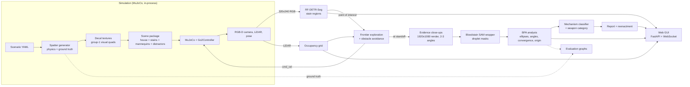

# Phase 2 plan: Crime Scene Investigator (simulation)

Status: approved 21 Oct 2026 (decisions in section 12). Parts 1 and 4 (pure Python) are
already built and tested; nothing that needs the simulator, Docker or the GPU
has been started; that waits for the laptop.

Contents
1. What the three external repos actually give us
2. Simulator route (decided: native)
3. Architecture
4. Folder layout
5. Scenes, stains and the camera
6. Dataset and models
7. BPA analysis (done) and first results
8. Autonomous investigation
9. GUI
10. Schedule, risks and scope cuts
11. Laptop checklist (environment check deferred)
12. Decisions
13. Licenses

---

## 1. What the three external repos actually give us

**robot-unitree-go2-mujoco** (syswonder, HEAD `d6e5464`, 20 Sep 2026, ~880 MB)
- A Robonix "body package": Go2 MJCF + meshes, six environments
  (`scenesmith_house_185` 113 MB, `scenesmith_house_186` 100 MB,
  `scenesmith_multilevel_house`, `yard`, two RL courses), a native Python
  MuJoCo backend and a browser (WASM) backend.
- The Go2 walks for real: a joint-torque trot gait (default) or an ONNX RL
  policy. It is driven with velocity commands (`cmd_vel`: linearX, linearY,
  angularZ). The gait clamps to 0.4 m/s forward, 0.15 m/s sideways, 0.5 rad/s;
  a 0.35 s watchdog stops it.
- Sensors (`sim/native/sensors.py`): "MID-360" LiDAR by ray casting (1536 rays,
  -7 to 52 deg vertical, 10 Hz); IMU; front RGB-D camera `front_rgbd_camera`,
  **320x240 RGB at 5 Hz, fovy 60 deg** (fx = fy = 207.8), depth ray-cast at
  160x120 and upsampled.
- **The native backend is plain Python** (`mujoco==3.3.7`, numpy). Its classes
  can be imported directly, as `sim/tests/native_smoke.py` does:
  `NativeSceneBuilder` (merges an environment + the robot into one scene),
  `Go2Controller` (`.command({"type": "cmd_vel", ...})`, `.step()`),
  `NativeSensorSuite` (`.camera()`, `.lidar()`, `.imu()`).
- ROS 2 Humble is only used by a bridge node (`/cmd_vel`, `/odom`, `/scan`,
  `/mid360/points`, `/front/rgb`, `/front/depth`, `/front/camera_info`, TF).
  Mapping (RTAB-Map), Nav2 and frontier exploration are **external Robonix
  services** fetched by `rbnx build`; they cannot run without Robonix.
- Docker: `sim/start.sh` always uses Docker Compose, and
  `sim/compose.native.yaml` is written for **WSL2** (`/dev/dxg`, `/mnt/wslg`);
  on native Ubuntu it would most likely fail without an override. Base image
  pulls and pip mirrors point at Chinese mirrors.
- Scenes: `assets/environments/manifest.json` (schema 2) lists packages
  (`scene.xml`, `index.json`, `spawn.json`, meshes). Geom groups:
  1 = environment visual, 3 = environment collision; **LiDAR and depth rays
  only hit groups 0, 3, 5**. So a stain decal added as a group-1 visual geom
  shows in RGB but is invisible to LiDAR and depth, which is what we want.
- Frontier exploration logic (`skills/explore/explore_skill/frontier.py`) is
  pure numpy and reusable (MulanPSL-2.0).

**rf-detr** (Roboflow, 1.12.0.dev, Apache-2.0)
- Segmentation models `RFDETRSegNano/Small/Medium/Large/XLarge/2XLarge`;
  **all six seg sizes are Apache-2.0** (only some detection sizes are PML).
- `pip install "rfdetr[train,loggers]"`, Python >= 3.10, torch >= 2.2.
- COCO layout `train/ valid/ test/` each with `_annotations.coco.json`;
  polygons preferred over RLE. `model.train(dataset_dir=..., epochs, batch_size,
  lr, early_stopping=True, ...)` writes `metrics.csv` (box and mask mAP) and
  `checkpoint_best_total.pth`. Resolution must be a multiple of 24 (Small and up).
- Inference returns `supervision.Detections` with boolean masks (N, H, W).

**Bloodstain-Analysis-AI-Tool** (Zdong104, 2023, MIT code, Apache-2.0 model)
- Only a Colab notebook calling stock `segment_anything` with a
  **fine-tuned vit_b checkpoint hosted on Google Drive**
  (file id `1mvh81GEjU7Z2ExLVQyUotMUV0l84UpO0`, no hash, size not stated).
- No droplet post-processing, no ellipse fitting, no angle code, no training
  code. It was tuned on lab high-speed video frames (drip/spatter), not
  crime-scene photos, so expect a domain gap.
- So the "wrapper" is mostly new code: load the checkpoint, run
  `SamAutomaticMaskGenerator` on a stain crop, filter masks, return droplet
  masks. We keep a classical fallback (colour threshold + connected
  components) and measure both against simulator ground truth.

## 2. Simulator route (decided: native)

**Recommendation: native-only, no Docker, no ROS 2, no Robonix for the core
demo.**

- We run MuJoCo ourselves in the go2venv (`mujoco==3.3.7`, `MUJOCO_GL=egl`
  for headless or `glfw` with a window) and import the simulator's own
  `NativeSceneBuilder`, `Go2Controller` and `NativeSensorSuite`. The Go2
  primitives stay untouched.
- Why: Robonix brings a VLM key requirement, gRPC services, Chinese mirrors
  and containers we don't need. The stock Docker native profile is WSL2-only.
  Nav2/RTAB-Map only come through Robonix. Everything we need (stepping, cmd_vel,
  RGB-D, LiDAR, pose) is reachable from Python in-process, which is also faster
  to debug in two weeks.
- What we give up: Nav2 and RTAB-Map. We implement our own occupancy grid
  from LiDAR, frontier exploration (adapting the repo's frontier logic) and a
  simple local planner with obstacle avoidance (Part 5).
- Docker is then **not needed**. If later you want the ROS 2 topics (e.g. for
  RViz or Nav2), we add Docker plus an override compose file for native
  Ubuntu + NVIDIA; that is an optional extra, not on the critical path.
- How the simulator is brought in (decided): a **git submodule** at
  `Phase_2_Investigator/third_party/robot-unitree-go2-mujoco`, pinned to
  commit `d6e5464`, marked `shallow = true`. Git records the exact version,
  GitHub shows it as a link to the upstream repo, and `scripts/setup.sh`
  fetches only that commit (`git submodule update --init --depth 1`), so a
  plain clone of our repo stays small and nothing of theirs is copied in.
- Our scene packages live in `Phase_2_Investigator/sim_env/scene_packages/`,
  in the simulator's package format. A small builder makes an overlay assets
  folder (links to their assets + our packages + a merged manifest) so their
  tree is never modified.

## 3. Architecture



The velocity interface (`navigation/velocity.py`) has two implementations:
the simulator's `Go2Controller` and, later, the real Go2's
`SportClient.Move` from Phase 1, with the same speed limits and dead-man.

## 4. Folder layout

```
Phase_2_Investigator/
  sim_env/        spatter/ (physics, stains, raster), scenarios/ (YAML + random),
                  config/ (weapon mapping), scene_packages/ (MJCF), build/ (gitignored)
  perception/     rfdetr_detector.py, bloodstain_sam.py, classical_droplets.py
  analysis/       bpa/ (ellipse, projection, convergence, origin, measure), classifier/
  navigation/     velocity.py, occupancy.py, frontier.py, planner.py, investigator.py
  gui/            server.py (FastAPI), static/ (HTML/JS, three.js reenactment)
  training/       build_coco_dataset.py, train_rfdetr.py, train_mechanism_classifier.py,
                  ai_images/ (import + SAM-assisted labelling of your own images)
  evaluation/     observe.py, run_bpa_eval.py, results/ (small PNG + JSON, committed)
  tests/          pytest
  scripts/        setup.sh, download_weights.sh, run_demo.sh, generate_scenario.py
  docs/           plan.md, phase2_summary.md, architecture notes
  third_party/    simulator (git submodule, pinned, shallow)
```

## 5. Scenes, stains and the camera

- **Scenarios** (done, `sim_env/scenarios/configs/`): four hand-written events
  (living room blunt blows + cast-off; kitchen projected + drip trail; hallway
  fall with a hand smear, no weapon; bedroom edged-weapon cast-off) plus a
  seeded random generator. Each defines room, furniture, mannequins,
  distractor red objects and a sequence of events. They are standalone rooms
  now; `binding:` will place them inside `scenesmith_house_185/186` rooms.
- **Stains into MuJoCo**: per surface, the generator renders an RGBA decal
  texture (done, `raster.decal_patch`). Each becomes a thin group-1 visual box
  0.5 mm off the surface with that texture, `contype=0 conaffinity=0`.
  Mannequins are capsules (visual + collision so LiDAR sees them).
  Distractors are red boxes/cylinders (cushion, book, towel...).
- **Camera resolution is the main design constraint.** The simulator's front
  camera (320x240, 60 deg) makes one pixel about 5 mm at 1 m, the size of a
  whole droplet. The evaluation (`evaluation/results/camera_standoff.png`)
  shows it cannot measure droplets at any distance. Plan:
  - detection (RF-DETR) runs on the normal 320x240 stream (stain *regions* are
    big enough);
  - for analysis the robot stops at 0.5-0.6 m and we render an **evidence
    close-up** from the same camera pose at 1920x1080 with a 40 deg FOV
    (MuJoCo `Renderer`). At 0.6 m a 3 mm stain is ~50-100 pixels and the angle
    error is about 1.5 deg. The real Go2's front camera streamed 1920x1080 in
    Phase 1, so this matches the hardware better than the sim default.
- **Sim vs real** (noted in code): MID-360 LiDAR in sim vs the Go2's L1; ground
  truth odometry in sim (we can add noise); camera intrinsics differ.

## 6. Dataset and models

**Classes (decided): one per mechanism.** RF-DETR-Seg is trained with five
classes, `impact`, `castoff`, `projected`, `drip` and `transfer`; each stain
region is labelled with the mechanism of the event that made it (known from
the generator's ground truth).
- Because one frame often shows only part of a pattern, the detector's class
  is treated as one opinion. The droplet-level pattern classifier (Part 4)
  is the second. The report fuses both: a weighted average of the two
  probability vectors, weighted by how many frames and droplets back each,
  and shows when they disagree.
- To keep five classes trainable on synthetic data, the dataset generator
  balances mechanisms across scenarios (as the classifier training already
  does) and we report per-class AP, not just mean mAP.
- Distractor red objects are not a class; they appear unlabelled (hard
  negatives), and we report how often they are detected (false-positive rate).

**Synthetic dataset** (`training/build_coco_dataset.py`, Part 3):
- 40-60 random scenarios + the four built-in ones, inside the two houses;
  for each, ~60-100 camera poses (robot heights, distances 0.4-3 m, yaw/pitch
  jitter), lighting variation (light positions, intensities), random
  floor/wall materials. Target ~4-6k images at 640x480 (and 320x240 copies).
- Labels are automatic: render a second pass where only the decals are visible
  in a flat colour per stain group, threshold, polygonise (OpenCV contours).
- Split by scenario: 70 / 15 / 15, so no scenario appears in two splits.
- **AI-generated images (optional)**: you supply a folder; a script imports
  them into `datasets/ai/` and pre-labels them with SAM + a red-region prompt;
  you review and fix in Roboflow (export COCO) or CVAT. Kept separate so we can
  train with and without them and compare test mAP.

**RF-DETR fine-tuning** (Part 3): start with `RFDETRSegSmall` (384 px), try
`RFDETRSegMedium` (432) if time allows; `lr=5e-5` (small data),
`early_stopping=True`, ~50-100 epochs, batch 8 with grad accumulation 2 on
the RTX 4000 Ada (20 GB). Log box and mask mAP50 / mAP50-95 from
`metrics.csv`; weights stay in `weights/` (gitignored).

**Droplet segmentation**: the bloodstain SAM wrapper vs a classical
threshold + connected-components baseline, both scored on simulator crops
where every droplet mask is known (IoU, count recall, angle error after the
ellipse fit). We use whichever wins; if the Drive checkpoint can't be fetched
we fall back to stock `sam_vit_b_01ec64.pth`.

**Mechanism classifier** (done, see 7): gradient boosting on 24 interpretable
features per stain group, trained on synthetic ground truth.

## 7. BPA analysis (done) and first results

Implemented in `analysis/bpa/` and tested (`tests/test_bpa_math.py`):
- ellipse fit on the stain body (tail excluded) -> width, length,
  alpha = arcsin(W/L), direction from the tail side; rejects stains that are too
  small, too round (W/L > 0.9) or have no visible tail;
- camera path: mask + depth + intrinsics + pose -> plane fit -> perspective
  undone by ray-plane intersection -> ellipse in metric surface coordinates;
- area of convergence (2D robust least squares), area of origin by 3D
  straight lines (works across several surfaces), the classic tangent method,
  and a **gravity-corrected** origin (back-traced ballistic curves with drag);
- uncertainty: bootstrap + sensitivity to the assumed impact speeds +
  a model-error term calibrated on synthetic events -> 95% ellipsoid;
- mechanism classifier + weapon-category inference with "consistent with"
  wording and an evidence list.

Results so far (synthetic, idealised segmentation; see
`evaluation/results/`):

| Measure | Result |
|---|---|
| Impact angle error per stain (2,341 stains) | median 1.9 deg, 90th percentile 6.5 deg |
| Direction error | median 0.6 deg, 1.7% reversed |
| Area of origin, straight lines (33 events) | median 0.70 m (too high, as textbooks warn) |
| Area of origin, gravity-corrected, impact events (22) | median 0.07 m |
| Area of origin, gravity-corrected, projected events (11) | median 0.47 m (moving, sweeping source: the origin is a path, not a point) |
| Truth inside the reported 95% ellipsoid | 88% of events (target 95%: projected ellipsoids still a little small) |
| Camera: sim 320x240 front camera | 32-100% of 3 mm stains lost at 0.3-1.5 m; unusable for droplets |
| Camera: 1920x1080, 40 deg evidence close-up | no stains lost up to 1.5 m; median angle error 1.1-2.0 deg up to 1 m |
| Mechanism classifier, test groups (600 scenarios) | 94% accuracy (5 classes) |

Honest caveats: these use perfect segmentation and the generator's own
physics. The classifier leans on stain size, which reflects our droplet-size
choices; accuracy on real images will be lower. With stains on only one
surface the origin height cannot be fixed by geometry alone; it depends on the
assumed impact speeds, which the report states.

## 8. Autonomous investigation (Part 5)

- Occupancy grid (5 cm cells) from the LiDAR scan, robot pose from the sim.
- Frontier exploration: pick the nearest reachable frontier cluster
  (adapting `frontier.py`), A* on the inflated grid, pure-pursuit to waypoints,
  reactive slow-down/stop from the LiDAR sector in front. Speed limits as in
  Phase 1 (0.3 m/s, 0.5 rad/s); all motion through `cmd_vel`.
- RF-DETR runs on the live 320x240 stream. A detection of any mechanism class
  above threshold, back-projected with depth, becomes a point of interest
  (merged within 0.5 m).
- Visiting a point of interest: plan to a standoff pose 0.5-0.6 m from the
  surface, take evidence close-ups from 2-3 angles (+-25 deg), run
  SAM -> BPA -> classifier, store results, resume exploring.
- Stop when no frontiers remain or after the time limit; compile the report
  (pattern groups merged across views, origin estimates, mechanism, weapon
  categories, sequence of events).

## 9. GUI (Part 6)

FastAPI + WebSocket backend in the same process as the simulation loop;
plain HTML/JS frontend (no build step), three.js from a CDN for the 3D view.
Panels: live camera with RF-DETR masks; top-down map with path, stains and
origin ellipse; per-group panel (crops, droplet ellipses, angle histogram,
mechanism, confidence, explanation); final summary; reenactment (two
mannequins at the estimated origin, the inferred motion, droplets along
reconstructed trajectories; toggle to overlay the ground truth); export to
HTML (and PDF via the browser's print-to-PDF, avoiding extra dependencies).

## 10. Schedule, risks and scope cuts

| Date | Target | Status |
|---|---|---|
| Oct 21 | Plan; Parts 1 and 4 pure Python + tests | **done (this branch)** |
| Oct 22 | Laptop: environment check, simulator running natively, Go2 drivable in a house | waiting for laptop |
| Oct 26 | Stains in the MuJoCo scene; Parts 1, 2, 4 end-to-end on sim camera images; evaluation graphs | minimum demoable version |
| Oct 30 | Part 3 (dataset, RF-DETR, classifier) and Part 6 GUI with live feed, map, results | |
| Nov 1 | Part 5 autonomous exploration, reenactment view | |
| Nov 1-2 | Buffer, fixes, docs, demo video, phase2_summary.md | |
| Nov 3 | Due | |

Risks:
- **Rendering on the laptop** (EGL/GLFW with the NVIDIA driver): check first
  thing on Oct 22; fallback is CPU rendering (OSMesa) at lower resolution.
- **Simulator integration** (importing their classes outside Docker): their
  native runtime expects a bridge websocket; we bypass it and call the classes
  directly. If that fails, fallback: our own minimal Go2 base driven
  kinematically (as in Phase 1's simulator) in the same house scenes.
- **Bloodstain SAM download** from Google Drive may be blocked or rate-limited;
  fallback to stock SAM and the classical droplet segmenter.
- **RF-DETR training time**: ~4-6k images, Small model, should train in a few
  hours on the RTX 4000 Ada; if short of time, train fewer epochs or Nano.
- **Synthetic-to-real gap**: everything is evaluated in simulation only.

Scope cuts if we fall behind, in your priority order: drop the reenactment
animation first (keep a static 3D plot), then autonomous exploration (use
scripted waypoints), then RF-DETR fine-tuning (use the colour-threshold
detector the dataset labels come from). The minimum demoable version is
scenario + stains in the sim + BPA on sim images + evaluation graphs.

## 11. Laptop checklist (environment check deferred)

Read-only checks to run first on the laptop (no sudo):

```bash
lsb_release -ds; uname -r
nvidia-smi                                   # driver + GPU visible
~/go2venv/bin/python --version               # need >= 3.10 for rfdetr
glxinfo -B | grep -E "OpenGL (renderer|version)"   # (mesa-utils) GPU OpenGL, not llvmpipe
python -c "import mujoco; print(mujoco.__version__)"   # inside go2venv, if present
git --version; node --version; uv --version; docker --version; docker compose version
df -h ~ ; free -h
```

Likely installs (I will ask before anything with sudo):
- Python packages into go2venv (no sudo): `mujoco==3.3.7`, the project
  `requirements.txt`, later `rfdetr[train,loggers]`, `segment-anything`,
  `pycocotools`, `gdown`, `fastapi`, `uvicorn[standard]`, `opencv-python`.
- If `glxinfo` is missing: `sudo apt install mesa-utils`; for headless EGL
  rendering `sudo apt install libegl1 libgl1` (usually already present with the
  NVIDIA driver).
- If go2venv is Python 3.8/3.9: create a new venv with Python 3.10
  (`sudo apt install python3.10-venv` on 22.04, where 3.10 is the system Python).
- **Docker, NVIDIA Container Toolkit, Node.js 20, uv and Robonix are not needed
  for the recommended route.** If we later choose the ROS 2 route, I will give
  the official Docker apt-repository commands, the docker-group step
  (`sudo usermod -aG docker $USER`, log out/in, `docker run hello-world`) and
  the NVIDIA Container Toolkit steps then.

## 12. Decisions

Answered 21 Oct 2026:
1. Simulator route: **native**, no Docker/ROS/Robonix; our own exploration.
2. Simulator dependency: **git submodule**, pinned and shallow (see 2).
3. RF-DETR classes: **one per mechanism** (five classes), fused with the
   pattern classifier (see 6).
4. Evidence close-ups at **1920x1080**: yes.
5. go2venv is **Python 3.12**: fine for everything (rfdetr needs >= 3.10;
   mujoco 3.3.7 and onnxruntime 1.23.2 have 3.12 wheels).

## 13. Licenses

Our code: same as this repo. Simulator: MIT / Apache-2.0 / BSD-3 (Go2 model) /
MulanPSL-2.0 (explore skill) mix, used unmodified as a submodule in `third_party/`; any
adapted frontier code keeps its MulanPSL-2.0 notice. RF-DETR: Apache-2.0, seg
models Apache-2.0. Bloodstain SAM: code MIT, model Apache-2.0 (SAM).
