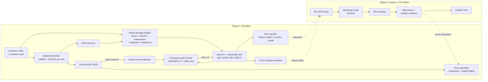

# Phase 2 plan: Crime Scene Investigator

Status: approved 28 Oct 2026 (native in-process route, branch `phase2-csi`).
Due Mon 9 Nov 2026. **Stage A progress: A1-A6 built (28-29 Oct); checklist with evidence in
[stage_a_checklist.md](stage_a_checklist.md), waiting for your confirmation before Stage B.**
The 21 Oct plan (native Ubuntu laptop, due 3 Nov) is replaced by this one; its
decisions that still hold are carried over in section 11.

Contents
0. Step 0: environment check
1. What already exists (continued, not restarted)
2. Simulator route
3. Architecture
4. Folder layout
5. Stage A work items (A1-A6)
6. Stage A to B interfaces
7. Stage B outline (not started until Stage A is confirmed)
8. Dataset strategy
9. Schedule
10. Risks and scope cuts
11. Decisions
12. Licenses

---

## 0. Step 0: environment check

**Where the work happens.** Claude Code is running in a cloud container (Ubuntu
24.04, CPU only, no GPU), not on your Windows/WSL2 machine. Everything in
Stage A can be built and tested there headlessly: MuJoCo renders offscreen
with EGL (Mesa), and the Go2 sim runs about 3x faster than real time. Things
that need **your** machine:
- the interactive MuJoCo viewer and keyboard teleop (WSLg window);
- the GPU (RF-DETR training in Stage B);
- the browser checks (GUI at `http://localhost:<port>` from Windows).

So for each milestone I push to `phase2-csi`, you `git pull` in WSL, and run the
one-line commands in the README to confirm.

**Results in the cloud container (28 Oct):**

| Check | Result |
|---|---|
| Simulator submodule `d6e5464` (= upstream HEAD, unchanged since 20 Sep) | fetched shallow, 519 MB working tree |
| Simulator's own `sim/tests/native_smoke.py`, house 185 | **ok**: Go2 stands (base 0.29 m), LiDAR 720 scan returns + 1344 points, RGB-D camera valid |
| Go2 walk test, `cmd_vel` 0.3 m/s for 4 s | moved 1.06 m, upright (z-axis 0.999), 0.31 s wall time per sim second |
| Existing unit tests | 44 passed |
| `MUJOCO_GL=egl` offscreen rendering | ok (software) |

**To run on your WSL2 machine** (read-only, no sudo), then paste me the output:

```bash
lsb_release -a; uname -r; echo "WSL distro: $WSL_DISTRO_NAME"
nvidia-smi
pwd                       # must NOT start with /mnt/c
cd Phase_2_Investigator && ./scripts/setup.sh --check
```

`setup.sh --check` now also covers: WSL1 vs WSL2, repo under `/mnt/c`, WSLg,
Node, uv, Docker + Compose (marked optional), PyTorch + CUDA, and an offscreen
MuJoCo render with egl / glfw / osmesa.

What to do if something fails:
- `nvidia-smi` fails inside WSL: update the NVIDIA driver **on Windows**
  (GeForce/Studio or RTX Enterprise driver from nvidia.com). Never install a
  Linux NVIDIA driver inside WSL.
- WSLg missing (no windows open): in PowerShell `wsl --update`, then
  `wsl --shutdown` and reopen Ubuntu. Test with `sudo apt install x11-apps`
  then `xeyes` (I will ask before any sudo).
- PyTorch without CUDA (Stage B only):
  `pip install torch torchvision --index-url https://download.pytorch.org/whl/cu124`.
- Repo under `/mnt/c`: clone it again under `~` (10-50x faster file access).
- **Docker is not needed** for the chosen route (section 2). If you want it
  anyway: install Docker Desktop for Windows, Settings -> General ->
  "Use the WSL 2 based engine", Settings -> Resources -> WSL Integration ->
  enable `Ubuntu-22.04`, Apply & Restart; then in WSL `docker run hello-world`
  and `docker run --rm --gpus all nvidia/cuda:12.4.1-base-ubuntu22.04 nvidia-smi`.

## 1. What already exists (continued, not restarted)

Branch `phase2-csi` (5 commits, 21 Oct) already has:
- **Spatter generator** (`sim_env/spatter/`): ballistic droplets with gravity +
  quadratic drag for impact, cast-off, projected, drip and transfer; stains as
  ellipses with sin(alpha) = W/L along the travel direction, tails, satellites;
  full ground truth; RGBA decal textures per surface. It hits analytic box
  surfaces; its `SurfaceSet.first_hit` was designed so a MuJoCo ray-cast
  version can replace it.
- **Scenarios**: 4 YAML configs (stand-alone rooms) + seeded random generator.
- **Weapon mapping** YAML with reliability notes.
- **BPA maths, mechanism classifier and evaluation** (`analysis/`, `training/`,
  `evaluation/`). This is Stage B work done before the staging rule. It stays
  as it is, its tests keep running, and I will **not extend it** until you
  confirm Stage A.
- `scripts/setup.sh`, `scripts/download_weights.sh`, README, 44 tests.

## 2. Simulator route

The brief lists three routes. **Recommendation: a hybrid of routes 2 and 3,
"native in-process"**: run the syswonder simulator's own native Python
classes (`NativeSceneBuilder`, `Go2Controller`, `NativeSensorSuite`) inside our
process, with no Docker, ROS 2 or Robonix.

- We get the repo's real Go2 (MJCF, walking gait driven by `cmd_vel`, clamped
  to 0.4 m/s, 0.15 m/s sideways, 0.5 rad/s, 0.35 s watchdog), its MID-360
  LiDAR model, IMU and front RGB-D camera, and its houses, all untouched.
  That is more than route 3 (we don't re-implement sensors or the gait).
- It already works (section 0), with no setup fight.
- Why not the full Robonix stack (route 1): it needs the `rbnx` CLI and source
  tree, gRPC services, a VLM key for Pilot/Scene, and Docker images built from
  Chinese mirrors; Nav2/RTAB-Map/explore only come through it. That is several
  days of risk for features we can replace with ~500 lines of our own code.
- Why not route 2 as written (ROS 2 topics): the ROS 2 bridge lives in a
  Docker container; going through it adds Docker + ROS 2 Humble to your WSL
  for the same data we can read directly from Python.
- What we give up: Nav2, RTAB-Map and the Robonix explore skill. We write our
  own occupancy grid, frontier exploration (adapting the repo's
  `frontier.py`, MulanPSL-2.0), A* and local obstacle avoidance (A4).
- Our velocity interface mirrors ROS `cmd_vel` (`linear.x`, `linear.y`,
  `angular.z`), so a ROS 2 or real-Go2 (`SportClient.Move`) backend can be
  added later without touching navigation code.
- The simulator stays a pinned, shallow **git submodule** at
  `third_party/robot-unitree-go2-mujoco`. Our scenes are built into
  `sim_env/build/` (gitignored) as environment packages in the simulator's
  format (`scene.xml`, `index.json`, `spawn.json` + a merged
  `manifest.json`), so their tree is never modified.

## 3. Architecture



## 4. Folder layout

```
Phase_2_Investigator/
  sim_env/        spatter/        physics, mechanisms, stains, raster (exists) + mj_surfaces.py (ray cast)
                  scenarios/      configs/*.yaml (5), random_scenario.py
                  config/         weapon_mapping.yaml
                  scene_builder/  package.py (env package), decals.py, mannequins.py, props.py
                  runtime.py      SimSession: load scenario, step, cmd_vel, sensors, collisions
                  interfaces.py   dataclasses shared with Stage B (section 6)
                  playback.py     event playback from an EventDescription
                  build/          generated scene packages (gitignored)
  navigation/     velocity.py, occupancy.py, frontier.py, planner.py (A*), local.py (safety),
                  explorer.py, inspect.py, collisions.py
  perception/     (Stage B) rfdetr_detector.py, bloodstain_sam.py, classical_droplets.py
  analysis/       (exists, frozen) bpa/, classifier/
  gui/            (Stage B) server.py, static/
  training/       (exists) train_mechanism_classifier.py; build_coco_dataset.py (A6)
  evaluation/     (exists) results/
  tests/          pytest (unit tests run headless, no GPU)
  scripts/        setup.sh, run_sim.sh, teleop.py, sensor_viewer.py, explore.py,
                  inspect.py, playback.py, record_run.py, export_coco.py, make_media.sh
  docs/           plan.md, recording_format.md, phase2_summary.md, media/
  third_party/    robot-unitree-go2-mujoco (submodule, pinned, shallow)
```

## 5. Stage A work items

**A1 Simulator running: DONE 28 Oct.** Evidence in `docs/media/`:
- `a1_check.json`: `run_sim.sh --mode check` passes 15/15 checks in houses 185 and 186. The Go2 stands, and walks forward, back, turns, strafes and stops on cmd_vel. RGB works. Depth matches an independent ray cast to under 1 mm. The 720-ray scan and ~1,350-point cloud work. IMU reads |a| = 9.81 m/s^2. Pose is reported, and there are no collisions.
- `a1_teleop_viewer.png`: the MuJoCo viewer with a camera that follows the robot. Teleop was tested with injected key presses on a virtual X display.
- `a1_sensor_viewer_live.png`, `a1_sensors_house185.png/.gif`, `a1_sensors_house186.png`.
- Found and fixed: `mj_multiRay` holes in depth (section 10).

Plan for A1 as written:
- `sim_env/runtime.py` `SimSession`: builds the scene, loads the Go2, steps
  physics, takes `cmd_vel`, returns sensors through the interfaces below.
- `./scripts/run_sim.sh --scenario N [--mode teleop|explore|inspect|playback|record] [--headless]`.
- Teleop in the native MuJoCo viewer (WSLg window): W/S forward/back,
  A/D turn, Q/E strafe, Space stop. The passive viewer only reports key
  presses, not releases, so each press steps the target speed up or down,
  Space zeroes it, and the gait's 0.35 s watchdog is kept alive by our loop.
  Fallback: a simple GLFW camera window with the same keys (`--mode teleop-simple`).
- `scripts/sensor_viewer.py`: live RGB, depth (colour map), 2D LiDAR scan
  (polar plot), the 3D point cloud (top and side views), IMU and odometry
  readouts; `--snapshot` writes PNGs to `docs/media/` as evidence.

**Status of A2-A6 (29 Oct): built.** These changed from the plan below:
- Stains are geometry, not textures. MuJoCo 3.3.7 drops texture alpha, so each stain is a flat ellipsoid with the exact ground-truth size and direction, plus a tail and satellites.
- Droplets land on the visible meshes (ray cast), not on the houses' coarse collision boxes.
- Two house-186 areas behind the bed are unreachable for the robot, so S3 moved to the bedroom's north-east corner.
- Exploration is LiDAR frontiers followed by a camera-coverage patrol: the LiDAR sees a whole room from one spot, but the camera needs to get close.
- Inspection close-ups emulate the Go2's body pitch, which the sim gait cannot do.
- Evidence is in `docs/media/` and `stage_a_checklist.md`.

**A2 Procedural bloodstains in the sim**
- Add `MjSurfaces.first_hit` using `mujoco.mj_ray` against the compiled scene's
  collision geoms (house walls, floors, furniture), returning the same `Hit`
  (point, normal, local u/v frame, surface id) as the analytic version, so the
  existing generator lands droplets on real house surfaces.
- Decals: for each hit surface patch, one thin group-1 visual box 0.5 mm off
  the surface, carrying the generated RGBA texture (`contype=0`,
  `conaffinity=0`; LiDAR/depth rays only hit groups 0, 3, 5, so decals don't
  disturb the sensors). Texel size 0.5 mm, so stains read correctly from the
  camera at 0.5-3 m.
- `weapon_mapping.yaml` (exists) reviewed for the 5 mechanisms and 3 weapon
  categories, with reliable / weak inference notes.
- Tests (extend the existing 44): droplets land on the expected surfaces in a
  MuJoCo test room; the fitted ellipse of each rendered stain matches
  arcsin(W/L) within tolerance; directions point along travel; ray-cast and
  analytic hits agree.

**A3 Scenarios (5)**
1. House 185 living room: blunt blows (impact + cast-off), pipe.
2. House 185 kitchen: edged weapon, projected (arterial-style) + drip trail.
3. House 186 hallway: fall, no weapon (passive drip + transfer smear).
4. House 186 bedroom: edged-weapon cast-off + impact.
5. Simple room (fast to load, good for tests/demos): bat, impact + transfer.
Each: mannequins (capsule stick figures, with collision so LiDAR sees them),
1-3 extra obstacles in the robot's path, 2-3 red distractors (cushion, book,
towel, mug). Ground truth JSON: origin, mechanism, weapon category, swing path,
mannequin positions, every droplet's position, impact angle and direction.
`random_scenario.py --seed N` picks a house room, mechanism, positions.
The existing 4 configs move from stand-alone rooms into the house rooms
(their `binding:` field), using room bounds read from the house's
`index.json`/geometry.

**A4 Autonomous navigation**
- Occupancy grid (5 cm) from the 2D scan + pose; frontier exploration;
  A* on the inflated grid; pure pursuit; local safety layer that slows inside
  0.6 m and stops at 0.35 m from any LiDAR return in the travel direction.
  Speed limits 0.3 m/s, 0.5 rad/s.
- Collisions logged from MuJoCo contacts between robot geoms and anything but
  the floor; the run fails its check if any occur.
- Inspect point: given a world point + surface normal, plan to a standoff
  0.6 m along the normal, face it, capture 3 views (0, +25, -25 deg); for now
  fed with ground-truth stain-cluster centres.
- Sim vs real notes in `navigation/README.md`: MID-360 in sim vs L1 on the
  real Go2; perfect odometry (optional noise); camera intrinsics differ.

**A5 Event playback**
- `playback.py` takes an `EventDescription` (origin, mechanism, swing path,
  weapon category, droplet launch list) and animates it: an attacker
  mannequin (mocap capsules: torso, head, arm + weapon) performs the swing;
  droplets (small red spheres from a fixed mocap pool) fly along their
  trajectories and the decals appear when they land. Rendered live in the
  viewer and to MP4/GIF headless. Built from ground truth now; Stage B fills
  the same structure from the analysis.

**A6 Data export**
- Run recorder: `runs/<scenario>_<time>/` with RGB PNG, depth as 16-bit PNG
  (mm), `camera_info.json` (K, size, distortion = 0), `poses.jsonl`
  (robot base + camera world pose per frame), LiDAR `.npz`, `ground_truth.json`,
  `meta.json`. Documented in `docs/recording_format.md`.
- COCO renderer: many robot poses per scenario, random lighting, floor/wall
  materials, distances 0.4-3 m, distractors; labels from a second render
  where only decals are visible (segmentation render), polygonised with
  OpenCV. Classes: one per mechanism (decided 21 Oct). Split by scenario.

## 6. Stage A to B interfaces (`sim_env/interfaces.py`)

```python
CameraFrame(t, rgb: uint8[H,W,3], depth_m: float32[H,W], K: float[3,3],
            T_world_cam: float[4,4], frame_id)
LidarScan(t, ranges: float[N], angle_min, angle_increment,
          points_world: float[M,3], T_world_lidar)
RobotState(t, pose_xyz_yaw, T_world_base, twist, imu: {gyro, accel, quat})
GroundTruth  (loaded from ground_truth.json; Stage B evaluation only)
EventDescription(origin, mechanism, weapon_category, swing_path,
                 launches, source: "ground_truth" | "analysis")
```
Camera convention: OpenCV (x right, y down, z forward), depth in metres along
the optical axis. Every Stage B component consumes these, whether live or from
a recorded run.

## 7. Stage B outline (not started until Stage A is confirmed)

B1 RF-DETR-Seg Small fine-tune on the A6 dataset (GPU, your machine) + SAM
droplet wrapper with an OpenCV fallback; B2 BPA (mostly exists) + projection
from live frames + evaluation graphs; B3 live pipeline replacing ground-truth
stain locations; B4 FastAPI + WebSocket GUI with three.js reenactment and HTML
report. Detail from the 21 Oct plan stays valid and goes into this section
when Stage B starts.

## 8. Dataset strategy

- ~40-60 random scenarios + the 5 built-in ones, 60-100 poses each,
  ~4-6k images at 640x480 (detector input), evidence close-ups at 1920x1080
  for droplet analysis (the sim camera at 320x240 is too coarse for droplets:
  1 px ~ 5 mm at 1 m).
- Rendering speed: in the CPU container a 320x240 frame is fast enough; the
  dataset can be rendered there or on your machine. Datasets are gitignored.
- Hard negatives: distractors are unlabelled; we report their false-positive
  rate in Stage B.

## 9. Schedule

| Date | Target |
|---|---|
| Oct 28 | Step 0 done (container), plan approved, route confirmed; **A1**: run_sim.sh, teleop, sensor viewer |
| Oct 29-30 | **A2** ray-cast landing + decals in the house scenes + tests; **A3** 5 scenarios + random generator |
| Oct 31-Nov 1 | **A4** exploration, safety, collision log, inspect behaviour |
| Nov 2 | **A5** playback, **A6** recorder + COCO export, media, Stage A checklist -> you confirm |
| Nov 3-4 | B1 RF-DETR + SAM wrapper; B2 BPA on sim frames + evaluation |
| Nov 5-6 | B3 live pipeline; B4 GUI |
| Nov 7-8 | Buffer, docs, phase2_summary.md, demo video |
| Nov 9 | Submit |

## 10. Risks and scope cuts

- **WSLg viewer performance**: WSLg OpenGL goes through Mesa's D3D12 driver on
  your NVIDIA GPU; usually fine. Fallback: offscreen rendering shown in a plain GLFW window.
- **House scene load time / stain decal count**: many textured decals can slow
  compile and rendering; we merge stains per surface patch (tens of decals, not
  thousands).
- **Gait limits**: 0.4 m/s max and a trot gait that may catch on rugs or
  thresholds; we keep planners conservative and log stalls.
- **Mapping houses to scenario rooms**: room bounds must be extracted from
  house geometry; if that is slow, scenarios 3-4 use simple rooms.
- **Your machine is not reachable from here**: viewer/teleop/GPU steps rely on
  you running a command and sending me the output; I keep them to one-liners.

Cuts if Stage A runs late (in order): fewer house-based scenarios (simple
rooms instead); playback rendered to video only (no live viewer); then in
Stage B skip RF-DETR fine-tuning and use colour-threshold detection.

- **mj_multiRay misses (found 28 Oct)**: MuJoCo 3.3.7's batched ray cast misses some box geoms that `mj_ray` hits. This affects up to ~9% of depth pixels near doorways, ~0.5% of 3D LiDAR rays, and 0% of the 2D scan. Fixed for depth by re-casting only the missing pixels (+~10 ms per frame). The simulator itself is untouched.
- **GPU: RTX 3060 Ti, 8 GB** (confirmed 28 Oct). For Stage B, use RF-DETR-Seg Small or Nano with batch 2-4 and gradient accumulation 4-8. Mixed precision is on. Expect several hours for ~5k images; Nano is the fallback. Stage A needs no GPU.

## 11. Decisions

Carried over from 21 Oct: simulator as a pinned shallow submodule; RF-DETR
classes = one per mechanism, fused with the pattern classifier; 1920x1080
evidence close-ups.

Answered 28 Oct 2026:
1. Route: native in-process (section 2), no Docker / ROS 2 / Robonix.
2. Branch: commits go to `phase2-csi`.
3. Scenarios: 4 in houses 185/186 + 1 simple room (section 5, A3).
4. Machine: Windows + WSL2 Ubuntu 22.04 with an RTX 3060 Ti (8 GB).

## 12. Licenses

Our code: same as this repo. Simulator: MIT / Apache-2.0 / BSD-3 (Go2 model) /
MulanPSL-2.0 (explore skill), used unmodified as a submodule; adapted frontier
code keeps its MulanPSL-2.0 notice. RF-DETR and its seg models: Apache-2.0.
Bloodstain SAM: code MIT, model Apache-2.0.
