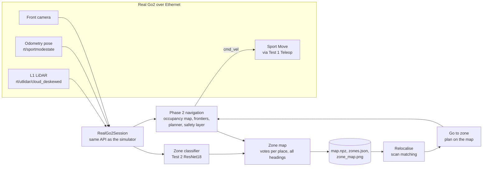

# Stage R: the real Go2 maps the lab itself, then becomes the crime-scene dog

Started 17 Nov 2026. Test 2 is submitted and frozen; everything new lives in `Phase_2_Investigator/`.
Test 2 code and models are reused (imported or copied), never changed. The laptop is now **native Linux**,
driven from the terminal (Claude Code in the terminal), so nothing here needs VS Code, WSL or a GUI.

## 1. Where Test 2 left off, and what changes

Test 2's go-to-zone got better in two steps (`Test2/REPORT.md` 7.3–7.8):

**1. Camera only (7.3).** *Where am I* came from the majority of one look-around, *which way* from the
direction where the target looked most likely. The lab data shows why that is fragile (7.6):
- The camera sees where the dog faces, not where it stands. Open-area accuracy was 0.24 facing one way
  and 0.90 facing another.
- Errors come in streaks of up to 8.8 s.
- In the lab trials it wandered when the target wasn't in view, and in the replayed real-map simulation
  6 of 36 requests stopped in the wrong zone.

**2. Zone map from the recordings (7.7–7.8).** `Test2/real_go2/zone_map.py` aligned the five labelled
recording sessions into one map: P(zone | place) and the area the dog had walked. A histogram filter
localises the dog on it from classifier evidence plus odometry:
- median 0.61 m error once localised;
- first localised after 52 s of walking.

On the real dog: **6 of 6** completed requests arrived in the filmed run, with 6 more cancelled by the
operator.

**What that map can't do, and what Phase 2 adds:**

| | Test 2 zone map | Phase 2 Stage R |
|---|---|---|
| Who makes the map | You: drive and press zone keys in 5 recording sessions | **The dog: it explores on its own** |
| What the map knows | Where the dog walked, and the zone labels you keyed in | **The room's walls and furniture (LiDAR occupancy map)**, and zone votes from the camera at every place, from every direction |
| Where it can go | Only along walked corridors | Anywhere the LiDAR saw free, with real obstacle clearance |
| Localisation | From the classifier (needs a walk through 2–3 zones; 0.6 m) | **From the LiDAR geometry** (one look-around; independent of classifier mistakes) |
| New room or moved furniture | Record and label again | Run `map_zones.py` again |

The two combine well. The labelled recordings can later anchor the dog's own map (step R6), and both use
the same classifier.

## 2. Steps

| Step | What | Status (17 Nov) |
|---|---|---|
| **R0** | Linux laptop, terminal only: setup, network, Claude Code notes (`CLAUDE.md`) | Written; to run on the laptop |
| **R1** | `real_robot/session.py`: the real dog behind the simulator's session API, so Phase 2's navigation runs on it unchanged | Built. Unit-tested, and driven end to end through the simulator (`--link sim`) |
| **R2** | `scripts/real_check.py`: sensors-only check, the dog does not move (pose, LiDAR, floor height, camera, classifier, map snapshot) | Built, tested with `--link sim` |
| **R3** | `mapping/`: zone map, autonomous mapping (`scripts/map_zones.py`) | Built, scored in simulation (section 3) |
| **R4** | `scripts/goto_zone.py`: relocalise on a saved map, plan, drive, confirm with a look-around | Built, tested in simulation (section 3) |
| R5 | Lab session: `real_check` → `map_zones` → `goto_zone` trials; tune `--body-height`, speeds and the scan band | **Next, needs the dog** |
| R6 | Better zone evidence: align Test 2's labelled recordings (`zone_map.npz`) to the LiDAR map as a prior; operator anchors while mapping (press 1–4 to tag the current place); more varied training sessions | Later |
| R7 | Drift: odometry drifts over a long run; correct it continuously with the same scan matching as relocalisation | Later, if the lab map shows doubled walls |

### Crime-scene dog on the real robot (after R5)

Phase 2 Stage A built the crime-scene investigator in simulation:
- spatter physics;
- 5 scenarios;
- exploration with a camera-coverage patrol;
- the inspect behaviour;
- event playback;
- the COCO stain dataset.

Stage B (analysis + GUI) was outlined but not started. Bringing it to the real dog:

| Step | What | Builds on |
|---|---|---|
| **C1** | **Evidence in the lab:** non-graphic red stain prints on paper or poster board, taped to walls and floor (removable), plus red distractors. Ground truth is measured with a tape. | Phase 2's stain shapes (`sim_env/spatter`) can be printed to scale |
| **C2** | **Stain detector:** first a colour + shape detector (no GPU); then RF-DETR-Seg fine-tuned on the Phase 2 COCO set plus real photos from the dog's camera | Phase 2 A6 dataset, plan section 7 (B1) |
| **C3** | **Evidence on the map:** detection → camera ray → floor plane (known camera height) or LiDAR wall → a marker on the zone map, e.g. "stain cluster in lab_2 at (x, y)" | R3 zone map, `sim_env/interfaces.py` CameraFrame |
| **C4** | **Search mission:** map the lab, patrol so the camera sees every surface, inspect each cluster from 2–3 angles, never drive over evidence (evidence cells become obstacles in the costmap) | `navigation/coverage.py`, `navigation/inspect.py`, Test 2 Q3 |
| **C5** | **Analysis and report:** impact angle from each stain's ellipse (W/L = sin α), directionality, area of origin, mechanism; one report per zone | `analysis/bpa`, `analysis/classifier` (exist) |
| **C6** | **Reenactment and GUI:** event playback from the analysed event; a browser page served from the laptop | Phase 2 A5 playback, plan B4 |

## 3. Results so far (simulation)

See `outputs/zone_map/` and `docs/media/stage_r_*`. Every number below is from the run's `report.json` /
`outputs/goto/*.json`.

*(Filled in by the runs in this commit: see the README section "Stage R".)*

## 4. Things I need from you

1. **Lab model file:** copy `Test2/results/real_q1/resnet18/best.pt` from the old laptop to the same path
   on the Linux laptop. It is not in git (45 MB).
2. **First lab session:** run `scripts/real_check.py`, then a short `map_zones.py --backend real
   --max-time 300`, and send me `outputs/real_check/*/report.json` and the `outputs/zone_map/real_*`
   folder.
3. **Crime-scene evidence (C1):** what can you put in the lab? For example printed red stain patterns
   on paper. Is that allowed there?
4. **Does the lab layout stay the same between sessions?** Saved maps and relocalisation assume the walls
   and big furniture don't move.
5. **GPU on the Linux laptop?** It decides whether C2 starts with RF-DETR or with the colour detector.
