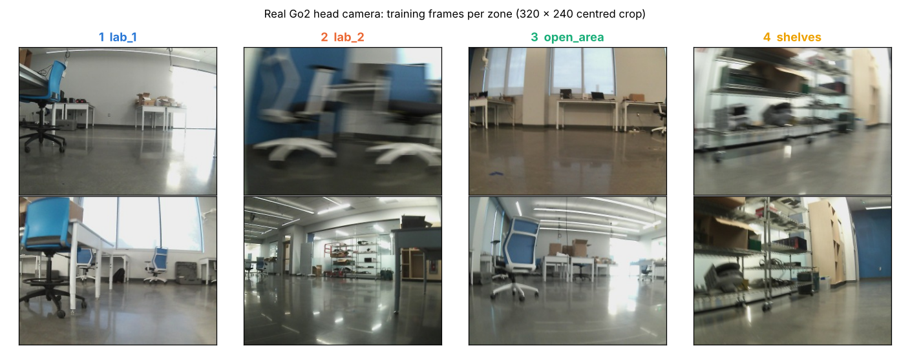
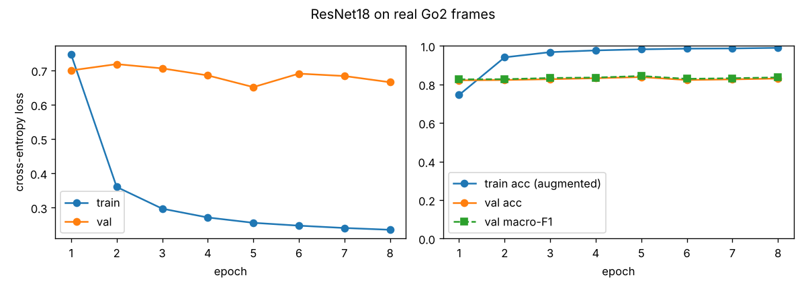
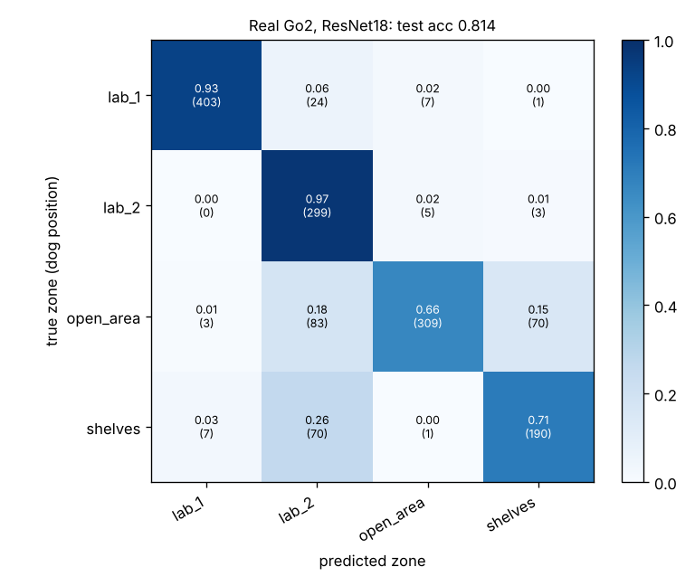
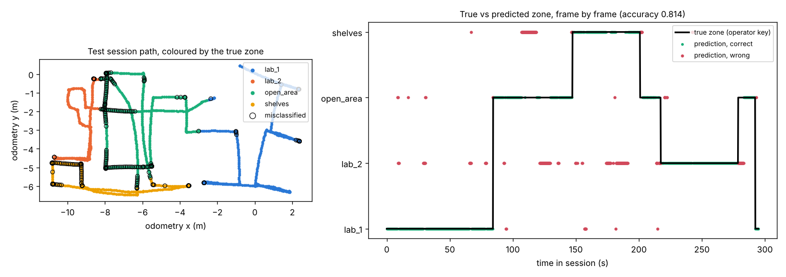
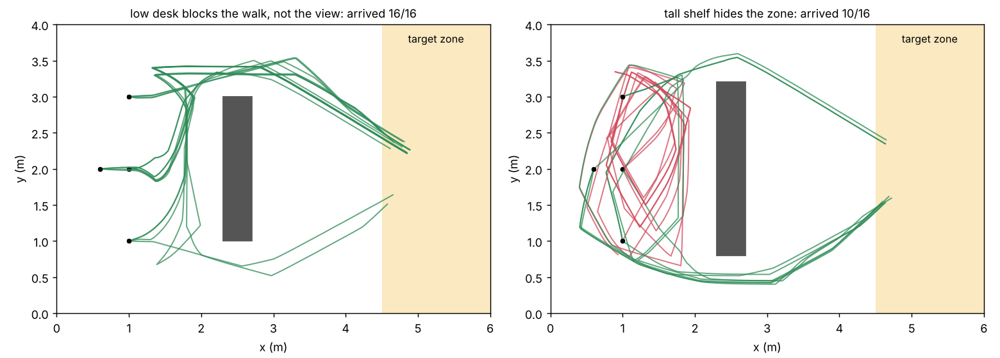

# Unitree-Dog-Claude-Dog-
Store the files needed to run the Unitree Go2

## Test 2 (ENG 6010): Go2 crime-scene search dog

A simulated Unitree Go2 walks through a MuJoCo crime scene, records a multi-sensor dataset (Q2), recognises
which zone of the scene it is in from its camera (Q1, ResNet18), and learns an evidence-search policy with PPO
that is deployed on the full MuJoCo Go2 (Q3). Write-up, results and reproduction commands:
[Test2/README.md](Test2/README.md). The full report is [Test2/REPORT.md](Test2/REPORT.md)
([PDF](Test2/Test2_Report.pdf)).

| | Result |
|---|---|
| **Q2** data (simulation) | 36 runs, 17,123 zone-labelled camera frames plus IMU, joints, foot contacts and pose at 50 Hz |
| **Q1** zone classifier (simulation) | ResNet18 **0.882** test accuracy (0.880 on an unseen scene); **0.911** live in MuJoCo |
| **Q1 on the real Go2** | **0.814** accuracy on a held-out lab session, trained on 3 recorded walks (details below) |
| **Q3** RL search (simulation) | PPO finds all evidence from **0.667** of 60 starts on the legged MuJoCo Go2 (planner 0.650, greedy 0.183) |

---

## Q1 on the real Go2: "which part of the lab am I in?"

The real dog learns to recognise **which zone of the lab it is in** from its head camera alone, using the
same training recipe as the simulated Q1. The lab is split into four zones:

| Key | Zone | What it is |
|---|---|---|
| 1 | `lab_1` | the desks on one side of the room |
| 2 | `lab_2` | the desks on the other side |
| 3 | `open_area` | the open floor between them |
| 4 | `shelves` | the shelves with the wires |

### How it works
1. **Record:** the dog is driven around the lab over Ethernet (keyboard teleop), and the operator presses
   the number of the zone it is in. Each session saves camera frames at 5 Hz plus the commands and the
   dog's odometry pose.
2. **Train:** an ImageNet-pretrained **ResNet18** is fine-tuned to map one camera frame to one of the four
   zones.
   - Sessions 1–3 are used for training, session 4 for validation, and session 5 is held out as the test.
   - The test is a full walk the model has never seen.
3. **Use:**
   - `live_zone.py` shows the predicted zone live on the dog's camera.
   - `goto_zone.py` sends the dog to a zone you pick. It looks around, picks the direction where the
     target zone appears, and walks there, using the LiDAR to go around obstacles.

*What the dog sees: two training frames per zone from the Go2's head camera. The real camera adds motion
blur when turning (lab_2, top), window glare and floor reflections.*

### The data
| Session | Used for | lab_1 | lab_2 | open_area | shelves | Frames |
|---|---|---|---|---|---|---|
| run_000 | train | 588 | 311 | 576 | 485 | 1,960 |
| run_001 | train | 295 | 554 | 417 | 250 | 1,516 |
| run_002 | train | 292 | 270 | 320 | 328 | 1,210 |
| run_003 | validation | 247 | 276 | 361 | 301 | 1,185 |
| run_004 | **test** | 435 | 307 | 465 | 268 | 1,475 |
| **Total** | | 1,857 | 1,718 | 2,139 | 1,632 | **7,346** |

All five sessions were recorded on 11 Nov 2026, about 24.5 minutes of labelled walking in total.

### Training
- ResNet18 (11.2 M parameters), ImageNet weights, 8 epochs, batch size 32.
- Colour and crop augmentation, and a class-weighted loss.
- It trained on the laptop CPU in **10,116 s (about 2.8 h)**.
- The best validation macro-F1 was **0.843** (epoch 5); that checkpoint is the one tested.

*Training accuracy climbs to 0.99, while validation stays at 0.82–0.84 from the first epoch. With only
three training walks, the limit is how well one walk's views carry over to another, not training time.*

### Success rates on the held-out session
| Measure | Result |
|---|---|
| **Accuracy** (1,475 frames) | **0.814** |
| Macro-F1 | 0.803 |
| Accuracy with a 1 s majority vote | 0.820 |
| Simulated Q1, for comparison | 0.882 |

| Zone | Correctly recognised (recall) | Precision | F1 |
|---|---|---|---|
| lab_1 | **0.926** | 0.976 | 0.951 |
| lab_2 | **0.974** | 0.628 | 0.764 |
| open_area | **0.664** | 0.960 | 0.785 |
| shelves | **0.709** | 0.720 | 0.714 |

*Rows are the true zone, columns the prediction. lab_1 and lab_2 are almost never confused with each
other. Most errors are open_area or shelves frames called lab_2.*

*The test walk. Left: the dog's path, coloured by the true zone, with every wrong frame circled. Right:
the true zone over time (black) and each prediction (green right, red wrong).*

### What we found
- **It works on a walk it has never seen:** 0.814 accuracy from about 15 minutes of training walks.
  That is 7 points below the simulator, a reasonable cost for real images.
- **The camera sees where the dog *faces*, not where it *stands*.** The open area sits between the other
  zones, so looking out from it you mostly see desks or shelves. Its accuracy depends on the heading:
  0.24 facing one way and 0.90 facing another. The simulator showed the same effect.
- **Errors come in streaks** of up to 8.8 s while the dog faces one way, so a 1 s vote helps little (0.814
  → 0.820). This is also why go-to-zone decides "have I arrived?" from a full turn on the spot, which
  averages over every direction, rather than from one view.
- **Confidence is meaningful:** the 67 % of frames predicted with ≥ 0.9 confidence are 0.908 accurate.
- **Found in the lab:** the Go2's LiDAR is mounted upside down. In its raw cloud the floor looked like an
  obstacle 5 cm away in every direction. Switching to the deskewed, odometry-frame cloud fixed it, before
  any autonomous motion.

### Go to zone: obstacle-aware navigation (simulation check)
Before the robot trials, the navigator was tested in a simulated 6 × 4 m room. Each layout was run from
4 starts × 4 headings:

| Layout | Reached the zone | Closest approach to the obstacle |
|---|---|---|
| A desk blocks the way (zone visible) | **16/16** | 0.26 m from the dog's centre |
| A shelf hides the zone | **10/16** | 0.25 m |

*Every simulated run: green arrived, red ran out of exploration. No run hit the obstacle.*

### Video
*Coming soon: the live zone recognition and go-to-zone trials on the real dog.*

The numbers above come from the files in [`Test2/results/real_q1/`](Test2/results/real_q1/). How to
reproduce them, and how to run everything on the dog, is in [`Test2/real_go2/README.md`](Test2/real_go2/README.md)
and [`Test2/real_go2/LAB_PLAN.md`](Test2/real_go2/LAB_PLAN.md). The full analysis is section 7 of the
report.
