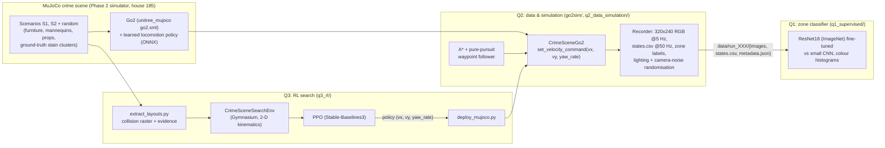

# ENG 6010 Test 2: a Unitree Go2 that searches a crime scene

A simulated Unitree Go2 walks through a MuJoCo crime scene (a furnished house with a staged
blood-spatter event), **records a structured multi-sensor dataset** of what it senses (Q2), uses its
head camera to **recognise which zone of the scene it is in** (Q1), and learns a
**search policy with reinforcement learning** that finds the evidence quickly without stepping on
floor stains or bumping into furniture, then runs that policy on the full physics model of the
dog (Q3). Every number in this document is read from a file in [`results/`](results/) that a script
in this folder wrote; the command that produces it is given next to it.


*The Go2 (learned locomotion policy, real contact physics) walking a route through house 185, scenario S1:
chase view, the head camera that Q1 classifies, and the top-down map with the zones.*

---

## Contents
1. [Background and motivation](#1-background-and-motivation)
2. [System overview](#2-system-overview)
3. [Setup and reproduction](#3-setup-and-reproduction)
4. [Q2: Dog data and simulation](#4-q2-dog-data-and-simulation)
5. [Q1: Supervised learning, crime-scene zone classifier](#5-q1-supervised-learning-crime-scene-zone-classifier)
6. [Q3: Reinforcement learning, evidence search](#6-q3-reinforcement-learning-evidence-search)
7. [Limitations and future work](#7-limitations-and-future-work)
8. [How Test 2 builds on Test 1](#8-how-test-2-builds-on-test-1)
9. [Repository layout and what is not in git](#9-repository-layout-and-what-is-not-in-git)
10. [References](#10-references)

---

## 1. Background and motivation

Searching a crime scene is slow, and every person who walks through it risks contaminating evidence:
a shoe print in a blood pool, a smeared drip trail, a moved object. A quadruped robot can move through
cluttered indoor spaces, recognise where it is, record everything it senses, and plan routes that
reach every piece of evidence **without stepping on it**. This project builds three pieces of that
system on the Unitree Go2:

* **Q1, supervised learning:** the dog recognises which zone of the crime scene it is in from a single
  head-camera frame (coarse visual localisation).
* **Q2, data and simulation:** the dog walks through the MuJoCo crime scene while we record a real,
  structured dataset of everything it senses (camera, IMU, joints, foot contacts, pose, commands).
* **Q3, reinforcement learning:** the dog learns a search policy that finds all evidence quickly while
  avoiding floor stains (contamination) and obstacles (collisions).

Q2 data trains Q1, and the Q2 scene and locomotion controller are the basis of the Q3 environment
and of its deployment.

## 2. System overview



* **Q2 → Q1:** the Q2 recorder labels every frame with the zone of the dog's base position
  ([`config/zones.yaml`](config/zones.yaml)); Q1 trains on those frames, split by run.
* **Q2 → Q3:** the RL environment's walls, furniture and evidence are exported from the same MuJoCo
  scenes, and its action is the same `set_velocity_command(vx, vy, yaw_rate)` interface, so the
  trained policy drives the Q2 Go2 unchanged.

## 3. Setup and reproduction

Tested here on Linux (Ubuntu, Python 3.13, CPU only, 4 cores) with MuJoCo 3.3.7. All commands run
from `Test2/`.

```bash
git clone https://github.com/CDJ7/Unitree-Dog-Claude-Dog-.git && cd Unitree-Dog-Claude-Dog-
git checkout claude/eng6010-test2-crime-scene-0rst3r
git submodule update --init --depth 1 Phase_2_Investigator/third_party/robot-unitree-go2-mujoco   # simulator (~520 MB)
cd Test2
pip install -r requirements.txt
# headless rendering (Linux): EGL, with OSMesa as the automatic fallback
sudo apt install -y libegl1 libegl-mesa0 libosmesa6 libgl1-mesa-dri
python -m pytest -q tests          # 9 tests: zones, planner, Q3 environment
```

| Step | Command | Output |
|---|---|---|
| Q2 dataset (36 runs) | `python q2_data_simulation/collect_dataset.py --workers 4` | `data/full/run_000 ... run_035` |
| Q2 figures + stats | `python q2_data_simulation/analyze.py` | `results/q2/*` |
| Q2 GIF | `python q2_data_simulation/make_gif.py` | `results/q2/go2_crime_scene.gif` |
| Q1 baselines | `python q1_supervised/baselines.py` | `results/q1/hist_*/` |
| Q1 ResNet18 (2,524 s here) | `python q1_supervised/train.py --model resnet18` | `results/q1/resnet18/` |
| Q1 small CNN (~650 s/epoch here) | `python q1_supervised/train.py --model smallcnn` | `results/q1/smallcnn/` |
| Q1 evaluation | `python q1_supervised/evaluate.py` | `results/q1/metrics.json`, figures |
| Q1 Grad-CAM, demo | `python q1_supervised/gradcam.py`; `python q1_supervised/demo.py` | `gradcam.png`, `demo_run_000.*` |
| Q3 layouts (~15 s per scene) | `python q3_rl/extract_layouts.py` | `q3_rl/layouts/` |
| Q3 PPO | `python q3_rl/train_ppo.py` (continue: `--resume`) | `results/q3/ppo/` |
| Q3 evaluation | `python q3_rl/evaluate.py` | `results/q3/eval_metrics.json`, figures |
| Q3 MuJoCo deployment | `python q3_rl/deploy_mujoco.py --layout s2` | `results/q3/deploy_s2.gif` |

Colab notebooks (clone the repo, `cd Test2`, install, run): [`q1_supervised/Q1_colab.ipynb`](q1_supervised/Q1_colab.ipynb)
and [`q3_rl/Q3_colab.ipynb`](q3_rl/Q3_colab.ipynb) (saves checkpoints to Google Drive and resumes).

Seeds are fixed in every config ([`config/collect.yaml`](config/collect.yaml) `seed: 2026`,
[`config/q1_train.yaml`](config/q1_train.yaml) `seed: 6010`, [`config/q3_ppo.yaml`](config/q3_ppo.yaml) `seed: 6010`),
and every training run writes its full hyper-parameters and library versions to a `train_config.json`
next to its results.

---

## 4. Q2: Dog data and simulation

### 4.1 Simulation setup
* **Scene:** `scenesmith_house_185` from the Phase 2 simulator: a furnished living room (6.0 x 4.5 m)
  and a bathroom (2.2 x 2.4 m) with about 100 textured furniture meshes and box colliders. Each
  scenario adds mannequins, props, distractors (red cushion/book/mug that are *not* blood) and a
  physically simulated blood-spatter event whose stains land on the walls, floor and furniture.
  Six scenes were used for data: S1 (pipe, impact + cast-off), S2 (knife, projected + drip trail) and
  four seeded random scenarios `r1851`-`r1854` in the same house.
* **Go2 model:** the official `unitree_mujoco` `go2.xml` (12 torque-driven joints, real contacts),
  unchanged.
* **Locomotion controller:** `unitree_rl_gym` ships pretrained deploy policies only for G1/H1/H1_2,
  not the Go2 (checked in Step 0, see [`PLAN.md`](PLAN.md)), so the brief's preferred option was not
  available. Instead the dog is driven by the **learned Go2 locomotion policy ("MoE Rough", ONNX)
  that ships with the simulator**: velocity command in, joint position targets out at 50 Hz, tracked by
  PD torque control (kp 20, kd 0.5). It walks with a real trot gait, it does not slide. The
  scripted trot of the simulator is kept as a fallback (`controller="scripted"`).
  One interface: [`go2sim/go2_env.py`](go2sim/go2_env.py) `CrimeSceneGo2.set_velocity_command(vx, vy, yaw_rate)`,
  clipped to the gait limits 0.4 m/s, 0.15 m/s, 0.5 rad/s.
* **Lights:** house 185 has no light sources, so three dimmable ceiling lamps are added at load time
  (inside `Test2/`, no shared files changed).

### 4.2 Movement through the scene
[`go2sim/waypoint_follower.py`](go2sim/waypoint_follower.py): an A* path on the 5 cm occupancy grid
built from the MuJoCo collision geometry (Phase 2 planner, robot radius 0.24 m), followed by pure
pursuit (lookahead 0.35 m) with a cross-track strafe term, turn-in-place for large heading errors,
replanning when off the path and stuck detection. [`config/collect.yaml`](config/collect.yaml) defines
4 hand-made routes (clockwise tour, counter-clockwise tour, victim-first slow, fast sweep; different
starts, zone orders and speeds 0.2-0.4 m/s) plus 2 random routes (random zone sequences, speeds and
in-place spins) per scene. An adaptive dwell (extra spins) is added in under-sampled zones to keep the
classes balanced.

### 4.3 Sensors and data pipeline
Modelled on `unitree_go2_create_dataset` (its `RobotState.msg` fields: IMU, motor q/dq/tau, foot
force, velocity command):

* **Front RGB camera** on the head (`base_link` + [0.32, 0, 0.12] m, 60 deg vertical FOV), 320x240 at 5 Hz.
* **State at 50 Hz** in `states.csv`: base pose (position, quaternion, yaw), world and body velocities,
  IMU (quaternion, gyro, accelerometer), all 12 joints' position/velocity/torque, foot forces and
  contact flags (> 5 N), velocity command, zone label, frame index linking each image to its state row.
* **Zone labels** from the base (x, y) and the polygons in [`config/zones.yaml`](config/zones.yaml):

  | id | zone | area |
  |---|---|---|
  | 0 | victim_area | x 0-1.8 (where the victim mannequin lies) |
  | 1 | bed_area | x 1.8-4.4, y 2.4-4.5 |
  | 2 | lounge_area | x 1.8-4.4, y 0-2.4 |
  | 3 | desk_entry_area | x 4.4-6.0 |
  | 4 | bathroom | x 6.0-8.2, y 1.05-3.45 |

* **Randomisation per run:** headlight ambient/diffuse, lamp intensities and positions, colour tint;
  camera noise (brightness, contrast, gamma, Gaussian noise, occasional blur, JPEG quality) ([`go2sim/randomization.py`](go2sim/randomization.py)).
* **Layout:** `data/run_XXX/{images/, states.csv, metadata.json}`; `metadata.json` holds the scene,
  route, seed, lighting, noise and camera intrinsics. Column reference: [`data/README.md`](data/README.md).

### 4.4 Dataset statistics
From [`results/q2/dataset_stats.json`](results/q2/dataset_stats.json) (`python q2_data_simulation/analyze.py`):

| | |
|---|---|
| Runs / scenes | 36 / 6 |
| Labelled frames | **17,123** (0 outside the zones) |
| State rows (50 Hz) | 171,083 |
| Simulated time / distance walked | 3,421.7 s / 573.0 m |
| Waypoints reached | 184 of 191 |
| Velocity tracking RMSE (0.3 s lag) | vx 0.064 m/s, vy 0.032 m/s, yaw rate 0.170 rad/s |
| Minimum uprightness (cos of tilt) | 0.964 |
| State rows with a robot-scene contact | 258 of 171,083 (15 runs) |

| Zone | victim_area | bed_area | lounge_area | desk_entry_area | bathroom |
|---|---|---|---|---|---|
| Frames | 2,922 | 2,845 | 5,341 | 3,629 | 2,386 |
| Share | 17.1% | 16.6% | 31.2% | 21.2% | 13.9% |

The smallest class has 0.447 of the largest. The lounge is the largest zone and every route crosses it;
Q1 uses class-weighted loss for the rest. In scene `r1854` the random scenario placed a storage box
at (6.6, 2.15), just inside the bathroom doorway, so the dog cannot enter and that scene has no bathroom frames.

| Trajectories (36 runs) | Frames per zone |
|---|---|
|  |  |


**In git:** one complete run [`data/sample/run_027`](data/sample/) (5.3 MB), the run list and config.
**Not in git:** the full 342 MB dataset; regenerate it with the command in section 3
(deterministic: same seeds, same runs).

---

## 5. Q1: Supervised learning, crime-scene zone classifier

### 5.1 Problem and data
Input: one 320x240 head-camera frame (resized to 168x224). Output: one of the 5 zones. This is coarse
visual localisation for the search robot. The 17,123 Q2 frames are split **by run**, never by frame,
so consecutive near-identical frames cannot leak between sets ([`q1_supervised/data.py`](q1_supervised/data.py)
asserts it):

| Split | Runs | Frames | What it contains |
|---|---|---|---|
| train | 20 | 10,321 | routes of scenes S1, S2, r1851-r1853 |
| val | 5 | 2,526 | one held-out route per seen scene (model selection) |
| test | 11 | 4,276 | **all 6 runs of scene r1854** (unseen props, stains, lighting) + 5 unseen routes of the other scenes |

### 5.2 Methods
* **ResNet18 transfer learning:** ImageNet-1k weights, final layer replaced by a 5-way layer, the whole
  network fine-tuned (AdamW, backbone lr 2e-4, head lr 1e-3, weight decay 1e-4, one-cycle schedule,
  label smoothing 0.05, class-weighted cross-entropy, batch 64, 8 epochs, half of the training frames
  sampled per epoch). Augmentation: random resized crop (scale 0.8-1), rotation ±5 deg, colour jitter
  (0.3 brightness/contrast/saturation, 0.03 hue); no horizontal flip (it would mirror the house).
  The download server of the torchvision weights was blocked in this environment, so the same
  ImageNet ResNet18 was taken from the ONNX Model Zoo (`resnet18-v1-7`, sha256-checked) and converted
  to torchvision, verified against onnxruntime (max relative error 7e-7)
  ([`q1_supervised/pretrained.py`](q1_supervised/pretrained.py)). On Colab torchvision's own weights are used.
* **Baselines:** (a) a small CNN trained from scratch (4 conv blocks, 1.17 M parameters, same
  augmentation, 12 epochs planned); (b) colour histograms + logistic regression: joint 8x8x8 RGB
  histogram vs joint HSV histogram, and an HSV histogram per cell of a 2x2 grid (adds coarse layout).
  The regularisation C is chosen on the validation runs.
* Config: [`config/q1_train.yaml`](config/q1_train.yaml). Code: [`train.py`](q1_supervised/train.py),
  [`baselines.py`](q1_supervised/baselines.py), [`evaluate.py`](q1_supervised/evaluate.py),
  [`gradcam.py`](q1_supervised/gradcam.py), [`demo.py`](q1_supervised/demo.py), Colab:
  [`Q1_colab.ipynb`](q1_supervised/Q1_colab.ipynb).

### 5.3 Results
Test set, 4,276 frames, from [`results/q1/metrics.json`](results/q1/metrics.json) /
[`comparison.md`](results/q1/comparison.md) (`python q1_supervised/evaluate.py`):

| Model | Test acc | Macro-F1 | Unseen scene (r1854) | Unseen routes | Acc, 1 s smoothing |
|---|---|---|---|---|---|
| **ResNet18 (ImageNet, fine-tuned)** | **0.882** | **0.887** | **0.880** | **0.883** | 0.869 |
| Small CNN (from scratch) | 0.788 | 0.794 | 0.738 | 0.832 | 0.786 |
| HSV histogram 2x2 grid + LR | 0.411 | 0.426 | 0.378 | 0.441 | 0.411 |
| HSV histogram + LR | 0.362 | 0.384 | 0.320 | 0.399 | 0.370 |
| RGB histogram + LR | 0.310 | 0.334 | 0.293 | 0.325 | 0.319 |

Per class, ResNet18:

| Zone | Precision | Recall | F1 | Support |
|---|---|---|---|---|
| victim_area | 0.860 | 0.833 | 0.846 | 663 |
| bed_area | 0.804 | 0.904 | 0.851 | 623 |
| lounge_area | 0.897 | 0.857 | 0.877 | 1,645 |
| desk_entry_area | 0.881 | 0.903 | 0.892 | 870 |
| bathroom | 0.977 | 0.966 | 0.971 | 475 |

| Confusion matrix (ResNet18) | Training curves (ResNet18) |
|---|---|
|  |  |

| Small CNN curves | Accuracy vs distance to the zone boundary |
|---|---|
|  |  |

**Grad-CAM** ([`results/q1/gradcam.png`](results/q1/gradcam.png)): per zone, the three most confident
correct test frames and the most confident mistake.


**Demo, predicted vs true zone over time** on held-out test run `run_000`
([`demo_run_000.png`](results/q1/demo_run_000.png), [`.gif`](results/q1/demo_run_000.gif),
`python q1_supervised/demo.py`): frame accuracy 0.816, 0.801 with a causal 1 s majority vote. A live
mode (`--live`) classifies the camera while the dog walks in MuJoCo.


### 5.4 Discussion
* **Transfer learning is worth it:** ImageNet features beat the same-data small CNN by 9.4 points
  overall and by 14.2 points on the unseen scene, where the from-scratch network falls off more (0.738
  vs 0.832 on unseen routes of seen scenes): it learned more scene-specific cues (props, stains). The
  ResNet barely changes between the unseen scene and unseen routes (0.880 vs 0.883).
* **Colour spaces:** HSV beats RGB by 5.2 points: separating hue from brightness makes the features
  less sensitive to the lighting randomisation. Adding a 2x2 spatial grid gains another 4.9 points.
  But colour statistics alone stay far below the CNNs (0.41 vs 0.88): the zones share the same floor,
  walls and colours, and what tells them apart is *which* furniture is visible and where.
* **Errors are at the boundaries:** at more than 0.3 m inside a zone ResNet18 is 0.969-1.0 accurate;
  within 0.3 m of a boundary it is 0.829 (`accuracy_by_distance_to_zone_boundary` in `metrics.json`).
  The label is the dog's *position*, but the camera looks *ahead*, often into the next zone; the
  Grad-CAM mistakes are exactly such frames (e.g. looking at the bed from the lounge). The largest
  confusion is lounge → bed (110 frames).
* **Grad-CAM** shows the network uses furniture and doorways (desk chair, bed, sofa, bathroom door
  frame and tiles), not the floor or the lighting.
* A 1 s majority vote did not help (0.869 vs 0.882): errors near boundaries come in runs longer than 1 s.
* The small CNN run was stopped by this environment's 2 h limit on background jobs after epoch 10 of 12;
  the checkpoint used is the best-validation epoch 9 (recorded in its `train_config.json`). Its
  validation curve is noisy, so 2 more epochs would probably change little.

---

## 6. Q3: Reinforcement learning, evidence search

Q3_SECTION

---

## 7. Limitations and future work
* **Simulation only.** Nothing here ran on the physical Go2. Sim-to-real steps: replace the
  ground-truth evidence positions by detections (the Phase 2 stain detector / a camera classifier),
  replace the raster lidar by the Go2's L1 LiDAR scans, and run the velocity commands through
  `SportClient.Move` as in Test 1's `go2_stream`, with the existing watchdog and speed limits.
* **Zone labels from position, camera looks ahead** (Q1): a label from the camera's view frustum, or
  a sequence model over several frames, would remove most boundary errors.
* **One house.** All Q1/Q3 scenes are house 185 (different events, props and lighting). Generalisation
  to another floor plan (house 186) is untested; the scripts accept it but zones would need defining.
* Q3_LIMITS
* **Compute:** everything ran on a 4-core CPU. The small CNN was stopped at epoch 10/12 by a time limit.

## 8. How Test 2 builds on Test 1
* **Phase 1 / Test 1** ([`docs/phase1_summary.md`](../docs/phase1_summary.md),
  [`docs/phase1_results/`](../docs/phase1_results/), [`go2_stream/`](../go2_stream/)): Go2 camera and LiDAR
  streaming and keyboard teleop on the real Go2 EDU, YOLO object detection, a kinematic MuJoCo world and
  a top-down object map. Test 2 keeps its top-down map style and its velocity-command interface
  (`SportClient.Move(vx, vy, yaw_rate)` ↔ `set_velocity_command(vx, vy, yaw_rate)`), so a Q3 policy
  could be sent to the real dog through the Test 1 teleop/control path.
* **Phase 2 crime-scene simulator** ([`Phase_2_Investigator/README.md`](../Phase_2_Investigator/README.md),
  [`docs/stage_a_checklist.md`](../Phase_2_Investigator/docs/stage_a_checklist.md)): Test 2 imports, without
  modifying them,
  * [`sim_env/runtime.py`](../Phase_2_Investigator/sim_env/runtime.py) `SimSession` (MuJoCo Go2 + sensors + controller),
  * [`sim_env/scenario_scene.py`](../Phase_2_Investigator/sim_env/scenario_scene.py) `open_scenario` (crime scenes with ground truth),
  * [`sim_env/scenarios/random_sim.py`](../Phase_2_Investigator/sim_env/scenarios/random_sim.py) (random scenarios),
  * [`navigation/occupancy.py`](../Phase_2_Investigator/navigation/occupancy.py) and [`navigation/planner.py`](../Phase_2_Investigator/navigation/planner.py) (grid + A*).

  What Test 2 adds on top: the learned locomotion policy behind one velocity interface, joint/foot
  logging, zone labels, lighting/noise randomisation and the dataset pipeline (Q2), the zone classifier
  (Q1), and the RL environment, training and deployment (Q3). No file outside `Test2/` was changed
  (except a link in the root `README.md`).

## 9. Repository layout and what is not in git
```
Test2/
├── README.md, PLAN.md, requirements.txt
├── config/        zones.yaml, collect.yaml (Q2), q1_train.yaml, q3_env.yaml (env + reward weights), q3_ppo.yaml
├── go2sim/        CrimeSceneGo2 (scene + learned controller + sensors), static map, waypoint follower, randomisation
├── q2_data_simulation/  collect_dataset.py, analyze.py, make_gif.py
├── q1_supervised/ data.py, models.py, pretrained.py, train.py, baselines.py, evaluate.py, gradcam.py, demo.py, Q1_colab.ipynb
├── q3_rl/         extract_layouts.py, layouts/, crime_scene_env.py, train_ppo.py, evaluate.py, deploy_mujoco.py, Q3_colab.ipynb
├── tests/         pytest: zones/planner, Q3 environment
├── data/          sample/run_027 + README (regeneration, column reference)
└── results/       q2/, q1/, q3/: figures, GIFs, metrics JSON, small checkpoints
```
Left out of git (`.gitignore`), and how to get them back:

| Not in git | Size | Regenerate with |
|---|---|---|
| `data/full/` (36 runs, 17,123 frames) | 342 MB | `python q2_data_simulation/collect_dataset.py --workers 4` |
| `data/full/_q1_cache/` (decoded frames) | ~1.9 GB | built automatically by Q1 scripts |
| `results/q1/*/best_fp32.pt` | 45 + 4.7 MB | `python q1_supervised/train.py --model ...`; the committed `best.pt` files are the same weights in fp16 (identical ResNet18 test predictions) |
| `results/q3/ppo/checkpoints/`, `results/q3/tb/` | Q3_CKPT_SIZE | `python q3_rl/train_ppo.py`; `best_model.zip` and `final_model.zip` are committed |

## 10. References
Professor's links:
* ShijieZhao36, *unitree_go2_create_dataset*: https://github.com/ShijieZhao36/unitree_go2_create_dataset
* Unitree Robotics, *unitree_rl_gym*: https://github.com/unitreerobotics/unitree_rl_gym
* H. Bounds, *Go2 RL locomotion*: https://harrisonbounds.github.io/dog/go2.html
* *unitree_rl_gym documentation*: https://zsc.github.io/unitree_rl_gym/

Software and methods:
* syswonder, *robot-unitree-go2-mujoco* (simulator, learned Go2 policy): https://github.com/syswonder/robot-unitree-go2-mujoco
* Unitree Robotics, *unitree_mujoco* (Go2 model): https://github.com/unitreerobotics/unitree_mujoco
* E. Todorov, T. Erez, Y. Tassa, "MuJoCo: A physics engine for model-based control", IROS 2012.
* K. He, X. Zhang, S. Ren, J. Sun, "Deep Residual Learning for Image Recognition", CVPR 2016.
* ONNX Model Zoo, ResNet18 v1-7: https://github.com/onnx/models
* R. R. Selvaraju et al., "Grad-CAM: Visual Explanations from Deep Networks via Gradient-based Localization", ICCV 2017.
* J. Schulman, F. Wolski, P. Dhariwal, A. Radford, O. Klimov, "Proximal Policy Optimization Algorithms", arXiv:1707.06347, 2017.
* A. Raffin et al., "Stable-Baselines3: Reliable Reinforcement Learning Implementations", JMLR 22(268), 2021.
* M. Towers et al., "Gymnasium: A Standard Interface for Reinforcement Learning Environments", arXiv:2407.17032, 2024.
* S. Thrun, W. Burgard, D. Fox, *Probabilistic Robotics* (occupancy grids), MIT Press, 2005.
