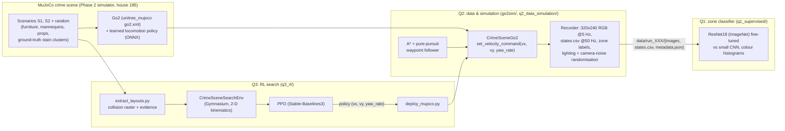

# ENG 6010 Test 2: a Unitree Go2 that searches a crime scene

A simulated Unitree Go2 walks through a MuJoCo crime scene (a furnished house with a staged
blood-spatter event), **records a structured multi-sensor dataset** of what it senses (Q2), uses its
head camera to **recognise which zone of the scene it is in** (Q1), and learns a
**search policy with reinforcement learning** that finds the evidence quickly without stepping on
floor stains or bumping into furniture, then runs that policy on the full physics model of the
dog (Q3). Every number in this document is read from a file in [`results/`](results/) that a script
in this folder wrote; the command that produces it is given next to it.

**Full technical report:** [`REPORT.md`](REPORT.md) (on GitHub) or [`Test2_Report.pdf`](Test2_Report.pdf) (34 pages, for printing):
methods, all results with the real recorded data, and appendices.


*The Go2 (learned locomotion policy, real contact physics) walking a route through house 185, scenario S1:
chase view, the head camera that Q1 classifies, and the top-down map with the zones.*

**Results at a glance**

| | Result | Details |
|---|---|---|
| **Q2** data | 36 runs, **17,123** zone-labelled frames with IMU, joints, foot contacts, pose and commands at 50 Hz, 573 m walked | [section 4](#4-q2-dog-data-and-simulation) |
| **Q1** zone classifier | ResNet18 transfer learning: **0.882** test accuracy (0.880 on a scene never seen in training), vs small CNN 0.788 and colour histograms 0.31-0.41; **0.911** live in MuJoCo | [section 5](#5-q1-supervised-learning-crime-scene-zone-classifier) |
| **Q1 on the real Go2** | 5 lab sessions, **7,346** operator-labelled frames, 4 zones (lab_1, lab_2, open_area, shelves); the same ResNet18 recipe scores **0.814** on a held-out session (macro-F1 0.803); go-to-zone with LiDAR avoidance 16/16 / 10/16 in a simulated room, robot trials pending | [section 5.5](#55-q1-on-the-real-go2-in-the-lab-which-part-of-the-lab-am-i-in) |
| **Q3** RL search | PPO with a training curriculum, on the Go2's real body shape: finds all evidence in **0.533** of 2-D test episodes vs random 0.050 and greedy 0.300 (a map-following planner: 0.700); on the full MuJoCo Go2, **0.667** over 60 starts, ahead of the planner (0.650) and greedy (0.183) | [section 6](#6-q3-reinforcement-learning-evidence-search) |

---

## Contents
1. [Background and motivation](#1-background-and-motivation)
2. [System overview](#2-system-overview)
3. [Setup and reproduction](#3-setup-and-reproduction)
4. [Q2: Dog data and simulation](#4-q2-dog-data-and-simulation)
5. [Q1: Supervised learning, crime-scene zone classifier](#5-q1-supervised-learning-crime-scene-zone-classifier)
   - [5.5 Q1 on the real Go2 in the lab](#55-q1-on-the-real-go2-in-the-lab-which-part-of-the-lab-am-i-in)
6. [Q3: Reinforcement learning, evidence search](#6-q3-reinforcement-learning-evidence-search)
7. [Limitations and future work](#7-limitations-and-future-work)
8. [How Test 2 builds on Test 1](#8-how-test-2-builds-on-test-1)
9. [Repository layout and what is not in git](#9-repository-layout-and-what-is-not-in-git)
10. [References](#10-references)

---

## 1. Background and motivation

Searching a crime scene is slow, and every person who walks through it risks contaminating evidence:
a shoe print in a blood pool, a smeared drip trail, a moved object. A quadruped robot can move through
cluttered indoor spaces, recognise where it is, record everything it senses, and plan routes that
reach every piece of evidence **without stepping on it**. This project builds three pieces of that
system on the Unitree Go2:

* **Q1, supervised learning:** the dog recognises which zone of the crime scene it is in from a single
  head-camera frame (coarse visual localisation).
* **Q2, data and simulation:** the dog walks through the MuJoCo crime scene while we record a real,
  structured dataset of everything it senses (camera, IMU, joints, foot contacts, pose, commands).
* **Q3, reinforcement learning:** the dog learns a search policy that finds all evidence quickly while
  avoiding floor stains (contamination) and obstacles (collisions).

Q2 data trains Q1, and the Q2 scene and locomotion controller are the basis of the Q3 environment
and of its deployment.

## 2. System overview



* **Q2 → Q1:** the Q2 recorder labels every frame with the zone of the dog's base position
  ([`config/zones.yaml`](config/zones.yaml)); Q1 trains on those frames, split by run.
* **Q2 → Q3:** the RL environment's walls, furniture and evidence are exported from the same MuJoCo
  scenes, and its action is the same `set_velocity_command(vx, vy, yaw_rate)` interface, so the
  trained policy drives the Q2 Go2 unchanged.

## 3. Setup and reproduction

Tested here on Linux (Ubuntu, Python 3.13, CPU only, 4 cores) with MuJoCo 3.3.7. All commands run
from `Test2/`.

```bash
git clone https://github.com/CDJ7/Unitree-Dog-Claude-Dog-.git && cd Unitree-Dog-Claude-Dog-
git submodule update --init --depth 1 Phase_2_Investigator/third_party/robot-unitree-go2-mujoco   # simulator (~520 MB)
cd Test2
pip install -r requirements.txt
# headless rendering (Linux): EGL, with OSMesa as the automatic fallback
sudo apt install -y libegl1 libegl-mesa0 libosmesa6 libgl1-mesa-dri
python -m pytest -q tests          # 10 tests: zones, planner, Q3 environment
```

| Step | Command | Output |
|---|---|---|
| Q2 dataset (36 runs) | `python q2_data_simulation/collect_dataset.py --workers 4` | `data/full/run_000 ... run_035` |
| Q2 figures + stats | `python q2_data_simulation/analyze.py` | `results/q2/*` |
| Q2 GIF | `python q2_data_simulation/make_gif.py` | `results/q2/go2_crime_scene.gif` |
| Q1 baselines | `python q1_supervised/baselines.py` | `results/q1/hist_*/` |
| Q1 ResNet18 (2,524 s here) | `python q1_supervised/train.py --model resnet18` | `results/q1/resnet18/` |
| Q1 small CNN (~650 s/epoch here) | `python q1_supervised/train.py --model smallcnn` | `results/q1/smallcnn/` |
| Q1 evaluation | `python q1_supervised/evaluate.py` | `results/q1/metrics.json`, figures |
| Q1 Grad-CAM, demo | `python q1_supervised/gradcam.py`; `python q1_supervised/demo.py` | `gradcam.png`, `demo_run_000.*` |
| Q1 live demo in MuJoCo | `python q1_supervised/demo.py --live` | `demo_live_r1854.*` |
| Q3 layouts (~15 s per scene) | `python q3_rl/extract_layouts.py` | `q3_rl/layouts/` |
| Q3 PPO, reported policy v4 (3,200 s here) | `python q3_rl/train_ppo.py` (continue: `--resume`) | `results/q3/ppo/` |
| Q3 evaluation | `python q3_rl/evaluate.py` | `results/q3/eval_metrics.json`, figures |
| Q3 MuJoCo deployment | `python q3_rl/deploy_mujoco.py --layout s2` | `results/q3/deploy_s2.gif` |
| Q3 MuJoCo evaluation (60 starts / policy, ~20 min) | `python q3_rl/deploy_eval.py` | `results/q3/deploy_eval*.{md,json,csv}` |
| Q3 v3 attempt: train / 2-D eval / MuJoCo eval | `python q3_rl/train_ppo.py --config config/q3_ppo_v3_rect.yaml`; `python q3_rl/evaluate.py --env-config config/q3_env_v3_rect.yaml --ppo-dir results/q3/v3_rect/ppo --out results/q3/v3_rect`; `python q3_rl/deploy_eval.py --env-config config/q3_env_v3_rect.yaml --out results/q3/v3_rect` | `results/q3/v3_rect/` |
| Q3 v2 run (disc body): train / 2-D eval / MuJoCo eval | `python q3_rl/train_ppo.py --config config/q3_ppo_v2_disc.yaml`; then `evaluate.py` and `deploy_eval.py` as for v3 with `--env-config config/q3_env_v2_disc.yaml --out results/q3/v2_disc` (evaluate also `--ppo-dir results/q3/v2_disc/ppo`) | `results/q3/v2_disc/` |
| Q3 paired run comparison | `python q3_rl/compare_runs.py --a results/q3/v2_disc --b results/q3 --out results/q3/paired_v4_vs_v2.json` | `paired_v4_vs_v2.json` |
| Q3 greedy deployment | `python q3_rl/deploy_mujoco.py --layout s2 --policy greedy --gif-every 6` | `results/q3/deploy_s2_greedy.gif` |

Colab notebooks (clone `main`, `cd Test2`, install, run):
* [`q1_supervised/Q1_colab.ipynb`](q1_supervised/Q1_colab.ipynb): data option A (your `data_full.zip` on Drive),
  B (regenerate with the simulator) or C (default, quick check on the 3 committed sample runs with
  [`config/q1_sample.yaml`](config/q1_sample.yaml); results go to `results/q1_sample/`, numbers not meaningful).
* [`q3_rl/Q3_colab.ipynb`](q3_rl/Q3_colab.ipynb): trains PPO with checkpoints on Google Drive and resumes after
  a disconnect, evaluates against the baselines, and optionally deploys on the MuJoCo Go2.

Both notebooks were executed cell by cell, outside Colab, by a Jupyter kernel in a fresh `/content` with
a fresh clone, with only `google.colab.drive` replaced by a local folder. Q1 with option C ran in 139 s
with no failing cell. Q3 ran in 158 s with no failing cell, with training shortened to 24,576 steps and
evaluation to 6 episodes for the test; the MuJoCo deployment cell was included. The Q1 notebook was
then also run on Google Colab itself (opened from GitHub, *Run all*, option C): every cell completed.
The Q3 notebook was then also run on Google Colab (with shortened training): every cell completed. A full
6 M-step training run on Colab has not been done.

Seeds are fixed in every config ([`config/collect.yaml`](config/collect.yaml) `seed: 2026`,
[`config/q1_train.yaml`](config/q1_train.yaml) `seed: 6010`, [`config/q3_ppo.yaml`](config/q3_ppo.yaml) `seed: 6010`),
and every training run writes its full hyper-parameters and library versions to a `train_config.json`
next to its results.

---

## 4. Q2: Dog data and simulation

### 4.1 Simulation setup
* **Scene:** `scenesmith_house_185` from the Phase 2 simulator: a furnished living room (6.0 x 4.5 m)
  and a bathroom (2.2 x 2.4 m) with about 100 textured furniture meshes and box colliders. Each
  scenario adds mannequins, props, distractors (red cushion/book/mug that are *not* blood) and a
  physically simulated blood-spatter event whose stains land on the walls, floor and furniture.
  Six scenes were used for data: S1 (pipe, impact + cast-off), S2 (knife, projected + drip trail) and
  four seeded random scenarios `r1851`-`r1854` in the same house.
* **Go2 model:** the official `unitree_mujoco` `go2.xml` (12 torque-driven joints, real contacts),
  unchanged.
* **Locomotion controller:** `unitree_rl_gym` ships pretrained deploy policies only for G1/H1/H1_2,
  not the Go2 (checked in Step 0, see [`PLAN.md`](PLAN.md)), so the brief's preferred option was not
  available. Instead the dog is driven by the **learned Go2 locomotion policy ("MoE Rough", ONNX)
  that ships with the simulator**: velocity command in, joint position targets out at 50 Hz, tracked by
  PD torque control (kp 20, kd 0.5). It walks with a real trot gait, it does not slide. The
  scripted trot of the simulator is kept as a fallback (`controller="scripted"`).
  One interface: [`go2sim/go2_env.py`](go2sim/go2_env.py) `CrimeSceneGo2.set_velocity_command(vx, vy, yaw_rate)`,
  clipped to the gait limits 0.4 m/s, 0.15 m/s, 0.5 rad/s.
* **Lights:** house 185 has no light sources, so three dimmable ceiling lamps are added at load time
  (inside `Test2/`, no shared files changed).

### 4.2 Movement through the scene
[`go2sim/waypoint_follower.py`](go2sim/waypoint_follower.py): an A* path on the 5 cm occupancy grid
built from the MuJoCo collision geometry (Phase 2 planner, robot radius 0.24 m), followed by pure
pursuit (lookahead 0.35 m) with a cross-track strafe term, turn-in-place for large heading errors,
replanning when off the path and stuck detection. [`config/collect.yaml`](config/collect.yaml) defines
4 hand-made routes (clockwise tour, counter-clockwise tour, victim-first slow, fast sweep; different
starts, zone orders and speeds 0.2-0.4 m/s) plus 2 random routes (random zone sequences, speeds and
in-place spins) per scene. An adaptive dwell (extra spins) is added in under-sampled zones to keep the
classes balanced.

### 4.3 Sensors and data pipeline
Modelled on `unitree_go2_create_dataset` (its `RobotState.msg` fields: IMU, motor q/dq/tau, foot
force, velocity command):

* **Front RGB camera** on the head (`base_link` + [0.32, 0, 0.12] m, 60 deg vertical FOV), 320x240 at 5 Hz.
* **State at 50 Hz** in `states.csv`: base pose (position, quaternion, yaw), world and body velocities,
  IMU (quaternion, gyro, accelerometer), all 12 joints' position/velocity/torque, foot forces and
  contact flags (> 5 N), velocity command, zone label, frame index linking each image to its state row.
* **Zone labels** from the base (x, y) and the polygons in [`config/zones.yaml`](config/zones.yaml):

  | id | zone | area |
  |---|---|---|
  | 0 | victim_area | x 0-1.8 (where the victim mannequin lies) |
  | 1 | bed_area | x 1.8-4.4, y 2.4-4.5 |
  | 2 | lounge_area | x 1.8-4.4, y 0-2.4 |
  | 3 | desk_entry_area | x 4.4-6.0 |
  | 4 | bathroom | x 6.0-8.2, y 1.05-3.45 |

* **Randomisation per run:** headlight ambient/diffuse, lamp intensities and positions, colour tint;
  camera noise (brightness, contrast, gamma, Gaussian noise, occasional blur, JPEG quality) ([`go2sim/randomization.py`](go2sim/randomization.py)).
* **Layout:** `data/run_XXX/{images/, states.csv, metadata.json}`; `metadata.json` holds the scene,
  route, seed, lighting, noise and camera intrinsics. Column reference: [`data/README.md`](data/README.md).

### 4.4 Dataset statistics
From [`results/q2/dataset_stats.json`](results/q2/dataset_stats.json) (`python q2_data_simulation/analyze.py`):

| | |
|---|---|
| Runs / scenes | 36 / 6 |
| Labelled frames | **17,123** (0 outside the zones) |
| State rows (50 Hz) | 171,083 |
| Simulated time / distance walked | 3,421.7 s / 573.0 m |
| Waypoints reached | 184 of 191 |
| Velocity tracking RMSE (0.3 s lag) | vx 0.064 m/s, vy 0.032 m/s, yaw rate 0.170 rad/s |
| Minimum uprightness (cos of tilt) | 0.964 |
| State rows with a robot-scene contact | 258 of 171,083 (15 runs) |

| Zone | victim_area | bed_area | lounge_area | desk_entry_area | bathroom |
|---|---|---|---|---|---|
| Frames | 2,922 | 2,845 | 5,341 | 3,629 | 2,386 |
| Share | 17.1% | 16.6% | 31.2% | 21.2% | 13.9% |

The smallest class has 0.447 of the largest. The lounge is the largest zone and every route crosses it;
Q1 uses class-weighted loss for the rest. In scene `r1854` the random scenario placed a storage box
at (6.6, 2.15), just inside the bathroom doorway, so the dog cannot enter and that scene has no bathroom frames.

| Trajectories (36 runs) | Frames per zone |
|---|---|
|  |  |


**In git:** three complete runs in [`data/sample/`](data/sample/) (24 MB; the data of the Colab quick
check), the run list and config.
**Not in git:** the full 342 MB dataset; regenerate it with the command in section 3
(deterministic: same seeds, same runs).

---

## 5. Q1: Supervised learning, crime-scene zone classifier

### 5.1 Problem and data
Input: one 320x240 head-camera frame (resized to 168x224). Output: one of the 5 zones. This is coarse
visual localisation for the search robot. The 17,123 Q2 frames are split **by run**, never by frame,
so consecutive near-identical frames cannot leak between sets ([`q1_supervised/data.py`](q1_supervised/data.py)
asserts it):

| Split | Runs | Frames | What it contains |
|---|---|---|---|
| train | 20 | 10,321 | routes of scenes S1, S2, r1851-r1853 |
| val | 5 | 2,526 | one held-out route per seen scene (model selection) |
| test | 11 | 4,276 | **all 6 runs of scene r1854** (unseen props, stains, lighting) + 5 unseen routes of the other scenes |

### 5.2 Methods
* **ResNet18 transfer learning:** ImageNet-1k weights, final layer replaced by a 5-way layer, the whole
  network fine-tuned (AdamW, backbone lr 2e-4, head lr 1e-3, weight decay 1e-4, one-cycle schedule,
  label smoothing 0.05, class-weighted cross-entropy, batch 64, 8 epochs, half of the training frames
  sampled per epoch). Augmentation: random resized crop (scale 0.8-1), rotation ±5 deg, colour jitter
  (0.3 brightness/contrast/saturation, 0.03 hue); no horizontal flip (it would mirror the house).
  The download server of the torchvision weights was blocked in this environment, so the same
  ImageNet ResNet18 was taken from the ONNX Model Zoo (`resnet18-v1-7`, sha256-checked) and converted
  to torchvision, verified against onnxruntime (max relative error 7e-7)
  ([`q1_supervised/pretrained.py`](q1_supervised/pretrained.py)). On Colab torchvision's own weights are used.
* **Baselines:** (a) a small CNN trained from scratch (4 conv blocks, 1.17 M parameters, same
  augmentation, 12 epochs planned); (b) colour histograms + logistic regression: joint 8x8x8 RGB
  histogram vs joint HSV histogram, and an HSV histogram per cell of a 2x2 grid (adds coarse layout).
  The regularisation C is chosen on the validation runs.
* Config: [`config/q1_train.yaml`](config/q1_train.yaml). Code: [`train.py`](q1_supervised/train.py),
  [`baselines.py`](q1_supervised/baselines.py), [`evaluate.py`](q1_supervised/evaluate.py),
  [`gradcam.py`](q1_supervised/gradcam.py), [`demo.py`](q1_supervised/demo.py), Colab:
  [`Q1_colab.ipynb`](q1_supervised/Q1_colab.ipynb).

### 5.3 Results
Test set, 4,276 frames, from [`results/q1/metrics.json`](results/q1/metrics.json) /
[`comparison.md`](results/q1/comparison.md) (`python q1_supervised/evaluate.py`):

| Model | Test acc | Macro-F1 | Unseen scene (r1854) | Unseen routes | Acc, 1 s smoothing |
|---|---|---|---|---|---|
| **ResNet18 (ImageNet, fine-tuned)** | **0.882** | **0.887** | **0.880** | **0.883** | 0.869 |
| Small CNN (from scratch) | 0.788 | 0.794 | 0.738 | 0.832 | 0.786 |
| HSV histogram 2x2 grid + LR | 0.411 | 0.426 | 0.378 | 0.441 | 0.411 |
| HSV histogram + LR | 0.362 | 0.384 | 0.320 | 0.399 | 0.370 |
| RGB histogram + LR | 0.310 | 0.334 | 0.293 | 0.325 | 0.319 |

Per class, ResNet18:

| Zone | Precision | Recall | F1 | Support |
|---|---|---|---|---|
| victim_area | 0.860 | 0.833 | 0.846 | 663 |
| bed_area | 0.804 | 0.904 | 0.851 | 623 |
| lounge_area | 0.897 | 0.857 | 0.877 | 1,645 |
| desk_entry_area | 0.881 | 0.903 | 0.892 | 870 |
| bathroom | 0.977 | 0.966 | 0.971 | 475 |

| Confusion matrix (ResNet18) | Training curves (ResNet18) |
|---|---|
|  |  |

| Small CNN curves | Accuracy vs distance to the zone boundary |
|---|---|
|  |  |

**Grad-CAM** ([`results/q1/gradcam.png`](results/q1/gradcam.png)): per zone, the three most confident
correct test frames and the most confident mistake.


**Demo, predicted vs true zone over time** on held-out test run `run_000`
([`demo_run_000.png`](results/q1/demo_run_000.png), [`.gif`](results/q1/demo_run_000.gif),
`python q1_supervised/demo.py`): frame accuracy 0.816, 0.801 with a causal 1 s majority vote.

**Live demo** (`python q1_supervised/demo.py --live`): the classifier runs inside the MuJoCo simulation
while the Go2 walks a tour of the zones in scene **r1854**, which Q1 never trained on. Each head-camera
frame is classified as it is rendered, every 0.2 s. The bathroom is skipped because r1854's storage box
blocks its door. Over 347 frames in 69.4 s, frame accuracy is **0.911**, and 0.919 with the 1 s majority
vote ([`demo_live_r1854.png`](results/q1/demo_live_r1854.png), [`.gif`](results/q1/demo_live_r1854.gif),
[`.csv`](results/q1/demo_live_r1854.csv)).

| Recorded test run `run_000` | Live in MuJoCo, scene r1854 |
|---|---|
|  |  |


**On the real Go2:** the same method was trained and tested on the real dog in the lab. It scores **0.814**
on a held-out session; see [section 5.5](#55-q1-on-the-real-go2-in-the-lab-which-part-of-the-lab-am-i-in).

### 5.4 Discussion
* **Transfer learning is worth it:** ImageNet features beat the same-data small CNN by 9.4 points
  overall and by 14.2 points on the unseen scene, where the from-scratch network falls off more (0.738
  vs 0.832 on unseen routes of seen scenes): it learned more scene-specific cues (props, stains). The
  ResNet barely changes between the unseen scene and unseen routes (0.880 vs 0.883).
* **Colour spaces:** HSV beats RGB by 5.2 points: separating hue from brightness makes the features
  less sensitive to the lighting randomisation. Adding a 2x2 spatial grid gains another 4.9 points.
  But colour statistics alone stay far below the CNNs (0.41 vs 0.88): the zones share the same floor,
  walls and colours, and what tells them apart is *which* furniture is visible and where.
* **Errors are at the boundaries:** at more than 0.3 m inside a zone ResNet18 is 0.969-1.0 accurate;
  within 0.3 m of a boundary it is 0.829 (`accuracy_by_distance_to_zone_boundary` in `metrics.json`).
  The label is the dog's *position*, but the camera looks *ahead*, often into the next zone; the
  Grad-CAM mistakes are exactly such frames (e.g. looking at the bed from the lounge). The largest
  confusion is lounge → bed (110 frames).
* **Grad-CAM** shows the network uses furniture and doorways (desk chair, bed, sofa, bathroom door
  frame and tiles), not the floor or the lighting.
* A 1 s majority vote did not help (0.869 vs 0.882): errors near boundaries come in runs longer than 1 s.
* The small CNN run was stopped by this environment's 2 h limit on background jobs after epoch 10 of 12;
  the checkpoint used is the best-validation epoch 9 (recorded in its `train_config.json`). Its
  validation curve is noisy, so 2 more epochs would probably change little.

### 5.5 Q1 on the real Go2 in the lab: "which part of the lab am I in?"

The real dog learns to recognise **which zone of the lab it is in** from its head camera alone, using the
same training recipe as the simulated Q1. The lab is split into four zones:

| Key | Zone | What it is |
|---|---|---|
| 1 | `lab_1` | the desks on one side of the room |
| 2 | `lab_2` | the desks on the other side |
| 3 | `open_area` | the open floor between them |
| 4 | `shelves` | the shelves with the wires |

#### How it works
1. **Record:** the dog is driven around the lab over Ethernet (keyboard teleop), and the operator presses
   the number of the zone it is in. Each session saves camera frames at 5 Hz plus the commands and the
   dog's odometry pose.
2. **Train:** an ImageNet-pretrained **ResNet18** is fine-tuned to map one camera frame to one of the four
   zones.
   - Sessions 1–3 are used for training, session 4 for validation, and session 5 is held out as the test.
   - The test is a full walk the model has never seen.
3. **Use:**
   - `live_zone.py` shows the predicted zone live on the dog's camera.
   - `goto_zone.py` sends the dog to a zone you pick. It looks around, picks the direction where the
     target zone appears, and walks there, using the LiDAR to go around obstacles.


*What the dog sees: two training frames per zone from the Go2's head camera. The real camera adds motion
blur when turning (lab_2, top), window glare and floor reflections.*

#### The data
| Session | Used for | lab_1 | lab_2 | open_area | shelves | Frames |
|---|---|---|---|---|---|---|
| run_000 | train | 588 | 311 | 576 | 485 | 1,960 |
| run_001 | train | 295 | 554 | 417 | 250 | 1,516 |
| run_002 | train | 292 | 270 | 320 | 328 | 1,210 |
| run_003 | validation | 247 | 276 | 361 | 301 | 1,185 |
| run_004 | **test** | 435 | 307 | 465 | 268 | 1,475 |
| **Total** | | 1,857 | 1,718 | 2,139 | 1,632 | **7,346** |

All five sessions were recorded on 11 Nov 2026, about 24.5 minutes of labelled walking in total.

#### Training
- ResNet18 (11.2 M parameters), ImageNet weights, 8 epochs, batch size 32.
- Colour and crop augmentation, and a class-weighted loss.
- It trained on the laptop CPU in **10,116 s (about 2.8 h)**.
- The best validation macro-F1 was **0.843** (epoch 5); that checkpoint is the one tested.


*Training accuracy climbs to 0.99, while validation stays at 0.82–0.84 from the first epoch. With only
three training walks, the limit is how well one walk's views carry over to another, not training time.*

#### Success rates on the held-out session
| Measure | Result |
|---|---|
| **Accuracy** (1,475 frames) | **0.814** |
| Macro-F1 | 0.803 |
| Accuracy with a 1 s majority vote | 0.820 |
| Simulated Q1, for comparison | 0.882 |

| Zone | Correctly recognised (recall) | Precision | F1 |
|---|---|---|---|
| lab_1 | **0.926** | 0.976 | 0.951 |
| lab_2 | **0.974** | 0.628 | 0.764 |
| open_area | **0.664** | 0.960 | 0.785 |
| shelves | **0.709** | 0.720 | 0.714 |


*Rows are the true zone, columns the prediction. lab_1 and lab_2 are almost never confused with each
other. Most errors are open_area or shelves frames called lab_2.*


*The test walk. Left: the dog's path, coloured by the true zone, with every wrong frame circled. Right:
the true zone over time (black) and each prediction (green right, red wrong).*

#### What we found
- **It works on a walk it has never seen:** 0.814 accuracy from about 15 minutes of training walks.
  That is 7 points below the simulator, a reasonable cost for real images.
- **The camera sees where the dog *faces*, not where it *stands*.** The open area sits between the other
  zones, so looking out from it you mostly see desks or shelves. Its accuracy depends on the heading:
  0.24 facing one way and 0.90 facing another. The simulator showed the same effect.
- **Errors come in streaks** of up to 8.8 s while the dog faces one way, so a 1 s vote helps little (0.814
  → 0.820). This is also why go-to-zone decides "have I arrived?" from a full turn on the spot, which
  averages over every direction, rather than from one view.
- **Confidence is meaningful:** the 67 % of frames predicted with ≥ 0.9 confidence are 0.908 accurate.
- **Found in the lab:** the Go2's LiDAR is mounted upside down. In its raw cloud the floor looked like an
  obstacle 5 cm away in every direction. Switching to the deskewed, odometry-frame cloud fixed it, before
  any autonomous motion.

#### Go to zone: obstacle-aware navigation (simulation check)
Before the robot trials, the navigator was tested in a simulated 6 × 4 m room. Each layout was run from
4 starts × 4 headings:

| Layout | Reached the zone | Closest approach to the obstacle |
|---|---|---|
| A desk blocks the way (zone visible) | **16/16** | 0.26 m from the dog's centre |
| A shelf hides the zone | **10/16** | 0.25 m |


*Every simulated run: green arrived, red ran out of exploration. No run hit the obstacle.*

#### Video
*Coming soon: the live zone recognition and go-to-zone trials on the real dog.*

The numbers above come from the files in [`results/real_q1/`](results/real_q1/). How to
reproduce them, and how to run everything on the dog, is in [`real_go2/README.md`](real_go2/README.md)
and [`real_go2/LAB_PLAN.md`](real_go2/LAB_PLAN.md). The full analysis is section 7 of
[`REPORT.md`](REPORT.md). `python real_go2/analyze_real.py` regenerates the figures and the analysis.

---

## 6. Q3: Reinforcement learning, evidence search

The reported policy is **v4**: PPO trained in a fast 2-D twin of the crime scene that uses the Go2's real
body shape, with a training curriculum. It is the fourth of four PPO runs. Section 6.6 explains how each
earlier run (v1-v3) led to the next, and compares all four on the same test starts.

### 6.1 Design: train in a fast 2-D twin of the scene, deploy on the full MuJoCo Go2
* **Training environment** [`q3_rl/crime_scene_env.py`](q3_rl/crime_scene_env.py), `CrimeSceneSearchEnv`
  (Gymnasium API, registered as `CrimeSceneSearch-v0`; passes `gymnasium.utils.env_checker` and SB3's
  `check_env`, see [`tests/test_q3_env.py`](tests/test_q3_env.py)). It is built from the **real MuJoCo
  scenes**: [`extract_layouts.py`](q3_rl/extract_layouts.py) opens each scenario exactly as Q2 does and
  exports the collision footprint of walls, furniture, mannequins and props (5 cm raster, same rasteriser
  as the Q2 planner) and the ground-truth stain clusters. 28 house-185 scenes: **16 train, 6 validation
  (model selection), 6 test** (S2, r1854 = Q1's unseen scene, and 4 new random scenes), never seen in training.
* **Body and motion:** the dog's body is the Go2's **0.70 x 0.32 m rectangle**. Body-frame velocity
  command → first-order lag → integration at 20 Hz (4 sub-steps per 0.2 s decision). A move or a turn
  that would make the rectangle overlap an obstacle cell is cancelled, so the dog has to line up with
  narrow gaps.
* **Evidence:** stain clusters with at least 5 stains and below 2 m (the head camera cannot see the
  ceiling): 89 items in the training scenes, 30 in validation, 29 in test. An item is **found** when it is in
  the head camera's view: within 1.5 m of the camera, inside its ±35 deg horizontal field of view and with
  a clear line of sight on the raster. **Contamination:** the 0.30 m footprint disc around the feet overlaps
  a *floor* stain cluster.
* **Deployment** [`q3_rl/deploy_mujoco.py`](q3_rl/deploy_mujoco.py): the policy runs unchanged on the
  MuJoCo Go2. Every 0.2 s the dog's true pose and measured body velocity are written into the env (its
  sensor model), the observation is built, and the action goes to Q2's `set_velocity_command`.

### 6.2 RL formulation
* **Observation** (54 values in [-1, 1]): position (x, y) and heading (sin, cos); body velocity (vx, vy,
  yaw rate); **24 lidar rays** over 360 deg (3 m); the nearest unfound evidence: body-frame direction,
  straight-line distance, path length on the map, height, floor flag; the nearest floor stain: direction
  and clearance; **found/unfound flags** for 8 evidence slots; a **route hint** (unit vector along the
  shortest path on the known floor plan to that item, from a clearance-weighted cost map, as a real Go2's
  map and planner would give; it knows nothing about stains); the previous action; a "bumped last step" flag.
* **Action:** continuous (vx, vy, yaw rate) in [-1, 1]³, scaled to the Go2 limits 0.4 m/s, 0.15 m/s,
  0.5 rad/s (the same limits `set_velocity_command` clips to).
* **Reward**, one function per term, weights in [`config/q3_env.yaml`](config/q3_env.yaml):

  r_t = 10·n_found(t) + 2·clip(d_{t-1} − d_t, ±0.5) − 1·1[on stain] − 8·n_new_stains(t)
        − 0.5·1[collision] − 20·1[severe collision] − 0.01 + 20·1[all found]

  with d_t the path length (m) on the map from the dog to the nearest place the nearest unfound item can
  be seen from (`reward_find`, `reward_progress`, `reward_contamination`, `reward_collision`,
  `reward_time`, `reward_all_found`).
* **Termination:** all evidence found (success) or a **severe collision**: 25 consecutive colliding steps
  (5 s pushing into an obstacle, failure). **Truncation:** 900 steps (180 s).
* **Domain randomisation** on every reset: scene (16), start pose (free space where the body can turn on
  the spot, not on a stain, not already seeing an item), a random subset of the scene's evidence (at least
  2) with ±5 cm jitter, velocity lag 0.15-0.35 s, speed gain 0.85-1.10, action noise 3%, lidar noise 2 cm
  and 2% dropout.
* **Training curriculum** (`curriculum` in [`config/q3_env.yaml`](config/q3_env.yaml), training only):
  training starts with one evidence item and a start within 1.5 m (on the map) of where it can be seen.
  Then 1 item / 3 m, 2 items / 5 m, 3 items / anywhere, and finally the full task above. The next level
  begins when 70% of the last 200 training episodes succeed. Validation and test always use the full task.

### 6.3 Algorithm and hyper-parameters
PPO from Stable-Baselines3 2.9.2 ([`train_ppo.py`](q3_rl/train_ppo.py), [`config/q3_ppo.yaml`](config/q3_ppo.yaml)):
8 environments in `SubprocVecEnv`, MLP 256-256 (policy and value), lr 3e-4, 512 steps per env per
update (4,096), batch 1,024, 10 epochs, γ 0.995, GAE λ 0.95, clip 0.2, entropy 0.005, initial log-std
−0.5, seed 6010, **6.0 M environment steps** (3,200 s on 4 CPU cores,
[`train_config.json`](results/q3/ppo/train_config.json)). Also:
* TensorBoard logs (`results/q3/tb`, plus custom `search/*` success, contamination and collision curves,
  and the curriculum level);
* a checkpoint every 100k steps;
* an `EvalCallback` every 50k steps on the 6 validation scenes (20 deterministic episodes) that keeps
  `best_model.zip`;
* the curriculum callback, which records each level change in [`curriculum.json`](results/q3/ppo/curriculum.json).

`--resume` continues from the newest checkpoint with the step counter, Monitor logs, evaluation history and
curriculum level intact. It was needed for real during this project: a container restart interrupted an
earlier run (v2), and training continued from its last checkpoint. The Colab notebook
[`Q3_colab.ipynb`](q3_rl/Q3_colab.ipynb) does the same with checkpoints on Google Drive.

### 6.4 Results
**Learning curves** ([`learning_curves.png`](results/q3/learning_curves.png), from the Monitor logs and
`evaluations.npz`): the curriculum reached level 1 at 0.35 M steps, level 2 at 0.43 M, level 3 at 0.50 M,
and the **full task from 0.56 M steps on**. Training success then jumps to about 0.8 and stays there:
0.808 over the last 500 training episodes, with 6.0% ending in a severe collision
([`train_summary.json`](results/q3/train_summary.json)). The model kept is the best validation return, at
1.95 M steps (validation success 0.95 at that check).


**Evaluation on the 6 test scenes** ([`results/q3/eval_metrics.json`](results/q3/eval_metrics.json),
[`comparison.md`](results/q3/comparison.md), `python q3_rl/evaluate.py`): 60 episodes per policy, the
**same** 60 episodes (scene, start, evidence subset, randomisation) for every policy:

| Policy | Success | Evidence found | Time to find all (s, successful eps) | Stain entries / ep | Steps on a stain / ep | Collision steps / ep | Severe-collision ends |
|---|---|---|---|---|---|---|---|
| random | 0.050 | 0.163 | 145.7 | 1.05 | 33.2 | 40.0 | 0.00 |
| greedy (straight at the nearest item, lidar avoidance) | 0.300 | 0.475 | 13.9 | 0.58 | 34.3 | 28.6 | 0.62 |
| planner (follows the route hint) | **0.700** | **0.786** | 18.5 | **0.40** | **5.8** | 24.7 | 0.15 |
| **PPO (v4)** | 0.533 | 0.674 | 19.3 | 0.52 | 19.2 | **22.6** | 0.20 |

Success per test scene (10 episodes each):

| | s2 | r1854 | r3101 | r3102 | r3103 | r3104 |
|---|---|---|---|---|---|---|
| greedy | 0.2 | 0.3 | 0.1 | 0.9 | 0.0 | 0.3 |
| planner | 0.9 | 0.7 | 0.2 | 1.0 | 0.8 | 0.6 |
| PPO | 0.7 | 0.8 | 0.0 | 0.9 | 0.0 | 0.8 |


*Same three test episodes for each policy (start dot; stars = evidence, green when found; red discs = floor stains).*

**Deployment in full MuJoCo** (`python q3_rl/deploy_mujoco.py --layout s2` / `--layout r1854`): the PPO
policy drives the MuJoCo Go2 (learned locomotion controller, real contacts) through its velocity commands.
* **S2:** it found **3/3** items in **43.2 s**, with 0 steps with a foot in a stain and 43 control steps
  with a robot-scene contact ([`deploy_s2.json`](results/q3/deploy_s2.json)).
* **r1854:** it found **5/5** in **27.6 s**, with 2 steps with a foot inside the victim's large blood pool
  and 0 contact steps ([`deploy_r1854.json`](results/q3/deploy_r1854.json)).
* The dog stayed upright throughout (minimum uprightness 0.920 / 0.996).

| S2 | r1854 |
|---|---|
|  |  |

**Greedy baseline on the MuJoCo Go2**, from the same start poses (`python q3_rl/deploy_mujoco.py --layout s2 --policy greedy --gif-every 6`,
[`deploy_s2_greedy.json`](results/q3/deploy_s2_greedy.json), [`deploy_r1854_greedy.json`](results/q3/deploy_r1854_greedy.json)):
it finds 0/3 in S2 and 1/5 in r1854 in the 180 s limit. It does not crash into things; it **deadlocks**.
In S2 it stops after about 30 s in the gap between the bed and the bin and does not move again: its
corridor check forbids driving forward, but the open direction it picks is close enough to straight ahead
that it does not turn either. All deployment GIFs play at 2x speed; the greedy ones show every 6th control
step instead of every 2nd, to keep them small.

| Greedy, S2 | Greedy, r1854 |
|---|---|
|  |  |

**MuJoCo evaluation over many starts, and the 2-D → MuJoCo gap** (`python q3_rl/deploy_eval.py`,
[`deploy_eval_metrics.json`](results/q3/deploy_eval_metrics.json), [`deploy_eval_episodes.csv`](results/q3/deploy_eval_episodes.csv)).
Each policy ran from 10 start poses in each of the 6 test scenes, i.e. 60 episodes per policy, on the
MuJoCo Go2 **and** in the 2-D environment from the identical start. Here every evidence item of the scene
must be found, with no random subset or noise, so the numbers are not the same protocol as the 2-D table above.

| Policy | Success 2-D | Success MuJoCo | Same outcome in both | Time, successful eps (2-D / MuJoCo) | Stain entries / ep (2-D / MuJoCo) | Steps with a foot in a stain / ep (MuJoCo) |
|---|---|---|---|---|---|---|
| **PPO (v4)** | 0.517 | **0.667** | 0.85 | 16.2 / 24.9 s | 0.62 / 1.53 | 30.6 |
| greedy | 0.217 | 0.183 | 0.97 | 6.7 / 5.8 s | 0.50 / 0.77 | 145.5 |
| planner | **0.533** | 0.650 | 0.75 | 17.5 / 19.9 s | 0.33 / 0.68 | 18.0 |

Success per test scene, 2-D → MuJoCo (10 starts each):

| | s2 | r1854 | r3101 | r3102 | r3103 | r3104 |
|---|---|---|---|---|---|---|
| PPO | 0.4 → 1.0 | 0.8 → 0.9 | 0.0 → 0.1 | 1.0 → 1.0 | 0.0 → 0.0 | 0.9 → 1.0 |
| greedy | 0.3 → 0.3 | 0.0 → 0.0 | 0.0 → 0.0 | 1.0 → 0.8 | 0.0 → 0.0 | 0.0 → 0.0 |
| planner | 0.6 → 0.4 | 0.5 → 0.7 | 0.0 → 0.1 | 0.9 → 1.0 | 0.7 → 0.9 | 0.5 → 0.8 |

* **The policy transfers to the legged robot.** PPO ends the same way in 2-D and MuJoCo in 85% of the
  paired episodes (greedy 97%, planner 75%). On the MuJoCo dog PPO is the best of the three (0.667 vs
  planner 0.650 and greedy 0.183).
* **Every policy does at least as well on the legged robot as in 2-D**, except greedy. The 2-D twin cancels
  any move into an obstacle, whereas the legged Go2 can brush past an obstacle's edge and keep going. PPO
  gains most in S2 (0.4 → 1.0).
* **Contacts are brief.** A robot-scene contact happens in 30 (PPO), 26 (planner) and 27 (greedy) of the 60
  MuJoCo episodes, but the median is 0-0.5 contact steps per episode. The means come from a few episodes
  where the dog keeps pushing into furniture.
* **No falls:** the lowest uprightness in any MuJoCo episode is 0.866 (PPO), 0.942 (planner) and 0.963 (greedy).
* **Stains on the MuJoCo dog:** PPO has a foot in a stain in 27 of 60 episodes, but its 1,833 such steps are
  dominated by 3 episodes where it stalls on a stain (629, 441 and 382 steps;
  [`paired_v4_vs_v2.json`](results/q3/paired_v4_vs_v2.json)). Greedy's 145.5 per episode come from
  deadlocks on top of a stain.

### 6.5 Discussion
* **All the RL components are in the code and work:** environment, observation, action, six reward
  terms, termination/truncation, domain randomisation, curriculum, PPO with vectorised envs, TensorBoard,
  checkpoints, evaluation callback, resume, baselines, deployment on the physical simulation.
* **PPO beats the random and greedy baselines everywhere** (2-D: 0.533 vs 0.050 / 0.300; MuJoCo: 0.667 vs
  0.183 for greedy). On the 2-D test it is still below the map-following planner (0.533 vs 0.700), which uses
  the same route hint perfectly. On the MuJoCo dog it is slightly ahead of the planner (0.667 vs 0.650).
* **Where it fails:** two scenes, r3101 and r3103, with narrow passages between furniture. PPO solves
  neither in 2-D, and 20% of its 2-D test episodes end in a severe collision. r3101 is hard for every
  policy (planner 0.2).
* **Contamination:** in 2-D, PPO enters about as many floor stains as greedy (0.52 vs 0.58 per episode) and
  spends fewer steps on them (19.2 vs 34.3), but the planner, whose clearance-weighted paths keep away from
  furniture where the stains also are, does better (0.40 entries, 5.8 steps). Many evidence items sit
  *inside* a large floor pool (e.g. the victim area of r1854), so seeing them without stepping near them is
  genuinely hard.
* **Why v4 is the reported policy:** it learns the most faithful body model, and it is at least as good as
  every other run on the MuJoCo dog (section 6.6). Its edge over v2 there (0.667 vs 0.633) is not
  statistically significant, and the choice was made after seeing both on the same test starts, so its
  MuJoCo number is a slightly optimistic estimate.
* **What would come next:** a recurrent policy or frame stacking against getting stuck in narrow gaps,
  stain cells in the route hint's cost (or a stronger penalty for standing on a stain), and training
  directly with MuJoCo in the loop for the last stage.

### 6.6 How we got here: four PPO runs
Every run uses the same PPO settings, test scenes and seeds; each one changed one or two things in
response to what the previous run showed.

| Run | What changed | Training success (last 500 eps) | 2-D test success (planner in that 2-D model) | MuJoCo success, same 60 starts | Results |
|---|---|---|---|---|---|
| v1 | 48-value observation, disc body, 3 M steps | - | 0.117 (-) | - | [`v1_obs48/`](results/q3/v1_obs48/) |
| v2 | + route hint, previous action, bump flag; 4 M steps | 0.928 | 0.633 (0.850) | 0.633 | [`v2_disc/`](results/q3/v2_disc/) |
| v3 | + Go2 rectangle body, 6 validation scenes, stain-entry penalty 3 → 8 | 0.428 | 0.250 (0.700) | 0.467 | [`v3_rect/`](results/q3/v3_rect/) |
| **v4** | + training curriculum; 6 M steps | **0.808** | **0.533** (0.700) | **0.667** | [`results/q3/`](results/q3/) |

The 2-D test numbers of v1/v2 come from the disc body model and those of v3/v4 from the rectangle model,
so only the MuJoCo column compares all runs on the same physics.

* **v1 → v2:** v1 had only the straight-line direction to the evidence. It drove into the furniture
  between it and the target and could not tell it was stuck: 45% of its test episodes ended in a severe
  collision. v2 adds the route hint (the planner's direction along the floor plan), the previous action
  and a "bumped" flag.
* **v2 → v3:** a MuJoCo evaluation of v2 ([`v2_disc/deploy_eval.md`](results/q3/v2_disc/deploy_eval.md)) showed
  that the 0.24 m disc of v1/v2 is narrower than the Go2's 0.7 m-long body: the real dog touched furniture in
  gaps the 2-D twin treated as free. v3 uses the real rectangle, 6 validation scenes instead of 2 (v2's 2
  saturated at 100% early) and a stronger stain penalty. It **failed**: training success plateaued at about
  0.4 from 0.8 M steps on. On the paired MuJoCo starts v2 succeeds in 10 episodes where v3 fails, and never the
  other way round (exact McNemar test p = 0.002, [`paired_vs_v2.json`](results/q3/v3_rect/paired_vs_v2.json)).
* **v3 → v4:** the same task becomes learnable with a curriculum. v4 beats v3 on 12 paired MuJoCo starts
  and loses none (p = 0.0005, [`paired_vs_v4.json`](results/q3/v3_rect/paired_vs_v4.json)).
* **v4 vs v2:** on the paired MuJoCo starts both succeed in 37, v4 alone in 3, v2 alone in 1, neither in 19
  (p = 0.63, [`paired_v4_vs_v2.json`](results/q3/paired_v4_vs_v2.json)): a statistical tie. v2 stands on stains
  less (179 foot-in-stain steps over the 60 episodes, against 1,833 for v4, mostly 3 stalled episodes). v4
  is reported because it reaches the same performance with the faithful body model.

| v3: no curriculum (plateau at about 0.4) | v4: curriculum (about 0.8 after the full task starts at 0.56 M) |
|---|---|
|  |  |

---

## 7. Limitations and future work
* **Simulation only.** Nothing here ran on the physical Go2. Sim-to-real steps: replace the
  ground-truth evidence positions by detections (the Phase 2 stain detector / a camera classifier),
  replace the raster lidar by the Go2's L1 LiDAR scans, and run the velocity commands through
  `SportClient.Move` as in Test 1's `go2_stream`, with the existing watchdog and speed limits.
* **Zone labels from position, camera looks ahead** (Q1): a label from the camera's view frustum, or
  a sequence model over several frames, would remove most boundary errors.
* **One house.** All Q1/Q3 scenes are house 185 (different events, props and lighting). Generalisation
  to another floor plan (house 186) is untested; the scripts accept it but zones would need defining.
* **Q3 runs in a 2-D twin of the scene:** the body is a rectangle sliding on a raster; obstacles are the
  footprints of their MuJoCo box colliders (anything a box collider covers counts as blocked, even if the
  dog could fit under part of it); evidence positions and the "found" test come from the ground truth
  rather than a detector; and the lidar is ray-cast on the raster. The MuJoCo deployment shows the commands
  transfer to the legged robot (60 paired episodes per policy: the same outcome in 75-97% of them), and the
  legged dog brushes past obstacle edges that the 2-D twin treats as blocking.
* **Q3 PPO** stays below the map-following planner on the 2-D test (0.533 vs 0.700), fails in the two
  scenes with the narrowest passages, and stalls on a stain in a few MuJoCo episodes. Its edge over the
  earlier disc-body run (v2) on the MuJoCo dog is not statistically significant (section 6.6).
* **Compute:** everything ran on a 4-core CPU. The small CNN was stopped at epoch 10/12 by a time limit.

## 8. How Test 2 builds on Test 1
* **Phase 1 / Test 1** ([`docs/phase1_summary.md`](../docs/phase1_summary.md),
  [`docs/phase1_results/`](../docs/phase1_results/), [`go2_stream/`](../go2_stream/)): Go2 camera and LiDAR
  streaming and keyboard teleop on the real Go2 EDU, YOLO object detection, a kinematic MuJoCo world and
  a top-down object map. Test 2 keeps its top-down map style and its velocity-command interface
  (`SportClient.Move(vx, vy, yaw_rate)` ↔ `set_velocity_command(vx, vy, yaw_rate)`), so a Q3 policy
  could be sent to the real dog through the Test 1 teleop/control path.
* **Phase 2 crime-scene simulator** ([`Phase_2_Investigator/README.md`](../Phase_2_Investigator/README.md),
  [`docs/stage_a_checklist.md`](../Phase_2_Investigator/docs/stage_a_checklist.md)): Test 2 imports, without
  modifying them,
  * [`sim_env/runtime.py`](../Phase_2_Investigator/sim_env/runtime.py) `SimSession` (MuJoCo Go2 + sensors + controller),
  * [`sim_env/scenario_scene.py`](../Phase_2_Investigator/sim_env/scenario_scene.py) `open_scenario` (crime scenes with ground truth),
  * [`sim_env/scenarios/random_sim.py`](../Phase_2_Investigator/sim_env/scenarios/random_sim.py) (random scenarios),
  * [`navigation/occupancy.py`](../Phase_2_Investigator/navigation/occupancy.py) and [`navigation/planner.py`](../Phase_2_Investigator/navigation/planner.py) (grid + A*).

  What Test 2 adds on top: the learned locomotion policy behind one velocity interface, joint/foot
  logging, zone labels, lighting/noise randomisation and the dataset pipeline (Q2), the zone classifier
  (Q1), and the RL environment, training and deployment (Q3). No file outside `Test2/` was changed
  (except a link in the root `README.md`).

## 9. Repository layout and what is not in git
```
Test2/
├── README.md, PLAN.md, requirements.txt
├── config/        zones.yaml, collect.yaml (Q2), q1_train.yaml, q1_sample.yaml (Colab quick check),
│                  q3_env.yaml (env, reward weights, curriculum) + q3_ppo.yaml (reported policy, v4),
│                  q3_env_v2_disc.yaml + q3_ppo_v2_disc.yaml (v2), q3_env_v3_rect.yaml + q3_ppo_v3_rect.yaml (v3)
├── go2sim/        CrimeSceneGo2 (scene + learned controller + sensors), static map, waypoint follower, randomisation
├── q2_data_simulation/  collect_dataset.py, analyze.py, make_gif.py
├── q1_supervised/ data.py, models.py, pretrained.py, train.py, baselines.py, evaluate.py, gradcam.py, demo.py, Q1_colab.ipynb
├── q3_rl/         extract_layouts.py, layouts/, crime_scene_env.py, train_ppo.py, evaluate.py, deploy_mujoco.py,
│                  deploy_eval.py, compare_runs.py, Q3_colab.ipynb
├── tests/         pytest: zones/planner, Q3 environment
├── data/          sample/ (3 runs) + README (regeneration, column reference)
└── results/       q2/, q1/, q3/: figures, GIFs, metrics JSON, small checkpoints;
                   q3/ is the reported policy (v4); q3/v1_obs48/, q3/v2_disc/ and q3/v3_rect/ hold the earlier runs
```
Left out of git (`.gitignore`), and how to get them back:

| Not in git | Size | Regenerate with |
|---|---|---|
| `data/full/` (36 runs, 17,123 frames) | 342 MB | `python q2_data_simulation/collect_dataset.py --workers 4` |
| `data/full/_q1_cache/` (decoded frames) | ~1.9 GB | built automatically by Q1 scripts |
| `results/q1/*/best_fp32.pt` | 45 + 4.7 MB | `python q1_supervised/train.py --model ...`; the committed `best.pt` files are the same weights in fp16 (identical ResNet18 test predictions) |
| `results/q3/ppo/checkpoints/`, `results/q3/tb/` | 114 MB + 1.5 MB | `python q3_rl/train_ppo.py`; `best_model.zip` and `final_model.zip` are committed |
| the same for v2: `results/q3/v2_disc/ppo/checkpoints/`, `results/q3/v2_disc/tb/` | 76 MB + 1 MB | `python q3_rl/train_ppo.py --config config/q3_ppo_v2_disc.yaml` |
| the same for v3: `results/q3/v3_rect/ppo/checkpoints/`, `results/q3/v3_rect/tb/` | 76 MB + 1 MB | `python q3_rl/train_ppo.py --config config/q3_ppo_v3_rect.yaml` |
| `results/q3/deploy_eval_parts/` (and v3's) | small | per-episode files of `deploy_eval.py`, merged into `deploy_eval_episodes.csv` |
| `results/q1_sample/` | small | written by the Colab quick check (`Q1_colab.ipynb` option C) |

## 10. References
Professor's links:
* ShijieZhao36, *unitree_go2_create_dataset*: https://github.com/ShijieZhao36/unitree_go2_create_dataset
* Unitree Robotics, *unitree_rl_gym*: https://github.com/unitreerobotics/unitree_rl_gym
* H. Bounds, *Go2 RL locomotion*: https://harrisonbounds.github.io/dog/go2.html
* *unitree_rl_gym documentation*: https://zsc.github.io/unitree_rl_gym/

Software and methods:
* syswonder, *robot-unitree-go2-mujoco* (simulator, learned Go2 policy): https://github.com/syswonder/robot-unitree-go2-mujoco
* Unitree Robotics, *unitree_mujoco* (Go2 model): https://github.com/unitreerobotics/unitree_mujoco
* E. Todorov, T. Erez, Y. Tassa, "MuJoCo: A physics engine for model-based control", IROS 2012.
* K. He, X. Zhang, S. Ren, J. Sun, "Deep Residual Learning for Image Recognition", CVPR 2016.
* ONNX Model Zoo, ResNet18 v1-7: https://github.com/onnx/models
* R. R. Selvaraju et al., "Grad-CAM: Visual Explanations from Deep Networks via Gradient-based Localization", ICCV 2017.
* J. Schulman, F. Wolski, P. Dhariwal, A. Radford, O. Klimov, "Proximal Policy Optimization Algorithms", arXiv:1707.06347, 2017.
* A. Raffin et al., "Stable-Baselines3: Reliable Reinforcement Learning Implementations", JMLR 22(268), 2021.
* M. Towers et al., "Gymnasium: A Standard Interface for Reinforcement Learning Environments", arXiv:2407.17032, 2024.
* S. Thrun, W. Burgard, D. Fox, *Probabilistic Robotics* (occupancy grids), MIT Press, 2005.
