# ENG 6010 Test 2: a Unitree Go2 that searches a crime scene

A simulated Unitree Go2 walks through a MuJoCo crime scene (a furnished house with a staged
blood-spatter event), **records a structured multi-sensor dataset** of what it senses (Q2), uses its
head camera to **recognise which zone of the scene it is in** (Q1), and learns a
**search policy with reinforcement learning** that finds the evidence quickly without stepping on
floor stains or bumping into furniture, then runs that policy on the full physics model of the
dog (Q3). Every number in this document is read from a file in [`results/`](results/) that a script
in this folder wrote; the command that produces it is given next to it.

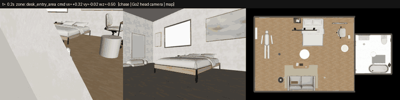

*The Go2 (learned locomotion policy, real contact physics) walking a route through house 185, scenario S1:
chase view, the head camera that Q1 classifies, and the top-down map with the zones.*

---

## Contents
1. [Background and motivation](#1-background-and-motivation)
2. [System overview](#2-system-overview)
3. [Setup and reproduction](#3-setup-and-reproduction)
4. [Q2: Dog data and simulation](#4-q2-dog-data-and-simulation)
5. [Q1: Supervised learning, crime-scene zone classifier](#5-q1-supervised-learning-crime-scene-zone-classifier)
6. [Q3: Reinforcement learning, evidence search](#6-q3-reinforcement-learning-evidence-search)
7. [Limitations and future work](#7-limitations-and-future-work)
8. [How Test 2 builds on Test 1](#8-how-test-2-builds-on-test-1)
9. [Repository layout and what is not in git](#9-repository-layout-and-what-is-not-in-git)
10. [References](#10-references)

---

## 1. Background and motivation

Searching a crime scene is slow, and every person who walks through it risks contaminating evidence:
a shoe print in a blood pool, a smeared drip trail, a moved object. A quadruped robot can move through
cluttered indoor spaces, recognise where it is, record everything it senses, and plan routes that
reach every piece of evidence **without stepping on it**. This project builds three pieces of that
system on the Unitree Go2:

* **Q1, supervised learning:** the dog recognises which zone of the crime scene it is in from a single
  head-camera frame (coarse visual localisation).
* **Q2, data and simulation:** the dog walks through the MuJoCo crime scene while we record a real,
  structured dataset of everything it senses (camera, IMU, joints, foot contacts, pose, commands).
* **Q3, reinforcement learning:** the dog learns a search policy that finds all evidence quickly while
  avoiding floor stains (contamination) and obstacles (collisions).

Q2 data trains Q1, and the Q2 scene and locomotion controller are the basis of the Q3 environment
and of its deployment.

## 2. System overview

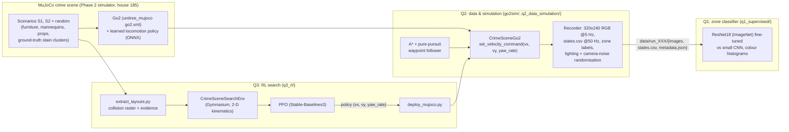

* **Q2 → Q1:** the Q2 recorder labels every frame with the zone of the dog's base position
  ([`config/zones.yaml`](config/zones.yaml)); Q1 trains on those frames, split by run.
* **Q2 → Q3:** the RL environment's walls, furniture and evidence are exported from the same MuJoCo
  scenes, and its action is the same `set_velocity_command(vx, vy, yaw_rate)` interface, so the
  trained policy drives the Q2 Go2 unchanged.

## 3. Setup and reproduction

Tested here on Linux (Ubuntu, Python 3.13, CPU only, 4 cores) with MuJoCo 3.3.7. All commands run
from `Test2/`.

```bash
git clone https://github.com/CDJ7/Unitree-Dog-Claude-Dog-.git && cd Unitree-Dog-Claude-Dog-
git checkout claude/eng6010-test2-crime-scene-0rst3r
git submodule update --init --depth 1 Phase_2_Investigator/third_party/robot-unitree-go2-mujoco   # simulator (~520 MB)
cd Test2
pip install -r requirements.txt
# headless rendering (Linux): EGL, with OSMesa as the automatic fallback
sudo apt install -y libegl1 libegl-mesa0 libosmesa6 libgl1-mesa-dri
python -m pytest -q tests          # 9 tests: zones, planner, Q3 environment
```

| Step | Command | Output |
|---|---|---|
| Q2 dataset (36 runs) | `python q2_data_simulation/collect_dataset.py --workers 4` | `data/full/run_000 ... run_035` |
| Q2 figures + stats | `python q2_data_simulation/analyze.py` | `results/q2/*` |
| Q2 GIF | `python q2_data_simulation/make_gif.py` | `results/q2/go2_crime_scene.gif` |
| Q1 baselines | `python q1_supervised/baselines.py` | `results/q1/hist_*/` |
| Q1 ResNet18 (2,524 s here) | `python q1_supervised/train.py --model resnet18` | `results/q1/resnet18/` |
| Q1 small CNN (~650 s/epoch here) | `python q1_supervised/train.py --model smallcnn` | `results/q1/smallcnn/` |
| Q1 evaluation | `python q1_supervised/evaluate.py` | `results/q1/metrics.json`, figures |
| Q1 Grad-CAM, demo | `python q1_supervised/gradcam.py`; `python q1_supervised/demo.py` | `gradcam.png`, `demo_run_000.*` |
| Q3 layouts (~15 s per scene) | `python q3_rl/extract_layouts.py` | `q3_rl/layouts/` |
| Q3 PPO | `python q3_rl/train_ppo.py` (continue: `--resume`) | `results/q3/ppo/` |
| Q3 evaluation | `python q3_rl/evaluate.py` | `results/q3/eval_metrics.json`, figures |
| Q3 MuJoCo deployment | `python q3_rl/deploy_mujoco.py --layout s2` | `results/q3/deploy_s2.gif` |
| Q3 MuJoCo evaluation (60 starts / policy, ~20 min) | `python q3_rl/deploy_eval.py` | `results/q3/deploy_eval*.{md,json,csv}` |
| Q3 v3 attempt: train / 2-D eval / MuJoCo eval | `python q3_rl/train_ppo.py --config config/q3_ppo_v3_rect.yaml`; `python q3_rl/evaluate.py --env-config config/q3_env_v3_rect.yaml --ppo-dir results/q3/v3_rect/ppo --out results/q3/v3_rect`; `python q3_rl/deploy_eval.py --env-config config/q3_env_v3_rect.yaml --out results/q3/v3_rect` | `results/q3/v3_rect/` |
| Q3 greedy deployment | `python q3_rl/deploy_mujoco.py --layout s2 --policy greedy --gif-every 6` | `results/q3/deploy_s2_greedy.gif` |

Colab notebooks (clone `main`, `cd Test2`, install, run):
* [`q1_supervised/Q1_colab.ipynb`](q1_supervised/Q1_colab.ipynb): data option A (your `data_full.zip` on Drive),
  B (regenerate with the simulator) or C (default, quick check on the 3 committed sample runs with
  [`config/q1_sample.yaml`](config/q1_sample.yaml); results go to `results/q1_sample/`, numbers not meaningful).
* [`q3_rl/Q3_colab.ipynb`](q3_rl/Q3_colab.ipynb): trains PPO with checkpoints on Google Drive and resumes after
  a disconnect, evaluates against the baselines, and optionally deploys on the MuJoCo Go2.

Both notebooks were executed cell by cell, outside Colab, by a Jupyter kernel in a fresh `/content` with
a fresh clone, with only `google.colab.drive` replaced by a local folder. Q1 with option C ran in 139 s
with no failing cell. Q3 ran in 158 s with no failing cell, with training shortened to 24,576 steps and
evaluation to 6 episodes for the test; the MuJoCo deployment cell was included. The Q1 notebook was
then also run on Google Colab itself (opened from GitHub, *Run all*, option C): every cell completed.
The Q3 notebook has not yet been run on Colab, so its Drive mount and long training run there are untested.

Seeds are fixed in every config ([`config/collect.yaml`](config/collect.yaml) `seed: 2026`,
[`config/q1_train.yaml`](config/q1_train.yaml) `seed: 6010`, [`config/q3_ppo.yaml`](config/q3_ppo.yaml) `seed: 6010`),
and every training run writes its full hyper-parameters and library versions to a `train_config.json`
next to its results.

---

## 4. Q2: Dog data and simulation

### 4.1 Simulation setup
* **Scene:** `scenesmith_house_185` from the Phase 2 simulator: a furnished living room (6.0 x 4.5 m)
  and a bathroom (2.2 x 2.4 m) with about 100 textured furniture meshes and box colliders. Each
  scenario adds mannequins, props, distractors (red cushion/book/mug that are *not* blood) and a
  physically simulated blood-spatter event whose stains land on the walls, floor and furniture.
  Six scenes were used for data: S1 (pipe, impact + cast-off), S2 (knife, projected + drip trail) and
  four seeded random scenarios `r1851`-`r1854` in the same house.
* **Go2 model:** the official `unitree_mujoco` `go2.xml` (12 torque-driven joints, real contacts),
  unchanged.
* **Locomotion controller:** `unitree_rl_gym` ships pretrained deploy policies only for G1/H1/H1_2,
  not the Go2 (checked in Step 0, see [`PLAN.md`](PLAN.md)), so the brief's preferred option was not
  available. Instead the dog is driven by the **learned Go2 locomotion policy ("MoE Rough", ONNX)
  that ships with the simulator**: velocity command in, joint position targets out at 50 Hz, tracked by
  PD torque control (kp 20, kd 0.5). It walks with a real trot gait, it does not slide. The
  scripted trot of the simulator is kept as a fallback (`controller="scripted"`).
  One interface: [`go2sim/go2_env.py`](go2sim/go2_env.py) `CrimeSceneGo2.set_velocity_command(vx, vy, yaw_rate)`,
  clipped to the gait limits 0.4 m/s, 0.15 m/s, 0.5 rad/s.
* **Lights:** house 185 has no light sources, so three dimmable ceiling lamps are added at load time
  (inside `Test2/`, no shared files changed).

### 4.2 Movement through the scene
[`go2sim/waypoint_follower.py`](go2sim/waypoint_follower.py): an A* path on the 5 cm occupancy grid
built from the MuJoCo collision geometry (Phase 2 planner, robot radius 0.24 m), followed by pure
pursuit (lookahead 0.35 m) with a cross-track strafe term, turn-in-place for large heading errors,
replanning when off the path and stuck detection. [`config/collect.yaml`](config/collect.yaml) defines
4 hand-made routes (clockwise tour, counter-clockwise tour, victim-first slow, fast sweep; different
starts, zone orders and speeds 0.2-0.4 m/s) plus 2 random routes (random zone sequences, speeds and
in-place spins) per scene. An adaptive dwell (extra spins) is added in under-sampled zones to keep the
classes balanced.

### 4.3 Sensors and data pipeline
Modelled on `unitree_go2_create_dataset` (its `RobotState.msg` fields: IMU, motor q/dq/tau, foot
force, velocity command):

* **Front RGB camera** on the head (`base_link` + [0.32, 0, 0.12] m, 60 deg vertical FOV), 320x240 at 5 Hz.
* **State at 50 Hz** in `states.csv`: base pose (position, quaternion, yaw), world and body velocities,
  IMU (quaternion, gyro, accelerometer), all 12 joints' position/velocity/torque, foot forces and
  contact flags (> 5 N), velocity command, zone label, frame index linking each image to its state row.
* **Zone labels** from the base (x, y) and the polygons in [`config/zones.yaml`](config/zones.yaml):

  | id | zone | area |
  |---|---|---|
  | 0 | victim_area | x 0-1.8 (where the victim mannequin lies) |
  | 1 | bed_area | x 1.8-4.4, y 2.4-4.5 |
  | 2 | lounge_area | x 1.8-4.4, y 0-2.4 |
  | 3 | desk_entry_area | x 4.4-6.0 |
  | 4 | bathroom | x 6.0-8.2, y 1.05-3.45 |

* **Randomisation per run:** headlight ambient/diffuse, lamp intensities and positions, colour tint;
  camera noise (brightness, contrast, gamma, Gaussian noise, occasional blur, JPEG quality) ([`go2sim/randomization.py`](go2sim/randomization.py)).
* **Layout:** `data/run_XXX/{images/, states.csv, metadata.json}`; `metadata.json` holds the scene,
  route, seed, lighting, noise and camera intrinsics. Column reference: [`data/README.md`](data/README.md).

### 4.4 Dataset statistics
From [`results/q2/dataset_stats.json`](results/q2/dataset_stats.json) (`python q2_data_simulation/analyze.py`):

| | |
|---|---|
| Runs / scenes | 36 / 6 |
| Labelled frames | **17,123** (0 outside the zones) |
| State rows (50 Hz) | 171,083 |
| Simulated time / distance walked | 3,421.7 s / 573.0 m |
| Waypoints reached | 184 of 191 |
| Velocity tracking RMSE (0.3 s lag) | vx 0.064 m/s, vy 0.032 m/s, yaw rate 0.170 rad/s |
| Minimum uprightness (cos of tilt) | 0.964 |
| State rows with a robot-scene contact | 258 of 171,083 (15 runs) |

| Zone | victim_area | bed_area | lounge_area | desk_entry_area | bathroom |
|---|---|---|---|---|---|
| Frames | 2,922 | 2,845 | 5,341 | 3,629 | 2,386 |
| Share | 17.1% | 16.6% | 31.2% | 21.2% | 13.9% |

The smallest class has 0.447 of the largest. The lounge is the largest zone and every route crosses it;
Q1 uses class-weighted loss for the rest. In scene `r1854` the random scenario placed a storage box
at (6.6, 2.15), just inside the bathroom doorway, so the dog cannot enter and that scene has no bathroom frames.

| Trajectories (36 runs) | Frames per zone |
|---|---|
| 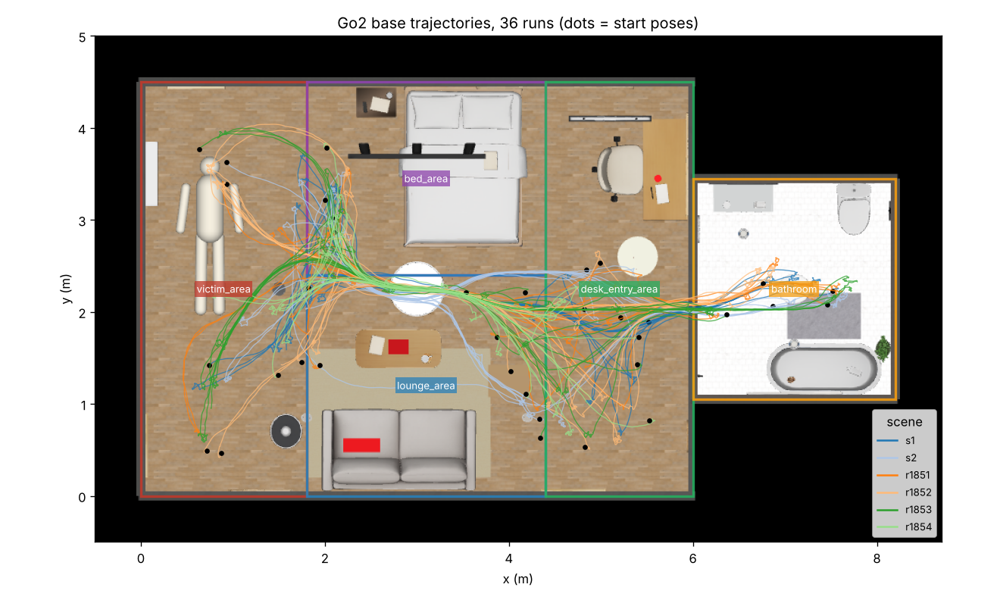 | 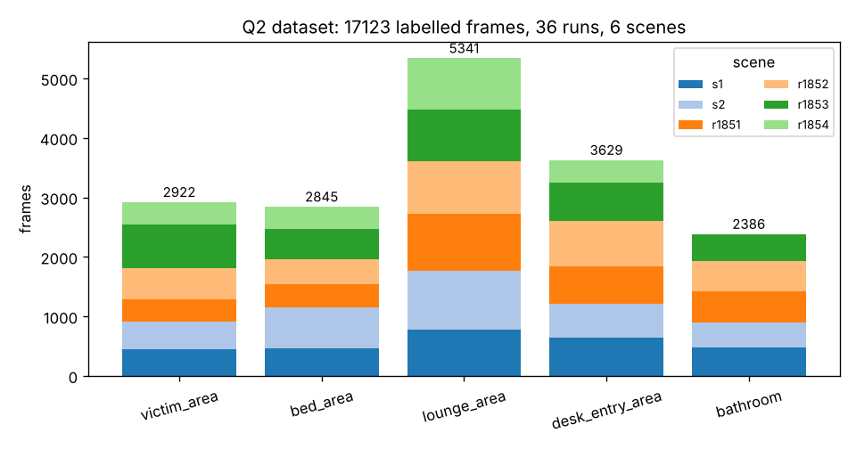 |

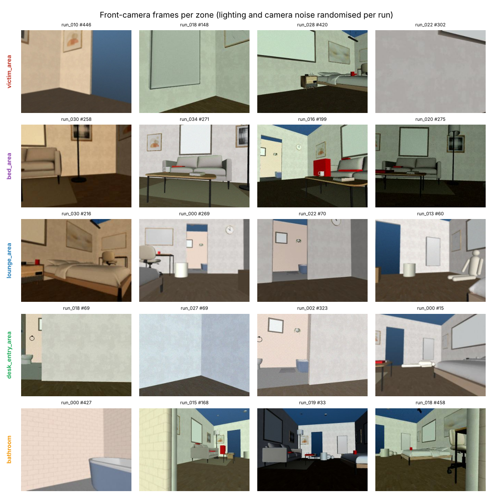

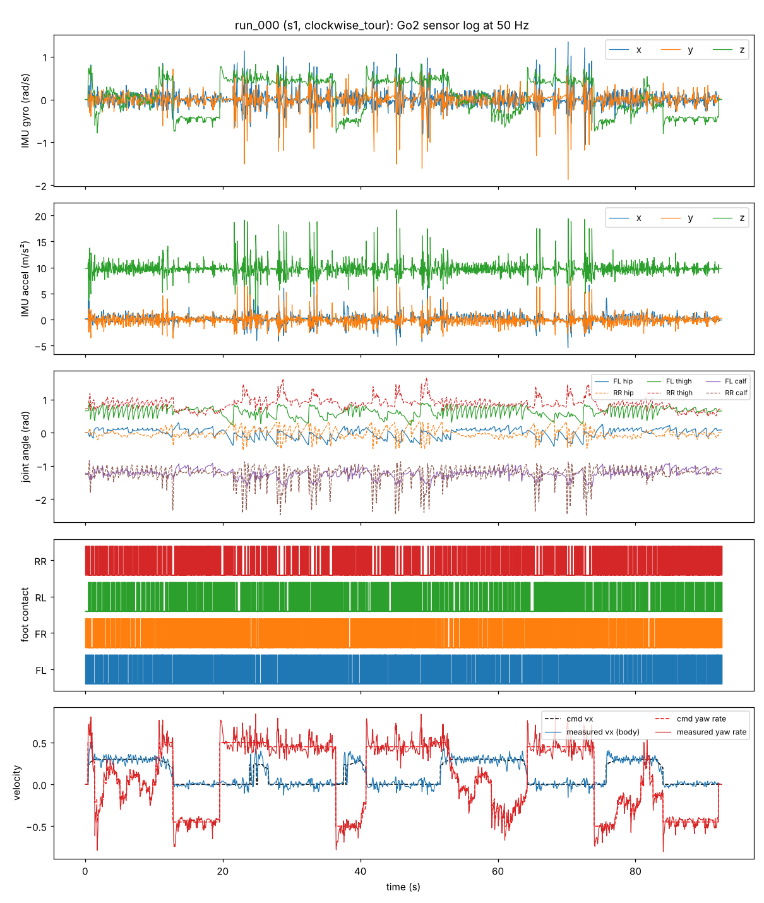

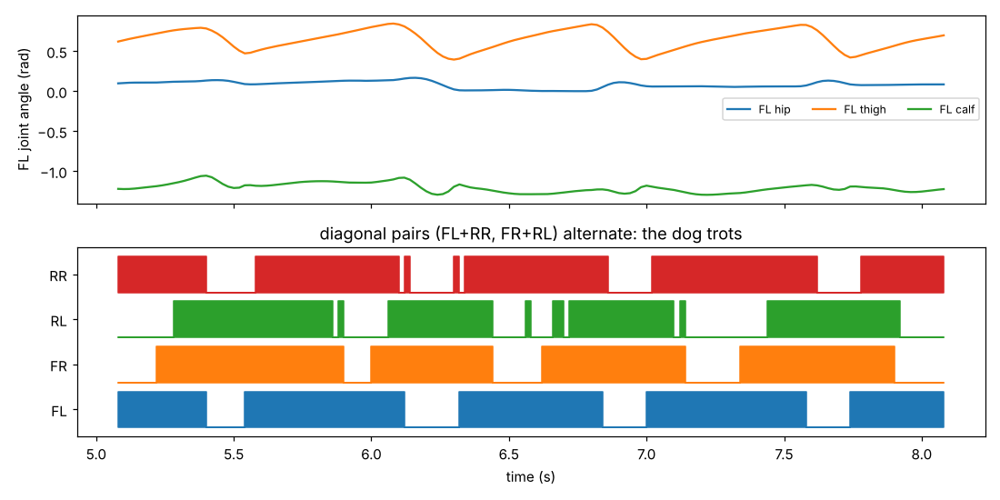

**In git:** one complete run [`data/sample/run_027`](data/sample/) (5.3 MB), the run list and config.
**Not in git:** the full 342 MB dataset; regenerate it with the command in section 3
(deterministic: same seeds, same runs).

---

## 5. Q1: Supervised learning, crime-scene zone classifier

### 5.1 Problem and data
Input: one 320x240 head-camera frame (resized to 168x224). Output: one of the 5 zones. This is coarse
visual localisation for the search robot. The 17,123 Q2 frames are split **by run**, never by frame,
so consecutive near-identical frames cannot leak between sets ([`q1_supervised/data.py`](q1_supervised/data.py)
asserts it):

| Split | Runs | Frames | What it contains |
|---|---|---|---|
| train | 20 | 10,321 | routes of scenes S1, S2, r1851-r1853 |
| val | 5 | 2,526 | one held-out route per seen scene (model selection) |
| test | 11 | 4,276 | **all 6 runs of scene r1854** (unseen props, stains, lighting) + 5 unseen routes of the other scenes |

### 5.2 Methods
* **ResNet18 transfer learning:** ImageNet-1k weights, final layer replaced by a 5-way layer, the whole
  network fine-tuned (AdamW, backbone lr 2e-4, head lr 1e-3, weight decay 1e-4, one-cycle schedule,
  label smoothing 0.05, class-weighted cross-entropy, batch 64, 8 epochs, half of the training frames
  sampled per epoch). Augmentation: random resized crop (scale 0.8-1), rotation ±5 deg, colour jitter
  (0.3 brightness/contrast/saturation, 0.03 hue); no horizontal flip (it would mirror the house).
  The download server of the torchvision weights was blocked in this environment, so the same
  ImageNet ResNet18 was taken from the ONNX Model Zoo (`resnet18-v1-7`, sha256-checked) and converted
  to torchvision, verified against onnxruntime (max relative error 7e-7)
  ([`q1_supervised/pretrained.py`](q1_supervised/pretrained.py)). On Colab torchvision's own weights are used.
* **Baselines:** (a) a small CNN trained from scratch (4 conv blocks, 1.17 M parameters, same
  augmentation, 12 epochs planned); (b) colour histograms + logistic regression: joint 8x8x8 RGB
  histogram vs joint HSV histogram, and an HSV histogram per cell of a 2x2 grid (adds coarse layout).
  The regularisation C is chosen on the validation runs.
* Config: [`config/q1_train.yaml`](config/q1_train.yaml). Code: [`train.py`](q1_supervised/train.py),
  [`baselines.py`](q1_supervised/baselines.py), [`evaluate.py`](q1_supervised/evaluate.py),
  [`gradcam.py`](q1_supervised/gradcam.py), [`demo.py`](q1_supervised/demo.py), Colab:
  [`Q1_colab.ipynb`](q1_supervised/Q1_colab.ipynb).

### 5.3 Results
Test set, 4,276 frames, from [`results/q1/metrics.json`](results/q1/metrics.json) /
[`comparison.md`](results/q1/comparison.md) (`python q1_supervised/evaluate.py`):

| Model | Test acc | Macro-F1 | Unseen scene (r1854) | Unseen routes | Acc, 1 s smoothing |
|---|---|---|---|---|---|
| **ResNet18 (ImageNet, fine-tuned)** | **0.882** | **0.887** | **0.880** | **0.883** | 0.869 |
| Small CNN (from scratch) | 0.788 | 0.794 | 0.738 | 0.832 | 0.786 |
| HSV histogram 2x2 grid + LR | 0.411 | 0.426 | 0.378 | 0.441 | 0.411 |
| HSV histogram + LR | 0.362 | 0.384 | 0.320 | 0.399 | 0.370 |
| RGB histogram + LR | 0.310 | 0.334 | 0.293 | 0.325 | 0.319 |

Per class, ResNet18:

| Zone | Precision | Recall | F1 | Support |
|---|---|---|---|---|
| victim_area | 0.860 | 0.833 | 0.846 | 663 |
| bed_area | 0.804 | 0.904 | 0.851 | 623 |
| lounge_area | 0.897 | 0.857 | 0.877 | 1,645 |
| desk_entry_area | 0.881 | 0.903 | 0.892 | 870 |
| bathroom | 0.977 | 0.966 | 0.971 | 475 |

| Confusion matrix (ResNet18) | Training curves (ResNet18) |
|---|---|
| 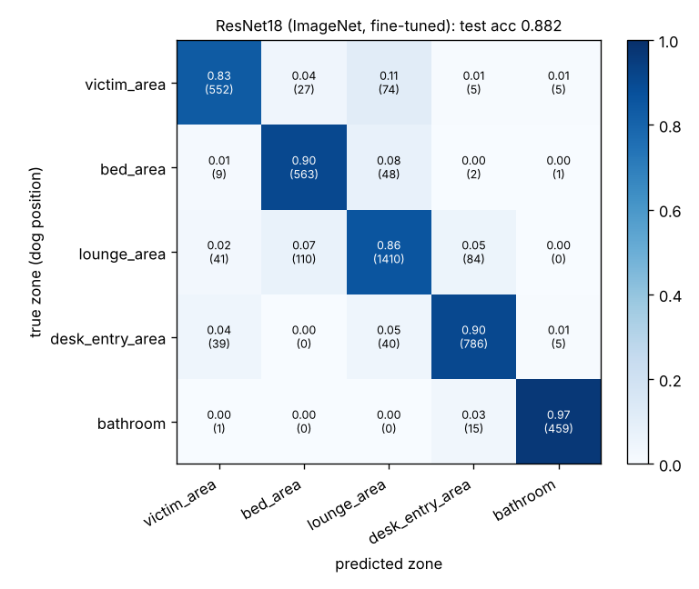 | 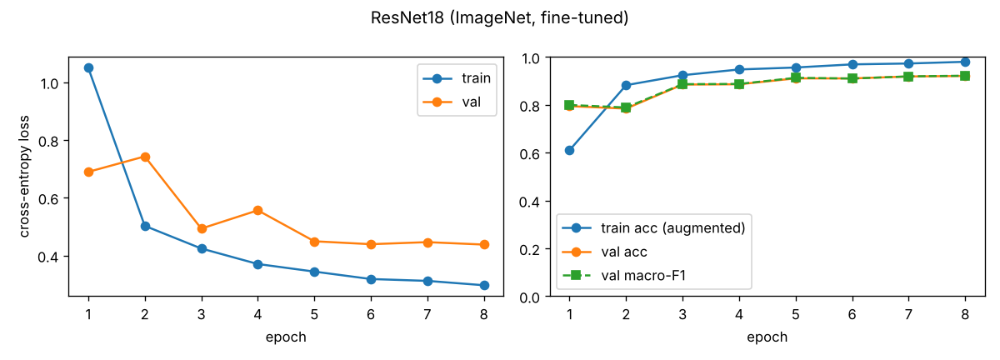 |

| Small CNN curves | Accuracy vs distance to the zone boundary |
|---|---|
| 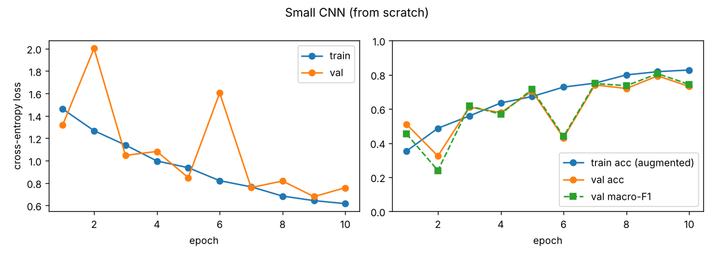 | 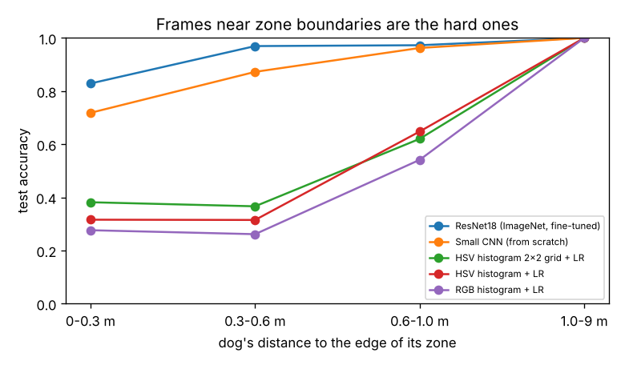 |

**Grad-CAM** ([`results/q1/gradcam.png`](results/q1/gradcam.png)): per zone, the three most confident
correct test frames and the most confident mistake.

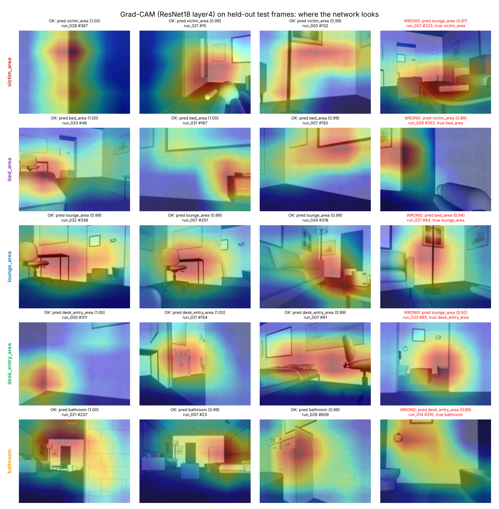

**Demo, predicted vs true zone over time** on held-out test run `run_000`
([`demo_run_000.png`](results/q1/demo_run_000.png), [`.gif`](results/q1/demo_run_000.gif),
`python q1_supervised/demo.py`): frame accuracy 0.816, 0.801 with a causal 1 s majority vote.

**Live demo** (`python q1_supervised/demo.py --live`): the classifier runs inside the MuJoCo simulation
while the Go2 walks a tour of the zones in scene **r1854**, which Q1 never trained on. Each head-camera
frame is classified as it is rendered, every 0.2 s. The bathroom is skipped because r1854's storage box
blocks its door. Over 347 frames in 69.4 s, frame accuracy is **0.911**, and 0.919 with the 1 s majority
vote ([`demo_live_r1854.png`](results/q1/demo_live_r1854.png), [`.gif`](results/q1/demo_live_r1854.gif),
[`.csv`](results/q1/demo_live_r1854.csv)).

| Recorded test run `run_000` | Live in MuJoCo, scene r1854 |
|---|---|
| 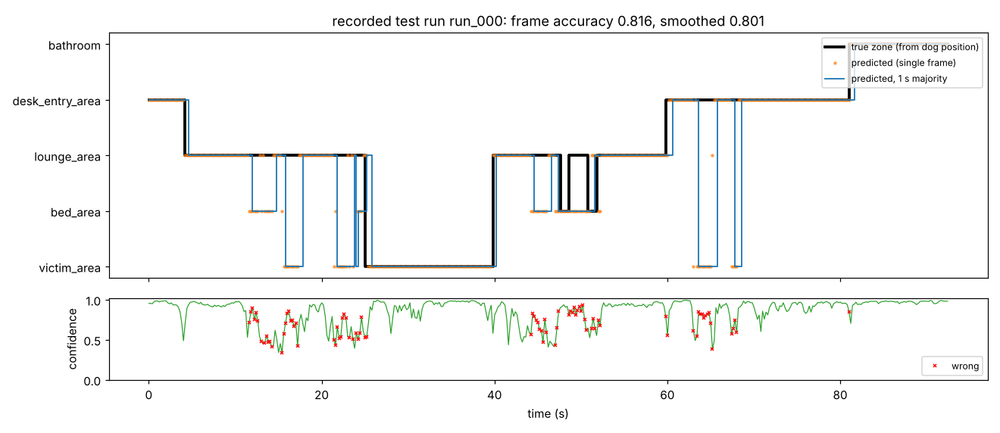 | 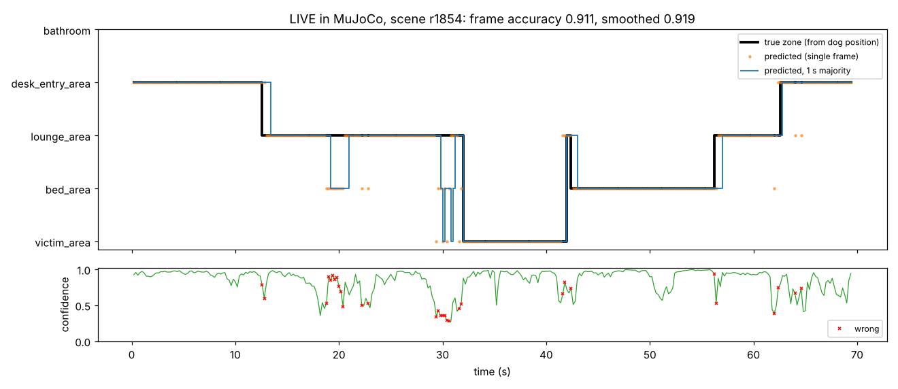 |

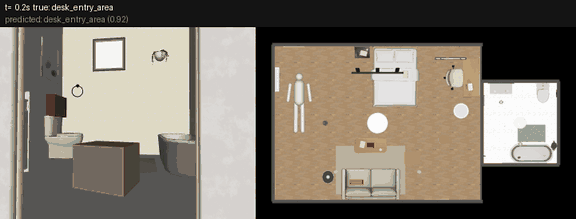

### 5.4 Discussion
* **Transfer learning is worth it:** ImageNet features beat the same-data small CNN by 9.4 points
  overall and by 14.2 points on the unseen scene, where the from-scratch network falls off more (0.738
  vs 0.832 on unseen routes of seen scenes): it learned more scene-specific cues (props, stains). The
  ResNet barely changes between the unseen scene and unseen routes (0.880 vs 0.883).
* **Colour spaces:** HSV beats RGB by 5.2 points: separating hue from brightness makes the features
  less sensitive to the lighting randomisation. Adding a 2x2 spatial grid gains another 4.9 points.
  But colour statistics alone stay far below the CNNs (0.41 vs 0.88): the zones share the same floor,
  walls and colours, and what tells them apart is *which* furniture is visible and where.
* **Errors are at the boundaries:** at more than 0.3 m inside a zone ResNet18 is 0.969-1.0 accurate;
  within 0.3 m of a boundary it is 0.829 (`accuracy_by_distance_to_zone_boundary` in `metrics.json`).
  The label is the dog's *position*, but the camera looks *ahead*, often into the next zone; the
  Grad-CAM mistakes are exactly such frames (e.g. looking at the bed from the lounge). The largest
  confusion is lounge → bed (110 frames).
* **Grad-CAM** shows the network uses furniture and doorways (desk chair, bed, sofa, bathroom door
  frame and tiles), not the floor or the lighting.
* A 1 s majority vote did not help (0.869 vs 0.882): errors near boundaries come in runs longer than 1 s.
* The small CNN run was stopped by this environment's 2 h limit on background jobs after epoch 10 of 12;
  the checkpoint used is the best-validation epoch 9 (recorded in its `train_config.json`). Its
  validation curve is noisy, so 2 more epochs would probably change little.

---

## 6. Q3: Reinforcement learning, evidence search

### 6.1 Design: train in a fast 2-D twin of the scene, deploy on the full MuJoCo Go2
* **Training environment** [`q3_rl/crime_scene_env.py`](q3_rl/crime_scene_env.py), `CrimeSceneSearchEnv`
  (Gymnasium API, registered as `CrimeSceneSearch-v0`; passes `gymnasium.utils.env_checker` and SB3's
  `check_env`, see [`tests/test_q3_env.py`](tests/test_q3_env.py)). It is built from the **real MuJoCo
  scenes**: [`extract_layouts.py`](q3_rl/extract_layouts.py) opens each scenario exactly as Q2 does and
  exports the collision footprint of walls, furniture, mannequins and props (5 cm raster, same rasteriser
  as the Q2 planner) and the ground-truth stain clusters. 24 house-185 scenes: **16 train, 2 validation
  (model selection), 6 test** (S2, r1854 = Q1's unseen scene, and 4 new random scenes), never seen in training.
  The dog is a 0.24 m disc with simple kinematics: body-frame velocity command → first-order lag →
  integration at 20 Hz (4 sub-steps per 0.2 s decision).
* **Evidence:** stain clusters with at least 5 stains and below 2 m (the head camera cannot see the
  ceiling): 89 items in the training scenes, 3 in validation, 29 in test. An item is **found** when it is in
  the head camera's view: within 1.5 m of the camera, inside its ±35 deg horizontal field of view and with
  a clear line of sight on the raster. **Contamination:** the 0.30 m footprint overlaps a *floor* stain
  cluster. **Collision:** the next position would overlap an obstacle (the move is cancelled).
* **Deployment** [`q3_rl/deploy_mujoco.py`](q3_rl/deploy_mujoco.py): the policy runs unchanged on the
  MuJoCo Go2; every 0.2 s the dog's true pose and measured body velocity are written into the env (its
  sensor model), the observation is built and the action goes to Q2's `set_velocity_command`.

### 6.2 RL formulation
* **Observation** (54 values in [-1, 1]): position (x, y) and heading (sin, cos); body velocity (vx, vy,
  yaw rate); **24 lidar rays** over 360 deg (3 m); the nearest unfound evidence: body-frame direction,
  straight-line distance, path length on the map, height, floor flag; the nearest floor stain: direction
  and clearance; **found/unfound flags** for 8 evidence slots; a **route hint** (unit vector along the
  shortest path on the known floor plan to that item, from a clearance-weighted cost map, as a real Go2's
  map and planner would give; it knows nothing about stains); the previous action; a "bumped last step" flag.
* **Action:** continuous (vx, vy, yaw rate) in [-1, 1]³, scaled to the Go2 limits 0.4 m/s, 0.15 m/s,
  0.5 rad/s (the same limits `set_velocity_command` clips to).
* **Reward**, one function per term, weights in [`config/q3_env.yaml`](config/q3_env.yaml):

  r_t = 10·n_found(t) + 2·clip(d_{t-1} − d_t, ±0.5) − 1·1[on stain] − 3·n_new_stains(t)
        − 0.5·1[collision] − 20·1[severe collision] − 0.01 + 20·1[all found]

  with d_t the path length (m) on the map from the dog to the nearest place the nearest unfound item can
  be seen from (`reward_find`, `reward_progress`, `reward_contamination`, `reward_collision`,
  `reward_time`, `reward_all_found`).
* **Termination:** all evidence found (success) or a **severe collision**: 25 consecutive colliding steps
  (5 s pushing into an obstacle, failure). **Truncation:** 900 steps (180 s).
* **Domain randomisation** on every reset: scene (16), start pose (free space, not on a stain, not already
  seeing an item), a random subset of the scene's evidence (at least 2) with ±5 cm jitter, velocity lag
  0.15-0.35 s, speed gain 0.85-1.10, action noise 3%, lidar noise 2 cm and 2% dropout.

### 6.3 Algorithm and hyper-parameters
PPO from Stable-Baselines3 2.9.2 ([`train_ppo.py`](q3_rl/train_ppo.py), [`config/q3_ppo.yaml`](config/q3_ppo.yaml)):
8 environments in `SubprocVecEnv`, MLP 256-256 (policy and value), lr 3e-4, 512 steps per env per
update (4,096), batch 1,024, 10 epochs, γ 0.995, GAE λ 0.95, clip 0.2, entropy 0.005, initial log-std
−0.5, seed 6010, **4.0 M environment steps**. TensorBoard logs (`results/q3/tb`, plus custom
`search/*` success, contamination and collision curves), a checkpoint every 100k steps, an
`EvalCallback` every 50k steps on the validation scenes (20 deterministic episodes) that keeps
`best_model.zip`. `--resume` continues from the newest checkpoint with the step counter, Monitor logs
and evaluation history intact; it was used for real here: the container restarted after the 200k-step
checkpoint and training resumed from it (the remaining 3.8 M steps took 1,853 s on 4 CPU cores,
[`results/q3/ppo/train_config.json`](results/q3/ppo/train_config.json)). The Colab notebook
[`Q3_colab.ipynb`](q3_rl/Q3_colab.ipynb) does the same with checkpoints on Google Drive.

### 6.4 Results
**Learning curves** ([`learning_curves.png`](results/q3/learning_curves.png), from the Monitor logs and
`evaluations.npz`): training success rises to about 0.9 and the evidence-found fraction to about 0.95;
validation success reaches 0.95 at 0.75 M steps and stays at 0.9-1.0 from 1 M steps on. The model kept is the best validation return
(2.8 M steps).

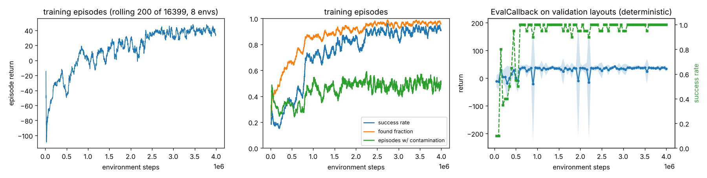

**Evaluation on the 6 test scenes** ([`results/q3/eval_metrics.json`](results/q3/eval_metrics.json),
[`comparison.md`](results/q3/comparison.md), `python q3_rl/evaluate.py`): 60 episodes per policy, the
**same** 60 episodes (scene, start, evidence subset, randomisation) for every policy:

| Policy | Success | Evidence found | Time to find all (s, successful eps) | Stain entries / ep | Steps on a stain / ep | Collision steps / ep | Severe-collision ends |
|---|---|---|---|---|---|---|---|
| random | 0.017 | 0.136 | 90.0 | 1.30 | 41.8 | 31.2 | 0.00 |
| greedy (straight at the nearest item, lidar avoidance) | 0.367 | 0.553 | 20.1 | 1.25 | 107.6 | 2.9 | 0.03 |
| planner (follows the route hint) | **0.850** | **0.876** | 18.4 | **0.52** | **6.4** | 4.7 | 0.00 |
| **PPO** | 0.633 | 0.737 | 21.0 | 1.32 | 20.1 | 8.2 | 0.10 |

Success per test scene (10 episodes each):

| | s2 | r1854 | r3101 | r3102 | r3103 | r3104 |
|---|---|---|---|---|---|---|
| greedy | 0.3 | 0.3 | 0.3 | 0.9 | 0.0 | 0.4 |
| planner | 0.9 | 1.0 | 0.3 | 1.0 | 1.0 | 0.9 |
| PPO | 0.6 | 1.0 | 0.1 | 1.0 | 0.2 | 0.9 |

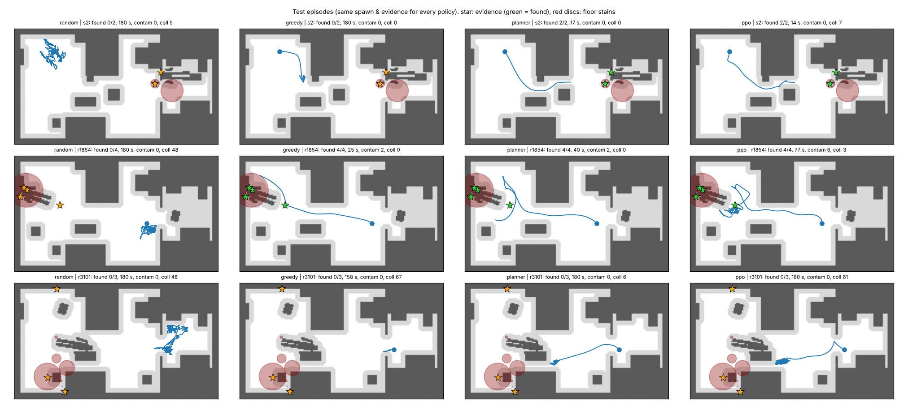

*Same three test episodes for each policy (start dot; stars = evidence, green when found; red discs = floor stains).*

**First attempt (kept for transparency,** [`results/q3/v1_obs48/`](results/q3/v1_obs48/)**):** with a 48-value
observation (no route hint, no previous action / bump flag), 3 M steps, PPO reached only 0.117 success
on the same test episodes, and 45% of its episodes ended in a severe collision: with only the
straight-line direction to the evidence it drove into furniture between it and the target and could not
tell it was stuck. Adding the route hint and the bump/previous-action inputs gave the result above.

**Deployment in full MuJoCo** (`python q3_rl/deploy_mujoco.py --layout s2` / `--layout r1854`): the
PPO policy drives the MuJoCo Go2 (learned locomotion controller, real contacts) through its velocity
commands. On test scene **S2** it found **3/3** items in **16.4 s** with **0** steps with a foot in a
stain and 9 control steps with a robot-scene contact
([`deploy_s2.json`](results/q3/deploy_s2.json)); on **r1854** it found **5/5** in **39.0 s**, with 7 steps
with a foot inside the victim's large blood pool and 1 contact step ([`deploy_r1854.json`](results/q3/deploy_r1854.json));
the dog stayed upright (min upright 0.969 / 0.994). (An earlier version of these two runs left the policy's
"previous action" and "bumped" inputs at zero during deployment, unlike in training; they are now filled in
as in training, and the runs above were redone with that fix.)

| S2 | r1854 |
|---|---|
| 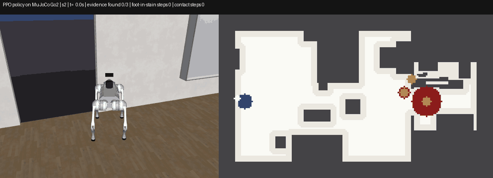 | 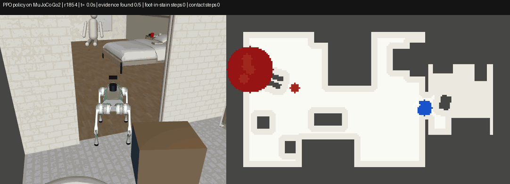 |

**Greedy baseline on the MuJoCo Go2** (`python q3_rl/deploy_mujoco.py --layout s2 --policy greedy --gif-every 6`,
same scenes and start poses as PPO, [`deploy_s2_greedy.json`](results/q3/deploy_s2_greedy.json),
[`deploy_r1854_greedy.json`](results/q3/deploy_r1854_greedy.json)):

| Scene | Policy | Found | Time | Steps with a foot in a stain | Stain entries (footprint) | Contact steps |
|---|---|---|---|---|---|---|
| S2 | PPO | **3/3** | **16.4 s** | 0 | 0 | 9 |
| S2 | greedy | 0/3 | 180 s (time limit) | 0 | 0 | 4 |
| r1854 | PPO | **5/5** | **39.0 s** | 7 | 5 | 1 |
| r1854 | greedy | 1/5 | 180 s (time limit) | 0 | 1 | 0 |

Greedy does not crash into things; it **deadlocks**. In S2 it stops after about 30 s in the gap between
the bed and the bin and does not move for the remaining 150 s. In r1854 it stops after one find. Its
corridor check forbids driving forward, but the open direction it picks is close enough to straight ahead
that it does not turn either. The 2-D evaluation shows the same weakness (0.367 success). All deployment GIFs
play at 2x speed; the greedy ones show every 6th control step instead of every 2nd, to keep them small.

| Greedy, S2 | Greedy, r1854 |
|---|---|
| 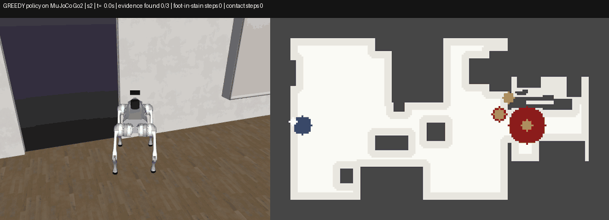 | 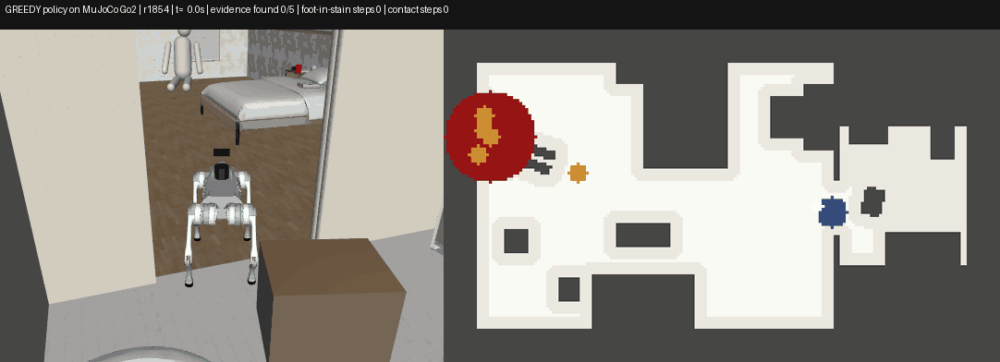 |

**MuJoCo evaluation over many starts, and the 2-D → MuJoCo gap** (`python q3_rl/deploy_eval.py`,
[`deploy_eval_metrics.json`](results/q3/deploy_eval_metrics.json), [`deploy_eval_episodes.csv`](results/q3/deploy_eval_episodes.csv)).
Each policy ran from 10 start poses in each of the 6 test scenes, i.e. 60 episodes per policy, on the
MuJoCo Go2 **and** in the 2-D environment from the identical start. Here every evidence item of the scene
must be found, with no random subset or noise, so the numbers are not the same protocol as the 2-D table above.

| Policy | Success 2-D | Success MuJoCo | Same outcome in both | Time, successful eps (2-D / MuJoCo) | Stain entries / ep (2-D / MuJoCo) | Steps with a foot in a stain / ep (MuJoCo) |
|---|---|---|---|---|---|---|
| PPO | 0.533 | **0.633** | 0.80 | 36.9 / 24.0 s | 2.00 / 1.68 | 3.0 |
| greedy | 0.250 | 0.183 | 0.93 | 9.7 / 8.7 s | 0.70 / 0.85 | 148.1 |
| planner | **0.733** | **0.700** | 0.93 | 20.5 / 18.9 s | 0.60 / 0.78 | 4.0 |

Success per test scene, 2-D → MuJoCo (10 starts each):

| | s2 | r1854 | r3101 | r3102 | r3103 | r3104 |
|---|---|---|---|---|---|---|
| PPO | 0.3 → 1.0 | 0.9 → 1.0 | 0.1 → 0.0 | 0.9 → 1.0 | 0.0 → 0.0 | 1.0 → 0.8 |
| greedy | 0.3 → 0.3 | 0.0 → 0.0 | 0.2 → 0.1 | 1.0 → 0.7 | 0.0 → 0.0 | 0.0 → 0.0 |
| planner | 0.3 → 0.4 | 0.8 → 0.7 | 0.3 → 0.3 | 1.0 → 1.0 | 1.0 → 0.9 | 1.0 → 0.9 |

* **The policies transfer to the legged robot.** The ranking is the same in both simulators (planner >
  PPO > greedy). Greedy and the planner end the same way in 93% of the paired episodes, and PPO in 80%.
* **PPO does better on the real dynamics than in its training simulator** (0.633 vs 0.533), almost entirely
  in S2 (0.3 → 1.0). In the 2-D twin a blocked move is cancelled outright. The legged Go2 can instead brush
  past an obstacle's edge and keep going: PPO has 6.5 contact steps per MuJoCo episode at the median.
* **The disc model is optimistic about clearance.** MuJoCo shows robot-scene contacts in 33 (planner),
  32 (greedy) and 44 (PPO) of 60 episodes, against almost none in 2-D. The 0.24 m disc is narrower than the
  Go2's 0.7 m-long body, so gaps that are free in 2-D make the real body touch furniture. The mean contact
  counts (65.5 PPO, 95.7 planner, 53.1 greedy steps per episode) come from a few episodes where the dog keeps
  pushing into furniture; the medians are 6.5, 1 and 1.
* **No falls.** Only 1 PPO and 2 greedy episodes tilted below 0.8 uprightness (lowest 0.619, an episode PPO
  still completed), and the planner stayed above 0.955.
* Greedy's 148 foot-in-stain steps per episode come from deadlocks on top of a stain, where it then
  stands for the rest of the episode.

### 6.5 Discussion
* **All the RL components are in the code and work:** environment, observation, action, six reward
  terms, termination/truncation, domain randomisation, PPO with vectorised envs, TensorBoard,
  checkpoints, evaluation callback, resume, baselines, deployment on the physical simulation.
* **PPO beats the random and greedy baselines** (0.633 vs 0.017 / 0.367 success), and when it succeeds it
  is about as fast as the planner (21.0 vs 18.4 s). Its main remaining failures are two scenes (r3101,
  r3103) with narrow passages between furniture where it gets stuck (10% of episodes end in a severe
  collision); r3101 is hard for every policy.
* **PPO does not beat the map-following planner.** The planner uses the same route hint perfectly; PPO
  has to learn to use it, and its validation set (2 small scenes, 3 items) saturated at 100% success
  early, so model selection could not tell good from better policies.
* **Contamination:** the reward made PPO spend far fewer steps on stains than greedy (20.1 vs 107.6 per
  episode) but it still enters about as many stains as greedy (1.32 vs 1.25 per episode), and more than the
  planner (0.52), whose clearance-weighted paths keep it away from furniture where the stains also are.
  Many evidence items sit *inside* a large floor pool (e.g. the victim area of r1854), so seeing them
  without stepping near them is genuinely hard; the entry penalty (3) is small next to the find reward (10).
* **What would come next:** the obvious next step, training on the Go2's real body shape with harder
  validation and a larger stain penalty, was tried and did **not** help (section 6.6). Next would be a
  curriculum on narrow passages (start in open space, then tighter scenes), a recurrent policy or frame
  stacking against getting stuck, stain cells added to the route hint's cost, and training directly with
  MuJoCo in the loop for the last stage.

### 6.6 Improvement attempt (v3): the Go2's real body shape, harder validation, stronger stain penalty
The MuJoCo evaluation above showed that the 2-D twin's 0.24 m disc is narrower than the real Go2. A third
run (**v3**, [`config/q3_env_v3_rect.yaml`](config/q3_env_v3_rect.yaml), [`config/q3_ppo_v3_rect.yaml`](config/q3_ppo_v3_rect.yaml),
results in [`results/q3/v3_rect/`](results/q3/v3_rect/)) changed three things and kept everything else (same
PPO settings, 4 M steps, same test scenes and seeds):
1. **Body:** collisions use the Go2's 0.70 x 0.32 m body as a rotated rectangle. A move or a turn that would
   make it overlap an obstacle is cancelled, so the dog has to line up with narrow gaps. With the disc
   config the new code reproduces the v2 evaluation exactly.
2. **Validation:** 6 scenes instead of 2 (4 new random scenes, r3203-r3206), so model selection is not saturated.
3. **Stain penalty:** 8 instead of 3 for each new floor stain entered.

**Result: v3 is worse than v2, so v2 remains the reported policy.**

| | v2 (disc, the reported policy) | v3 (rectangle body) |
|---|---|---|
| Training scenes, last 500 training episodes: success / severe-collision ends ([`train_summary.json`](results/q3/train_summary.json), [v3](results/q3/v3_rect/train_summary.json)) | 0.928 / 0.010 | 0.428 / 0.126 |
| 2-D test, 60 episodes: PPO success (planner in the same 2-D model) ([v3 `comparison.md`](results/q3/v3_rect/comparison.md)) | 0.633 (0.850) | 0.250 (0.700) |
| **MuJoCo, the same 60 starts: PPO success** ([v3 `deploy_eval.md`](results/q3/v3_rect/deploy_eval.md)) | **0.633** | 0.467 |
| MuJoCo: planner success | 0.700 | 0.667 |
| MuJoCo, PPO: stain entries / steps with a foot in a stain per episode | 1.68 / 3.0 | 1.40 / 26.5 |
| Showcase deployments, PPO: S2 / r1854 ([v3 `deploy_s2.json`](results/q3/v3_rect/deploy_s2.json), [`deploy_r1854.json`](results/q3/v3_rect/deploy_r1854.json)) | 3/3 in 16.4 s / 5/5 in 39.0 s | 0/3 / 2/5 (180 s limit) |

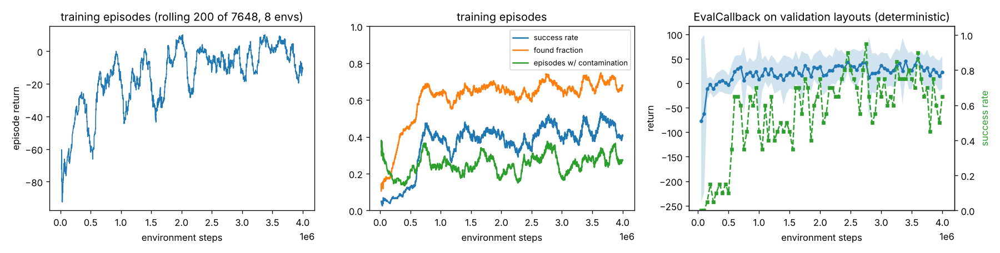

* **v3 did not learn its own training scenes.** Training success plateaus at about 0.4 from 0.8 M steps on
  (left and middle plots), and 12.6% of its last 500 training episodes end in a severe collision. This is
  not overfitting: the task with the real body is much harder (the planner also drops from 0.850 to 0.700
  in 2-D), and the curve is flat, so more steps alone would probably not help.
* **Validation was still a poor guide.** The selected checkpoint (3.6 M steps) scored 0.9 on the validation
  episodes but 0.25 on the test scenes. 20 evaluation episodes per check are noisy, and 2 of the 6
  validation scenes have only 1-2 evidence items, while every test scene has 3-7.
* **The stronger stain penalty** cut 2-D stain entries (v3 PPO 0.90 per episode vs 1.32 for v2, though in
  different 2-D body models). On the MuJoCo dog v3 kept a foot in a stain for 26.5 steps per episode: 58% of
  those steps come from failed episodes, almost all from one r1854 episode that stalls on a stain for 898
  of its 900 steps, and the rest from successful r3102 episodes that cross a stain on the way.
* **Choosing v2 used the test scenes.** Both runs are reported in full, but the choice of v2 as "the"
  policy was made after seeing both on the same MuJoCo test starts, so v2's 0.633 there is a slightly
  optimistic estimate.

---

## 7. Limitations and future work
* **Simulation only.** Nothing here ran on the physical Go2. Sim-to-real steps: replace the
  ground-truth evidence positions by detections (the Phase 2 stain detector / a camera classifier),
  replace the raster lidar by the Go2's L1 LiDAR scans, and run the velocity commands through
  `SportClient.Move` as in Test 1's `go2_stream`, with the existing watchdog and speed limits.
* **Zone labels from position, camera looks ahead** (Q1): a label from the camera's view frustum, or
  a sequence model over several frames, would remove most boundary errors.
* **One house.** All Q1/Q3 scenes are house 185 (different events, props and lighting). Generalisation
  to another floor plan (house 186) is untested; the scripts accept it but zones would need defining.
* **Q3 runs in a 2-D twin of the scene:** the dog is a disc, obstacles are the footprints of their MuJoCo box
  colliders (anything a box collider covers counts as blocked, even if the dog could fit under part of it), evidence positions and the "found" test come from the
  ground truth rather than a detector, and the lidar is ray-cast on the raster. The MuJoCo deployment
  shows the commands transfer to the legged robot (60 paired episodes per policy: the same outcome in 80-93%
  of them); the disc model is narrower than the Go2's body, so the real dog touches furniture in gaps the
  2-D twin treats as free.
* **Q3 PPO** is below the map-following planner (0.633 vs 0.850 success) and enters about one floor stain per
  episode. Training on the Go2's real body shape (v3, section 6.6) made the 2-D twin more faithful but the
  policy worse (0.467 vs 0.633 success on the MuJoCo dog); that is still an open problem.
* **Compute:** everything ran on a 4-core CPU. The small CNN was stopped at epoch 10/12 by a time limit.

## 8. How Test 2 builds on Test 1
* **Phase 1 / Test 1** ([`docs/phase1_summary.md`](../docs/phase1_summary.md),
  [`docs/phase1_results/`](../docs/phase1_results/), [`go2_stream/`](../go2_stream/)): Go2 camera and LiDAR
  streaming and keyboard teleop on the real Go2 EDU, YOLO object detection, a kinematic MuJoCo world and
  a top-down object map. Test 2 keeps its top-down map style and its velocity-command interface
  (`SportClient.Move(vx, vy, yaw_rate)` ↔ `set_velocity_command(vx, vy, yaw_rate)`), so a Q3 policy
  could be sent to the real dog through the Test 1 teleop/control path.
* **Phase 2 crime-scene simulator** ([`Phase_2_Investigator/README.md`](../Phase_2_Investigator/README.md),
  [`docs/stage_a_checklist.md`](../Phase_2_Investigator/docs/stage_a_checklist.md)): Test 2 imports, without
  modifying them,
  * [`sim_env/runtime.py`](../Phase_2_Investigator/sim_env/runtime.py) `SimSession` (MuJoCo Go2 + sensors + controller),
  * [`sim_env/scenario_scene.py`](../Phase_2_Investigator/sim_env/scenario_scene.py) `open_scenario` (crime scenes with ground truth),
  * [`sim_env/scenarios/random_sim.py`](../Phase_2_Investigator/sim_env/scenarios/random_sim.py) (random scenarios),
  * [`navigation/occupancy.py`](../Phase_2_Investigator/navigation/occupancy.py) and [`navigation/planner.py`](../Phase_2_Investigator/navigation/planner.py) (grid + A*).

  What Test 2 adds on top: the learned locomotion policy behind one velocity interface, joint/foot
  logging, zone labels, lighting/noise randomisation and the dataset pipeline (Q2), the zone classifier
  (Q1), and the RL environment, training and deployment (Q3). No file outside `Test2/` was changed
  (except a link in the root `README.md`).

## 9. Repository layout and what is not in git
```
Test2/
├── README.md, PLAN.md, requirements.txt
├── config/        zones.yaml, collect.yaml (Q2), q1_train.yaml, q3_env.yaml (env + reward weights), q3_ppo.yaml
├── go2sim/        CrimeSceneGo2 (scene + learned controller + sensors), static map, waypoint follower, randomisation
├── q2_data_simulation/  collect_dataset.py, analyze.py, make_gif.py
├── q1_supervised/ data.py, models.py, pretrained.py, train.py, baselines.py, evaluate.py, gradcam.py, demo.py, Q1_colab.ipynb
├── q3_rl/         extract_layouts.py, layouts/, crime_scene_env.py, train_ppo.py, evaluate.py, deploy_mujoco.py, Q3_colab.ipynb
├── tests/         pytest: zones/planner, Q3 environment
├── data/          sample/run_027 + README (regeneration, column reference)
└── results/       q2/, q1/, q3/: figures, GIFs, metrics JSON, small checkpoints
```
Left out of git (`.gitignore`), and how to get them back:

| Not in git | Size | Regenerate with |
|---|---|---|
| `data/full/` (36 runs, 17,123 frames) | 342 MB | `python q2_data_simulation/collect_dataset.py --workers 4` |
| `data/full/_q1_cache/` (decoded frames) | ~1.9 GB | built automatically by Q1 scripts |
| `results/q1/*/best_fp32.pt` | 45 + 4.7 MB | `python q1_supervised/train.py --model ...`; the committed `best.pt` files are the same weights in fp16 (identical ResNet18 test predictions) |
| `results/q3/ppo/checkpoints/`, `results/q3/tb/` | 76 MB + 1 MB | `python q3_rl/train_ppo.py`; `best_model.zip` and `final_model.zip` are committed |

## 10. References
Professor's links:
* ShijieZhao36, *unitree_go2_create_dataset*: https://github.com/ShijieZhao36/unitree_go2_create_dataset
* Unitree Robotics, *unitree_rl_gym*: https://github.com/unitreerobotics/unitree_rl_gym
* H. Bounds, *Go2 RL locomotion*: https://harrisonbounds.github.io/dog/go2.html
* *unitree_rl_gym documentation*: https://zsc.github.io/unitree_rl_gym/

Software and methods:
* syswonder, *robot-unitree-go2-mujoco* (simulator, learned Go2 policy): https://github.com/syswonder/robot-unitree-go2-mujoco
* Unitree Robotics, *unitree_mujoco* (Go2 model): https://github.com/unitreerobotics/unitree_mujoco
* E. Todorov, T. Erez, Y. Tassa, "MuJoCo: A physics engine for model-based control", IROS 2012.
* K. He, X. Zhang, S. Ren, J. Sun, "Deep Residual Learning for Image Recognition", CVPR 2016.
* ONNX Model Zoo, ResNet18 v1-7: https://github.com/onnx/models
* R. R. Selvaraju et al., "Grad-CAM: Visual Explanations from Deep Networks via Gradient-based Localization", ICCV 2017.
* J. Schulman, F. Wolski, P. Dhariwal, A. Radford, O. Klimov, "Proximal Policy Optimization Algorithms", arXiv:1707.06347, 2017.
* A. Raffin et al., "Stable-Baselines3: Reliable Reinforcement Learning Implementations", JMLR 22(268), 2021.
* M. Towers et al., "Gymnasium: A Standard Interface for Reinforcement Learning Environments", arXiv:2407.17032, 2024.
* S. Thrun, W. Burgard, D. Fox, *Probabilistic Robotics* (occupancy grids), MIT Press, 2005.
