# A Unitree Go2 That Searches a Crime Scene

**ENG 6010 — Second Test: Technical Report**

Repository: <https://github.com/CDJ7/Unitree-Dog-Claude-Dog-> (folder `Test2/`) · November 2026

All numbers in this report are read from result files that the project's scripts wrote. The file is named
next to each table or figure. A shorter, reproduction-oriented companion is [`README.md`](README.md).

---

## Abstract

Searching a crime scene is slow, and every person who walks through it risks contaminating evidence. This
project builds three connected pieces of a robotic search system on a simulated **Unitree Go2** quadruped,
in a MuJoCo model of a furnished house with a physically simulated blood-spatter event.

**Q2, data and simulation:**
- **Locomotion:** the Go2 walks on real contact physics with a learned locomotion policy behind a single
  `set_velocity_command(vx, vy, yaw_rate)` interface.
- **Data collection:** a waypoint follower drives 36 routes through six crime scenes while a recorder
  writes a structured dataset:
  - **17,123** head-camera frames, each labelled with the crime-scene zone;
  - **171,083** time-synchronised 50 Hz state rows (IMU, 12-joint positions, velocities and torques, foot
    contacts, pose, commands);
  - lighting and camera-noise randomisation.

**Q1, supervised learning:** a ResNet18 fine-tuned from ImageNet weights identifies which of five zones the
dog is in from a single frame.
- **0.882** accuracy on held-out test runs, and **0.880** on a scene never seen in training.
- Comparison models, on the same split: a small CNN trained from scratch (0.788) and colour-histogram
  classifiers (RGB 0.310, HSV 0.362, HSV on a 2×2 grid 0.411).
- Running live inside the simulation on the unseen scene, it is right **0.911** of the time.

**Q3, reinforcement learning:** a PPO policy learns to find all evidence quickly while avoiding floor stains
and furniture.
- **Training:** in a fast 2-D twin of the real scenes that models the Go2's actual body shape, with a training
  curriculum.
- **2-D test:** it finds all evidence in **0.533** of test episodes (random 0.050, greedy 0.300; a
  map-following planner 0.700).
- **Real physics:** deployed unchanged on the legged MuJoCo Go2, it succeeds from **0.667** of 60 test
  starts, ahead of the planner (0.650) and greedy (0.183).
- **Development:** four training runs were needed. The report documents each step, including a failed one,
  with paired statistical tests.

**On the real Go2 (section 7):** the Q1 pipeline is carried over to the physical dog in a
four-zone lab (lab_1, lab_2, open_area, shelves).
- **Tools:** connections over Ethernet (Unitree SDK) and Wi-Fi (WebRTC), a labelled recorder, retraining
  with the unchanged Q1 code, and a live recognition demo.
- **Autonomy:** a *go-to-zone* behaviour finds a requested zone with the camera classifier and avoids
  obstacles on the way with the LiDAR.
- **Checked in simulation:** in a closed-loop 2-D room it reached the zone in **16/16** runs when a desk
  blocked the way, and in **10/16** when a shelf hid the zone, with no collisions.
- **Real data:** 5 sessions on the real dog gave 7,346 labelled frames. On a held-out session the
  ResNet18 is right **0.814** of the time (macro-F1 0.803; simulation 0.882). Most errors happen when
  the dog stands in one zone but faces another.
- **Pending:** the live-demo video and the go-to-zone trials on the dog.

---

## Contents

1. [Introduction](#1-introduction)
2. [Background](#2-background)
3. [System overview](#3-system-overview)
4. [Q2: Dog data and simulation](#4-q2-dog-data-and-simulation)
5. [Q1: Crime-scene zone classifier](#5-q1-crime-scene-zone-classifier)
6. [Q3: Reinforcement-learning evidence search](#6-q3-reinforcement-learning-evidence-search)
7. [Toward the real Go2: lab zones and go-to-zone](#7-toward-the-real-go2-lab-zones-and-go-to-zone)
8. [Discussion across the three questions](#8-discussion-across-the-three-questions)
9. [Limitations and future work](#9-limitations-and-future-work)
10. [Reproducibility](#10-reproducibility)
11. [Conclusion](#11-conclusion)
12. [References](#12-references)
13. [Appendices](#appendices)

---

## 1. Introduction

### 1.1 Motivation
A crime scene has to be documented completely, and the first rule of doing so is to change nothing. People
who walk through a scene leave shoe prints in blood pools, smear drip trails and move objects. A quadruped
robot is a natural candidate for the first survey:
- it fits through cluttered indoor spaces;
- it carries cameras and other sensors;
- it can record everything it senses;
- it can plan routes that reach every piece of evidence without stepping on any of it.

### 1.2 Objectives
The test asks for three pieces of such a system on the Unitree Go2, under one theme:

| Question | Task | What is delivered |
|---|---|---|
| **Q2** Data & simulation | Make the dog move through the crime scene in simulation and record a real, structured dataset of everything it senses | Go2 with a learned locomotion controller, waypoint routes, a 36-run multi-sensor dataset, analysis plots |
| **Q1** Supervised learning | Recognise which zone of the crime scene the dog is in from its camera | ResNet18 transfer learning vs a small CNN and colour-histogram baselines, Grad-CAM, a live demo |
| **Q3** Reinforcement learning | Learn a search policy that finds all evidence fast without contaminating it or colliding | A Gymnasium environment built from the real scenes, PPO with a curriculum, baselines, deployment on the physical simulation |

### 1.3 How the pieces connect
- **Q2 → Q1:** Q2's recorded frames, labelled automatically from the dog's position, are Q1's training data.
- **Q2 → Q3:**
  - Q3's training environment is exported from the same MuJoCo scenes.
  - The trained policy is deployed through Q2's velocity interface on the same legged Go2.

### 1.4 Main findings
1. A learned locomotion policy plus an A*/pure-pursuit follower produces a clean, balanced dataset:
   - 184 of 191 route goals reached;
   - zone classes within a factor of 2.2 of each other;
   - a proper trot gait in the recorded joint and contact data.
2. ImageNet transfer learning is clearly worth it. The fine-tuned ResNet18 beats a same-data CNN trained from
   scratch by 9.4 points, and by 14.2 points on the unseen scene. Colour statistics alone are far behind.
   Almost all remaining errors are within 0.3 m of a zone boundary: the camera looks ahead into the next zone.
3. For RL, the observation and the training procedure mattered more than the algorithm:
   - **v1:** without a route hint, PPO failed (0.117 success).
   - **v2:** with a route hint, it worked on a simplified body (0.633).
   - **v3:** on the real body shape without help, it failed again (0.467 on MuJoCo).
   - **v4:** with a curriculum, it succeeded on the real body (0.667 on MuJoCo).

---

## 2. Background

### 2.1 Platform: the Unitree Go2
The Go2 is a 15 kg quadruped:
- **Joints:** 12 actuated joints, a hip, thigh and calf on each leg.
- **Body:** about 0.70 m long and 0.31 m wide.
- **Sensors:** a head camera and a LiDAR.
- **Control:** it accepts body-frame velocity commands, vx (forward), vy (sideways) and yaw rate. Test 1
  drove a real Go2 EDU through exactly this interface (`SportClient.Move`).

This project keeps that interface so that a policy from Q3 could, in principle, drive the real dog.

### 2.2 Simulation
- **Physics:** MuJoCo [Todorov 2012], through the `robot-unitree-go2-mujoco` simulator, which includes the
  official `unitree_mujoco` Go2 model.
- **Crime scenes:** they come from this repository's Phase 2 work, `Phase_2_Investigator/`, which places
  mannequins, props and a ballistically simulated blood-spatter event into furnished houses. It also keeps
  the ground truth of every stain cluster.
- **Locomotion policies:** the professor's references include `unitree_rl_gym`, which trains them with Isaac
  Gym. Its released deploy policies cover the G1, H1 and H1-2 robots but **not the Go2**, which Step 0 of
  this project confirmed ([PLAN.md](PLAN.md)). The Go2 is therefore driven by the learned "MoE Rough" Go2
  policy that ships with the simulator (section 4.1).

### 2.3 Learning methods
- **Q1, transfer learning:** a ResNet18 [He 2016] pretrained on ImageNet, fine-tuned end to end.
- **Q1, explanation:** Grad-CAM [Selvaraju 2017] shows which pixels drive each decision.
- **Q3, RL algorithm:** Proximal Policy Optimization [Schulman 2017], an on-policy actor-critic method with
  a clipped surrogate objective, as implemented in Stable-Baselines3 [Raffin 2021], on a Gymnasium
  environment [Towers 2024].
- **Q3, curriculum learning:** the policy first trains on easy versions of the task, which become harder as
  it improves.

---

## 3. System overview

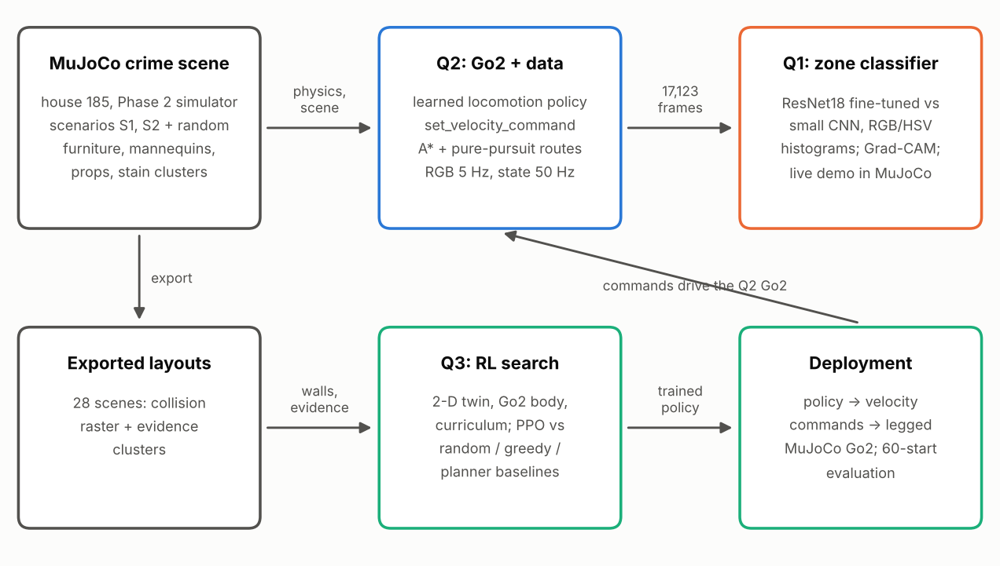

*Figure 3.1 — How the three questions connect.*

| Component | Code | Role |
|---|---|---|
| Crime scenes | `Phase_2_Investigator/sim_env/` (imported, not modified) | MuJoCo scenes, mannequins, props, stain ground truth |
| `CrimeSceneGo2` | [`go2sim/go2_env.py`](go2sim/go2_env.py) | Scene + Go2 + learned controller + sensors + lighting; `set_velocity_command` |
| Waypoint follower | [`go2sim/waypoint_follower.py`](go2sim/waypoint_follower.py) | A* on a 5 cm grid, pure pursuit, replanning |
| Data pipeline | [`q2_data_simulation/`](q2_data_simulation/) | Routes, recording, randomisation, analysis |
| Zone classifier | [`q1_supervised/`](q1_supervised/) | Dataset, models, training, evaluation, Grad-CAM, demos |
| RL environment | [`q3_rl/crime_scene_env.py`](q3_rl/crime_scene_env.py) | 2-D twin of the scenes, rewards, curriculum |
| RL training / evaluation | [`q3_rl/`](q3_rl/) | PPO, baselines, MuJoCo deployment, paired comparisons |

---

## 4. Q2: Dog data and simulation

### 4.1 Simulation setup
- **Scene:** `scenesmith_house_185` is a furnished living room (6.0 × 4.5 m) and a bathroom (2.2 × 2.4 m),
  with about 100 textured furniture meshes and box colliders. Each scenario adds:
  - mannequins (victim, sometimes an attacker);
  - props, such as a storage box and a laundry basket;
  - distractors: red objects that are *not* blood, such as a cushion, a book and a mug;
  - a blood-spatter event whose stains land on walls, floor and furniture.
- **Six scenes:**
  - **S1:** pipe, impact plus cast-off;
  - **S2:** knife, projected spatter plus a drip trail;
  - **r1851–r1854:** four seeded random scenarios in the same house.
- **Robot:** the official `unitree_mujoco` `go2.xml`, unmodified: 12 torque-driven joints and real contact
  physics.
- **Locomotion controller:** the simulator's learned Go2 policy, "MoE Rough", in ONNX format.
  - It turns a velocity command into joint-position targets at 50 Hz.
  - PD torque control tracks the targets (kp 20, kd 0.5).
  - The dog walks with a genuine trot (section 4.5); it does not slide.
  - One interface, `CrimeSceneGo2.set_velocity_command(vx, vy, yaw_rate)`, clips commands to the gait
    limits of 0.4 m/s, 0.15 m/s and 0.5 rad/s.
- **Lighting:** house 185 has no light sources, so three dimmable ceiling lamps are added when the scene is
  loaded.

### 4.2 Moving through the scene
[`waypoint_follower.py`](go2sim/waypoint_follower.py) plans an A* path on a 5 cm occupancy grid built from
the MuJoCo collision geometry, using a 0.24 m robot radius.
- **Path following:** pure pursuit with a 0.35 m lookahead, plus a sideways correction term.
- **Recovery:** it turns in place for large heading errors, replans (at most once per second) when off the
  path, and detects when it is stuck.
- **Routes**, in [`config/collect.yaml`](config/collect.yaml):
  - 4 hand-made routes per scene, with different starts, zone orders and speeds of 0.20–0.40 m/s;
  - 2 random routes per scene, with random zone sequences, speeds and in-place look-around spins.
- **Balance:** an adaptive dwell adds extra spins in zones that are under-represented so far.

### 4.3 Sensors and recording
The record format mirrors the `RobotState.msg` of the professor's `unitree_go2_create_dataset` reference
(IMU, motor q/dq/tau, foot force, velocity command):
- **Head RGB camera:** mounted at `base_link` + (0.32, 0, 0.12) m with a 60° vertical field of view;
  320 × 240 pixels at **5 Hz**.
- **State at 50 Hz:** 81 columns per row:
  - base pose and velocities (world and body frame);
  - IMU quaternion, gyroscope and accelerometer;
  - all 12 joint positions, velocities and torques;
  - four foot forces and contact flags (a force over 5 N counts as contact);
  - the velocity command;
  - the zone label;
  - the index of the camera frame recorded at that instant.

  Appendix B lists the columns and shows real rows.
- **Zone labels:** computed from the dog's base (x, y) and the polygons in
  [`config/zones.yaml`](config/zones.yaml):

| id | Zone | Area (m) |
|---|---|---|
| 0 | victim_area | x 0–1.8 (where the victim mannequin lies) |
| 1 | bed_area | x 1.8–4.4, y 2.4–4.5 |
| 2 | lounge_area | x 1.8–4.4, y 0–2.4 |
| 3 | desk_entry_area | x 4.4–6.0 |
| 4 | bathroom | x 6.0–8.2, y 1.05–3.45 |

- **Randomisation per run:**
  - **Lighting:** headlight ambient and diffuse levels, lamp intensities and positions, colour tint.
  - **Camera:** brightness, contrast, gamma, Gaussian noise, occasional blur, JPEG quality.

  Each run's values are stored in its `metadata.json` (Appendix C).
- **Output layout:** `data/run_XXX/{images/, states.csv, metadata.json}`.

### 4.4 The dataset
Statistics from [`results/q2/dataset_stats.json`](results/q2/dataset_stats.json). Appendix A gives every one of
the 36 runs.

| Quantity | Value |
|---|---|
| Runs / scenes | 36 / 6 |
| Labelled frames | **17,123** (none outside a zone) |
| State rows at 50 Hz | **171,083** |
| Simulated time / distance walked | 3,421.7 s / 573.0 m |
| Route goals reached | 184 of 191 |
| Velocity-tracking RMSE (0.3 s lag) | vx 0.064 m/s, vy 0.032 m/s, yaw rate 0.170 rad/s |
| Minimum uprightness (cosine of body tilt) | 0.964 |
| State rows with a robot–scene contact | 258 of 171,083, in 15 runs |

| Zone | victim_area | bed_area | lounge_area | desk_entry_area | bathroom |
|---|---|---|---|---|---|
| Frames | 2,922 | 2,845 | 5,341 | 3,629 | 2,386 |
| Share | 17.1 % | 16.6 % | 31.2 % | 21.2 % | 13.9 % |

The smallest class has 0.447 times as many frames as the largest. The lounge is the largest zone, and every
route crosses it. In scene r1854 the random scenario placed a storage box at (6.6, 2.15), just inside the
bathroom door, so the dog cannot enter and that scene has no bathroom frames.

| Trajectories of all 36 runs | Frames per zone and scene |
|---|---|
| 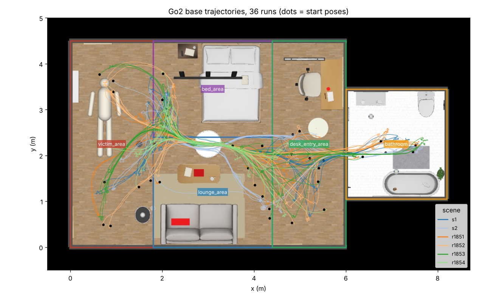 | 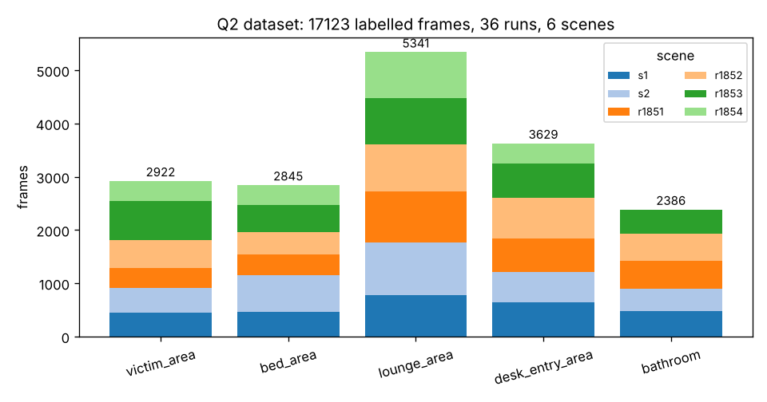 |

*Figure 4.1 — Left: every route over the top-down map of house 185. Right: frame counts.*

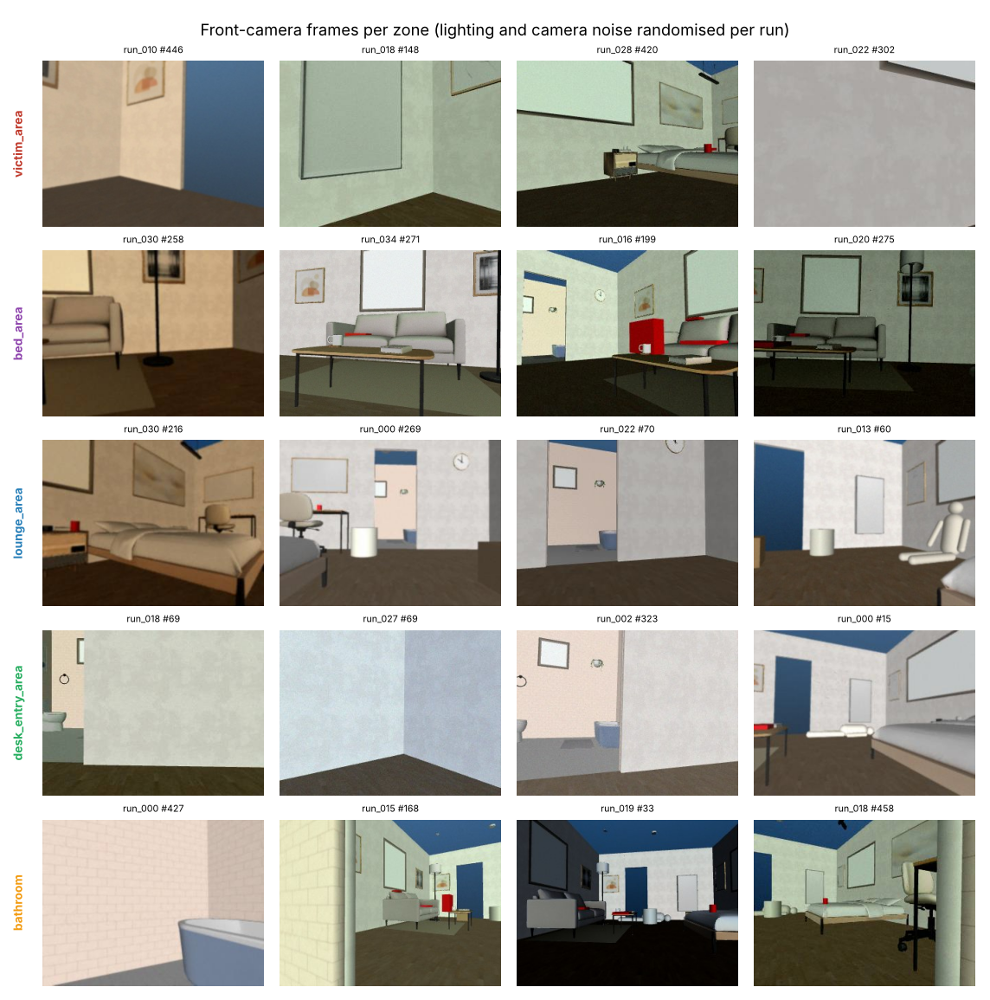

*Figure 4.2 — Sample head-camera frames per zone, with the per-run lighting and noise randomisation visible.*

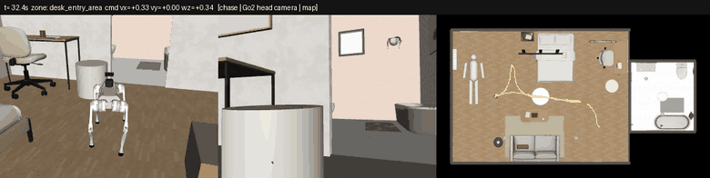

*Figure 4.3 — The Go2 walking a route in S1: chase camera, head camera, map. Animated:
[`results/q2/go2_crime_scene.gif`](results/q2/go2_crime_scene.gif).*

### 4.5 What the sensor data shows
These statistics were computed over all 171,083 state rows. "Moving" means a commanded speed above 0.15 m/s,
which is 89,368 rows.

| Measurement | Value | Interpretation |
|---|---|---|
| Foot contact share while moving (FL / FR / RL / RR) | 0.777 / 0.768 / 0.668 / 0.740 | Each foot is on the ground about 70–78 % of the time: a walking trot with overlapping stance |
| Correlation of contact flags FL–RR (diagonal) | +0.72 | Diagonal legs land together: a **trot** |
| Correlation of contact flags FL–FR (same side of the front) | −0.29 | Front legs alternate |
| Front-left touch-downs per second while moving | 1.57 ± 0.08 (mean ± sd over runs) | Stride frequency of about 1.6 Hz, very regular across runs |
| Joint torque RMS while moving (hip / thigh / calf) | 2.30 / 2.76 / 5.36 N·m | The calf (knee) carries the most load |
| 99th percentile of joint torque magnitude (hip / thigh / calf) | 5.55 / 7.27 / 13.10 N·m | Well inside the Go2's actuator limits |
| Joint range, 1st–99th percentile (hip / thigh / calf) | −0.18…0.17 / 0.40…1.06 / −1.52…−0.98 rad | Typical standing-trot posture |
| Foot force during stance, mean / 95th percentile | 50.6 / 83.3 N | About a third of the body weight per foot, on average |
| IMU vertical acceleration, mean ± sd | 9.79 ± 1.09 m/s² | Gravity plus the gait's vertical bounce |
| Base height, mean ± sd | 0.363 ± 0.009 m | The body stays level and steady |
| Commanded vs measured forward speed while moving | 0.279 vs 0.286 m/s | The controller tracks the command closely |

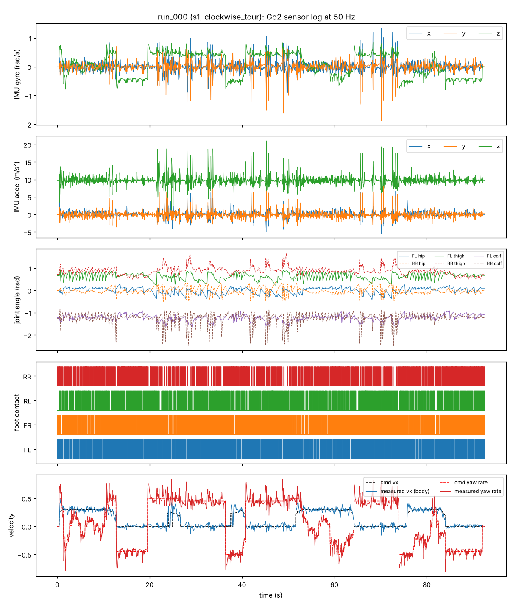

*Figure 4.4 — IMU, joint angles, torques and foot contacts over a whole run (run_000).*

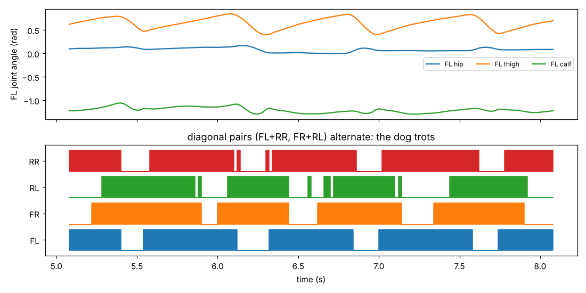

*Figure 4.5 — A few seconds of the same run: the alternating diagonal contacts of the trot.*

### 4.6 Discussion
- **The dataset is clean:**
  - every frame has a zone;
  - 96 % of route goals were reached (the rest timed out in tight spots);
  - contacts with furniture are rare (0.15 % of rows) and mostly brief grazes in the narrow gap between S2's
    ottoman and coffee table.
- **The data is real sensor data:** it is not only images. The joint, contact and IMU streams show a stable
  trot that holds its commanded speed. That makes the set useful beyond Q1, for example for gait analysis or
  state estimation.
- **Collection was debugged and re-run:** a bug in the follower made the first collection hang in scene r1853,
  because a replan could loop without stepping the simulation. After the fix, those 6 runs were collected
  again ([`data/README.md`](data/README.md)).

---

## 5. Q1: Crime-scene zone classifier

### 5.1 Problem and data split
- **Task:** given one 320 × 240 head-camera frame, resized to 168 × 224, predict which of the five zones the
  dog is in. This is coarse visual localisation for the search robot.
- **Split:** the 17,123 frames are split **by run**, never by frame. Neighbouring frames are nearly
  identical, so a frame-level split would leak test information into training. The code asserts that no run
  appears in two splits.

| Split | Runs | Frames | Content |
|---|---|---|---|
| Train | 20 | 10,321 | Routes of scenes S1, S2, r1851–r1853 |
| Validation | 5 | 2,526 | One held-out route per seen scene (model selection) |
| Test | 11 | 4,276 | **All 6 runs of scene r1854**, plus 5 unseen routes of the other scenes |

### 5.2 Models
**ResNet18, transfer learning:**
- **Model:** ImageNet-1k weights, the last layer replaced by a 5-way layer, and the whole network
  fine-tuned.
- **Training:**
  - optimiser: AdamW with a one-cycle schedule;
  - learning rates: 2e-4 for the backbone and 1e-3 for the head;
  - weight decay 1e-4 and label smoothing 0.05;
  - class-weighted cross-entropy;
  - batch 64, 8 epochs, half of the training frames sampled each epoch.
- **Augmentation:** random resized crop (scale 0.8–1), rotation ±5°, colour jitter (brightness, contrast and
  saturation 0.3; hue 0.03). No horizontal flip, because it would mirror the house.
- **Weights:** the download server for torchvision's weights was blocked in the project's environment. The
  same network was taken from the ONNX Model Zoo (`resnet18-v1-7`, checked by SHA-256), converted to
  torchvision, and verified against onnxruntime (maximum relative error 7 × 10⁻⁷).

**Comparison models:**
- **Small CNN from scratch:** 4 convolution blocks, 1.17 M parameters, the same augmentation; 12 epochs were
  planned.
- **Colour-histogram baselines**, each with logistic regression whose regularisation is tuned on validation:
  - a joint 8×8×8 **RGB** histogram (512 features);
  - a joint **HSV** histogram (512 features);
  - an **HSV histogram per cell of a 2×2 grid** (2,048 features), which adds coarse layout.

### 5.3 Training
Per-epoch history from `results/q1/<model>/history.json`; one epoch took about 290 s for ResNet18 and 650 s for
the small CNN, on a 4-core CPU.

| Epoch | ResNet18 train acc | ResNet18 val acc | ResNet18 val macro-F1 | Small CNN train acc | Small CNN val acc | Small CNN val macro-F1 |
|---|---|---|---|---|---|---|
| 1 | 0.610 | 0.794 | 0.799 | 0.353 | 0.510 | 0.454 |
| 2 | 0.882 | 0.784 | 0.788 | 0.487 | 0.324 | 0.240 |
| 3 | 0.923 | 0.884 | 0.886 | 0.559 | 0.610 | 0.617 |
| 4 | 0.947 | 0.886 | 0.887 | 0.635 | 0.578 | 0.570 |
| 5 | 0.956 | 0.910 | 0.913 | 0.673 | 0.704 | 0.715 |
| 6 | 0.969 | 0.910 | 0.909 | 0.728 | 0.431 | 0.439 |
| 7 | 0.972 | 0.918 | 0.919 | 0.751 | 0.740 | 0.749 |
| 8 | 0.979 | **0.920** | **0.921** | 0.799 | 0.720 | 0.736 |
| 9 | | | | 0.818 | **0.793** | **0.806** |
| 10 | | | | 0.828 | 0.731 | 0.744 |

The ResNet converges smoothly. The small CNN's validation score swings by up to 0.3 between epochs. Its run
was stopped after epoch 10 of 12 by the compute environment's 2-hour limit on background jobs, so the
checkpoint used is epoch 9, its best validation score.

The histogram baselines' regularisation strength C was chosen on validation macro-F1, from the files
`results/q1/hist_*/train_config.json`:

| C | 0.0003 | 0.001 | 0.003 | 0.01 | 0.1 | 1.0 |
|---|---|---|---|---|---|---|
| RGB | 0.363 | **0.377** | 0.370 | 0.351 | 0.348 | 0.351 |
| HSV | 0.390 | 0.421 | **0.426** | 0.416 | 0.404 | 0.400 |
| HSV 2×2 grid | 0.451 | 0.462 | **0.477** | 0.465 | 0.428 | 0.394 |

| ResNet18 training curves | Small CNN training curves |
|---|---|
| 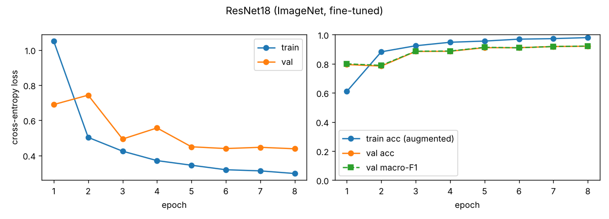 | 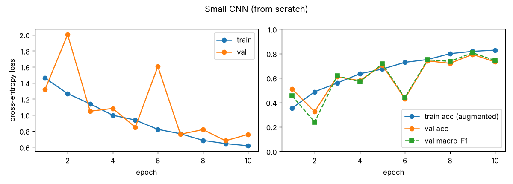 |

*Figure 5.1 — Loss and accuracy per epoch.*

### 5.4 Results
Test set: 4,276 frames ([`results/q1/metrics.json`](results/q1/metrics.json)).

| Model | Test accuracy | Macro-F1 | Unseen scene r1854 | Unseen routes of seen scenes | Accuracy with 1 s smoothing |
|---|---|---|---|---|---|
| **ResNet18 (ImageNet, fine-tuned)** | **0.882** | **0.887** | **0.880** | **0.883** | 0.869 |
| Small CNN (from scratch) | 0.788 | 0.794 | 0.738 | 0.832 | 0.786 |
| HSV histogram 2×2 grid + LR | 0.411 | 0.426 | 0.378 | 0.441 | 0.411 |
| HSV histogram + LR | 0.362 | 0.384 | 0.320 | 0.399 | 0.370 |
| RGB histogram + LR | 0.310 | 0.334 | 0.293 | 0.325 | 0.319 |

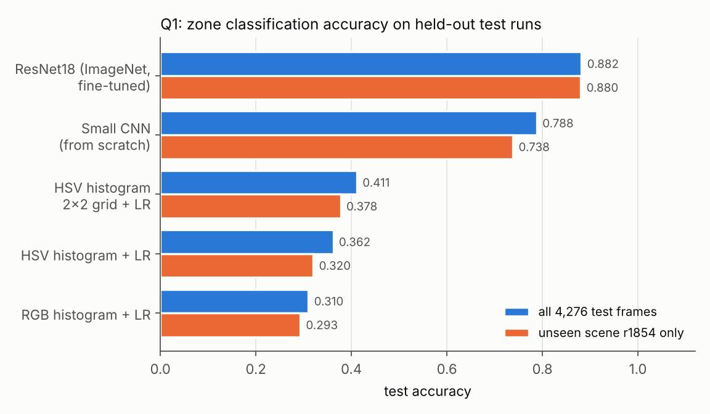

*Figure 5.2 — Test accuracy overall and on the unseen scene.*

**Per-class results** (precision / recall / F1):

| Zone (support) | ResNet18 | Small CNN | HSV 2×2 grid |
|---|---|---|---|
| victim_area (663) | 0.860 / 0.833 / 0.846 | 0.804 / 0.658 / 0.724 | 0.257 / 0.450 / 0.327 |
| bed_area (623) | 0.804 / 0.904 / 0.851 | 0.682 / 0.753 / 0.716 | 0.253 / 0.297 / 0.273 |
| lounge_area (1,645) | 0.897 / 0.857 / 0.877 | 0.799 / 0.787 / 0.793 | 0.577 / 0.385 / 0.462 |
| desk_entry_area (870) | 0.881 / 0.903 / 0.892 | 0.763 / 0.826 / 0.793 | 0.345 / 0.285 / 0.312 |
| bathroom (475) | 0.977 / 0.966 / 0.971 | 0.936 / 0.950 / 0.943 | 0.698 / 0.832 / 0.759 |

**ResNet18 confusion matrix** (rows: true zone; columns: predicted):

| true \ predicted | victim | bed | lounge | desk_entry | bathroom |
|---|---|---|---|---|---|
| victim | **552** | 27 | 74 | 5 | 5 |
| bed | 9 | **563** | 48 | 2 | 1 |
| lounge | 41 | 110 | **1,410** | 84 | 0 |
| desk_entry | 39 | 0 | 40 | **786** | 5 |
| bathroom | 1 | 0 | 0 | 15 | **459** |

**Accuracy by the dog's distance to the edge of its zone:**

| Distance (test frames) | ResNet18 | Small CNN | HSV 2×2 | HSV | RGB |
|---|---|---|---|---|---|
| 0–0.3 m (2,678) | 0.829 | 0.718 | 0.382 | 0.316 | 0.276 |
| 0.3–0.6 m (1,010) | 0.969 | 0.872 | 0.366 | 0.315 | 0.261 |
| 0.6–1.0 m (582) | 0.973 | 0.962 | 0.620 | 0.648 | 0.541 |
| > 1.0 m (6) | 1.000 | 1.000 | 1.000 | 1.000 | 1.000 |

| Confusion matrix | Accuracy vs boundary distance |
|---|---|
| 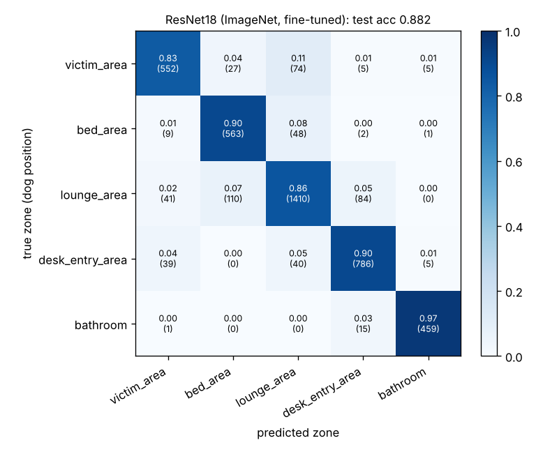 | 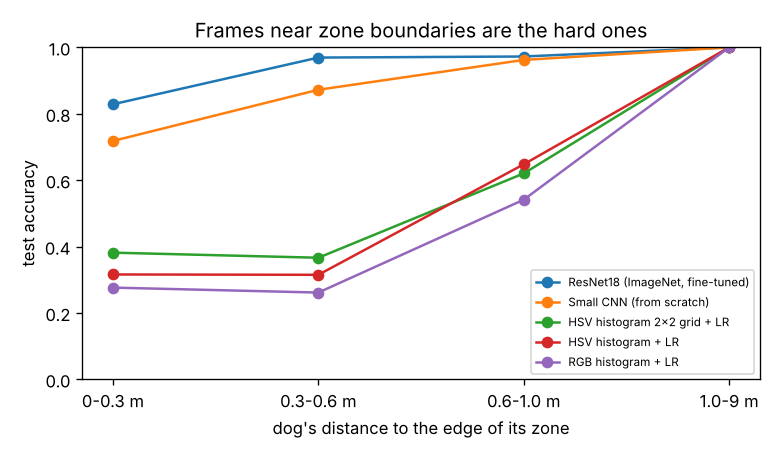 |

*Figure 5.3 — Where the errors are.*

### 5.5 Explainability: Grad-CAM
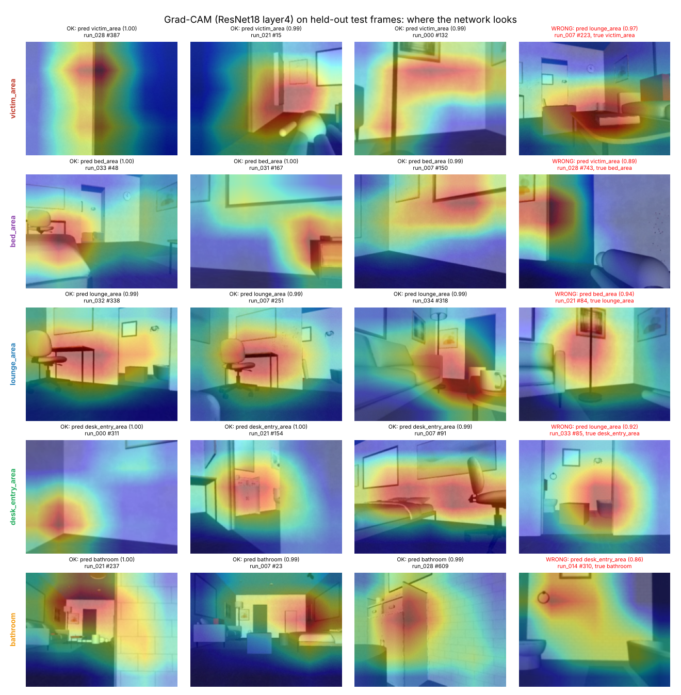

*Figure 5.4 — Grad-CAM on held-out test frames. For each zone it shows the three most confident correct
predictions and the most confident mistake.*

The heat maps show the network uses furniture and doorways, not the floor or the lighting:
- the desk chair and the bed;
- the sofa;
- the bathroom door frame and tiles.

Each confident mistake is a frame looking *into* a neighbouring zone. For example, the lounge-area mistake
looks at the bed.

### 5.6 Demonstrations
- **Recorded:** the classifier was replayed over held-out test run `run_000`. Frame accuracy is **0.816**,
  and 0.801 with a causal 1-second majority vote
  ([`results/q1/demo_run_000.png`](results/q1/demo_run_000.png)).
- **Live in MuJoCo:** the Go2 walked a tour of the zones in scene **r1854**, never seen in training. Each
  head-camera frame was classified as it was rendered, every 0.2 s.
  - Over **347 frames in 69.4 s**, frame accuracy is **0.911**, and 0.919 with the 1-second majority vote
    ([`results/q1/demo_live_r1854.csv`](results/q1/demo_live_r1854.csv)).
  - The bathroom was skipped because the storage box blocks its door.

| Recorded test run | Live in MuJoCo, unseen scene |
|---|---|
| 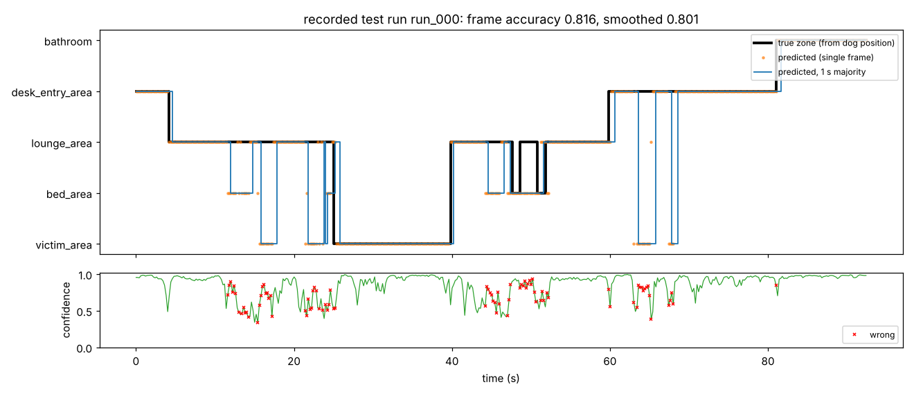 | 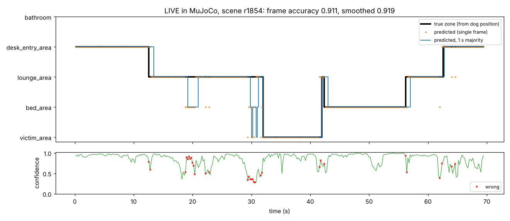 |

*Figure 5.5 — Predicted zone (dots: single frame; blue: 1 s vote) against the true zone (black) over time.*

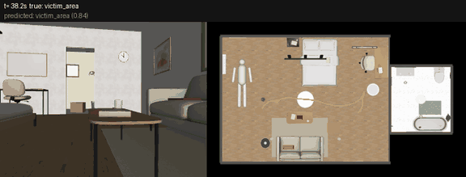

*Figure 5.6 — A frame of the live demo: head camera with prediction, and the map. Animated:
[`results/q1/demo_live_r1854.gif`](results/q1/demo_live_r1854.gif).*

### 5.7 Discussion
- **Transfer learning is clearly worth it:**
  - ImageNet features beat the same-data small CNN by 9.4 points overall, and by 14.2 points on the unseen
    scene.
  - The from-scratch network learned more scene-specific cues, such as props and stains: it scores 0.738 on
    the unseen scene against 0.832 on unseen routes of known scenes.
  - The ResNet hardly changes between the two (0.880 vs 0.883), so it generalises to new props, stains and
    lighting.
- **Colour spaces:**
  - HSV beats RGB by 5.2 points, because separating hue from brightness makes the features less sensitive to
    the lighting randomisation.
  - Adding a coarse 2×2 spatial grid gains another 4.9 points.
  - Colour statistics alone still stay far below the CNNs (0.41 vs 0.88). The zones share the same floor,
    walls and colours; what tells them apart is *which* furniture is visible, and where.
- **The remaining errors are a labelling issue more than a model issue:**
  - More than 0.3 m inside a zone, ResNet18 is 97–100 % correct; within 0.3 m of a boundary it is 83 %.
  - The label is the dog's *position*, but the camera looks *ahead*, often into the next zone.
  - The biggest single confusion, lounge → bed (110 frames), is exactly this case.
- **Smoothing does not help:** a 1-second majority vote gives 0.869 vs 0.882. Errors near boundaries come in
  stretches longer than 1 second.

---

## 6. Q3: Reinforcement-learning evidence search

### 6.1 Design: train in a fast 2-D twin, deploy on the legged robot
Training PPO directly on the legged MuJoCo robot would be slow: physics runs at about 8× real time on this
CPU (section 6.7). Q3 therefore uses two levels, as the brief suggests.

- **Training: `CrimeSceneSearchEnv`** ([`crime_scene_env.py`](q3_rl/crime_scene_env.py)) is a Gymnasium
  environment built from the real scenes.
  - **Scene export:** [`extract_layouts.py`](q3_rl/extract_layouts.py) opens each MuJoCo scenario exactly
    as Q2 does. It exports the collision footprint of walls, furniture, mannequins and props as a 5 cm
    raster, plus the ground-truth stain clusters.
  - **Scenes:** 28 house-185 scenes: **16 train, 6 validation, 6 test**. The test scenes are S2, r1854
    (Q1's unseen scene) and 4 new random scenes, none of them seen in training.
  - **Speed:** the environment runs at about 1,300 steps per second on one core.
  - **Checks:** it passes `gymnasium.utils.env_checker` and Stable-Baselines3's `check_env`.
- **Deployment** ([`deploy_mujoco.py`](q3_rl/deploy_mujoco.py)): the same policy, unchanged, drives the
  legged Go2 in MuJoCo.
  - Every 0.2 s, the dog's true pose and measured velocity are written into the environment, which acts as
    the sensor model.
  - The observation is built from it, and the action goes to Q2's `set_velocity_command`.

### 6.2 Problem formulation
**Body and motion:**
- **Body:** the Go2's real **0.70 × 0.32 m rectangle**, rotated with the dog.
- **Motion:** the velocity command goes through a first-order lag and is integrated at 20 Hz, with 4
  sub-steps per 0.2 s decision.
- **Collisions:** a move or a turn that would make the rectangle overlap an obstacle cell is cancelled, so the
  dog has to line up with narrow gaps.

**Evidence:**
- **What counts:** stain clusters with at least 5 stains, below 2 m. The head camera cannot see the ceiling.
- **How many:** 89 items in training scenes, 30 in validation, 29 in test.
- **Found:** within 1.5 m of the camera, inside its ±35° horizontal field of view, with a clear line of sight.
- **Contamination:** the 0.30 m disc around the feet overlaps a *floor* stain cluster.

**Observation (54 values in [−1, 1]):**

| Indices | Content |
|---|---|
| 0–3 | position x, y (normalised); heading sin, cos |
| 4–6 | body velocity vx, vy, yaw rate (normalised by the limits) |
| 7–30 | **24 lidar rays** over 360°, range / 3 m |
| 31–36 | nearest unfound evidence: body-frame dx, dy; straight-line distance; path length on the map; height; floor flag |
| 37–39 | nearest floor stain: body-frame dx, dy; clearance between footprint and stain |
| 40–47 | **found / unfound flags** for 8 evidence slots |
| 48–49 | **route hint:** unit vector along the shortest path on the known floor plan to that item, from a clearance-weighted cost map (what a real robot's map and planner would give; it knows nothing about stains) |
| 50–52 | previous action |
| 53 | "bumped last step" flag |

**Action:** continuous (vx, vy, yaw rate) in [−1, 1]³, scaled to the Go2 limits of 0.4 m/s, 0.15 m/s and 0.5 rad/s.

**Reward:** each term is a separate function, with its weight in [`config/q3_env.yaml`](config/q3_env.yaml):

$$
r_t = 10\,n^{\text{found}}_t + 2\,\text{clip}(d_{t-1}-d_t,\pm0.5) - 1\cdot\mathbb{1}[\text{on stain}] - 8\,n^{\text{new stain}}_t
- 0.5\cdot\mathbb{1}[\text{collision}] - 20\cdot\mathbb{1}[\text{severe collision}] - 0.01 + 20\cdot\mathbb{1}[\text{all found}]
$$

Here $d_t$ is the path length on the map from the dog to the nearest place from which the nearest unfound item
can be seen.

**Episode end:**
- **Success:** all evidence found.
- **Failure:** a *severe collision*, meaning 25 consecutive colliding steps (5 s pushing into an obstacle).
- **Truncation:** after 900 steps (180 s).

**Domain randomisation, at every reset:**
- the scene (one of 16);
- the start pose: free space where the body can turn on the spot, not on a stain, not already seeing an item;
- a random subset of the scene's evidence (at least 2 items), positions jittered by ±5 cm;
- velocity lag 0.15–0.35 s and speed gain 0.85–1.10;
- action noise 3 %, lidar noise 2 cm and 2 % lidar dropout.

**Training curriculum** (training only):

| Level | Evidence items | Start within (path on map) |
|---|---|---|
| 0 | 1 | 1.5 m of where it can be seen |
| 1 | 1 | 3 m |
| 2 | 2 | 5 m |
| 3 | 3 | anywhere |
| full task | random subset (≥ 2), as above | anywhere |

The next level begins when 70 % of the last 200 training episodes succeed. Validation and test always use the
full task.

**Baselines,** using the same observation:
- **random:** uniformly random actions.
- **greedy:** steers towards the open lidar direction closest to the nearest item's straight-line bearing,
  and drives when a robot-wide corridor ahead is clear.
- **planner:** follows the route hint with the same corridor check. It uses the map perfectly but knows
  nothing about stains.

### 6.3 Algorithm and training
PPO from Stable-Baselines3 2.9.2:
- **Parallelism:** 8 environments in `SubprocVecEnv`.
- **Network:** MLP 256-256 for both policy and value.
- **Hyperparameters:**
  - learning rate 3e-4;
  - 512 steps per env per update (4,096 in total), batch 1,024, 10 epochs;
  - γ 0.995, GAE λ 0.95, clip 0.2;
  - entropy coefficient 0.005, initial log-std −0.5;
  - seed 6010.
- **Length:** **6.0 M steps**, which took 3,200 s on 4 CPU cores.
- **Logging and saving:**
  - TensorBoard, including custom success, contamination, collision and curriculum-level curves;
  - a checkpoint every 100 k steps;
  - an evaluation callback every 50 k steps on the 6 validation scenes (20 deterministic episodes), which
    keeps the best model;
  - a curriculum callback.
- **Resume:** training can resume after a disconnect, with the step counter, logs, evaluation history and
  curriculum level intact. This was used for real when the cloud container restarted mid-training.

| Training steps | 50 k | 0.5 M | 1 M | 2 M | 3 M | 4 M | 5 M | 6 M |
|---|---|---|---|---|---|---|---|---|
| Validation success (20 episodes) | 0.00 | 0.60 | 0.75 | 0.70 | 0.80 | 0.95 | 0.95 | 0.85 |
| Validation mean return | −54.7 | −3.6 | 10.3 | −10.1 | 32.9 | 24.8 | 40.2 | 30.7 |

**Curriculum progress**, from [`curriculum.json`](results/q3/ppo/curriculum.json):
- level 1 at 0.35 M steps;
- level 2 at 0.43 M;
- level 3 at 0.50 M;
- the **full task from 0.56 M steps** on.

Over the last 500 training episodes the success rate is **0.808**, and 6.0 % end in a severe collision
([`train_summary.json`](results/q3/train_summary.json)). The model kept is the one with the best validation
return, at 1.95 M steps.

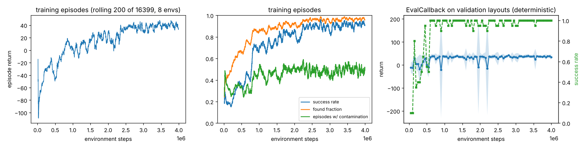

*Figure 6.1 — Training return and success (left, middle), and validation return and success (right).
Success jumps to about 0.8 as soon as the full task starts at 0.56 M steps.*

### 6.4 Results on the 2-D test set
60 episodes per policy, with **the same** 60 episodes for every policy: the same scene, start, evidence subset
and randomisation ([`results/q3/eval_metrics.json`](results/q3/eval_metrics.json)).

| Policy | Success | Evidence found | Time to find all (s, successful episodes) | Stain entries / episode | Steps on a stain / episode | Collision steps / episode | Severe-collision ends |
|---|---|---|---|---|---|---|---|
| random | 0.050 | 0.163 | 145.7 | 1.05 | 33.2 | 40.0 | 0.00 |
| greedy | 0.300 | 0.475 | 13.9 | 0.58 | 34.3 | 28.6 | 0.62 |
| planner | **0.700** | **0.786** | 18.5 | **0.40** | **5.8** | 24.7 | 0.15 |
| **PPO (reported)** | 0.533 | 0.674 | 19.3 | 0.52 | 19.2 | **22.6** | 0.20 |

| Success per test scene (10 episodes each) | s2 | r1854 | r3101 | r3102 | r3103 | r3104 |
|---|---|---|---|---|---|---|
| greedy | 0.2 | 0.3 | 0.1 | 0.9 | 0.0 | 0.3 |
| planner | 0.9 | 0.7 | 0.2 | 1.0 | 0.8 | 0.6 |
| PPO | 0.7 | 0.8 | 0.0 | 0.9 | 0.0 | 0.8 |

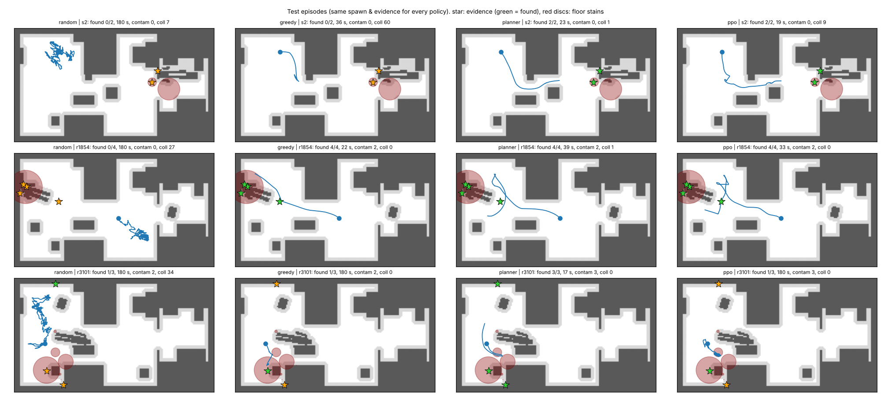

*Figure 6.2 — The same three test episodes for each policy. Dot: start; stars: evidence, green when found;
red discs: floor stains.*

### 6.5 Deployment on the legged MuJoCo Go2

**Showcase runs** ([`deploy_s2.json`](results/q3/deploy_s2.json), [`deploy_r1854.json`](results/q3/deploy_r1854.json)):

| Scene | Policy | Found | Time | Steps with a foot in a stain | Robot–scene contact steps | Min. uprightness |
|---|---|---|---|---|---|---|
| S2 | **PPO** | **3/3** | 43.2 s | 0 | 43 | 0.920 |
| S2 | greedy | 0/3 | 180 s (limit) | 0 | 4 | 0.985 |
| r1854 | **PPO** | **5/5** | 27.6 s | 2 | 0 | 0.996 |
| r1854 | greedy | 1/5 | 180 s (limit) | 0 | 0 | 0.999 |

| PPO in S2 | PPO in r1854 |
|---|---|
| 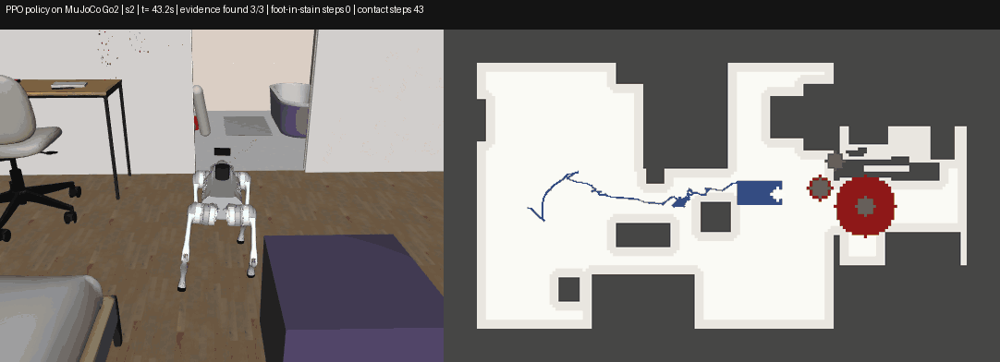 | 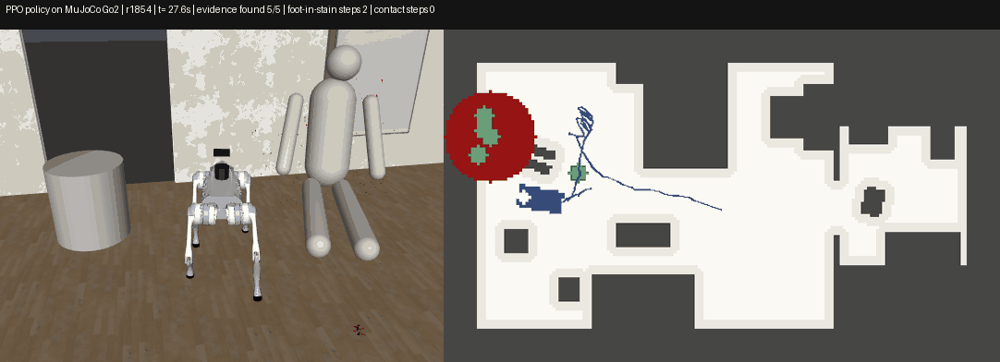 |

*Figure 6.3 — Final frames of the PPO deployments: chase camera, and the map with the dog's trail. Animated:
[`deploy_s2.gif`](results/q3/deploy_s2.gif), [`deploy_r1854.gif`](results/q3/deploy_r1854.gif).*

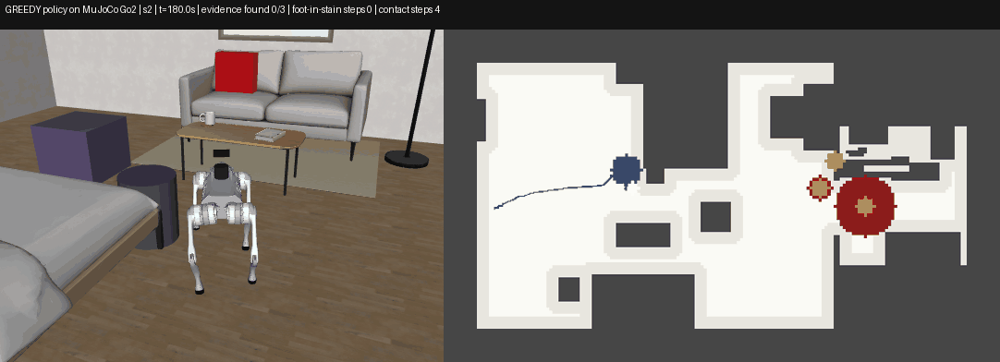

*Figure 6.4 — The greedy baseline in S2, stuck between the bed and the bin for the last 150 s. Its corridor
check forbids driving forward, but its chosen direction is close enough to straight ahead that it never turns.*

### 6.6 MuJoCo evaluation over many starts: the 2-D → MuJoCo gap
Each policy ran from 10 start poses in each of the 6 test scenes: 60 episodes per policy, **both** in MuJoCo
and in the 2-D environment from the identical start. Every evidence item of the scene must be found; there is
no random subset and no noise ([`deploy_eval_metrics.json`](results/q3/deploy_eval_metrics.json)).

| Policy | Success 2-D | Success MuJoCo | Same outcome in both | Time, successful episodes (2-D / MuJoCo) | Stain entries / episode (2-D / MuJoCo) | Steps with a foot in a stain / episode (MuJoCo) |
|---|---|---|---|---|---|---|
| **PPO** | 0.517 | **0.667** | 0.85 | 16.2 / 24.9 s | 0.62 / 1.53 | 30.6 |
| planner | 0.533 | 0.650 | 0.75 | 17.5 / 19.9 s | 0.33 / 0.68 | 18.0 |
| greedy | 0.217 | 0.183 | 0.97 | 6.7 / 5.8 s | 0.50 / 0.77 | 145.5 |

| Success, 2-D → MuJoCo | s2 | r1854 | r3101 | r3102 | r3103 | r3104 |
|---|---|---|---|---|---|---|
| PPO | 0.4 → 1.0 | 0.8 → 0.9 | 0.0 → 0.1 | 1.0 → 1.0 | 0.0 → 0.0 | 0.9 → 1.0 |
| planner | 0.6 → 0.4 | 0.5 → 0.7 | 0.0 → 0.1 | 0.9 → 1.0 | 0.7 → 0.9 | 0.5 → 0.8 |
| greedy | 0.3 → 0.3 | 0.0 → 0.0 | 0.0 → 0.0 | 1.0 → 0.8 | 0.0 → 0.0 | 0.0 → 0.0 |

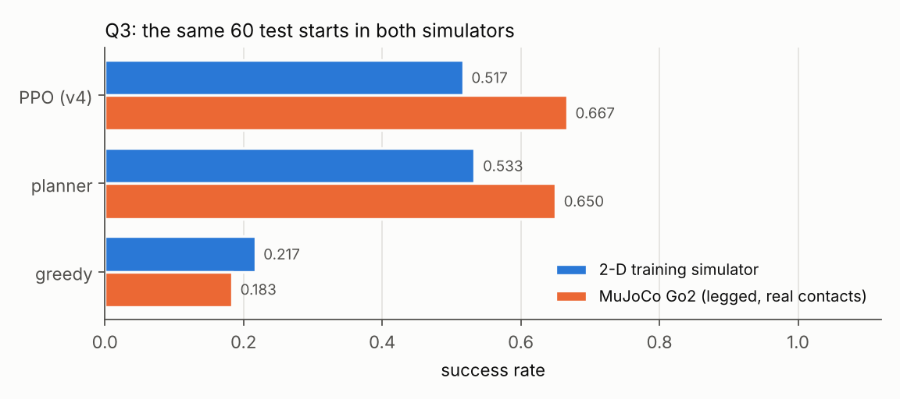

*Figure 6.5 — The same 60 starts in both simulators.*

- **The policy transfers to the legged robot.** PPO ends the same way in 2-D and MuJoCo in 85 % of the paired
  episodes. On the MuJoCo dog it is the best of the three policies.
- **PPO and the planner do *better* on the legged robot than in 2-D.** The 2-D twin cancels any move into an
  obstacle, whereas the legged Go2 can brush past an obstacle's edge and keep going. PPO gains most in S2,
  from 0.4 to 1.0.
- **Contacts are brief:** a robot–scene contact happens in 30 (PPO), 26 (planner) and 27 (greedy) of 60
  episodes, but the median is 0–0.5 contact steps per episode.
- **No falls:** the lowest uprightness in any of the 180 MuJoCo episodes is 0.866.
- **Stains are concentrated in a few episodes:**
  - PPO has a foot in a stain in 27 of 60 episodes, but 3 episodes where it stalls on a stain account for
    1,452 of its 1,833 such steps.
  - Greedy's 145.5 steps per episode come from deadlocks on top of stains.

### 6.7 How we got here: four training runs
Every run used the same PPO settings, test scenes and seeds; each changed one or two things in response to the
previous run.

| Run | What changed | Training success (last 500) | 2-D test success (planner in the same model) | MuJoCo success (same 60 starts) |
|---|---|---|---|---|
| v1 | 48-value observation, 0.24 m disc body, 3 M steps | – | 0.117 (–) | – |
| v2 | + route hint, previous action, bump flag; 4 M steps | 0.928 | 0.633 (0.850) | 0.633 |
| v3 | + real rectangle body, 6 validation scenes, stain-entry penalty 3 → 8 | 0.428 | 0.250 (0.700) | 0.467 |
| **v4** | + training curriculum; 6 M steps | **0.808** | **0.533** (0.700) | **0.667** |

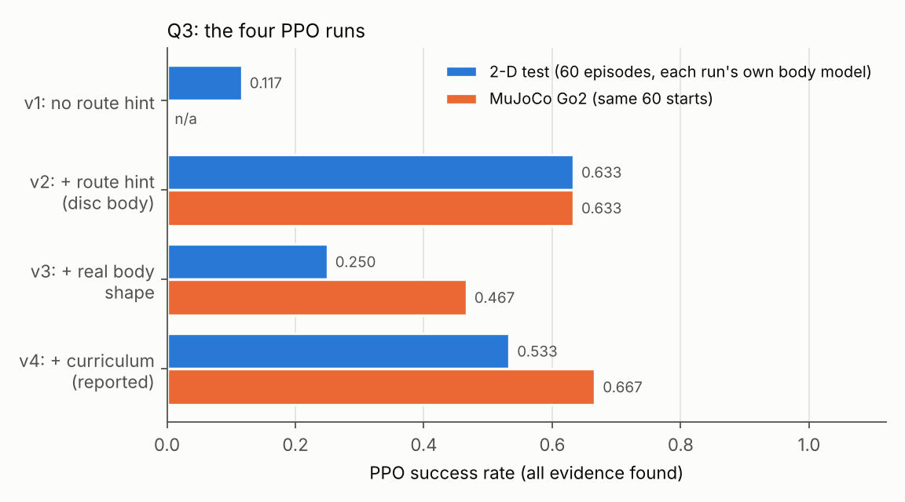

*Figure 6.6 — PPO success across the four runs. v1/v2 use the disc body model in 2-D and v3/v4 the rectangle,
so only the MuJoCo bars compare all runs on the same physics.*

- **v1 → v2:** v1 saw only the straight-line direction to the evidence. It drove into furniture between itself
  and the target, and could not tell it was stuck: 45 % of its test episodes ended in a severe collision. The
  route hint, previous action and bump flag fixed this.
- **v2 → v3:** a MuJoCo evaluation of v2 showed its 0.24 m disc is narrower than the real 0.7 m body, so the
  real dog touched furniture in gaps the 2-D twin treated as free. v3 trained on the real rectangle, and
  **failed**: training success plateaued at about 0.4.
- **v3 → v4:** with a curriculum the same task became learnable.
- **Statistics on the paired MuJoCo starts:** exact McNemar tests, using the
  [`compare_runs.py`](q3_rl/compare_runs.py) outputs in `results/q3/`.

| Comparison | Both succeed | Only the first succeeds | Only the second succeeds | Neither | p |
|---|---|---|---|---|---|
| v2 vs v3 | – | 10 | 0 | – | 0.002 |
| v4 vs v3 | – | 12 | 0 | – | 0.0005 |
| v2 vs v4 | 37 | 1 | 3 | 19 | 0.63 |

So v4 is significantly better than v3, and statistically tied with v2. v4 is the reported policy because it
reaches v2's performance with the faithful body model. It was chosen after seeing both runs on the test
starts, so its MuJoCo success of 0.667 is a slightly optimistic estimate.

| v3: no curriculum, plateau at ~0.4 | v4: curriculum, ~0.8 after the full task starts |
|---|---|
| 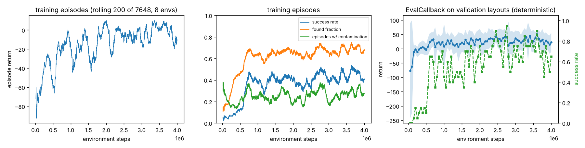 |  |

*Figure 6.7 — The effect of the curriculum on the same task.*

### 6.8 Discussion
- **Every RL component the brief asks for is in the code and works:**
  - the environment, observation, action and six reward terms;
  - termination and truncation;
  - domain randomisation and the curriculum;
  - vectorised PPO, TensorBoard, checkpoints, the evaluation callback and resume;
  - three baselines;
  - deployment on the physical simulation.
- **Against the baselines:**
  - PPO beats random and greedy everywhere.
  - On the 2-D test it trails the planner (0.533 vs 0.700), which uses the same route hint perfectly.
  - On the legged robot it slightly leads the planner (0.667 vs 0.650).
- **Where it fails:** in r3101 and r3103, two scenes with narrow passages between furniture. PPO solves
  neither in 2-D, and 20 % of its 2-D test episodes end in a severe collision. r3101 is hard for every policy.
- **Contamination is the open problem:**
  - Many evidence items sit *inside* a large floor pool, so seeing them without stepping near them is
    genuinely hard.
  - PPO enters about as many stains as greedy (0.52 vs 0.58 per episode) but spends less time on them (19.2
    vs 34.3 steps).
  - The planner's clearance-weighted paths keep it away from the furniture where stains also are, so it
    does better on this metric.

---

## 7. Toward the real Go2: lab zones and go-to-zone

Sections 4–6 ran entirely in simulation. This section carries Q1 onto the **physical Unitree Go2** in the
lab, and adds a small autonomous behaviour on top of it: *pick a zone, and the dog goes there*. The
data was recorded on the real dog, the classifier was trained and tested on it, and the LiDAR check was
run on the robot (sections 7.5 and 7.6). The live-demo video and the go-to-zone trials on the dog are still
to come. Every real-robot number is read from the files those runs wrote, and nothing is reported for the
runs not yet done.

### 7.1 Goal and lab zones
The question is whether the Q1 recipe, an ImageNet ResNet18 fine-tuned on frames labelled by zone, works on
real camera images of a real room, and whether its output is useful enough to drive the dog. The lab is
split into four zones, defined in [`real_go2/real_config.yaml`](real_go2/real_config.yaml):

| Key | Zone | What it is |
|---|---|---|
| 1 | `lab_1` | the desks on one side of the room |
| 2 | `lab_2` | the desks on the other side |
| 3 | `open_area` | the open floor between them |
| 4 | `shelves` | the shelves with the wires |

Unlike the simulation, the real dog has no ground-truth position to label frames with. The operator labels
them while driving instead: they press the number of the zone the dog is in, and 0 while crossing between
zones. This mirrors how Q2 labelled frames, by the dog's position, while avoiding the boundary errors
section 5.4 found, because frames between zones are not saved.

### 7.2 From the simulated pipeline to the robot
The real-robot tools live in [`real_go2/`](real_go2/README.md). They keep the simulated dataset's format,
so Q1's training code runs unchanged.

| Step | Script | What it does |
|---|---|---|
| Connect | `sources.py` | `sdk`: Ethernet with the Unitree SDK (DDS), which gives camera, LiDAR, IMU and motion control. `webrtc`: Wi-Fi, camera and motion only. `fake`: replays simulator frames to test everything without the robot. |
| Record | `record_real.py` | The operator drives with Test 1's teleop keys and labels zones with 1–4. Writes `data_real/run_XXX/{images, states.csv, metadata.json}` at 5 Hz. |
| Train | `q1_supervised/train.py --config real_go2/real_config.yaml` | The same ResNet18 recipe as section 5.3. The split is by session order: the last session is the test set, the second-to-last the validation set. |
| Evaluate | `evaluate_real.py` | Accuracy, macro-F1, per-zone scores, 1 s smoothed accuracy and a confusion matrix on the held-out session. |
| Live demo | `live_zone.py` | Classifies the live camera with an on-screen panel. The operator keys in the true zone, and the panel shows a running live accuracy. Recorded to MP4. |
| Go to zone | `goto_zone.py` | The autonomous behaviour of section 7.3. |

**Preprocessing:**
- The Go2 camera gives 16:9 frames.
- The recorder keeps a centred 4:3 crop at 320 × 240, so the image has the same shape as the simulated
  frames.
- Training resizes the crop to 168 × 224, exactly as in section 5.1.

**Safety:** all motion goes through Test 1's teleop layer (`go2_stream/teleop.py`), which no Test 2 code
modifies. It provides:
- speed limits;
- a watchdog that stops the dog if the control loop stalls;
- an autonomy hook whose commands lapse 0.3 s after they stop being refreshed;
- manual override: any driving key cancels autonomous motion at once.

### 7.3 Go-to-zone: finding a zone and avoiding obstacles
The classifier says *which zone the camera sees*, not where the zone is. The navigator turns that into
motion, with the LiDAR handling everything in the way. It repeats three steps until it arrives, gives up,
or the operator takes over.

1. **Look around.** The dog turns once on the spot. For each of 24 headings it stores:
   - the classifier's probability that the camera sees the **target** zone;
   - the **free distance** ahead from the LiDAR. This uses Test 1's body corridor: 0.6 m wide, between
     −0.15 and +0.45 m in height, so the floor is ignored.

   From one turn come two answers. *Where am I* is the zone most views belong to. If the target holds at
   least half the views, the dog has **arrived** and waves.
2. **Choose a heading.** Each heading scores

   $$\text{score}(h) = P(\text{target}\mid h)\;\times\;f_{\text{free}}(h)\;\times\;\text{penalty}_{\text{blocked}}(h),$$

   - $f_{\text{free}}$ is 0 up to `stop_obstacle_m` = 0.5 m of free distance and rises linearly to 1 at
     `want_free_m` = 1.5 m.
   - Headings that stopped the dog in the last 3 legs get a penalty of 0.2.

   So a desk 0.5 m away cancels a direction even when the target is visible right behind it.
   - **Detour:** if the best score is low because the target's own direction is blocked, the dog takes the
     open heading (at least 1.1 m free and not recently blocked) closest to the
     target. It keeps the side it chose, so it doesn't swing
     back and forth around a desk.
   - **Explore:** if the target is not seen in any direction, the dog walks toward open space, for at most
     10 legs. The score favours continuing the previous direction (×1.6) and passing the edge of an
     obstacle (×1.8), where a hidden zone tends to come into view. It avoids turning back (×0.3).
   - **Boxed in:** if no heading has 1.1 m free, the dog stops and reports it.
3. **Walk one leg** of up to 4 s at 0.25 m/s, re-checking the LiDAR on every scan:
   - something within **1.0 m** ahead: slow to 40 % and steer toward the freer side;
   - something within **0.5 m**: stop, remember that heading as blocked, and look again;
   - the target recognised steadily (confidence ≥ 0.8 for 2 s), or lost (< 0.25 for 1.5 s): end the leg
     early.

   It gives up after 20 legs.

| Parameter (`navigation:`) | Value | Parameter | Value |
|---|---|---|---|
| `heading_bins` | 24 (15°) | `stop_obstacle_m` | 0.50 m |
| `scan_rate` | 0.5 rad/s | `slow_obstacle_m` | 1.00 m |
| `arrive_share` | 0.50 | `want_free_m` | 1.5 m |
| `approach_speed` | 0.25 m/s | `lookahead_m` | 2.5 m |
| `leg_s` | 4.0 s | `blocked_memory_legs` | 3 |
| `max_legs` | 20 | `explore_legs` | 10 |

Without the LiDAR (Wi-Fi, or `--allow-no-lidar`), there is no obstacle check. The navigator then caps the
speed at 0.15 m/s and the legs at 2 s, and is meant only for a clear floor under close supervision.

**Logging:** every run writes `results/real_q1/goto_<time>.json`. It lists each zone request with its
target, its result (arrived, failed, cancelled), the reason, the legs used and the time taken, plus every
state change. The MP4 shows the camera next to a radar of the target likelihood, the free space and the
chosen heading.

### 7.4 Closed-loop check in a simulated room
Before the robot, the navigator was run closed-loop in a 2-D room ([`real_go2/nav_sim.py`](real_go2/nav_sim.py)):
- **Room:** 6 × 4 m, with the target zone at x > 4.5 m.
- **Robot:** follows the commanded velocities exactly.
- **LiDAR:** the free-space profile is ray-cast with three parallel rays across the body width.
- **Camera:** the "classifier" sees the target when facing it within ±26° with nothing in the way, and
  sees the target everywhere inside the zone.

Two layouts were tested, each from 4 starting points × 4 starting headings:
- a **low desk** that blocks the straight walk but not the view;
- a **tall shelf** that hides the zone from every starting point.

| Layout | Reached the zone | Legs used (arrived runs) | Closest approach to an obstacle |
|---|---|---|---|
| Low desk blocks the walk, not the view | **16/16** | 7–16 | 0.26 m |
| Tall shelf hides the zone | **10/16** | 7–14 | 0.25 m |

*Source: `results/real_q1/nav_sweep.json`, run with the turning controller added in the lab (section 7.5).
With the earlier proportional turn, the same sweep gave 16/16 and 8/16. The closest approach is measured
from the robot's centre; the Go2's half-width is about 0.16 m.*

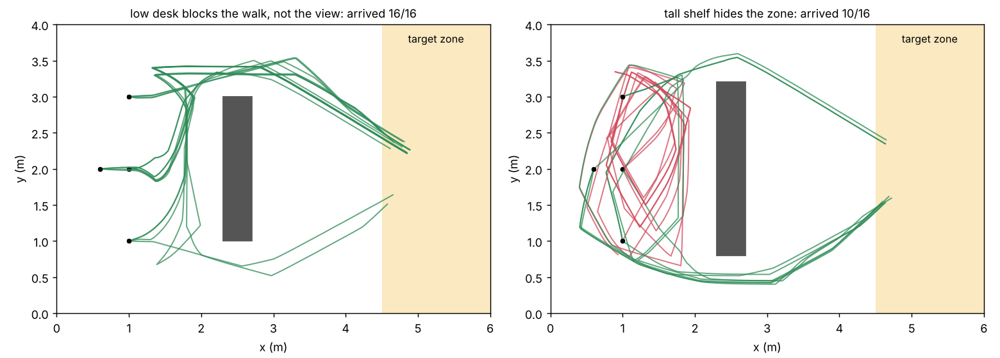

*Figure 7.1 — Every closed-loop run. The grey box is the obstacle, the black dots are the starts, and the
yellow area is the target zone. Green runs arrived, red runs did not. `results/real_q1/nav_sim_paths.png`.*

**Results:**
- **Avoidance:** it is reliable. No run touched an obstacle, and every desk run detoured around it.
- **Hidden zone:** finding it is the weak point. All 6 failures used their 10 exploration legs on the
  starting side of the shelf, then stopped with "shelves not seen in any direction". The successful
  runs went round an end of the shelf early.
- **Cause:** exploration only remembers the previous direction and recently blocked headings. It has no map
  of where it has already been, so it can circle. A small visited-area map from the dog's odometry would be
  the natural fix.
- **Practical rule:** on the real dog, start each request where the target zone is in view.

The simulation tests the decision logic and the avoidance rules. It does not test the real camera, LiDAR
noise or legged motion. The tests (`tests/test_goto_zone.py`) also check each rule on scripted inputs:
- the corridor ignores the floor;
- a blocked target direction triggers a detour;
- the dog slows and steers at 1 m, and stops and remembers the direction at 0.5 m;
- walls on all sides end in "boxed in".

### 7.5 What has been run on the robot
| Component | Without the robot | On the robot |
|---|---|---|
| Ethernet connection (`sdk`): camera, state, LiDAR, teleop | Code paths reuse Test 1's `go2_stream` modules | **Done:** used for all 5 recording sessions |
| Recording with operator labels | `fake` source | **Done:** 5 sessions, 7,346 labelled frames |
| Training and evaluation | `fake` source | **Done:** on the lab laptop (section 7.6) |
| LiDAR free-space check | 23 tests, closed-loop sweep (section 7.4) | **Done, with two fixes** (below) |
| Live recognition demo, go-to-zone trials | `fake` source | Pending: the videos and trial logs are the next step |
| Wi-Fi connection (`webrtc`) | Written against `unitree_webrtc_connect` 2.2.0 | Not used: Ethernet worked |

**Changes made in the lab:** the configuration that was actually used is saved as
`results/real_q1/logs/real_config_used_in_lab.yaml`.
- **Training memory:** the laptop's WSL has about 3.7 GB of RAM. Batch size 64 was killed for running out
  of memory, so training used **batch size 32** and no extra loader processes. The rest of the recipe is
  unchanged.
- **LiDAR frame:** the raw LiDAR topic `rt/utlidar/cloud` is in the sensor's own frame, and the sensor is
  mounted upside down (z points down). The floor therefore looked like an obstacle 0.05 m away in every
  direction, and the navigator would never have walked. The fix reads `rt/utlidar/cloud_deskewed`
  instead. That cloud is in the odometry frame and is converted to the body frame with the dog's pose. The
  floor then sits at about −0.31 m, below the corridor, and the dog's own body is already removed. This is
  the false-obstacle risk Test 1 had flagged, and the `--lidar-check` mode caught it before any
  autonomous motion.
- **Turning:** at small commanded rates the Go2 barely turns on the spot, so a purely proportional turn
  stalled short of the chosen heading. Turning now uses a gain of 1.5 rad/s per rad of heading error, a
  minimum rate of 0.25 rad/s, a maximum of 1.0 rad/s, a ~6° tolerance and a 12 s timeout. Slow, medium
  and fast speed presets were also added (0.25 / 0.35 / 0.45 m/s walking).

### 7.6 Results on the real Go2

#### Dataset
All five sessions were recorded on 11 November 2026 between 15:13 and 15:53, over Ethernet at 5 Hz. The
dog was driven by keyboard teleop, and the operator keyed in the zone. Sessions are split in order: the
first three train, the fourth validates, and the fifth is the test set.

| Session | Split | lab_1 | lab_2 | open_area | shelves | Frames | Labelled walking |
|---|---|---|---|---|---|---|---|
| run_000 | train | 588 | 311 | 576 | 485 | 1,960 | 392 s |
| run_001 | train | 295 | 554 | 417 | 250 | 1,516 | 303 s |
| run_002 | train | 292 | 270 | 320 | 328 | 1,210 | 242 s |
| run_003 | val | 247 | 276 | 361 | 301 | 1,185 | 237 s |
| run_004 | **test** | 435 | 307 | 465 | 268 | 1,475 | 295 s |
| **All** | | **1,857** | **1,718** | **2,139** | **1,632** | **7,346** | 24.5 min |

*Source: `results/real_q1/dataset_summary.json`, computed from each session's `states.csv` (copies in
`results/real_q1/dataset/`). The images stay out of git.*

The classes are balanced within a factor of 1.31. The training loss is class-weighted as in section 5.3,
with weights between 0.89 and 1.10.

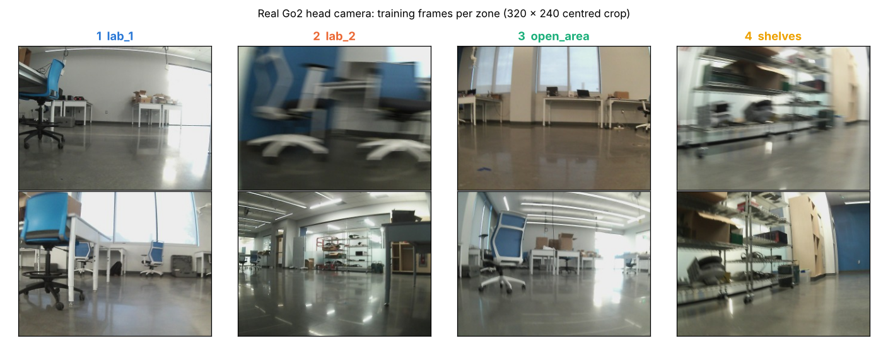

*Figure 7.2 — Two training frames per zone from the Go2's head camera, after the centred 4:3 crop. The
lab_2 example shows the motion blur that turning on the spot causes. `results/real_q1/real_sample_frames.png`.*

#### Training
Training used the section 5.3 recipe (ImageNet ResNet18, 8 epochs, separate learning rates for the head
and the backbone, label smoothing 0.05, colour and crop augmentation, no flips) with batch size 32. It ran
on the laptop CPU (3 threads, PyTorch 2.14.1) and took **10,116 s**, about 2.8 h. Validation macro-F1
peaked at **0.843 in epoch 5**, and that checkpoint is the one tested.

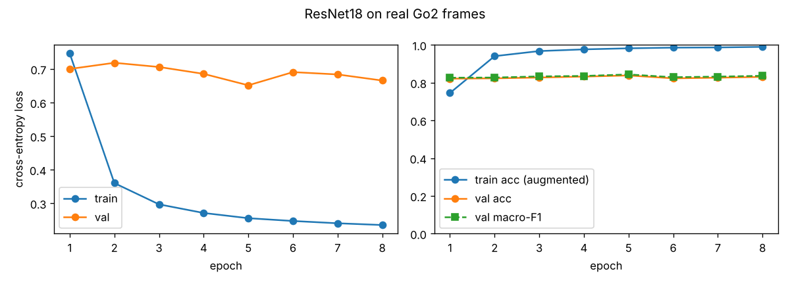

*Figure 7.3 — Training and validation curves. `results/real_q1/curves_resnet18.png`, from
`resnet18/history.json`.*

- **Fit:** training accuracy reaches 0.990, while validation stays at 0.82–0.84 from the first epoch on.
- **Meaning:** the network fits the three training walks almost perfectly. What limits it is how well the
  views of one walk carry over to another, not training time.
- **Comparison:** in simulation, validation kept rising, from 0.794 to 0.920 (section 5.3). Here it is
  flat, which points to the small number of distinct training walks (3, against 24 simulated runs).

#### Test session (run_004, never seen in training)
| Measure | Simulated Q1 (section 5.4) | **Real Go2, held-out session** |
|---|---|---|
| Accuracy | 0.882 (0.880 unseen scene) | **0.814** |
| Macro-F1 | — | **0.803** |
| Accuracy, 1 s majority vote | — | **0.820** |

| Zone | Precision | Recall | F1 | Frames |
|---|---|---|---|---|
| lab_1 | 0.976 | 0.926 | 0.951 | 435 |
| lab_2 | 0.628 | **0.974** | 0.764 | 307 |
| open_area | 0.960 | **0.664** | 0.785 | 465 |
| shelves | 0.720 | 0.709 | 0.714 | 268 |

*Source: `results/real_q1/metrics.json` (`real_go2/evaluate_real.py`). The accuracy recomputed from
`resnet18/test_predictions.csv` is the same, 0.8142.*

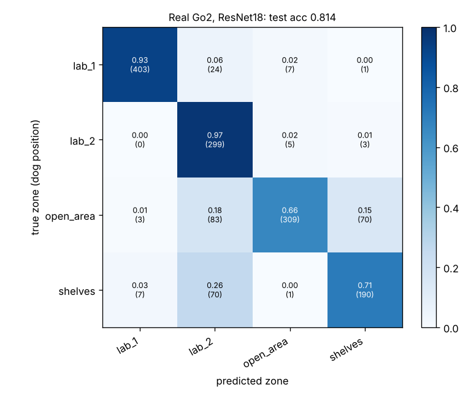

*Figure 7.4 — Confusion matrix on the held-out session. Rows are the true zone the operator keyed in;
columns are the prediction. `results/real_q1/confusion_resnet18.png`.*

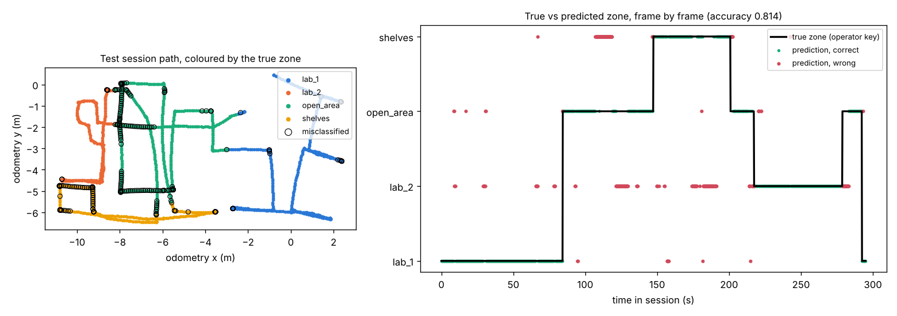

*Figure 7.5 — The test session. Left: the dog's odometry path, coloured by the true zone, with every
misclassified frame circled. Right: the true zone (black) and the prediction for each frame (green
correct, red wrong). `results/real_q1/real_test_session.png`.*

#### Where the errors come from
All the analysis below is in `results/real_q1/error_analysis.json` (`real_go2/analyze_real.py`).

- **lab_2 absorbs the errors.** Most mistakes are other zones called lab_2: 83 open_area frames and
  70 shelves frames. That gives lab_2 high recall (0.974) but low precision (0.628).
  - lab_1 is clearly separable: F1 0.951, and only 24 of its frames were taken for lab_2.
  - The expected lab_1 / lab_2 mix-up therefore mostly did not happen.
- **The camera sees where the dog faces, not where it stands.** This is the same effect section 5.4
  found in simulation. Open-area accuracy depends strongly on the dog's heading (odometry yaw, 45° bins):

  | Heading | Open-area accuracy | Frames |
  |---|---|---|
  | 45° | 0.237 | 59 |
  | 135° | 0.462 | 39 |
  | −180° | 0.481 | 52 |
  | −135° | 0.900 | 50 |
  | −90° | 0.875 | 64 |

  The open area is a gap between the other zones, so in most directions its view is filled by desks or
  shelves that belong to another zone. Shelves frames vary in the same way: 0.44 at −90° and 0.91 at 45°.
- **Errors come in streaks, not single frames.** There are 35 error streaks. The median is 3 frames, and
  the longest is 44 frames (8.8 s) while the dog faced one direction. A 1 s majority vote therefore only
  raises the accuracy from 0.814 to 0.820. The views themselves are ambiguous; the errors are not random
  noise.
- **Zone boundaries matter less than in simulation:**

  | Frames from the nearest zone change | Accuracy | Frames |
  |---|---|---|
  | 0–5 (within 1 s) | 0.648 | 54 |
  | 5–15 | 0.805 | 118 |
  | 15–50 | 0.914 | 337 |
  | 50 or more | 0.790 | 966 |

  Frames within 1 s of a zone change are the hardest. But accuracy far from a boundary is not near 1 as
  it was in simulation, because of the heading effect.
- **Confidence is informative:**
  - The median confidence is 0.958 on correct frames and 0.821 on wrong ones.
  - Frames with confidence ≥ 0.9 (66.7 % of them) are 0.908 accurate.

  The go-to-zone navigator relies on this in two ways. It stops a leg only on a target held at ≥ 0.8 for
  2 s. And it decides arrival from a whole look-around turn, not from one view: the look-around votes over
  every heading, so the heading effect averages out. The open area's recall of 0.664 is still above the
  0.5 arrival share.

#### Live demo and go-to-zone (pending)
| Measure | Simulation | Real Go2 |
|---|---|---|
| Live accuracy on the walking dog | 0.911 (section 5.6) | *pending: `live_*.json`* |
| Go-to-zone arrivals | 16/16 desk, 10/16 hidden (section 7.4) | *pending: `goto_*.json`, trial protocol in `real_go2/LAB_PLAN.md`* |

#### Discussion
- **The method transfers.** The same recipe that reached 0.882 in simulation reaches **0.814** on a real
  walk it never saw, from about 15 minutes of labelled training walking (3 sessions). The real camera adds
  motion blur, glare from windows and reflections on the floor (Figure 7.2), and people and chairs move
  between sessions. A drop of 7 points is a reasonable cost.
- **The labels limit accuracy more than the network does.** A zone label says where the dog *stands*,
  while the camera shows where it *faces*. In a room whose middle zone is a gap between the others, the
  two often differ.
  - *Option 1:* label by what is in view.
  - *Option 2:* classify a short sequence of frames from a turn, as the navigator's look-around already
    does.

  Either would address the main error source.
- **Variation is limited.** All sessions were recorded within 40 minutes on one afternoon, in the same
  light. The test session shows that the model handles a new walk. It does not show how the model copes
  with another time of day, or with the room rearranged. More varied sessions, as `LAB_PLAN.md` suggests,
  would test that.

---

## 8. Discussion across the three questions

- **One simulator, one interface.**
  - Q2's velocity interface is the action space of Q3.
  - Q2's scenes are the source of Q3's training world.
  - Q2's camera and labels are the data of Q1.

  As a result, every component was tested on the same legged robot in the same physics. Q1 runs live on the
  walking dog, and Q3's policy walks the same robot.
- **Simplified training worlds work, if they are checked.** Both Q1 (labels from position) and Q3 (a 2-D
  twin) rely on a simplification of the real problem. In each case a check against the physical simulation
  showed where the simplification broke:
  - **Q1:** the camera looks ahead of the labelled position.
  - **Q3:** the disc body was too narrow.

  For Q3, fixing the simplification needed a change in *training method* (the curriculum), not only in the
  model.
- **A search robot could use Q1 and Q3 together.** Q1's zone estimate is the kind of coarse localisation Q3's
  observation currently takes from ground truth. Q1 is 97–100 % accurate away from boundaries, which would
  suit a room-level search plan.

---

## 9. Limitations and future work

- **Mostly simulation.** No result in sections 4–6 comes from the physical Go2. Section 7 carries Q1 to
  the real dog: its classifier is trained and tested on real data, but the go-to-zone trials on the dog
  are still pending.
- **Real Q1 data** comes from one afternoon in one room. The zone labels describe where the dog stands,
  not what the camera sees, which causes most of the errors (section 7.6).
- **Q3 sim-to-real:** the path would be:
  - replace ground-truth evidence positions by detections, from the Phase 2 stain detector or a camera
    classifier;
  - replace the raster lidar by the Go2's L1 LiDAR scans;
  - send the velocity commands through `SportClient.Move`, as Test 1's `go2_stream` does, with its watchdog
    and speed limits.
- **One house.** All Q1 and Q3 scenes are house 185, with different events, props and lighting. Another floor
  plan (house 186) is untested; the scripts accept it, but its zones would need defining.
- **Q1 labels:** a label taken from the camera's view, or a sequence model over several frames, would remove
  most of the remaining boundary errors.
- **Q3's 2-D twin:**
  - the body is a rectangle sliding on a raster, and box colliders count as fully blocked;
  - evidence and the "found" test come from ground truth;
  - lidar is ray-cast on the raster.

  The 60-start MuJoCo evaluation measures how much this matters: 75–97 % of episodes end the same way in both
  simulators.
- **Q3 policy:**
  - It is below the planner on the 2-D test.
  - It fails in the two narrowest scenes.
  - It stalls on a stain in a few MuJoCo episodes.
  - Next steps: a recurrent policy or frame stacking against getting stuck; stain cells in the route hint's
    cost; and fine-tuning with MuJoCo in the loop.
- **Compute:** all work ran on a 4-core CPU without a GPU. The small CNN was stopped at epoch 10 of 12 by a
  time limit.

---

## 10. Reproducibility

- **Software:**
  - Python 3.13, MuJoCo 3.3.7, PyTorch 2.15.0, Stable-Baselines3 2.9.2, Gymnasium 1.4.0;
  - CPU only, 4 cores;
  - headless rendering through EGL, with OSMesa as the fallback.
- **Seeds:** fixed in every config: `seed: 2026` for collection, `6010` for Q1 and Q3. Every training run
  writes its full hyperparameters and library versions to a `train_config.json`.
- **Commands:** every result has a one-line reproduction command in [`README.md`](README.md) (section 3),
  run from `Test2/`. The main ones:

```
python q2_data_simulation/collect_dataset.py --workers 4  # Q2 dataset, 36 runs
python q2_data_simulation/analyze.py                      # Q2 stats + figures
python q1_supervised/train.py --model resnet18            # Q1, 2,524 s here
python q1_supervised/evaluate.py                          # Q1 test metrics
python q3_rl/train_ppo.py                                 # Q3 PPO, 3,200 s here
python q3_rl/evaluate.py                                  # Q3 2-D test
python q3_rl/deploy_eval.py                               # Q3 MuJoCo, 60 starts
python report/make_report_figures.py                      # report figures
python real_go2/nav_sim.py                                # go-to-zone closed-loop sweep (7.4)
python real_go2/analyze_real.py                           # real-Go2 figures + error analysis (7.6)
python real_go2/summarize_real.py                         # real-Go2 tables (7.6)
python -m pytest -q tests                                 # 23 tests
```

- **Colab:** both notebooks were run end to end on Google Colab itself:
  - [`Q1_colab.ipynb`](q1_supervised/Q1_colab.ipynb), with the quick-check data option;
  - [`Q3_colab.ipynb`](q3_rl/Q3_colab.ipynb), with shortened training.
- **Not in git** (regeneration commands in the README):
  - the 342 MB dataset;
  - the decoded-frame cache;
  - PPO checkpoints and TensorBoard logs.
- **Checked:** the main evaluations were re-run after every reorganisation of the repository, and reproduced
  the committed result files exactly.

---

## 11. Conclusion

This project put a simulated Unitree Go2 to work in a MuJoCo crime scene.

- **Q2:** it walks with a learned locomotion policy along 36 routes, recording a 17,123-frame, 171,083-row
  multi-sensor dataset with automatic zone labels. Its joint and contact data show a stable trot that tracks
  its commands.
- **Q1:** a fine-tuned ResNet18 recognises the zone from one camera frame with 0.882 accuracy, and 0.880 in an
  unseen scene. It clearly beats a CNN trained from scratch and colour-histogram methods, and it runs live on
  the walking robot at 0.911.
- **Q3:**
  - A PPO policy trained in a fast 2-D twin of the real scenes, with the robot's real body shape and a
    curriculum, finds all the evidence from 0.667 of 60 test starts on the legged robot.
  - That is better than a greedy controller (0.183) and on par with a map-based planner (0.650).
  - Getting there took four documented training runs. The key lessons were that the policy needs a route
    hint, and that a realistic body model needs a curriculum to be learnable.
- **Real Go2:**
  - Recorded in the lab, the Q1 recipe recognises the four zones on a walk it never saw with **0.814**
    accuracy. Most errors come from the camera facing a different zone from the one the dog stands in.
  - Go-to-zone with LiDAR obstacle avoidance reached the zone 16/16 times around a desk and 10/16 times
    when it was hidden, in a simulated room, without collisions.
  - Its trials on the dog are the next step.
- **Open:** stepping on evidence remains the main weakness, together with the move from simulation to the
  real dog.

---

## 12. References

Professor's references:
1. ShijieZhao36, *unitree_go2_create_dataset*. <https://github.com/ShijieZhao36/unitree_go2_create_dataset>
2. Unitree Robotics, *unitree_rl_gym*. <https://github.com/unitreerobotics/unitree_rl_gym>
3. H. Bounds, *Go2 RL locomotion*. <https://harrisonbounds.github.io/dog/go2.html>
4. *unitree_rl_gym documentation*. <https://zsc.github.io/unitree_rl_gym/>

Software and methods:

5. syswonder, *robot-unitree-go2-mujoco* (simulator, learned Go2 policy). <https://github.com/syswonder/robot-unitree-go2-mujoco>
6. Unitree Robotics, *unitree_mujoco* (Go2 model). <https://github.com/unitreerobotics/unitree_mujoco>
7. E. Todorov, T. Erez, Y. Tassa, "MuJoCo: A physics engine for model-based control", IROS 2012.
8. K. He, X. Zhang, S. Ren, J. Sun, "Deep Residual Learning for Image Recognition", CVPR 2016.
9. ONNX Model Zoo, ResNet18 v1-7. <https://github.com/onnx/models>
10. R. R. Selvaraju et al., "Grad-CAM: Visual Explanations from Deep Networks via Gradient-based Localization", ICCV 2017.
11. J. Schulman, F. Wolski, P. Dhariwal, A. Radford, O. Klimov, "Proximal Policy Optimization Algorithms", arXiv:1707.06347, 2017.
12. A. Raffin et al., "Stable-Baselines3: Reliable Reinforcement Learning Implementations", JMLR 22(268), 2021.
13. M. Towers et al., "Gymnasium: A Standard Interface for Reinforcement Learning Environments", arXiv:2407.17032, 2024.
14. Y. Bengio, J. Louradour, R. Collobert, J. Weston, "Curriculum Learning", ICML 2009.
15. S. Thrun, W. Burgard, D. Fox, *Probabilistic Robotics*, MIT Press, 2005.

---

## Appendices

### Appendix A — All 36 recorded runs
From `data/full/runs.csv`, written by `collect_dataset.py`. Columns:
- **Speed:** commanded walking speed, m/s.
- **Frames:** camera frames recorded.
- **Time:** simulated duration, s.
- **Dist.:** distance walked, m.
- **Goals:** route goals reached / planned.
- **Contact rows:** state rows with a robot–scene contact.
- **Last five columns:** frames per zone.

| Run | Scene | Route | Speed | Frames | Time | Dist. | Goals | Contact rows | victim | bed | lounge | desk_entry | bathroom |
|---|---|---|---|---|---|---|---|---|---|---|---|---|---|
| run_000 | s1 | clockwise_tour | 0.30 | 463 | 92.5 | 13.3 | 5/5 | 0 | 74 | 10 | 194 | 127 | 58 |
| run_001 | s1 | counter_tour | 0.35 | 495 | 98.9 | 14.9 | 5/5 | 0 | 87 | 114 | 117 | 151 | 26 |
| run_002 | s1 | victim_first_slow | 0.20 | 464 | 92.7 | 10.0 | 4/4 | 0 | 136 | 45 | 142 | 42 | 99 |
| run_003 | s1 | fast_sweep | 0.40 | 372 | 74.3 | 16.8 | 6/6 | 0 | 35 | 100 | 61 | 70 | 106 |
| run_004 | s1 | random_0 | 0.38 | 518 | 103.5 | 21.6 | 7/7 | 0 | 80 | 79 | 143 | 122 | 94 |
| run_005 | s1 | random_1 | 0.35 | 490 | 97.9 | 24.8 | 7/7 | 0 | 29 | 113 | 120 | 136 | 92 |
| run_006 | s2 | clockwise_tour | 0.30 | 435 | 86.9 | 12.4 | 5/5 | 10 | 0 | 157 | 142 | 127 | 9 |
| run_007 | s2 | counter_tour | 0.35 | 282 | 56.4 | 11.6 | 5/5 | 5 | 63 | 39 | 58 | 91 | 31 |
| run_008 | s2 | victim_first_slow | 0.20 | 600 | 119.9 | 14.5 | 4/4 | 90 | 127 | 97 | 226 | 51 | 99 |
| run_009 | s2 | fast_sweep | 0.40 | 307 | 61.3 | 15.1 | 6/6 | 1 | 95 | 24 | 56 | 49 | 83 |
| run_010 | s2 | random_0 | 0.26 | 720 | 143.9 | 25.1 | 5/5 | 57 | 118 | 154 | 290 | 86 | 72 |
| run_011 | s2 | random_1 | 0.20 | 802 | 160.3 | 25.6 | 5/5 | 35 | 66 | 224 | 223 | 158 | 131 |
| run_012 | r1851 | clockwise_tour | 0.30 | 534 | 106.6 | 18.1 | 5/5 | 0 | 126 | 85 | 144 | 113 | 66 |
| run_013 | r1851 | counter_tour | 0.35 | 350 | 69.9 | 11.2 | 5/5 | 0 | 25 | 72 | 144 | 85 | 24 |
| run_014 | r1851 | victim_first_slow | 0.20 | 395 | 78.9 | 8.9 | 4/4 | 0 | 0 | 97 | 172 | 41 | 85 |
| run_015 | r1851 | fast_sweep | 0.40 | 328 | 65.5 | 14.1 | 6/6 | 0 | 85 | 21 | 55 | 84 | 83 |
| run_016 | r1851 | random_0 | 0.24 | 747 | 149.3 | 21.8 | 6/6 | 5 | 75 | 39 | 283 | 187 | 163 |
| run_017 | r1851 | random_1 | 0.27 | 517 | 103.3 | 16.1 | 5/5 | 0 | 58 | 75 | 161 | 124 | 99 |
| run_018 | r1852 | clockwise_tour | 0.30 | 470 | 93.9 | 15.3 | 5/5 | 0 | 52 | 101 | 85 | 173 | 59 |
| run_019 | r1852 | counter_tour | 0.35 | 439 | 87.8 | 14.1 | 5/5 | 5 | 117 | 34 | 121 | 133 | 34 |
| run_020 | r1852 | victim_first_slow | 0.20 | 617 | 123.3 | 16.1 | 4/4 | 5 | 115 | 115 | 249 | 40 | 98 |
| run_021 | r1852 | fast_sweep | 0.40 | 384 | 76.7 | 16.9 | 6/6 | 12 | 46 | 0 | 128 | 106 | 104 |
| run_022 | r1852 | random_0 | 0.34 | 668 | 133.5 | 26.3 | 6/6 | 4 | 102 | 70 | 195 | 124 | 177 |
| run_023 | r1852 | random_1 | 0.25 | 511 | 102.1 | 15.7 | 5/5 | 0 | 103 | 98 | 91 | 183 | 36 |
| run_024 | r1853 | clockwise_tour | 0.30 | 578 | 115.6 | 16.8 | 5/5 | 0 | 81 | 120 | 138 | 143 | 96 |
| run_025 | r1853 | counter_tour | 0.35 | 447 | 89.3 | 16.7 | 4/5 | 0 | 139 | 69 | 63 | 163 | 13 |
| run_026 | r1853 | victim_first_slow | 0.20 | 548 | 109.5 | 13.1 | 4/4 | 2 | 207 | 85 | 165 | 83 | 8 |
| run_027 | r1853 | fast_sweep | 0.40 | 241 | 48.2 | 14.8 | 6/6 | 0 | 18 | 29 | 69 | 50 | 75 |
| run_028 | r1853 | random_0 | 0.27 | 747 | 149.4 | 26.5 | 7/7 | 8 | 97 | 101 | 226 | 126 | 197 |
| run_029 | r1853 | random_1 | 0.28 | 649 | 129.7 | 20.2 | 6/6 | 0 | 183 | 102 | 213 | 82 | 69 |
| run_030 | r1854 | clockwise_tour | 0.30 | 398 | 79.6 | 10.1 | 4/5 | 3 | 56 | 74 | 155 | 113 | 0 |
| run_031 | r1854 | counter_tour | 0.35 | 368 | 73.6 | 12.8 | 5/5 | 0 | 52 | 65 | 105 | 146 | 0 |
| run_032 | r1854 | victim_first_slow | 0.20 | 344 | 68.8 | 8.4 | 3/4 | 16 | 73 | 77 | 194 | 0 | 0 |
| run_033 | r1854 | fast_sweep | 0.40 | 174 | 34.7 | 8.6 | 5/6 | 0 | 24 | 32 | 76 | 42 | 0 |
| run_034 | r1854 | random_0 | 0.38 | 372 | 74.3 | 13.5 | 5/7 | 0 | 77 | 81 | 175 | 39 | 0 |
| run_035 | r1854 | random_1 | 0.26 | 349 | 69.6 | 11.3 | 4/5 | 0 | 101 | 47 | 162 | 39 | 0 |

### Appendix B — The state table (`states.csv`)
Each run's `states.csv` has 81 columns at 50 Hz:
- **Time:** `t`.
- **Base pose:** `base_x, base_y, base_z`, quaternion `base_qw…qz`, `base_yaw`.
- **Base velocity:** world-frame `base_v*_world`, body-frame `base_v*_body`, body angular rates `base_w*_body`.
- **IMU:** `imu_qw…qz`, `imu_gyro_{x,y,z}`, `imu_acc_{x,y,z}`.
- **Posture:** `upright`.
- **Command:** `cmd_vx, cmd_vy, cmd_yaw_rate`.
- **Joints:** `q_*`, `dq_*` and `tau_*` for the 12 joints `{FL,FR,RL,RR}_{hip,thigh,calf}`.
- **Feet:** `foot_force_{FL,FR,RL,RR}` and `foot_contact_*`.
- **Labels and bookkeeping:** `zone_id, zone, collisions, goal_index`, and `frame` (the image index, or −1
  when no image was taken at that instant).

Real rows from `data/sample/run_027/states.csv` (scene r1853, route `fast_sweep`), 15 of the 81 columns.
The dog trots forward while turning right. Note the front-left foot lifting (contact 0) and landing
(contact 1) while the front-right foot holds stance, and the calf torque building up as the leg loads:

| t (s) | x | y | yaw | vx body | gyro z | acc z | q FL thigh | τ FL calf | contact FL | contact FR | cmd vx | cmd yaw rate | zone | frame |
|---|---|---|---|---|---|---|---|---|---|---|---|---|---|---|
| 10.02 | 3.371 | 2.213 | −0.211 | 0.379 | −0.325 | 10.212 | 0.660 | 0.009 | 0 | 1 | 0.394 | −0.281 | lounge_area | 50 |
| 10.04 | 3.379 | 2.211 | −0.217 | 0.387 | −0.309 | 10.024 | 0.598 | 0.256 | 0 | 1 | 0.394 | −0.278 | lounge_area | −1 |
| 10.06 | 3.386 | 2.210 | −0.223 | 0.398 | −0.297 | 9.715 | 0.535 | 0.581 | 0 | 1 | 0.394 | −0.275 | lounge_area | −1 |
| 10.08 | 3.395 | 2.209 | −0.229 | 0.413 | −0.287 | 9.243 | 0.483 | 0.990 | 0 | 1 | 0.394 | −0.274 | lounge_area | −1 |
| 10.10 | 3.403 | 2.209 | −0.235 | 0.431 | −0.288 | 8.584 | 0.447 | 1.364 | 0 | 1 | 0.394 | −0.274 | lounge_area | −1 |
| 10.12 | 3.412 | 2.208 | −0.241 | 0.439 | −0.290 | 10.650 | 0.432 | 2.648 | 1 | 1 | 0.394 | −0.276 | lounge_area | −1 |
| 10.22 | 3.451 | 2.200 | −0.291 | 0.357 | −0.558 | 8.785 | 0.577 | 7.633 | 1 | 1 | 0.386 | −0.431 | lounge_area | 51 |
| 10.32 | 3.485 | 2.189 | −0.343 | 0.384 | −0.470 | 9.941 | 0.696 | 8.815 | 1 | 0 | 0.389 | −0.378 | lounge_area | −1 |
| 10.42 | 3.522 | 2.173 | −0.383 | 0.396 | −0.347 | 10.153 | 0.792 | 4.991 | 1 | 1 | 0.391 | −0.337 | lounge_area | 52 |
| 10.52 | 3.555 | 2.156 | −0.416 | 0.350 | −0.291 | 9.560 | 0.810 | −1.939 | 0 | 1 | 0.393 | −0.306 | lounge_area | −1 |

### Appendix C — A run's metadata (`metadata.json`, run_027, abridged)
```
{
 "run": "run_027", "scene": "r1853", "environment": "scenesmith_house_185",
 "scenario_title": "Random scenario 1853: projected (edged)",
 "route": {"name": "fast_sweep", "start": "victim_area",
           "order": ["bed_area", "desk_entry_area", "bathroom", "desk_entry_area", "lounge_area", "victim_area"],
           "speed": 0.4, "spins": "none", "kind": "hand"},
 "seed": 2026027,
 "start_pose": [0.637, 3.775, 0.830],
 "goals_reached": 6,
 "lighting": {"headlight_ambient": 1.035, "headlight_diffuse": 0.983, "tint": [0.85, 0.92, 1.0],
              "lamps": [0.427, 0.040, 0.065], "lamp_shift": [-0.292, -0.523]},
 "camera_noise": {"brightness": 1.140, "contrast": 0.979, "gamma": 1.070, "gauss_sigma": 5.79,
                  "blur_radius": 0.0, "jpeg_quality": 84},
 "camera": {"body": "base_link", "pos_in_base_m": [0.32, 0.0, 0.12], "fovy_deg": 60.0,
            "image_size": [320, 240], "image_hz": 5,
            "model": "pinhole, fx = fy = (H/2)/tan(fovy/2), cx = W/2, cy = H/2"},
 "controller": "learned", "state_hz": 50, "duration_s": 48.16
}
```

### Appendix D — Hyperparameters

| Q1 setting | Value |
|---|---|
| Input size | 168 × 224 |
| Optimiser | AdamW, one-cycle schedule |
| Learning rate (backbone / head) | 2e-4 / 1e-3 |
| Weight decay / label smoothing | 1e-4 / 0.05 |
| Loss | class-weighted cross-entropy |
| Batch / epochs (ResNet18) | 64 / 8 (half of the training frames per epoch) |
| Small CNN | 4 conv blocks, 1.17 M parameters, 12 epochs planned, stopped after 10 |
| Augmentation | random resized crop 0.8–1, rotation ±5°, colour jitter 0.3 / 0.3 / 0.3 / 0.03 |
| Histograms | 8 bins per channel; C grid 0.0003–1.0 chosen on validation |
| Seed | 6010 |

| Q3 setting | Value |
|---|---|
| Algorithm | PPO (Stable-Baselines3 2.9.2), 8 × `SubprocVecEnv` |
| Network | MLP 256-256, initial log-std −0.5 |
| Learning rate / γ / GAE λ / clip | 3e-4 / 0.995 / 0.95 / 0.2 |
| Steps per update / batch / epochs | 4,096 / 1,024 / 10 |
| Entropy / value coefficient / gradient clip | 0.005 / 0.5 / 0.5 |
| Total steps | 6.0 M |
| Decision rate / episode limit | 5 Hz / 900 steps (180 s) |
| Body / feet footprint | 0.70 × 0.32 m rectangle / 0.30 m disc |
| Find rule | 1.5 m, ±35°, line of sight |
| Lidar | 24 rays, 3 m, 2 cm noise, 2 % dropout |
| Reward weights | find 10, progress 2, on stain 1, stain entry 8, collision 0.5, severe collision 20, time 0.01, all found 20 |
| Curriculum | 4 levels (1 item / 1.5 m → 3 items / anywhere), advance at 70 % of the last 200 episodes |
| Seed | 6010 |
