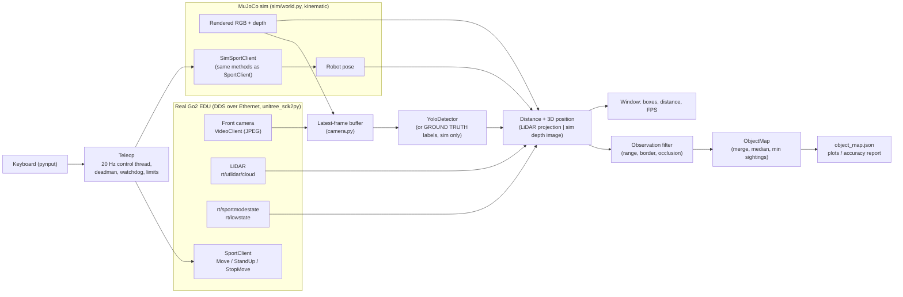
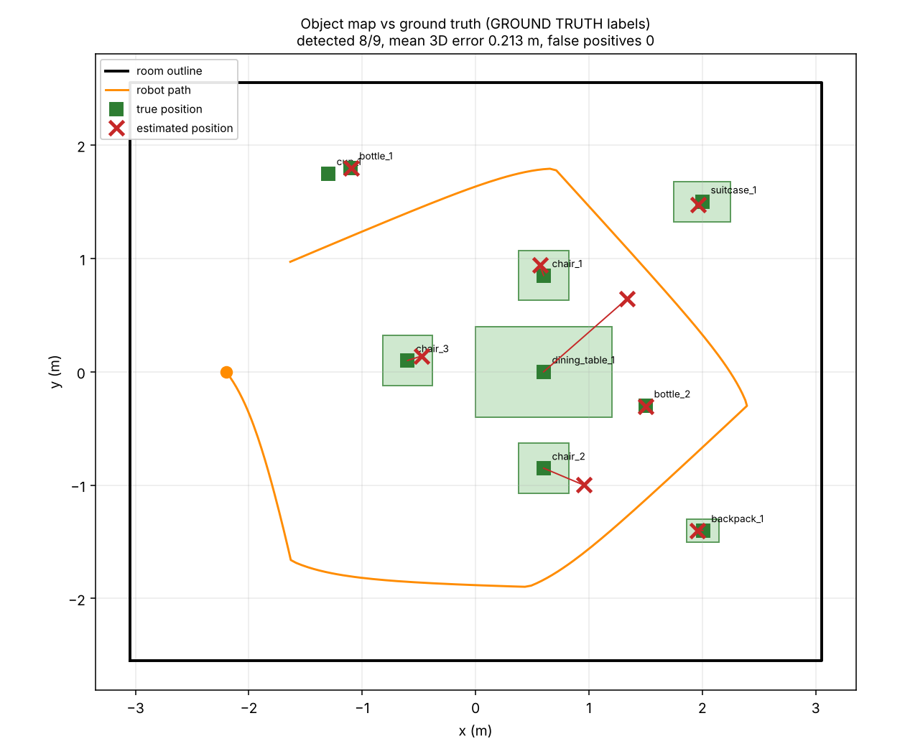
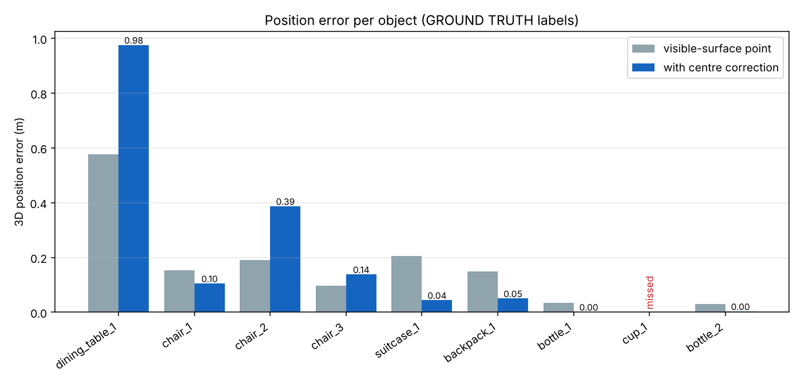

# Phase 1 summary: foundation for the "Scene Investigator"

Long-term goal: a Unitree Go2 that maps where objects are in a room and reasons about the scene.
Phase 1 = basics + simulation + beginning object detection. This document says what exists, what was measured,
and what is **not** verified yet.

## Architecture

Threads: camera/sim, detection, teleop control + watchdog, and the UI on the main thread. They share only
latest-value buffers, so a slow detector or window cannot stall robot control.

## What works

| Area | Status |
|---|---|
| Camera stream, keyboard teleop (limits, deadman, watchdog, stop on exit) | Run on the real robot |
| LiDAR streaming | Reported working by the user; not re-verified here |
| YOLO detection | Tested on still images (GPU: RTX 4000 Ada). **Not yet run live on the robot** (last attempt: no data from the dog, a connection problem) |
| LiDAR-based distance for detections | Unit-tested with synthetic data; **not run on the robot**. Camera-LiDAR calibration values are placeholders |
| MuJoCo room + kinematic Go2 + teleop in the sim | Works; 24 unit/integration tests, headless |
| Sim camera + depth into the same detector/UI code path | Works with a ray-cast render. The OpenGL render, YOLO on rendered frames and photo billboards **have not been run by the author** |
| Object map + accuracy report in the sim | Works (results below) |
| `preflight.py` | Output formatting and parsing tested with fakes; **never run against the robot** |
| `--map` on the real robot | Written, **untested** |

Why the sim is kinematic: Unitree's `unitree_mujoco` only accepts low-level joint commands. It has no `SportClient`
service, camera or LiDAR, so walking commands are not supported. Perception is what Phase 1 needs, so the base is moved
directly from the teleop velocity. It does not reproduce gait, balance or slip.

## Accuracy results (simulation)

Setup: scripted survey (6 waypoints, 360 degree spin at each, about 80 s), `--gt` mode, ray-cast render at 320x180,
nominal camera field of view 100 degrees. **Labels are GROUND TRUTH from the simulator, not YOLO**, so this isolates the
3D-position estimate. It says nothing about YOLO's detection accuracy on rendered objects. Raw files:
`docs/phase1_results/`.

| Object | Seen | Sightings | 3D error with centre correction (m) | 3D error, visible-surface point (m) |
|---|---|---|---|---|
| dining table | yes | 5 | 0.98 | 0.58 |
| chair 1 | yes | 10 | 0.10 | 0.15 |
| chair 2 | yes | 13 | 0.39 | 0.19 |
| chair 3 | yes | 38 | 0.14 | 0.10 |
| suitcase (box) | yes | 34 | 0.04 | 0.20 |
| backpack | yes | 47 | 0.05 | 0.15 |
| bottle 1 | yes | 40 | 0.00 | 0.03 |
| cup | **no** | | | |
| bottle 2 | yes | 23 | 0.00 | 0.03 |

8 of 9 objects found, mean 3D error 0.21 m, **median 0.08 m**, max 0.98 m (the table), 0 false positives.

How to read it:
- Compact objects on the floor or a table (bottles, backpack, box) are within about 5 cm of the true centre.
- The **dining table is the worst case**: the camera is about 0.3 m high, so it looks *under* the table top and the central
  depth lands on legs, chairs or the floor behind it. It had only 5 sightings. Thin or see-through objects are a
  known weakness of this estimator.
- The centre correction (a hand-set per-class half-depth prior, not fitted to this scene) helps boxes and bags but
  **hurts chairs and the table**, so both numbers are shown. An open-framed chair has no single "centre" along the view ray.
- The **cup was missed**: at 8 cm wide it is a few pixels at this resolution and distance. Small objects need a closer
  or higher-resolution view.
- Tuning trade-off: loosening the occlusion filter finds the table more reliably but creates phantom duplicates
  (up to 9 false positives in an offline sweep). The committed setting prefers no phantom objects. Results varied slightly
  between runs (timing), e.g. mean error 0.21 m vs 0.11 m with the table missed.
- One scene, one path, ground-truth labels: treat these as a sanity check of the geometry, not a benchmark.

## Known limitations
- Real-robot positions depend on the camera-LiDAR calibration, which is **a placeholder** (assumed field of view,
  zero offset). Measure it (checkerboard + a measured offset) before trusting them.
- The camera frame and LiDAR cloud are paired as "latest of each", not by timestamp.
- The LiDAR cloud may be in an odom frame; the code reads `header.frame_id` and transforms using `rt/sportmodestate`,
  but this path has not run on the robot. The odom origin may drift.
- The LiDAR is sparse: small or far objects may get no distance ("depth: n/a").
- Occlusion handling is a heuristic (floor-standing assumption); objects on shelves/tables can be misjudged.
- The sim does not model gait, slipping or sensor noise, so real error will be larger.
- Keyboard capture is global (pynput) and needs an X11 session.
- `Move` is a no-reply call: a dropped packet is not detected. Keep the Unitree remote in reach.

## Next phases
1. **Close the loop on the real robot:** run `preflight.py`, live YOLO with LiDAR distances, calibrate camera-LiDAR, repeat the
   1 m / 2 m / 3 m tape-measure check and an equivalent per-object accuracy test in a real room.
2. **Open-vocabulary detection** (e.g. a text-prompted detector) so the robot is not limited to the 80 COCO classes.
3. **Scene graph:** relations between mapped objects ("cup on table", "chair near table") from the 3D map.
4. **Room-type inference** from object sets (kitchen vs office) with a language model.
5. **Change detection between scans:** re-survey and diff object maps to report what moved, appeared or disappeared.
6. **Autonomous exploration** (only after the above, and with the safety layer unchanged): frontier-based coverage instead of manual driving.
